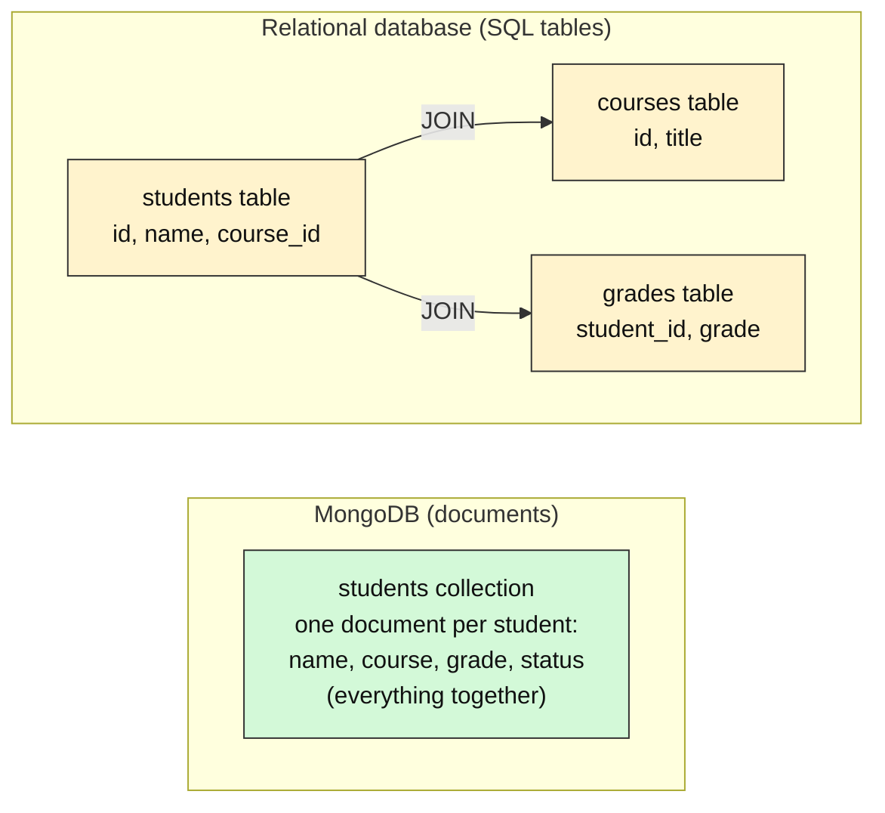
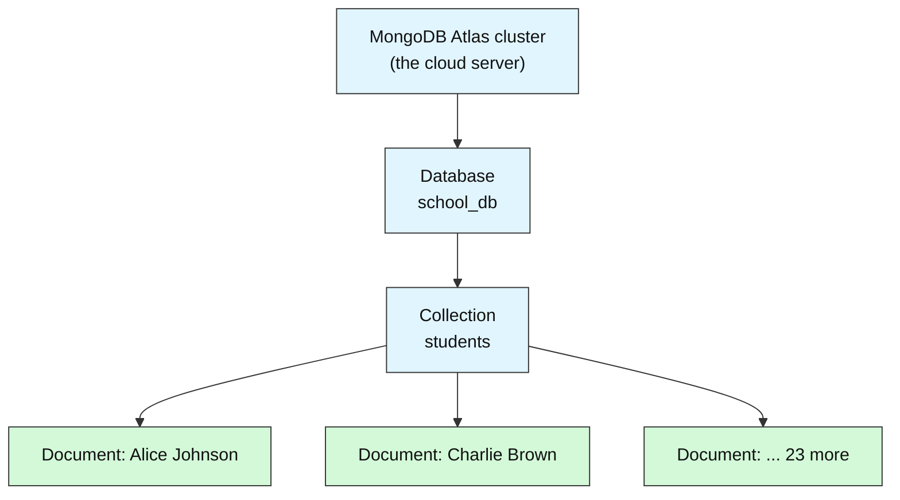
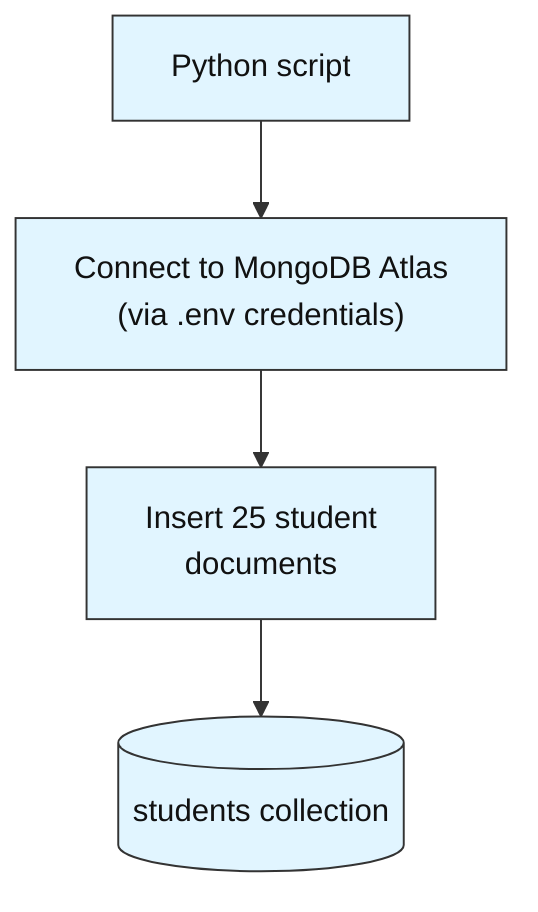
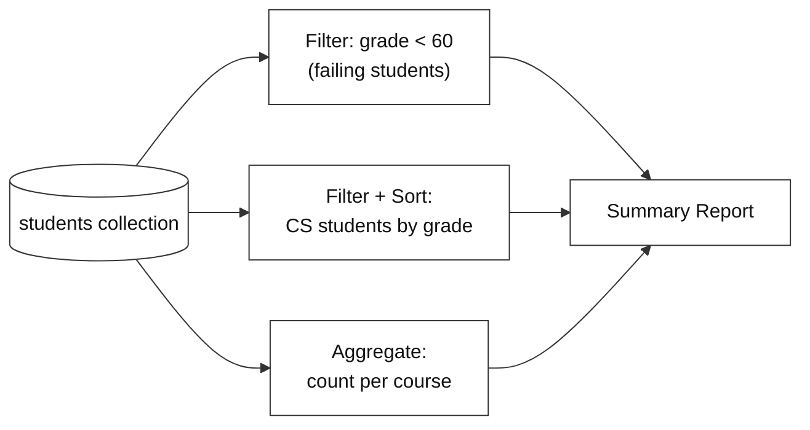
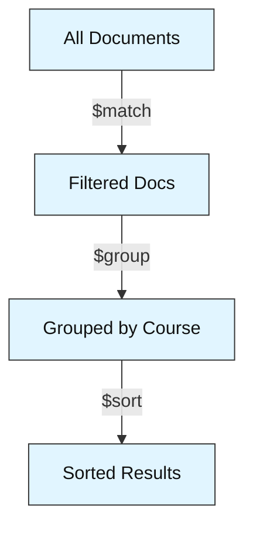

# How to Query Data

---

# Problem Statement / Use Case Overview

A university administrator needs to manage and query a growing collection of student records. They want to quickly answer questions like "which students are currently failing?", "list all Computer Science students sorted by grade", and "how many students are enrolled in each course?" — all without writing complex SQL joins or managing rigid table schemas.

## What Is MongoDB, and Why Use It?

**In one sentence:** MongoDB is a *document database* — it stores each record (here, one student) as a single self-contained **document**, instead of splitting it across several rigid tables.

Think of the difference like this: a relational database is a **spreadsheet** where every row must fill the same columns. MongoDB is a **folder of ID cards** — each card holds everything about one student, and a card can carry an extra field (like `scholarship`) without forcing every other card to change.

### Same student, two shapes



In SQL, one student's data is spread over three tables and stitched back together with `JOIN`s every time you ask a question. In MongoDB, the same student is one document, so a single read returns everything you need.

Here is what one student looks like in this lab. It is just JSON-style key–value pairs:

```json
{
  "name": "Charlie Brown",
  "student_id": "STU003",
  "course": "Physics",
  "grade": 55,
  "enrollment_date": "2024-09-02",
  "status": "active"
}
```

### Vocabulary: SQL terms vs MongoDB terms

| In a relational database | In MongoDB | What it means in this lab |
|--------------------------|------------|---------------------------|
| Database | **Database** | `school_db` — the whole project's data |
| Table | **Collection** | `students` — a group of similar documents |
| Row | **Document** | One student record |
| Column | **Field** | `name`, `grade`, `course`, ... |
| `JOIN` | Embedding / `$lookup` | Usually not needed for simple lookups |
| `SELECT ... WHERE` | `find({...})` | Filter documents by a condition |

### Where everything lives



**MongoDB Atlas** is MongoDB's hosted cloud service. You do not install or run a database server yourself — the lab simply connects to it with a connection string.

### Why MongoDB fits this problem

| Question the administrator asks | Relational approach | MongoDB approach |
|---------------------------------|---------------------|------------------|
| Which students are failing? | Design tables first, then `SELECT ... WHERE grade < 60` | `find({"grade": {"$lt": 60}})` |
| List Computer Science students by grade | Query + `ORDER BY`, possibly joining a courses table | `find({"course": "Computer Science"}).sort("grade", -1)` |
| How many students per course? | `GROUP BY` over joined tables | Aggregation pipeline with `$group` |
| We now also track `scholarship` | `ALTER TABLE` — change the structure for *every* row | Just add the field to the documents that need it |

### MongoDB compared with other kinds of databases

| | Relational (MySQL, PostgreSQL) | **MongoDB** (document) | Key–value (Redis) |
|---|---|---|---|
| **Data shape** | Rows in fixed tables | JSON-like documents | Simple key → value |
| **Schema changes** | Migrations needed | Flexible; fields can differ per document | No schema |
| **Nested / related data** | Split across tables, joined at query time | Can be stored together in one document | Limited |
| **Rich queries** (filter, sort, group) | Excellent (SQL) | Strong (`find`, aggregation pipeline) | Mostly lookup by key |
| **Scaling out** | Possible, often more effort | Built-in sharding for horizontal scaling | Built for speed, simple data |
| **Best for** | Strict structure, many cross-table relationships | Evolving data, nested records, fast development | Caches, sessions, counters |

> **Honest note:** MongoDB is not "better" for everything. If your data is highly relational and needs strict rules across many tables (for example, accounting ledgers), a relational database can be the better choice. MongoDB shines when records are self-contained, the shape changes over time, and you want to start building quickly.

**Learn more (official MongoDB documentation):**

- [What is MongoDB? — Database Manual](https://www.mongodb.com/docs/manual/introduction/)
- [Documents — Database Manual](https://www.mongodb.com/docs/manual/core/document/)
- [Databases and Collections](https://www.mongodb.com/docs/manual/core/databases-and-collections/)
- [NoSQL vs SQL databases](https://www.mongodb.com/resources/basics/databases/nosql-explained/nosql-vs-sql) (published by MongoDB, so read it as the vendor's view)

This lab walks you through building a queryable mini student database using MongoDB. You will learn how to connect to a real MongoDB Atlas cluster, design a flexible document schema, insert a realistic dataset of 25 student records, and then use MongoDB's built-in query operators to filter, sort, and project the data — finishing with a printed summary report that answers real administrative questions.

This is the read-heavy lab. You will focus on inserting data once, then querying it in different ways.

---

# Input Data

| Item | Detail |
|------|--------|
| **Student records** | 25 synthetic records generated inline in the notebook |
| **Fields per record** | `name`, `student_id`, `course`, `grade`, `enrollment_date`, `status` |
| **Courses covered** | Computer Science, Mathematics, Physics, English, Biology |
| **Grade range** | 45–98 (some intentionally failing, below 60) |
| **Status values** | `active`, `inactive`, `graduated` |

---

# Processing

### Part A — Building the Database



The notebook loads the Atlas connection string from a `.env` file using `python-dotenv`, connects to the real MongoDB Atlas cluster, creates a `students` collection inside a `school_db` database, and bulk-inserts 25 student documents in one operation.

### Part B — Querying the Data



Three types of queries are run against the same collection: a filter query to find failing students, a filtered sort to list top performers in a specific course, and an aggregation pipeline to count students per course. All results are collected into a single printed summary report.

---

# Output

**Inserting documents** confirms the count:

```
Inserted 25 student records.
```

**Query 1 — Failing students** (grade below 60):

```
--- Students Currently Failing (Grade < 60) ---
Charlie Brown        | Physics         | Grade: 55 | Status: active
Diana Prince         | English         | Grade: 48 | Status: active
Frank Castle         | Mathematics     | Grade: 52 | Status: inactive
Laura Palmer         | Biology         | Grade: 45 | Status: active
Rosa Parks           | English         | Grade: 58 | Status: inactive
Walt Disney          | Physics         | Grade: 56 | Status: active
```

**Query 2 — Computer Science students sorted by grade:**

```
--- Computer Science Students (Sorted by Grade) ---
Alice Johnson        | Grade: 95 | Status: active
Grace Hopper         | Grade: 91 | Status: active
Quincy Adams         | Grade: 87 | Status: active
Ivan Petrov          | Grade: 84 | Status: active
Yusuf Islam          | Grade: 70 | Status: active
Uma Thurman          | Grade: 62 | Status: active
```

**Query 3 — Course enrollment counts:**

```
--- Enrollment Count by Course ---
Computer Science     | 6 students
English              | 5 students
Mathematics          | 5 students
Physics              | 5 students
Biology              | 4 students
```

**Summary report** ties it all together in one formatted block.

---

# Tech Stack

| Component | Tool |
|-----------|------|
| **MongoDB driver** | `pymongo[srv,tls]==4.10.1` — Python driver for MongoDB with SRV and TLS support |
| **Credential loader** | `python-dotenv==1.0.1` — loads `.env` files for credentials |
| **CA certificates** | `certifi` — provides up-to-date CA bundles for reliable SSL/TLS on all platforms |

> **Note:** This lab connects to a real MongoDB Atlas cluster. The connection string is stored in a `.env` file (as `MONGODB_URI`) and loaded at runtime — credentials never appear in the notebook itself.

---

# Underlying Concepts (Summarized)

This lab builds on a handful of core MongoDB concepts. Here they are in brief.

### Document Databases vs. Relational Databases

Traditional relational databases (MySQL, PostgreSQL) store data in **tables** with fixed columns and rows. Every row must conform to the same schema — if you want to add a new field, you must alter the table first. MongoDB is a **document database**: it stores data as **documents** (JSON-like objects) inside **collections** (roughly equivalent to tables). Each document can have a different structure, so adding a new field to one student record doesn't require changing any others.

### Documents and Collections

A **document** is a key-value pair structure — think of it as a Python dictionary. For example:

```python
{"name": "Alice", "course": "CS", "grade": 92}
```

A **collection** is a group of documents, like a table of rows. In this lab, the `students` collection holds 25 documents, each representing one student.

### CRUD Operations

MongoDB supports four core operations:

- **Create** — `insert_one()` or `insert_many()` to add documents
- **Read** — `find()` with a filter to query documents
- **Update** — `update_one()` or `update_many()` to modify documents
- **Delete** — `delete_one()` or `delete_many()` to remove documents

This lab focuses on **Create** (inserting students) and **Read** (filtering, sorting, aggregating).

### Query Filters and Sorting

MongoDB uses Python dictionaries as query filters. For example, `{"grade": {"$lt": 60}}` means "find all documents where the grade field is less than 60." Sorting is done with `.sort("field_name", 1)` for ascending or `-1` for descending.

### Aggregation Pipelines

An **aggregation pipeline** is a sequence of stages that transform data step by step. Each stage takes input, processes it, and passes the result to the next stage. The `$group` stage groups documents by a field (e.g., course), and `$sum` tallies how many documents are in each group.



> **Why this matters:** Understanding the difference between a document database and a relational database is the first step to deciding which tool fits your project. MongoDB's flexible schema makes it a natural choice for applications where the data shape evolves over time — user profiles, product catalogs, or, as in this lab, student records.

---

# Pre-requisites

- **Basic Python knowledge** — variables, lists, dictionaries, loops, and `import` statements.
- **No MongoDB experience required** — this lab teaches you from scratch.
- **MongoDB Atlas cluster set up** — you need a MongoDB Atlas cluster and a `.env` file holding your connection string (`MONGODB_URI`) — set these up before you start. No additional database installation is needed.

---

# Environment / Dependencies Setup

| Package | Purpose |
|---------|---------|
| `pymongo[srv,tls]` | Python driver for MongoDB with SRV and TLS support |
| `python-dotenv` | Loads `.env` files so credentials stay out of the notebook |
| `certifi` | Provides up-to-date CA certificates for reliable SSL/TLS on all platforms |

```bash
pip install -q "pymongo[srv,tls]==4.10.1" python-dotenv==1.0.1 certifi
```

> **Note:** The `srv` extra is required for `mongodb+srv://` connection strings. The `tls` extra and `certifi` ensure SSL/TLS works reliably on all platforms (especially Windows). Run this command once in your terminal before opening the notebook, or run the first code cell in the notebook which does the same thing.

---

# Step-wise Instructions — Development

---

### Step 1 — Connect to MongoDB

```python
import os
import certifi
from dotenv import load_dotenv
import pymongo

# Load the Atlas connection string from the .env file
load_dotenv()
uri = os.environ["MONGODB_URI"]

# Connect to the real MongoDB Atlas cluster
# tlsCAFile uses certifi's CA bundle so SSL works reliably on all platforms
client = pymongo.MongoClient(uri, tlsCAFile=certifi.where())

# Access (or create) the database and collection
db = client["school_db"]
students = db["students"]

print("Connected to MongoDB Atlas")
```

> **Where does the `.env` file go?** `load_dotenv()` looks for a file named `.env` in the folder you run from and then in each parent folder above it. Save it next to your notebook, or once in the root folder of your course project, with a single line: `MONGODB_URI=mongodb+srv://<user>:<password>@<cluster-host>/` (use your own Atlas connection string, and never commit this file to Git).


`load_dotenv()` finds your `.env` file, reads it, and loads `MONGODB_URI` into the environment. `certifi.where()` points pymongo to a trusted CA certificate bundle, which ensures SSL works reliably on all platforms. The database and collection are created automatically on first insert.

---

### Step 2 — Design and Insert Student Records

```python
# Drop the collection first so re-running the notebook starts clean
# Without this, re-running would duplicate all 25 records
students.drop()

# 25 student records across 5 courses with varying grades
# Some students have grades below 60 (failing) to make queries interesting
student_records = [
    {"name": "Alice Johnson",    "student_id": "STU001", "course": "Computer Science", "grade": 95, "enrollment_date": "2024-09-01", "status": "active"},
    {"name": "Bob Smith",        "student_id": "STU002", "course": "Mathematics",      "grade": 78, "enrollment_date": "2024-09-01", "status": "active"},
    {"name": "Charlie Brown",    "student_id": "STU003", "course": "Physics",          "grade": 55, "enrollment_date": "2024-09-02", "status": "active"},
    {"name": "Diana Prince",     "student_id": "STU004", "course": "English",          "grade": 48, "enrollment_date": "2024-09-01", "status": "active"},
    {"name": "Eve Torres",       "student_id": "STU005", "course": "Biology",          "grade": 88, "enrollment_date": "2024-09-03", "status": "active"},
    {"name": "Frank Castle",     "student_id": "STU006", "course": "Mathematics",      "grade": 52, "enrollment_date": "2024-09-01", "status": "inactive"},
    {"name": "Grace Hopper",     "student_id": "STU007", "course": "Computer Science", "grade": 91, "enrollment_date": "2024-09-02", "status": "active"},
    {"name": "Hank Pym",         "student_id": "STU008", "course": "Physics",          "grade": 73, "enrollment_date": "2024-09-01", "status": "active"},
    {"name": "Ivan Petrov",      "student_id": "STU009", "course": "Computer Science", "grade": 84, "enrollment_date": "2024-09-03", "status": "active"},
    {"name": "Julia Child",      "student_id": "STU010", "course": "English",          "grade": 90, "enrollment_date": "2024-09-02", "status": "graduated"},
    {"name": "Karl Marx",        "student_id": "STU011", "course": "Mathematics",      "grade": 67, "enrollment_date": "2024-09-01", "status": "active"},
    {"name": "Laura Palmer",     "student_id": "STU012", "course": "Biology",          "grade": 45, "enrollment_date": "2024-09-02", "status": "active"},
    {"name": "Marco Polo",       "student_id": "STU013", "course": "Physics",          "grade": 82, "enrollment_date": "2024-09-03", "status": "active"},
    {"name": "Nina Simone",      "student_id": "STU014", "course": "English",          "grade": 76, "enrollment_date": "2024-09-01", "status": "active"},
    {"name": "Oscar Wilde",      "student_id": "STU015", "course": "Mathematics",      "grade": 93, "enrollment_date": "2024-09-02", "status": "active"},
    {"name": "Pia Zadora",       "student_id": "STU016", "course": "Biology",          "grade": 71, "enrollment_date": "2024-09-01", "status": "active"},
    {"name": "Quincy Adams",     "student_id": "STU017", "course": "Computer Science", "grade": 87, "enrollment_date": "2024-09-03", "status": "active"},
    {"name": "Rosa Parks",       "student_id": "STU018", "course": "English",          "grade": 58, "enrollment_date": "2024-09-02", "status": "inactive"},
    {"name": "Sam Wilson",       "student_id": "STU019", "course": "Physics",          "grade": 98, "enrollment_date": "2024-09-01", "status": "active"},
    {"name": "Tina Turner",      "student_id": "STU020", "course": "Mathematics",      "grade": 79, "enrollment_date": "2024-09-03", "status": "active"},
    {"name": "Uma Thurman",      "student_id": "STU021", "course": "Computer Science", "grade": 62, "enrollment_date": "2024-09-02", "status": "active"},
    {"name": "Vera Wang",        "student_id": "STU022", "course": "Biology",          "grade": 85, "enrollment_date": "2024-09-01", "status": "graduated"},
    {"name": "Walt Disney",      "student_id": "STU023", "course": "Physics",          "grade": 56, "enrollment_date": "2024-09-02", "status": "active"},
    {"name": "Xena Warrior",     "student_id": "STU024", "course": "English",          "grade": 94, "enrollment_date": "2024-09-03", "status": "active"},
    {"name": "Yusuf Islam",      "student_id": "STU025", "course": "Computer Science", "grade": 70, "enrollment_date": "2024-09-01", "status": "active"},
]

# insert_many() adds all documents to the collection in one call
result = students.insert_many(student_records)
print(f"Inserted {len(result.inserted_ids)} student records.")
```

`students.drop()` clears the collection before inserting so the notebook is safe to re-run without duplicating data. Each dictionary is a **document** — MongoDB's equivalent of a row. Unlike SQL, there's no table definition needed; you simply insert documents and MongoDB stores them as-is.

**Colour key used in the table snapshots:** 🟩 inserted &nbsp;·&nbsp; 🟨 updated &nbsp;·&nbsp; 🟥 deleted &nbsp;·&nbsp; 🟦 matched / returned by a query &nbsp;·&nbsp; ⬜ not touched

**What the `students` collection looks like after Step 2** — `drop()` emptied it, then `insert_many()` added 25 new documents (every row is 🟩 new). MongoDB also adds a hidden `_id` field to each document automatically.

| | # | name | student_id | course | grade | enrollment_date | status |
|---|---|---|---|---|---|---|---|
| 🟩 | 1 | Alice Johnson | STU001 | Computer Science | 95 | 2024-09-01 | active |
| 🟩 | 2 | Bob Smith | STU002 | Mathematics | 78 | 2024-09-01 | active |
| 🟩 | 3 | Charlie Brown | STU003 | Physics | 55 | 2024-09-02 | active |
| 🟩 | 4 | Diana Prince | STU004 | English | 48 | 2024-09-01 | active |
| 🟩 | 5 | Eve Torres | STU005 | Biology | 88 | 2024-09-03 | active |
| 🟩 | 6 | Frank Castle | STU006 | Mathematics | 52 | 2024-09-01 | inactive |
| 🟩 | 7 | Grace Hopper | STU007 | Computer Science | 91 | 2024-09-02 | active |
| 🟩 | 8 | Hank Pym | STU008 | Physics | 73 | 2024-09-01 | active |
| 🟩 | 9 | Ivan Petrov | STU009 | Computer Science | 84 | 2024-09-03 | active |
| 🟩 | 10 | Julia Child | STU010 | English | 90 | 2024-09-02 | graduated |
| 🟩 | 11 | Karl Marx | STU011 | Mathematics | 67 | 2024-09-01 | active |
| 🟩 | 12 | Laura Palmer | STU012 | Biology | 45 | 2024-09-02 | active |
| 🟩 | 13 | Marco Polo | STU013 | Physics | 82 | 2024-09-03 | active |
| 🟩 | 14 | Nina Simone | STU014 | English | 76 | 2024-09-01 | active |
| 🟩 | 15 | Oscar Wilde | STU015 | Mathematics | 93 | 2024-09-02 | active |
| 🟩 | 16 | Pia Zadora | STU016 | Biology | 71 | 2024-09-01 | active |
| 🟩 | 17 | Quincy Adams | STU017 | Computer Science | 87 | 2024-09-03 | active |
| 🟩 | 18 | Rosa Parks | STU018 | English | 58 | 2024-09-02 | inactive |
| 🟩 | 19 | Sam Wilson | STU019 | Physics | 98 | 2024-09-01 | active |
| 🟩 | 20 | Tina Turner | STU020 | Mathematics | 79 | 2024-09-03 | active |
| 🟩 | 21 | Uma Thurman | STU021 | Computer Science | 62 | 2024-09-02 | active |
| 🟩 | 22 | Vera Wang | STU022 | Biology | 85 | 2024-09-01 | graduated |
| 🟩 | 23 | Walt Disney | STU023 | Physics | 56 | 2024-09-02 | active |
| 🟩 | 24 | Xena Warrior | STU024 | English | 94 | 2024-09-03 | active |
| 🟩 | 25 | Yusuf Islam | STU025 | Computer Science | 70 | 2024-09-01 | active |


---

### Step 3 — Query: Find Failing Students

```python
# Find all students with a grade below 60
# {"grade": {"$lt": 60}} means "grade less than 60"
# {"_id": 0} is a projection that hides MongoDB's auto-generated _id field
failing_students = students.find(
    {"grade": {"$lt": 60}},
    {"_id": 0}
)

print("--- Students Currently Failing (Grade < 60) ---")
for s in failing_students:
    print(f"{s['name']:<20} | {s['course']:<15} | Grade: {s['grade']} | Status: {s['status']}")
```

`$lt` is the "less than" comparison operator. The second argument `{"_id": 0}` is a **projection** — it hides the auto-generated `_id` field so the output stays clean.

**Snapshot — which documents does the filter pick?** Nothing is changed by a `find()`; the query only *selects*. The 6 documents with `grade < 60` are 🟦 matched, the other 19 are ⬜ left alone:

| | # | name | student_id | course | grade | enrollment_date | status |
|---|---|---|---|---|---|---|---|
| ⬜ | 1 | Alice Johnson | STU001 | Computer Science | 95 | 2024-09-01 | active |
| ⬜ | 2 | Bob Smith | STU002 | Mathematics | 78 | 2024-09-01 | active |
| 🟦 | 3 | Charlie Brown | STU003 | Physics | 55 | 2024-09-02 | active |
| 🟦 | 4 | Diana Prince | STU004 | English | 48 | 2024-09-01 | active |
| ⬜ | 5 | Eve Torres | STU005 | Biology | 88 | 2024-09-03 | active |
| 🟦 | 6 | Frank Castle | STU006 | Mathematics | 52 | 2024-09-01 | inactive |
| ⬜ | 7 | Grace Hopper | STU007 | Computer Science | 91 | 2024-09-02 | active |
| ⬜ | 8 | Hank Pym | STU008 | Physics | 73 | 2024-09-01 | active |
| ⬜ | 9 | Ivan Petrov | STU009 | Computer Science | 84 | 2024-09-03 | active |
| ⬜ | 10 | Julia Child | STU010 | English | 90 | 2024-09-02 | graduated |
| ⬜ | 11 | Karl Marx | STU011 | Mathematics | 67 | 2024-09-01 | active |
| 🟦 | 12 | Laura Palmer | STU012 | Biology | 45 | 2024-09-02 | active |
| ⬜ | 13 | Marco Polo | STU013 | Physics | 82 | 2024-09-03 | active |
| ⬜ | 14 | Nina Simone | STU014 | English | 76 | 2024-09-01 | active |
| ⬜ | 15 | Oscar Wilde | STU015 | Mathematics | 93 | 2024-09-02 | active |
| ⬜ | 16 | Pia Zadora | STU016 | Biology | 71 | 2024-09-01 | active |
| ⬜ | 17 | Quincy Adams | STU017 | Computer Science | 87 | 2024-09-03 | active |
| 🟦 | 18 | Rosa Parks | STU018 | English | 58 | 2024-09-02 | inactive |
| ⬜ | 19 | Sam Wilson | STU019 | Physics | 98 | 2024-09-01 | active |
| ⬜ | 20 | Tina Turner | STU020 | Mathematics | 79 | 2024-09-03 | active |
| ⬜ | 21 | Uma Thurman | STU021 | Computer Science | 62 | 2024-09-02 | active |
| ⬜ | 22 | Vera Wang | STU022 | Biology | 85 | 2024-09-01 | graduated |
| 🟦 | 23 | Walt Disney | STU023 | Physics | 56 | 2024-09-02 | active |
| ⬜ | 24 | Xena Warrior | STU024 | English | 94 | 2024-09-03 | active |
| ⬜ | 25 | Yusuf Islam | STU025 | Computer Science | 70 | 2024-09-01 | active |


---

### Step 4 — Query: List CS Students Sorted by Grade

```python
# Find all Computer Science students, sorted by grade descending (highest first)
cs_students = students.find(
    {"course": "Computer Science"},
    {"_id": 0}
).sort("grade", -1)  # -1 = descending order

print("--- Computer Science Students (Sorted by Grade) ---")
for s in cs_students:
    print(f"{s['name']:<20} | Grade: {s['grade']} | Status: {s['status']}")
```

Chains a **filter** (course = "Computer Science") with a **sort** on grade. Use `1` for ascending (lowest first), `-1` for descending (highest first).

**Snapshot — the filter keeps only Computer Science, then the sort orders the matches.** 6 documents are 🟦 matched and listed from highest grade to lowest; the other 19 documents are ignored:

| | rank | name | student_id | course | grade | status |
|---|---|---|---|---|---|---|
| 🟦 | 1 | Alice Johnson | STU001 | Computer Science | 95 | active |
| 🟦 | 2 | Grace Hopper | STU007 | Computer Science | 91 | active |
| 🟦 | 3 | Quincy Adams | STU017 | Computer Science | 87 | active |
| 🟦 | 4 | Ivan Petrov | STU009 | Computer Science | 84 | active |
| 🟦 | 5 | Yusuf Islam | STU025 | Computer Science | 70 | active |
| 🟦 | 6 | Uma Thurman | STU021 | Computer Science | 62 | active |


---

### Step 5 — Query: Enrollment Count by Course (Aggregation)

```python
# Aggregation pipeline: group by course, then count students in each
pipeline = [
    {"$group": {"_id": "$course", "count": {"$sum": 1}}},
    {"$sort": {"count": -1, "_id": 1}}
]

course_counts = students.aggregate(pipeline)

print("--- Enrollment Count by Course ---")
for doc in course_counts:
    print(f"{doc['_id']:<20} | {doc['count']} students")
```

`$group` groups documents by `course` and counts each group with `$sum: 1`. `$sort` orders first by count descending, then by `_id` ascending as a tiebreaker so courses with the same count appear in alphabetical order. This is MongoDB's equivalent of SQL's `GROUP BY course ORDER BY count DESC, course ASC`.

**Snapshot — how `$group` builds its result.** Each course becomes one new result row (🟦), listed in the pipeline's `$sort` order (count high to low, then A–Z), and `$sum: 1` adds 1 for every student in that group. The original 25 documents are not modified:

| | _id (course) | students grouped into it | count |
|---|---|---|---|
| 🟦 | Computer Science | Alice Johnson, Grace Hopper, Ivan Petrov, Quincy Adams, Uma Thurman, Yusuf Islam | 6 |
| 🟦 | English | Diana Prince, Julia Child, Nina Simone, Rosa Parks, Xena Warrior | 5 |
| 🟦 | Mathematics | Bob Smith, Frank Castle, Karl Marx, Oscar Wilde, Tina Turner | 5 |
| 🟦 | Physics | Charlie Brown, Hank Pym, Marco Polo, Sam Wilson, Walt Disney | 5 |
| 🟦 | Biology | Eve Torres, Laura Palmer, Pia Zadora, Vera Wang | 4 |


---

### Step 6 — Print Summary Report

```python
# Re-run queries to collect data for the summary
failing = list(students.find({"grade": {"$lt": 60}}, {"_id": 0}))
top_cs = list(students.find({"course": "Computer Science"}, {"_id": 0}).sort("grade", -1))
enrollment = list(students.aggregate([
    {"$group": {"_id": "$course", "count": {"$sum": 1}}},
    {"$sort": {"count": -1, "_id": 1}}
]))

print("         STUDENT RECORDS SUMMARY REPORT")

print(f"\nTotal records in database: {students.count_documents({})}")
print(f"Students currently failing (grade < 60): {len(failing)}")

print("\n--- Failing Students ---")
for s in failing:
    print(f"  {s['name']} ({s['course']}) — Grade: {s['grade']}")

print(f"\n--- Top CS Student ---")
if top_cs:
    top = top_cs[0]
    print(f"  {top['name']} — Grade: {top['grade']}")

print("\n--- Course Enrollment ---")
for doc in enrollment:
    print(f"  {doc['_id']}: {doc['count']} students")
```

Re-runs the queries from Steps 3–5 and collects all results into a single formatted summary report — the kind of output an administrator would actually want to see.

---

# What We Learnt

- **Document databases store flexible, JSON-like documents** instead of rigid table rows — each record can have different fields without requiring schema changes.
- **Collections are MongoDB's equivalent of tables** — they group related documents together and are created automatically when you first insert data.
- **`pymongo` is the standard Python driver for MongoDB** — `MongoClient()` connects to the server, and the connection string is the only thing that changes between local, remote, and cloud deployments.
- **`python-dotenv` loads credentials from `.env` files** — keeping secrets out of notebooks while making them available at runtime.
- **`certifi` provides up-to-date CA certificates** — ensuring SSL/TLS connections work reliably across platforms without OS-level configuration.
- **`insert_many()` bulk-inserts a list of dictionaries** as documents — no table creation or column definition needed beforehand.
- **Query filters use dictionary syntax** — `{"grade": {"$lt": 60}}` means "grade less than 60," and multiple conditions can be combined in one filter.
- **Projections control which fields are returned** — `{"_id": 0}` hides the auto-generated `_id`, and you can include or exclude any field.
- **`.sort("field", -1)` orders results** — `1` for ascending, `-1` for descending, and it chains naturally with `.find()`.
- **Aggregation pipelines transform data in stages** — `$group` groups by a field, `$sum` counts, and `$sort` orders — MongoDB's equivalent of SQL's `GROUP BY`.

You can now connect to MongoDB Atlas, insert a set of documents in bulk, and query them with filters, sorts, projections, and aggregation pipelines.
