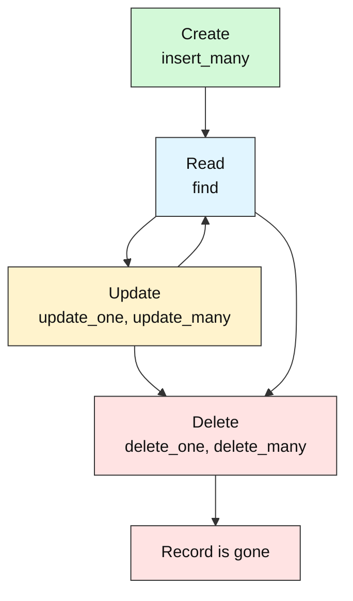
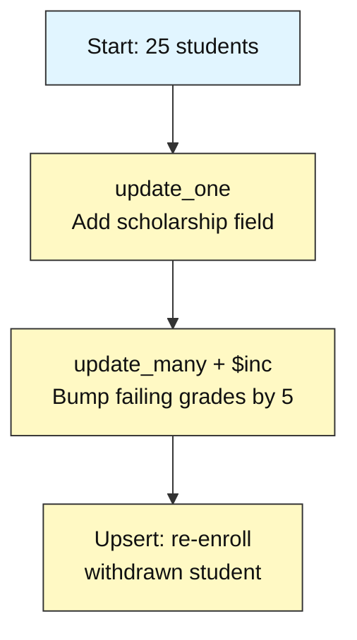
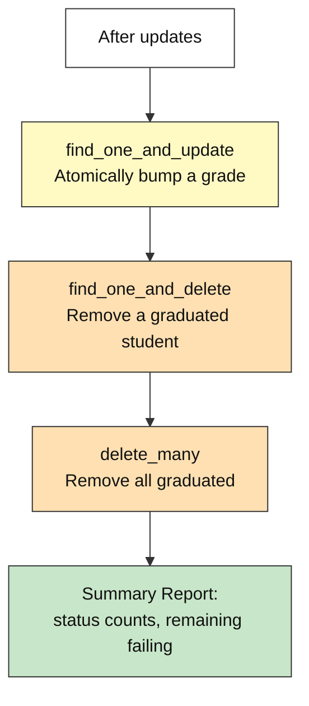

# How to Write, Update & Delete Data

---

# Problem Statement / Use Case Overview

A university needs to actively manage student enrollment records — updating grades when exam results come in, adding new fields like scholarships as policies change, re-enrolling students who withdrew, and removing records for students who have graduated. These are the **write** operations — changing data after it has been stored.

## What Is CRUD, and Why Is It the Foundation of Every Database?

**In one sentence:** CRUD stands for **C**reate, **R**ead, **U**pdate, **D**elete — the four basic things you can do with stored data, and every feature of every application is built from them.

Think of a **paper filing cabinet**. You *put in* a new folder (Create). You *take it out and look* at it (Read). You *cross out and rewrite* a line on it (Update). You *shred* it (Delete). A database does the same, only much faster. Whether it is a school system, a shop, or a social app, the work is always these four verbs.

### The life of one student record



A record is born (Create), looked at many times (Read), changed when facts change (Update), and finally removed (Delete). In the enrollment story, a student is enrolled, their grade is checked, the grade is corrected after exams, and the record is removed after graduation.

### The four verbs side by side

| CRUD verb | Plain meaning | SQL | MongoDB method | Example from this story |
|-----------|---------------|-----|----------------|-------------------------|
| **Create** | Store something new | `INSERT` | `insert_many` | Load the 25 starting students |
| **Read** | Look at stored data | `SELECT` | `find` | List students with `grade` below 60 |
| **Update** | Change what is stored | `UPDATE` | `update_one`, `update_many` | Add `scholarship`, raise failing grades |
| **Delete** | Remove it for good | `DELETE` | `delete_one`, `delete_many` | Remove graduated students |

### Why CRUD is the foundation of every DBMS

A database management system (DBMS) is software that stores data and lets you work with it. Every DBMS, old or new, must let you add, look up, change, and remove data. Only the spelling changes.

| World | Create | Read | Update | Delete |
|-------|--------|------|--------|--------|
| SQL database | `INSERT` | `SELECT` | `UPDATE` | `DELETE` |
| MongoDB | `insert_many` | `find` | `update_one`, `update_many` | `delete_one`, `delete_many` |
| Web API (HTTP) | `POST` | `GET` | `PUT` or `PATCH` | `DELETE` |

So once you understand CRUD in one system, you can pick up another quickly. The ideas stay the same.

### How an update works

An update has two parts: **which** documents to change (the filter) and **what** to change (the operator). Using an operator changes only the named field. The rest of the document stays untouched.

| Operator | Plain meaning | Example from this story |
|----------|---------------|-------------------------|
| `$set` | Set a field to a value; add it if missing | Give one student a `scholarship` field |
| `$unset` | Remove a field completely | Drop a field that is no longer needed |
| `$inc` | Add to (or subtract from) a number | Raise failing grades by 5 |

Why not rewrite the whole document? Rewriting means you must send every field again, and one forgotten field is lost. Operators are shorter and safer. `$inc` is also better than "read the grade, add 5, write it back", because the database does the change in one step.

Two more ideas appear in this lab:

- **Upsert** (`upsert=True`): "update if it exists, otherwise insert." It handles a re-enrolling student without checking first.
- **Atomic find-and-change** (`find_one_and_update`, `find_one_and_delete`): find one document and change or remove it in one step, and get it back. No other change can sneak in between.

### Reading the results

Update and delete calls return a small receipt. Read it every time.

| Receipt field | What it tells you |
|---------------|-------------------|
| Matched count | How many documents the filter found |
| `modified_count` | How many documents actually changed |
| `upserted_id` | The new `_id`, if an upsert had to insert a document |
| `deleted_count` | How many documents were removed |

Matched and modified can differ. If a document already holds the new value, it is matched but not modified.

### Safe habits

- **Filter first.** Run the same filter with `find` or `count_documents` to see what you are about to touch.
- **Check the counts.** If you expected 3 and the receipt says 25, stop and investigate.
- **Prefer the `_one` versions** when you mean one record. Use the `_many` versions on purpose.
- **Remember an empty filter matches everything.** `update_many` or `delete_many` with `{}` touches every document.

> **Honest note:** A delete is permanent. MongoDB has no undo button for it. Many real systems avoid this by setting a field such as `status` to `graduated` or `inactive` instead of deleting, so the record can still be read later. Delete only when you are sure the data is no longer needed, or when you have a backup.

**Learn more (official MongoDB documentation):**

- [MongoDB CRUD Operations — Database Manual](https://www.mongodb.com/docs/manual/crud/)
- [CRUD Operations — PyMongo Driver](https://www.mongodb.com/docs/languages/python/pymongo-driver/current/crud/)
- [Field Update Operators — Database Manual](https://www.mongodb.com/docs/manual/reference/operator/update-field/)
- [What are CRUD Operations?](https://www.mongodb.com/resources/products/fundamentals/crud) (published by MongoDB, so read it as the vendor's view)

This lab walks you through the full **CRUD write lifecycle** in MongoDB. You will learn how to update individual and multiple documents using different update operators (`$set`, `$unset`, `$inc`), perform upserts to handle re-enrollments, delete documents, and use atomic `find_one_and_update` / `find_one_and_delete` operations. A set of 25 student records, inserted automatically at the start, is your starting point.

---

# Input Data

| Item | Detail |
|------|--------|
| **Starting dataset** | A set of 25 student records (inserted automatically at the start of this lab) |
| **Fields per record** | `name`, `student_id`, `course`, `grade`, `enrollment_date`, `status` |
| **Status values** | `active`, `inactive`, `graduated` |
| **Write operations covered** | `update_one`, `update_many`, `find_one_and_update`, `find_one_and_delete`, `delete_one`, `delete_many` |

---

# Processing

### Part A — Single & Bulk Updates



The notebook starts by inserting the 25 student records (dropping the collection first so re-runs are safe). It then walks through `update_one` to add a field to a single student, `update_many` with `$inc` to modify groups of students, and an upsert to handle a re-enrollment.

### Part B — Atomic Find-and-Modify & Deletions



After updates are complete, the notebook demonstrates atomic find-and-modify operations (`find_one_and_update` and `find_one_and_delete`), then bulk deletion, and prints a summary report showing the final state of the collection.

---

# Output

**Insert confirmation:**
```
Inserted 25 student records.
```

**Single update — Alice receives a scholarship:**
```
Updated: Alice Johnson — added scholarship = 'Dean's Award'
```

**Increment — Failing students' grades raised by 5:**
```
Updated 6 failing student(s) — grades incremented by 5

--- Updated Failing Students ---
Charlie Brown        | Physics      | Grade: 60
Diana Prince         | English      | Grade: 53
Frank Castle         | Mathematics  | Grade: 57
Laura Palmer         | Biology      | Grade: 50
Rosa Parks           | English      | Grade: 63
Walt Disney          | Physics      | Grade: 61
```

**Upsert — Re-enrolling Frank Castle after withdrawal:**
```
Upserted: Frank Castle — status set to 'active'
```

**Atomic find-and-modify — Bob Smith's grade bumped:**
```
Updated: Bob Smith — grade 78 → 83
```

**Deletion — Graduated students removed:**
```
Deleted: Julia Child (graduated)
Deleted 1 graduated student(s).
```

**Summary report:**
```
         ENROLLMENT TRACKER SUMMARY

Total students remaining: 23
Students with scholarship field: 1

--- Status Distribution ---
  active: 22
  inactive: 1

--- Still Failing (Grade < 60) ---
  Laura Palmer (Biology) — Grade: 50
  Diana Prince (English) — Grade: 53
  Frank Castle (Mathematics) — Grade: 57
```

---

# Tech Stack

| Component | Tool |
|-----------|------|
| **MongoDB driver** | `pymongo[srv,tls]==4.10.1` — Python driver for MongoDB with SRV and TLS support |
| **Credential loader** | `python-dotenv==1.0.1` — loads `.env` files for credentials |
| **CA certificates** | `certifi` — provides up-to-date CA bundles for reliable SSL/TLS on all platforms |

> **Note:** This lab connects to a real MongoDB Atlas cluster. The connection string is stored in a `.env` file (as `MONGODB_URI`) and loaded at runtime — credentials never appear in the notebook itself.

---

# Underlying Concepts (Summarized)

This lab builds on the write side of MongoDB. Here are the concepts it uses in brief.

### Update Operators

MongoDB update operations always use an **update document** that tells MongoDB *what* to change. The most common operators are:

- **`$set`** — sets a field to a specific value, or creates it if it doesn't exist
- **`$unset`** — removes a field entirely from a document
- **`$inc`** — increments a numeric field by a given amount (useful for counters, scores, balances)

```python
# $set adds or overwrites a field
students.update_one({"name": "Alice"}, {"$set": {"scholarship": "Dean's Award"}})

# $inc raises a numeric field
students.update_one({"name": "Alice"}, {"$inc": {"grade": 5}})

# $unset removes a field
students.update_one({"name": "Alice"}, {"$unset": {"scholarship": ""}})
```

### Upserts

An **upsert** is a combined update-or-insert operation. If the filter matches a document, it updates it. If nothing matches, it inserts a new document with the filter fields and the update fields combined. This is useful for re-enrolling a student who previously withdrew — the record may or may not already exist.

```python
# upsert=True: update if exists, insert if not
students.update_one(
    {"student_id": "STU006"},
    {"$set": {"status": "active"}},
    upsert=True
)
```

### Atomic Find-and-Modify Operations

`find_one_and_update` and `find_one_and_delete` combine a query and a write in a single atomic operation — they find a document, apply a change, and return the document (before or after the change). This avoids the race condition of finding a document in one call and modifying it in another.

> **Why this matters:** Understanding the full CRUD write lifecycle — update, delete, and upsert — is what makes MongoDB practical for real applications. Reading data is only half of the job; being able to change it safely is what lets an application stay up to date.

---

# Pre-requisites

- **Basic familiarity with connecting to MongoDB, inserting documents and running simple queries** — explained briefly below if you need a refresher.
- **Basic Python knowledge** — variables, lists, dictionaries, loops, and `import` statements.
- **MongoDB Atlas cluster set up** — you need a MongoDB Atlas cluster and a `.env` file holding your connection string (`MONGODB_URI`) — set these up before you start. No additional database installation is needed.

---

# Environment / Dependencies Setup

| Package | Purpose |
|---------|---------|
| `pymongo[srv,tls]` | Python driver for MongoDB with SRV and TLS support |
| `python-dotenv` | Loads `.env` files so credentials stay out of the notebook |
| `certifi` | Provides up-to-date CA certificates for reliable SSL/TLS on all platforms |

```bash
pip install -q "pymongo[srv,tls]==4.10.1" python-dotenv==1.0.1 certifi
```

---

# Step-wise Instructions — Development

---

### Step 1 — Connect to MongoDB

```python
import os
import certifi
from dotenv import load_dotenv
import pymongo

# Load the Atlas connection string from the .env file
load_dotenv()
uri = os.environ["MONGODB_URI"]

# Connect to the real MongoDB Atlas cluster
client = pymongo.MongoClient(uri, tlsCAFile=certifi.where())

# Access the database and collection
db = client["school_db"]
students = db["students"]

print("Connected to MongoDB Atlas")
```

> **Where does the `.env` file go?** `load_dotenv()` looks for a file named `.env` in the folder you run from and then in each parent folder above it. Save it next to your notebook, or once in the root folder of your course project, with a single line: `MONGODB_URI=mongodb+srv://<user>:<password>@<cluster-host>/` (use your own Atlas connection string, and never commit this file to Git).


---

### Step 2 — Insert the Starting Dataset

```python
# Drop the collection first so re-running the notebook starts clean
students.drop()

# 25 student records — the starting point for write operations
student_records = [
    {"name": "Alice Johnson",  "student_id": "STU001", "course": "Computer Science", "grade": 95, "enrollment_date": "2024-09-01", "status": "active"},
    {"name": "Bob Smith",      "student_id": "STU002", "course": "Mathematics",      "grade": 78, "enrollment_date": "2024-09-01", "status": "active"},
    {"name": "Charlie Brown",  "student_id": "STU003", "course": "Physics",          "grade": 55, "enrollment_date": "2024-09-02", "status": "active"},
    {"name": "Diana Prince",   "student_id": "STU004", "course": "English",          "grade": 48, "enrollment_date": "2024-09-01", "status": "active"},
    {"name": "Eve Torres",     "student_id": "STU005", "course": "Biology",          "grade": 88, "enrollment_date": "2024-09-03", "status": "active"},
    {"name": "Frank Castle",   "student_id": "STU006", "course": "Mathematics",      "grade": 52, "enrollment_date": "2024-09-01", "status": "inactive"},
    {"name": "Grace Hopper",   "student_id": "STU007", "course": "Computer Science", "grade": 91, "enrollment_date": "2024-09-02", "status": "active"},
    {"name": "Hank Pym",       "student_id": "STU008", "course": "Physics",          "grade": 73, "enrollment_date": "2024-09-01", "status": "active"},
    {"name": "Ivan Petrov",    "student_id": "STU009", "course": "Computer Science", "grade": 84, "enrollment_date": "2024-09-03", "status": "active"},
    {"name": "Julia Child",    "student_id": "STU010", "course": "English",          "grade": 90, "enrollment_date": "2024-09-02", "status": "graduated"},
    {"name": "Karl Marx",      "student_id": "STU011", "course": "Mathematics",      "grade": 67, "enrollment_date": "2024-09-01", "status": "active"},
    {"name": "Laura Palmer",   "student_id": "STU012", "course": "Biology",          "grade": 45, "enrollment_date": "2024-09-02", "status": "active"},
    {"name": "Marco Polo",     "student_id": "STU013", "course": "Physics",          "grade": 82, "enrollment_date": "2024-09-03", "status": "active"},
    {"name": "Nina Simone",    "student_id": "STU014", "course": "English",          "grade": 76, "enrollment_date": "2024-09-01", "status": "active"},
    {"name": "Oscar Wilde",    "student_id": "STU015", "course": "Mathematics",      "grade": 93, "enrollment_date": "2024-09-02", "status": "active"},
    {"name": "Pia Zadora",     "student_id": "STU016", "course": "Biology",          "grade": 71, "enrollment_date": "2024-09-01", "status": "active"},
    {"name": "Quincy Adams",   "student_id": "STU017", "course": "Computer Science", "grade": 87, "enrollment_date": "2024-09-03", "status": "active"},
    {"name": "Rosa Parks",     "student_id": "STU018", "course": "English",          "grade": 58, "enrollment_date": "2024-09-02", "status": "inactive"},
    {"name": "Sam Wilson",     "student_id": "STU019", "course": "Physics",          "grade": 98, "enrollment_date": "2024-09-01", "status": "active"},
    {"name": "Tina Turner",    "student_id": "STU020", "course": "Mathematics",      "grade": 79, "enrollment_date": "2024-09-03", "status": "active"},
    {"name": "Uma Thurman",    "student_id": "STU021", "course": "Computer Science", "grade": 62, "enrollment_date": "2024-09-02", "status": "active"},
    {"name": "Vera Wang",      "student_id": "STU022", "course": "Biology",          "grade": 85, "enrollment_date": "2024-09-01", "status": "graduated"},
    {"name": "Walt Disney",    "student_id": "STU023", "course": "Physics",          "grade": 56, "enrollment_date": "2024-09-02", "status": "active"},
    {"name": "Xena Warrior",   "student_id": "STU024", "course": "English",          "grade": 94, "enrollment_date": "2024-09-03", "status": "active"},
    {"name": "Yusuf Islam",    "student_id": "STU025", "course": "Computer Science", "grade": 70, "enrollment_date": "2024-09-01", "status": "active"},
]

result = students.insert_many(student_records)
print(f"Inserted {len(result.inserted_ids)} student records.")
```

**Colour key used in the table snapshots:** 🟩 inserted &nbsp;·&nbsp; 🟨 updated &nbsp;·&nbsp; 🟥 deleted &nbsp;·&nbsp; 🟦 matched / returned by a query &nbsp;·&nbsp; ⬜ not touched

**Snapshot — the `students` collection right after the insert: all 25 documents are 🟩 newly inserted (MongoDB also adds a hidden `_id` to each one automatically; it is left out here). `enrollment_date` is also left out to save space, and no document has a `scholarship` field yet, so that column is empty.**

|  | student_id | name | course | grade | status | scholarship |
|---|---|---|---|---|---|---|
| 🟩 | STU001 | Alice Johnson | Computer Science | 95 | active |  |
| 🟩 | STU002 | Bob Smith | Mathematics | 78 | active |  |
| 🟩 | STU003 | Charlie Brown | Physics | 55 | active |  |
| 🟩 | STU004 | Diana Prince | English | 48 | active |  |
| 🟩 | STU005 | Eve Torres | Biology | 88 | active |  |
| 🟩 | STU006 | Frank Castle | Mathematics | 52 | inactive |  |
| 🟩 | STU007 | Grace Hopper | Computer Science | 91 | active |  |
| 🟩 | STU008 | Hank Pym | Physics | 73 | active |  |
| 🟩 | STU009 | Ivan Petrov | Computer Science | 84 | active |  |
| 🟩 | STU010 | Julia Child | English | 90 | graduated |  |
| 🟩 | STU011 | Karl Marx | Mathematics | 67 | active |  |
| 🟩 | STU012 | Laura Palmer | Biology | 45 | active |  |
| 🟩 | STU013 | Marco Polo | Physics | 82 | active |  |
| 🟩 | STU014 | Nina Simone | English | 76 | active |  |
| 🟩 | STU015 | Oscar Wilde | Mathematics | 93 | active |  |
| 🟩 | STU016 | Pia Zadora | Biology | 71 | active |  |
| 🟩 | STU017 | Quincy Adams | Computer Science | 87 | active |  |
| 🟩 | STU018 | Rosa Parks | English | 58 | inactive |  |
| 🟩 | STU019 | Sam Wilson | Physics | 98 | active |  |
| 🟩 | STU020 | Tina Turner | Mathematics | 79 | active |  |
| 🟩 | STU021 | Uma Thurman | Computer Science | 62 | active |  |
| 🟩 | STU022 | Vera Wang | Biology | 85 | graduated |  |
| 🟩 | STU023 | Walt Disney | Physics | 56 | active |  |
| 🟩 | STU024 | Xena Warrior | English | 94 | active |  |
| 🟩 | STU025 | Yusuf Islam | Computer Science | 70 | active |  |

---

### Step 3 — Single Update: Add a Scholarship Field

```python
# update_one() modifies the first document that matches the filter
# $set creates the "scholarship" field if it doesn't exist
result = students.update_one(
    {"name": "Alice Johnson"},
    {"$set": {"scholarship": "Dean's Award"}}
)

print(f"Updated: Alice Johnson — added scholarship = 'Dean's Award'")
```

`update_one()` updates **only the first** matching document. `$set` either creates a new field or overwrites an existing one — it never removes other fields.

**Snapshot — 1 document is 🟨 updated: Alice Johnson gains a new `scholarship` field (empty → Dean's Award). The other 24 documents are ⬜ untouched and are not listed.**

|  | student_id | name | course | grade | status | scholarship |
|---|---|---|---|---|---|---|
| 🟨 | STU001 | Alice Johnson | Computer Science | 95 | active | (none) → Dean's Award |
| ⬜ | … | … 24 other documents unchanged | | | | |

---

### Step 4 — Bulk Increment: Bump Failing Grades by 5

```python
# Capture who's failing BEFORE the update
failing_ids = [s["student_id"] for s in students.find(
    {"grade": {"$lt": 60}}, {"_id": 0, "student_id": 1}
)]

# update_many() modifies ALL documents that match the filter
# $inc adds 5 to the grade field (no need to read the current value first)
result = students.update_many(
    {"grade": {"$lt": 60}},
    {"$inc": {"grade": 5}}
)

print(f"Updated {result.modified_count} failing student(s) — grades incremented by 5")

# Look up the SAME students by their captured IDs, not by re-filtering on grade
updated_failing = students.find(
    {"student_id": {"$in": failing_ids}}, {"_id": 0}
)

print("\n--- Updated Failing Students ---")
for s in updated_failing:
    print(f"{s['name']:<20} | {s['course']:<12} | Grade: {s['grade']}")
```

`$inc` is atomic — MongoDB reads the current value, adds the increment, and writes it back in one operation. This is safer than reading, modifying in Python, and writing back, because another process can't slip in a write between the read and the write.

**Snapshot — 6 documents are 🟨 updated: every student with a grade below 60 gets `$inc` +5 (e.g. Charlie Brown 55 → 60). The other 19 documents are ⬜ untouched. The printed list in the code shows these same 6 students.**

|  | student_id | name | course | grade | status | scholarship |
|---|---|---|---|---|---|---|
| 🟨 | STU003 | Charlie Brown | Physics | 55 → 60 | active |  |
| 🟨 | STU004 | Diana Prince | English | 48 → 53 | active |  |
| 🟨 | STU006 | Frank Castle | Mathematics | 52 → 57 | inactive |  |
| 🟨 | STU012 | Laura Palmer | Biology | 45 → 50 | active |  |
| 🟨 | STU018 | Rosa Parks | English | 58 → 63 | inactive |  |
| 🟨 | STU023 | Walt Disney | Physics | 56 → 61 | active |  |
| ⬜ | … | … 19 other documents unchanged | | | | |

---

### Step 5 — Upsert: Re-enroll a Withdrawn Student

```python
# upsert=True: if the filter matches, update it; if nothing matches, insert a new document
# Frank Castle (STU006) has status "inactive" — this changes it to "active"
result = students.update_one(
    {"student_id": "STU006"},
    {"$set": {"status": "active"}},
    upsert=True
)

if result.upserted_id:
    print(f"Upserted: new document inserted with _id = {result.upserted_id}")
else:
    print(f"Upserted: Frank Castle — status set to 'active'")
```

Without `upsert=True`, `update_one` does nothing if the filter matches nothing. With it, MongoDB inserts a new document combining the filter fields and the update fields. Here the filter matches an existing student, so it behaves like a normal update — but the pattern is essential when you're not sure if a record already exists.

**Snapshot — 1 document is 🟨 updated: Frank Castle's status changes from inactive to active. The filter matched an existing document, so nothing new was inserted (no 🟩 row). The other 24 documents are ⬜ untouched.**

|  | student_id | name | course | grade | status | scholarship |
|---|---|---|---|---|---|---|
| 🟨 | STU006 | Frank Castle | Mathematics | 57 | inactive → active |  |
| ⬜ | … | … 24 other documents unchanged | | | | |

---

### Step 6 — Atomic Find-and-Modify: Bump a Grade

```python
# find_one_and_update: finds one document, applies an update, and returns it
# By default it returns the document BEFORE the update — so we can see the old grade
old = students.find_one_and_update(
    {"student_id": "STU002"},
    {"$inc": {"grade": 5}},
    projection={"_id": 0, "name": 1, "grade": 1}
)

print(f"Updated: {old['name']} — grade {old['grade']} → {old['grade'] + 5}")
```

`find_one_and_update` is the modify counterpart of `find_one_and_delete` — it finds and updates in one atomic step, returning the document as it was **before** the change. This avoids the race condition of reading a value, modifying it in Python, and writing it back. Like `update_one`, it only affects the first matching document.

**Snapshot — 1 document is 🟨 updated: Bob Smith's grade goes from 78 to 83. The other 24 documents are ⬜ untouched.**

|  | student_id | name | course | grade | status | scholarship |
|---|---|---|---|---|---|---|
| 🟨 | STU002 | Bob Smith | Mathematics | 78 → 83 | active |  |
| ⬜ | … | … 24 other documents unchanged | | | | |

---

### Step 7 — Delete: Remove Graduated Students

```python
# find_one_and_delete: finds one document, deletes it, and returns what it removed
graduated = students.find_one_and_delete(
    {"status": "graduated"},
    projection={"_id": 0, "name": 1, "status": 1}
)

if graduated:
    print(f"Deleted: {graduated['name']} (graduated)")
```

`find_one_and_delete` is the delete counterpart of `find_one_and_update` — it finds and removes in one step, returning the deleted document so you can log or confirm what was removed.

**Snapshot — 1 document is 🟥 deleted: Julia Child, the first graduated student found (shown once here, then gone). 24 documents remain; the other 23 are ⬜ untouched.**

|  | student_id | name | course | grade | status | scholarship |
|---|---|---|---|---|---|---|
| 🟥 | STU010 | Julia Child | English | 90 | graduated |  |
| ⬜ | … | … 23 other documents unchanged, including Vera Wang who is still graduated | | | | |

```python
# delete_many() removes ALL documents matching the filter
result = students.delete_many({"status": "graduated"})
print(f"Deleted {result.deleted_count} graduated student(s).")
```

`delete_many` with `{"status": "graduated"}` cleans up any remaining graduated records in one call. Combined with the previous `find_one_and_delete`, this demonstrates both single and bulk deletion patterns.

**Snapshot — 1 more document is 🟥 deleted: Vera Wang, the last remaining graduated student. The collection now has 23 documents and none has status graduated. The other 22 are ⬜ untouched.**

|  | student_id | name | course | grade | status | scholarship |
|---|---|---|---|---|---|---|
| 🟥 | STU022 | Vera Wang | Biology | 85 | graduated |  |
| ⬜ | … | … 22 other documents unchanged | | | | |

---

### Step 8 — Summary Report

```python
# Count remaining students
total = students.count_documents({})

# Count how many students have the "scholarship" field (updated in Step 3)
updated = students.count_documents({"scholarship": {"$exists": True}})

# Status distribution
pipeline = [
    {"$group": {"_id": "$status", "count": {"$sum": 1}}},
    {"$sort": {"_id": 1}}
]
status_counts = {doc["_id"]: doc["count"] for doc in students.aggregate(pipeline)}

# Students still failing after the grade bump
still_failing = list(students.find(
    {"grade": {"$lt": 60}},
    {"_id": 0}
).sort("grade", 1))

print("         ENROLLMENT TRACKER SUMMARY")
print(f"\nTotal students remaining: {total}")
print(f"Students with scholarship field: {updated}")

print("\n--- Status Distribution ---")
for status, count in sorted(status_counts.items()):
    print(f"  {status}: {count}")

print("\n--- Still Failing (Grade < 60) ---")
for s in still_failing:
    print(f"  {s['name']} ({s['course']}) — Grade: {s['grade']}")
```

Re-collects the key metrics from each step and prints a formatted summary — the same kind of report an enrollment office would review at the end of a processing cycle.

**Snapshot — a read-only query returns 3 documents (🟦 matched): the students whose grade is still below 60, sorted lowest first. The other 20 documents are ⬜ not returned. Nothing is changed.**

|  | student_id | name | course | grade | status | scholarship |
|---|---|---|---|---|---|---|
| 🟦 | STU012 | Laura Palmer | Biology | 50 | active |  |
| 🟦 | STU004 | Diana Prince | English | 53 | active |  |
| 🟦 | STU006 | Frank Castle | Mathematics | 57 | active |  |
| ⬜ | … | … 20 other documents not returned | | | | |

---

# What We Learnt

- **`update_one()` modifies the first matching document** — use it when you know exactly which record to change.
- **`update_many()` modifies every matching document** — use it for bulk operations across a collection.
- **`$set` creates or overwrites a field** without touching other fields — the most common update operator.
- **`$inc` atomically increments a numeric field** — safer than reading, modifying in Python, and writing back.
- **`$unset` removes a field entirely** from matching documents.
- **Upserts (`upsert=True`) combine insert and update** — if the filter matches, update; if not, insert a new document.
- **`find_one_and_delete` is atomic** — finds and removes in one step, returning the deleted document.
- **`find_one_and_update` is atomic** — finds and updates in one step, returning the document as it was before the change.
- **`delete_many()` removes all matching documents** — use it with a specific filter to avoid accidental full-collection deletion.
- **`modified_count` and `deleted_count` tell you what actually changed** — always check these to confirm operations worked as expected.
- **Atomic operations prevent race conditions** — MongoDB guarantees that find-and-modify and find-and-delete happen as a single uninterruptible step.

You can now update one or many documents with `$set`, `$unset` and `$inc`, upsert re-enrolled students, delete single or multiple documents, and use atomic find-and-modify operations.
