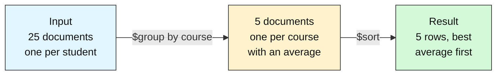
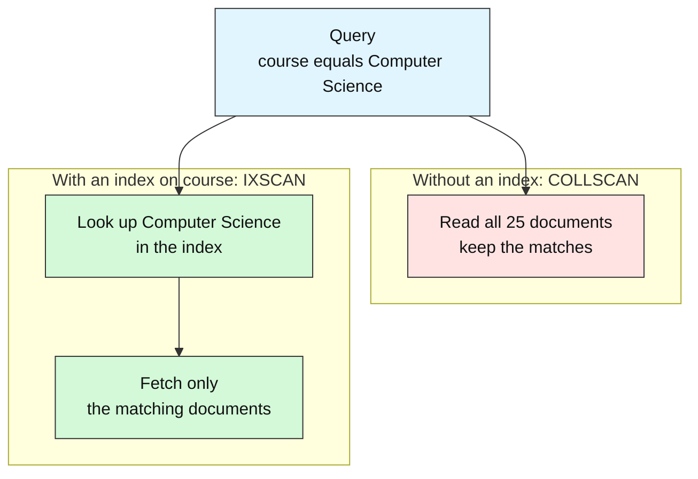
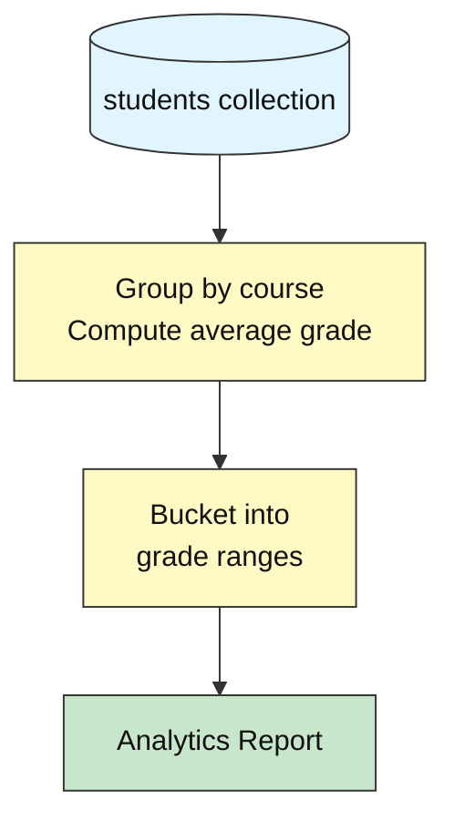
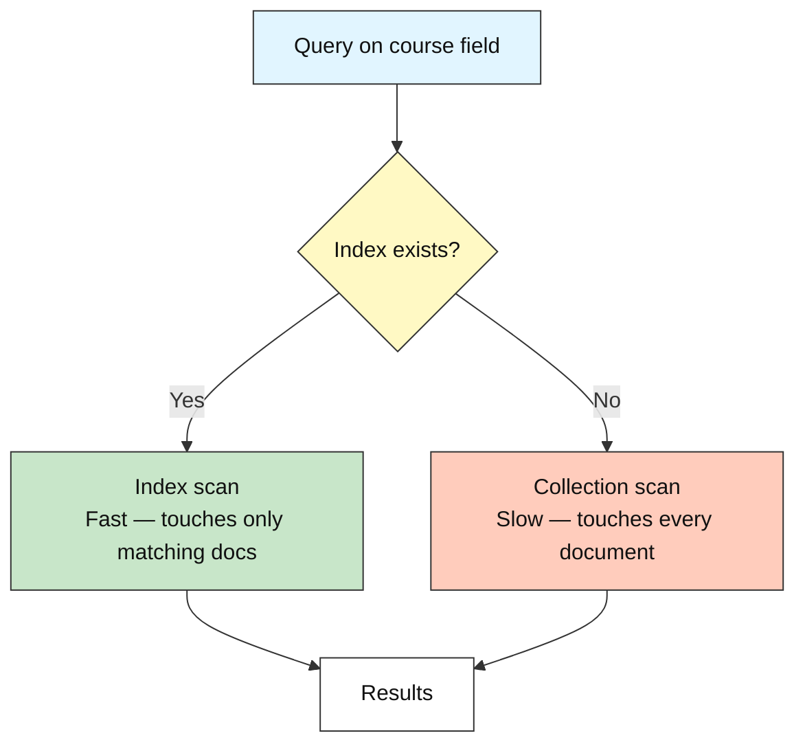
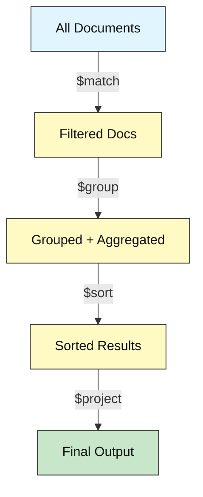

# How to Analyze Data at Scale

---

# Problem Statement / Use Case Overview

A university's academic office needs to move beyond individual student lookups and answer questions that span the entire dataset: which courses have the highest and lowest average grades? How are grades distributed across the class — how many students scored an A versus a C? These are analytical questions that can't be answered with a simple `find()` query.

## What Are Aggregation Pipelines and Indexes, and Why Do They Matter?

**In one sentence:** An *aggregation pipeline* turns many records into a few useful numbers by passing them through a chain of stages inside the database, and an *index* is a lookup list that helps the database find records without reading all of them.

Think of a **factory assembly line**. Raw parts go in at one end. Each station does one small job. A finished product comes out at the other end. An index is like the **index at the back of a book**: instead of reading every page to find "Physics", you look it up and jump straight to the right pages.

### What "analytics" means

Analytics means asking questions about the *whole* dataset, not about one student. You do not want 25 records back. You want a few numbers, such as "what is the average grade in each course?" or "how many students scored in each grade band?". The work is to **shrink many records into a short summary**.

### How a pipeline works



Each stage takes the documents produced by the stage before it and hands its own output to the next one. The number of documents can shrink (like `$group`) or stay the same (like `$sort`). Stage order matters, because each stage only sees what the previous stage gave it.

### The stages used in this lab

| Stage | In plain words | Example use here |
|-------|----------------|------------------|
| `$match` | Keep only the documents that fit a condition | Keep only active students |
| `$group` | Put documents into piles by a field, then calculate one value per pile | One pile per course, with its average grade |
| `$sort` | Put the results in order | Highest average first |
| `$bucket` | Drop each document into a numeric range | Count students in each grade band |
| `$project` | Choose or reshape the fields in the output | Show only the fields you need |

Inside `$group`, small helpers called *accumulators* do the maths. `$avg` finds the mean and `$sum` adds values up, which is also how you count.

### If you know SQL

| SQL idea | Pipeline stage | What it does |
|----------|----------------|--------------|
| `WHERE` | `$match` | Filters documents before grouping |
| `GROUP BY` with `AVG()` or `COUNT()` | `$group` with `$avg` or `$sum` | Makes one summary row per group |
| `HAVING` | `$match` placed after `$group` | Filters the groups themselves |
| `ORDER BY` | `$sort` | Orders the results |
| `SELECT col1, col2` | `$project` | Picks the output fields |
| `CASE WHEN` ranges | `$bucket` | Sorts values into ranges |

SQL packs all of this into one statement. A pipeline lists the steps one after another, so you can read it top to bottom.

### Why do the work inside the database?

| | Pull everything into Python, then calculate | Aggregation pipeline in the database |
|---|---|---|
| **Data moved over the network** | Every document | Only the small result |
| **Where the maths runs** | Your program's memory | The database server, close to the data |
| **Code to write** | Loops and counters by hand | A short list of stages |
| **As data grows** | Gets slower and heavier | Stays practical, and indexes can help |

With 25 students the difference is tiny. With millions of records, sending everything to your program becomes slow and costly.

### What is an index?

An **index** is a small, sorted structure that the database keeps next to your data. It stores a field's values (for example `course`) together with pointers to the matching documents. A book index works the same way.



| | COLLSCAN | IXSCAN |
|---|---|---|
| **Short for** | Collection scan | Index scan |
| **Book comparison** | Read every page | Check the index, jump to the page |
| **Documents examined** | Every document in the collection | Only the matching ones |
| **Where you see it** | `stage` in the `.explain()` output | `stage` in the `.explain()` output |

The `.explain()` method shows which of the two MongoDB chose, so you can check an index is really being used.

### The trade-off

An index makes reads faster, but it is not free. It takes extra storage. Every insert, update or delete must also update the index, so writes get a little slower.

> **Honest note:** Do not index every field. On a tiny collection, such as this lab's 25 students, a full scan is already instant and an index gives you no real benefit. Indexes pay off when a collection is large and a field is filtered or sorted on often. If your data changes constantly and is rarely searched, extra indexes mostly add cost. Also, a pipeline only benefits from an index in some stages, such as an early `$match` or `$sort`. A `$group` still has to process the documents it receives.

**Learn more (official MongoDB documentation):**

- [Aggregation Pipeline — Database Manual](https://www.mongodb.com/docs/manual/core/aggregation-pipeline/)
- [Aggregation Stages — Database Manual](https://www.mongodb.com/docs/manual/reference/mql/aggregation-stages/)
- [Indexes — Database Manual](https://www.mongodb.com/docs/manual/indexes/)
- [Explain Results — Database Manual](https://www.mongodb.com/docs/manual/reference/explain-results/)

This lab teaches you to use MongoDB's **aggregation pipeline** — a sequence of data transformation stages that run directly inside the database — to compute course-level statistics and grade distributions from a 25-student dataset. You will also learn how **indexing** speeds up these queries and how to use `.explain()` to verify that MongoDB is using your index instead of scanning every document.

---

# Input Data

| Item | Detail |
|------|--------|
| **Student records** | 25 synthetic records (inserted automatically at the start) |
| **Fields per record** | `name`, `student_id`, `course`, `grade`, `enrollment_date`, `status` |
| **Courses covered** | Computer Science, Mathematics, Physics, English, Biology |
| **Grade range** | 45–98 (some intentionally failing, below 60) |

---

# Processing

### Part A — Aggregation Pipelines



The notebook runs two aggregation pipelines: one that groups students by course and computes the average grade per course (sorted highest to lowest), and another that buckets all students into grade ranges (A, B, C, D, F) to show the overall grade distribution.

### Part B — Indexing and Performance



You run `.explain()` twice — once before creating the index (seeing a COLLSCAN) and once after (seeing an IXSCAN) — making the performance difference visible.

---

# Output

**Average grade per course:**

```
--- Average Grade per Course ---
Computer Science     | Avg: 81.5
Mathematics          | Avg: 73.8
English              | Avg: 73.2
Physics              | Avg: 72.8
Biology              | Avg: 72.2
```

**Grade distribution:**

```
--- Grade Distribution ---
  0-59   (F): 6 students
  60-69  (D): 2 students
  70-79  (C): 6 students
  80-89  (B): 5 students
  90-100 (A): 6 students
```

**Index performance comparison:**

```
--- Before indexing ---
Stage: COLLSCAN

--- After indexing ---
Stage: IXSCAN

--- Comparison ---
Before index: COLLSCAN
After index:  IXSCAN
```

**Analytics summary report:**

```
       ACADEMIC PERFORMANCE ANALYTICS

Total students: 25
Overall average grade: 75.1

Top course:    Computer Science (avg 81.5)
Bottom course: Biology (avg 72.2)

--- Grade Distribution ---
  A: 6 students
  B: 5 students
  C: 6 students
  D: 2 students
  F: 6 students
```

---

# Tech Stack

| Component | Tool |
|-----------|------|
| **MongoDB driver** | `pymongo[srv,tls]==4.10.1` — Python driver for MongoDB with SRV and TLS support |
| **Credential loader** | `python-dotenv==1.0.1` — loads `.env` files for credentials |
| **CA certificates** | `certifi` — provides up-to-date CA bundles for reliable SSL/TLS on all platforms |

> **Note:** This lab connects to a real MongoDB Atlas cluster. The connection string is stored in the `.env` file and loaded at runtime — credentials never appear in the notebook itself.

---

# Underlying Concepts (Summarized)

### Aggregation Pipelines

An **aggregation pipeline** is a sequence of stages that transform data step by step inside the database, rather than pulling raw data into your application. Each stage receives the output of the previous one as its input. This is MongoDB's equivalent of SQL's `GROUP BY`, `HAVING`, and window functions — but expressed as a chain of stages rather than a single query.



The key stages used in this lab are:

- **`$group`** — groups documents by a field (e.g., course) and applies accumulators (e.g., `$avg`, `$sum`) to each group
- **`$sort`** — orders the grouped results by a field (e.g., average grade descending)
- **`$bucket`** — distributes documents into predefined ranges (e.g., grade bands 0–59, 60–69, etc.)
- **`$project`** — reshapes documents, selecting or computing specific fields for the output

Pipelines run inside the database engine, so they are faster than pulling all documents into Python and processing them there — especially as collections grow.

### Indexing

An **index** is a data structure that lets MongoDB locate documents matching a query without scanning every document in the collection. Without an index, MongoDB must perform a **collection scan** (COLLSCAN) — reading every document to find matches. With an index, it performs an **index scan** (IXSCAN) — reading only the index entries that match.

Creating an index on a field that you frequently filter or sort by (e.g., `course`) is the single most impactful performance optimization you can make. The tradeoff is that indexes consume storage and slow down write operations slightly, since every insert or update must also update the index.

### `.explain()`

The `.explain()` method returns the **query execution plan** — a detailed breakdown of how MongoDB processed a query, including which stages it used and how many documents it examined. This is the tool you use to verify that your indexes are actually being used. The key field to look at is `stage`: `COLLSCAN` means no index was used; `IXSCAN` means an index was used. When a query has no projection, the winning plan's top-level `stage` directly shows `COLLSCAN` or `IXSCAN`. When a query includes a projection (as in this lab's covered-query Steps 5/6), MongoDB wraps the real scan under an outer projection stage — so you need to look inside `inputStage.stage` to find the `COLLSCAN` or `IXSCAN` value.

> **Why this matters:** Aggregation pipelines let you compute analytics directly inside the database, which is faster and more efficient than pulling raw data into your application. Indexing ensures those pipelines run quickly even as collections grow. Together, they are the foundation for building production-grade MongoDB applications that can handle real data volumes.

---

# Pre-requisites

- **Basic MongoDB familiarity** — connecting to MongoDB, inserting documents, and running basic queries and updates.
- **Basic Python knowledge** — variables, lists, dictionaries, loops, and `import` statements.
- **MongoDB Atlas cluster set up** — you need a MongoDB Atlas cluster and a `.env` file holding your connection string — set these up before you start. No additional database installation is needed.

---

# Environment / Dependencies Setup

| Package | Purpose |
|---------|---------|
| `pymongo[srv,tls]` | Python driver for MongoDB with SRV and TLS support |
| `python-dotenv` | Loads `.env` files so credentials stay out of the notebook |
| `certifi` | Provides up-to-date CA certificates for reliable SSL/TLS on all platforms |

```bash
pip install -q "pymongo[srv,tls]==4.10.1" python-dotenv==1.0.1 certifi
```

---

# Step-wise Instructions — Development

---

### Step 1 — Connect to MongoDB

```python
import os
import certifi
from dotenv import load_dotenv
import pymongo

# Load the Atlas connection string from the .env file
load_dotenv()
uri = os.environ["MONGODB_URI"]

# Connect to the real MongoDB Atlas cluster
client = pymongo.MongoClient(uri, tlsCAFile=certifi.where())

# Access the database and collection
db = client["school_db"]
students = db["students"]

print("Connected to MongoDB Atlas")
```

> **Where does the `.env` file go?** `load_dotenv()` looks for a file named `.env` in the folder you run from and then in each parent folder above it. Save it next to your notebook, or once in the root folder of your course project, with a single line: `MONGODB_URI=mongodb+srv://<user>:<password>@<cluster-host>/` (use your own Atlas connection string, and never commit this file to Git).


`load_dotenv` reads the connection string from the `.env` file, and `certifi.where()` provides trusted CA certificates for SSL.

---

### Step 2 — Insert the Starting Dataset

```python
students.drop()

student_records = [
    {"name": "Alice Johnson",  "student_id": "STU001", "course": "Computer Science", "grade": 95, "enrollment_date": "2024-09-01", "status": "active"},
    {"name": "Bob Smith",      "student_id": "STU002", "course": "Mathematics",      "grade": 78, "enrollment_date": "2024-09-01", "status": "active"},
    {"name": "Charlie Brown",  "student_id": "STU003", "course": "Physics",          "grade": 55, "enrollment_date": "2024-09-02", "status": "active"},
    {"name": "Diana Prince",   "student_id": "STU004", "course": "English",          "grade": 48, "enrollment_date": "2024-09-01", "status": "active"},
    {"name": "Eve Torres",     "student_id": "STU005", "course": "Biology",          "grade": 88, "enrollment_date": "2024-09-03", "status": "active"},
    {"name": "Frank Castle",   "student_id": "STU006", "course": "Mathematics",      "grade": 52, "enrollment_date": "2024-09-01", "status": "inactive"},
    {"name": "Grace Hopper",   "student_id": "STU007", "course": "Computer Science", "grade": 91, "enrollment_date": "2024-09-02", "status": "active"},
    {"name": "Hank Pym",       "student_id": "STU008", "course": "Physics",          "grade": 73, "enrollment_date": "2024-09-01", "status": "active"},
    {"name": "Ivan Petrov",    "student_id": "STU009", "course": "Computer Science", "grade": 84, "enrollment_date": "2024-09-03", "status": "active"},
    {"name": "Julia Child",    "student_id": "STU010", "course": "English",          "grade": 90, "enrollment_date": "2024-09-02", "status": "graduated"},
    {"name": "Karl Marx",      "student_id": "STU011", "course": "Mathematics",      "grade": 67, "enrollment_date": "2024-09-01", "status": "active"},
    {"name": "Laura Palmer",   "student_id": "STU012", "course": "Biology",          "grade": 45, "enrollment_date": "2024-09-02", "status": "active"},
    {"name": "Marco Polo",     "student_id": "STU013", "course": "Physics",          "grade": 82, "enrollment_date": "2024-09-03", "status": "active"},
    {"name": "Nina Simone",    "student_id": "STU014", "course": "English",          "grade": 76, "enrollment_date": "2024-09-01", "status": "active"},
    {"name": "Oscar Wilde",    "student_id": "STU015", "course": "Mathematics",      "grade": 93, "enrollment_date": "2024-09-02", "status": "active"},
    {"name": "Pia Zadora",     "student_id": "STU016", "course": "Biology",          "grade": 71, "enrollment_date": "2024-09-01", "status": "active"},
    {"name": "Quincy Adams",   "student_id": "STU017", "course": "Computer Science", "grade": 87, "enrollment_date": "2024-09-03", "status": "active"},
    {"name": "Rosa Parks",     "student_id": "STU018", "course": "English",          "grade": 58, "enrollment_date": "2024-09-02", "status": "inactive"},
    {"name": "Sam Wilson",     "student_id": "STU019", "course": "Physics",          "grade": 98, "enrollment_date": "2024-09-01", "status": "active"},
    {"name": "Tina Turner",    "student_id": "STU020", "course": "Mathematics",      "grade": 79, "enrollment_date": "2024-09-03", "status": "active"},
    {"name": "Uma Thurman",    "student_id": "STU021", "course": "Computer Science", "grade": 62, "enrollment_date": "2024-09-02", "status": "active"},
    {"name": "Vera Wang",      "student_id": "STU022", "course": "Biology",          "grade": 85, "enrollment_date": "2024-09-01", "status": "graduated"},
    {"name": "Walt Disney",    "student_id": "STU023", "course": "Physics",          "grade": 56, "enrollment_date": "2024-09-02", "status": "active"},
    {"name": "Xena Warrior",   "student_id": "STU024", "course": "English",          "grade": 94, "enrollment_date": "2024-09-03", "status": "active"},
    {"name": "Yusuf Islam",    "student_id": "STU025", "course": "Computer Science", "grade": 70, "enrollment_date": "2024-09-01", "status": "active"},
]

result = students.insert_many(student_records)
print(f"Inserted {len(result.inserted_ids)} student records.")
```

`students.drop()` ensures re-running the notebook starts clean without duplicating records.

**Colour key used in the table snapshots:** 🟩 inserted &nbsp;·&nbsp; 🟨 updated &nbsp;·&nbsp; 🟥 deleted &nbsp;·&nbsp; 🟦 matched / returned by a query &nbsp;·&nbsp; ⬜ not touched

**Snapshot — the `students` collection after `insert_many`: all 25 documents are 🟩 newly inserted (the collection was empty after `drop()`). MongoDB adds a hidden `_id` to each document automatically, so it is not shown.**

| | name | student_id | course | grade | enrollment_date | status |
|---|---|---|---|---|---|---|
| 🟩 | Alice Johnson | STU001 | Computer Science | 95 | 2024-09-01 | active |
| 🟩 | Bob Smith | STU002 | Mathematics | 78 | 2024-09-01 | active |
| 🟩 | Charlie Brown | STU003 | Physics | 55 | 2024-09-02 | active |
| 🟩 | Diana Prince | STU004 | English | 48 | 2024-09-01 | active |
| 🟩 | Eve Torres | STU005 | Biology | 88 | 2024-09-03 | active |
| 🟩 | Frank Castle | STU006 | Mathematics | 52 | 2024-09-01 | inactive |
| 🟩 | Grace Hopper | STU007 | Computer Science | 91 | 2024-09-02 | active |
| 🟩 | Hank Pym | STU008 | Physics | 73 | 2024-09-01 | active |
| 🟩 | Ivan Petrov | STU009 | Computer Science | 84 | 2024-09-03 | active |
| 🟩 | Julia Child | STU010 | English | 90 | 2024-09-02 | graduated |
| 🟩 | Karl Marx | STU011 | Mathematics | 67 | 2024-09-01 | active |
| 🟩 | Laura Palmer | STU012 | Biology | 45 | 2024-09-02 | active |
| 🟩 | Marco Polo | STU013 | Physics | 82 | 2024-09-03 | active |
| 🟩 | Nina Simone | STU014 | English | 76 | 2024-09-01 | active |
| 🟩 | Oscar Wilde | STU015 | Mathematics | 93 | 2024-09-02 | active |
| 🟩 | Pia Zadora | STU016 | Biology | 71 | 2024-09-01 | active |
| 🟩 | Quincy Adams | STU017 | Computer Science | 87 | 2024-09-03 | active |
| 🟩 | Rosa Parks | STU018 | English | 58 | 2024-09-02 | inactive |
| 🟩 | Sam Wilson | STU019 | Physics | 98 | 2024-09-01 | active |
| 🟩 | Tina Turner | STU020 | Mathematics | 79 | 2024-09-03 | active |
| 🟩 | Uma Thurman | STU021 | Computer Science | 62 | 2024-09-02 | active |
| 🟩 | Vera Wang | STU022 | Biology | 85 | 2024-09-01 | graduated |
| 🟩 | Walt Disney | STU023 | Physics | 56 | 2024-09-02 | active |
| 🟩 | Xena Warrior | STU024 | English | 94 | 2024-09-03 | active |
| 🟩 | Yusuf Islam | STU025 | Computer Science | 70 | 2024-09-01 | active |

---

### Step 3 — Aggregation: Average Grade per Course

```python
pipeline = [
    {"$group": {"_id": "$course", "avg_grade": {"$avg": "$grade"}}},
    {"$sort": {"avg_grade": -1}}
]

course_avgs = list(students.aggregate(pipeline))

print("--- Average Grade per Course ---")
for doc in course_avgs:
    print(f"{doc['_id']:<20} | Avg: {doc['avg_grade']:.1f}")
```

`$group` collects all students sharing the same `course` value. `$avg` computes the mean grade within each group. `$sort` orders the results from highest to lowest average.

**Snapshot — input and output of the pipeline. All 25 documents are 🟦 read by `$group`; the output has 5 new result rows, also 🟦, already sorted by `avg_grade` (high to low). The `students` collection itself is not changed.**

Input to `$group` (all 25 documents):

| | name | course | grade |
|---|---|---|---|
| 🟦 | Alice Johnson | Computer Science | 95 |
| 🟦 | Bob Smith | Mathematics | 78 |
| 🟦 | Charlie Brown | Physics | 55 |
| 🟦 | Diana Prince | English | 48 |
| 🟦 | Eve Torres | Biology | 88 |
| 🟦 | Frank Castle | Mathematics | 52 |
| 🟦 | Grace Hopper | Computer Science | 91 |
| 🟦 | Hank Pym | Physics | 73 |
| 🟦 | Ivan Petrov | Computer Science | 84 |
| 🟦 | Julia Child | English | 90 |
| 🟦 | Karl Marx | Mathematics | 67 |
| 🟦 | Laura Palmer | Biology | 45 |
| 🟦 | Marco Polo | Physics | 82 |
| 🟦 | Nina Simone | English | 76 |
| 🟦 | Oscar Wilde | Mathematics | 93 |
| 🟦 | Pia Zadora | Biology | 71 |
| 🟦 | Quincy Adams | Computer Science | 87 |
| 🟦 | Rosa Parks | English | 58 |
| 🟦 | Sam Wilson | Physics | 98 |
| 🟦 | Tina Turner | Mathematics | 79 |
| 🟦 | Uma Thurman | Computer Science | 62 |
| 🟦 | Vera Wang | Biology | 85 |
| 🟦 | Walt Disney | Physics | 56 |
| 🟦 | Xena Warrior | English | 94 |
| 🟦 | Yusuf Islam | Computer Science | 70 |

Output of `$group` + `$sort`:

| | _id (course) | grades in the group | count | avg_grade |
|---|---|---|---|---|
| 🟦 | Computer Science | 95, 91, 84, 87, 62, 70 | 6 | 81.5 |
| 🟦 | Mathematics | 78, 52, 67, 93, 79 | 5 | 73.8 |
| 🟦 | English | 48, 90, 76, 58, 94 | 5 | 73.2 |
| 🟦 | Physics | 55, 73, 82, 98, 56 | 5 | 72.8 |
| 🟦 | Biology | 88, 45, 71, 85 | 4 | 72.2 |

---

### Step 4 — Aggregation: Grade Distribution with $bucket

```python
pipeline = [
    {"$bucket": {
        "groupBy": "$grade",
        "boundaries": [0, 60, 70, 80, 90, 101],
        "default": "Other",
        "output": {"count": {"$sum": 1}}
    }}
]

distribution = list(students.aggregate(pipeline))

print("--- Grade Distribution ---")
labels = {0: "0-59   (F)", 60: "60-69  (D)", 70: "70-79  (C)",
          80: "80-89  (B)", 90: "90-100 (A)"}
for doc in distribution:
    label = labels.get(doc["_id"], doc["_id"])
    print(f"  {label}: {doc['count']} students")
```

`$bucket` distributes documents into predefined ranges based on the `grade` field. Each `boundaries` value is the inclusive lower edge of a bucket. The `output` key defines what to compute for each bucket — here, a simple count.

**Snapshot — input and output of `$bucket`. All 25 documents are 🟦 read, and each falls into one bucket by its `grade`; the 5 output rows are new result rows, also 🟦. The `students` collection is not changed.**

Input to `$bucket` (all 25 documents, with the bucket each one lands in):

| | name | grade | lands in bucket (_id) |
|---|---|---|---|
| 🟦 | Alice Johnson | 95 | 90 |
| 🟦 | Bob Smith | 78 | 70 |
| 🟦 | Charlie Brown | 55 | 0 |
| 🟦 | Diana Prince | 48 | 0 |
| 🟦 | Eve Torres | 88 | 80 |
| 🟦 | Frank Castle | 52 | 0 |
| 🟦 | Grace Hopper | 91 | 90 |
| 🟦 | Hank Pym | 73 | 70 |
| 🟦 | Ivan Petrov | 84 | 80 |
| 🟦 | Julia Child | 90 | 90 |
| 🟦 | Karl Marx | 67 | 60 |
| 🟦 | Laura Palmer | 45 | 0 |
| 🟦 | Marco Polo | 82 | 80 |
| 🟦 | Nina Simone | 76 | 70 |
| 🟦 | Oscar Wilde | 93 | 90 |
| 🟦 | Pia Zadora | 71 | 70 |
| 🟦 | Quincy Adams | 87 | 80 |
| 🟦 | Rosa Parks | 58 | 0 |
| 🟦 | Sam Wilson | 98 | 90 |
| 🟦 | Tina Turner | 79 | 70 |
| 🟦 | Uma Thurman | 62 | 60 |
| 🟦 | Vera Wang | 85 | 80 |
| 🟦 | Walt Disney | 56 | 0 |
| 🟦 | Xena Warrior | 94 | 90 |
| 🟦 | Yusuf Islam | 70 | 70 |

Output of `$bucket`:

| | _id (lower bound) | grades in the bucket | count |
|---|---|---|---|
| 🟦 | 0 | 55, 48, 52, 45, 58, 56 | 6 |
| 🟦 | 60 | 67, 62 | 2 |
| 🟦 | 70 | 78, 73, 76, 71, 79, 70 | 6 |
| 🟦 | 80 | 88, 84, 82, 87, 85 | 5 |
| 🟦 | 90 | 95, 91, 90, 93, 98, 94 | 6 |

---

### Step 5 — Query Performance Without an Index

```python
query = {"course": "Computer Science"}
projection = {"_id": 0, "course": 1}

# Before creating any index, run the query and inspect the execution plan
# Project only the indexed field so the query is covered (no FETCH needed)
plan_before = students.find(query, projection).explain()

winning_before = plan_before.get("queryPlanner", {}).get("winningPlan", {})
stage_before = winning_before.get("inputStage", {}).get("stage", winning_before.get("stage", "unknown"))

print("--- Before indexing ---")
print(f"Stage: {stage_before}")
```

With no index on `course`, MongoDB must perform a **collection scan** (COLLSCAN) — it reads every document in the collection to find matches. This is fine for 25 documents, but would be slow on a collection with millions.

**Snapshot — result of `find({"course": "Computer Science"}, {"_id": 0, "course": 1})`. The 6 matching documents are 🟦 returned (only the `course` field is projected); the other 19 are ⬜ not returned. Nothing is changed; only the way MongoDB finds them differs (COLLSCAN reads all 25 documents).**

| | course (returned) |
|---|---|
| 🟦 | Computer Science |
| 🟦 | Computer Science |
| 🟦 | Computer Science |
| 🟦 | Computer Science |
| 🟦 | Computer Science |
| 🟦 | Computer Science |
| ⬜ | … 19 other documents not matched |

---

### Step 6 — Create an Index and Verify the Difference

```python
students.create_index("course")
print("Index created on 'course' field")

# Now run the same covered query again and inspect the execution plan
plan_after = students.find(query, projection).explain()

winning_after = plan_after.get("queryPlanner", {}).get("winningPlan", {})
stage_after = winning_after.get("inputStage", {}).get("stage", winning_after.get("stage", "unknown"))

print(f"\n--- After indexing ---")
print(f"Stage: {stage_after}")

print(f"\n--- Comparison ---")
print(f"Before index: {stage_before}")
print(f"After index:  {stage_after}")
```

Creating an index on `course` lets MongoDB locate matching documents via an **index scan** (IXSCAN) instead of scanning every document. By projecting only the indexed field (`{"_id": 0, "course": 1}`), the query becomes **covered** — MongoDB can answer it entirely from the index without fetching the full document. We read the scan stage from `inputStage` (the inner stage of the plan) rather than the top-level `stage`, because MongoDB may wrap the scan in a projection stage. The result: the `inputStage` stage changes from `COLLSCAN` to `IXSCAN` after the index is created.

**Snapshot — the indexes on `students` after `create_index("course")`. The `course_1` index is 🟩 newly created; the default `_id_` index is ⬜ untouched, and no student documents change. The same 6 Computer Science documents are now found via an IXSCAN on `course_1`.**

| | index name | key | stage used by the query |
|---|---|---|---|
| ⬜ | _id_ | {_id: 1} | not used |
| 🟩 | course_1 | {course: 1} | IXSCAN (before: COLLSCAN) |

---

### Step 7 — Analytics Summary Report

```python
# Overall stats
total = students.count_documents({})
pipeline_all = [{"$group": {"_id": None, "avg": {"$avg": "$grade"}}}]
overall_avg = list(students.aggregate(pipeline_all))[0]["avg"]

# Top and bottom courses
top_course = course_avgs[0]
bottom_course = course_avgs[-1]

# Grade distribution
dist_pipeline = [
    {"$bucket": {
        "groupBy": "$grade",
        "boundaries": [0, 60, 70, 80, 90, 101],
        "output": {"count": {"$sum": 1}}
    }}
]
dist = {doc["_id"]: doc["count"] for doc in students.aggregate(dist_pipeline)}

print("       ACADEMIC PERFORMANCE ANALYTICS")
print(f"\nTotal students: {total}")
print(f"Overall average grade: {overall_avg:.1f}")

print(f"\nTop course:    {top_course['_id']} (avg {top_course['avg_grade']:.1f})")
print(f"Bottom course: {bottom_course['_id']} (avg {bottom_course['avg_grade']:.1f})")

print("\n--- Grade Distribution ---")
for bound, label in [(90, "A"), (80, "B"), (70, "C"), (60, "D"), (0, "F")]:
    print(f"  {label}: {dist.get(bound, 0)} students")
```

Collects the key metrics from each aggregation step into one formatted summary — the kind of report an academic office would review at the end of a semester.

**Snapshot — the three queries behind the report. The collection is not changed: all 25 documents are 🟦 read by each query, and every result row below is a new 🟦 row.**

| | query | result |
|---|---|---|
| 🟦 | `count_documents({})` | 25 |
| 🟦 | `$group` with `_id: None`, `$avg` of grade | avg = 75.1 (exact 75.08) |

Output of the `$bucket` used for the report (same 25 grades as in Step 4):

| | _id (lower bound) | letter | count |
|---|---|---|---|
| 🟦 | 90 | A | 6 |
| 🟦 | 80 | B | 5 |
| 🟦 | 70 | C | 6 |
| 🟦 | 60 | D | 2 |
| 🟦 | 0 | F | 6 |

---

# What We Learnt

- **Aggregation pipelines transform data in stages inside the database** — `$group`, `$avg`, `$sort`, and `$bucket` let you compute analytics without pulling raw data into Python.
- **`$group` groups documents by a field** and applies accumulators like `$avg` (mean) and `$sum` (count) to each group.
- **`$bucket` distributes documents into predefined ranges** — useful for creating grade distributions, histograms, or any binned analysis.
- **`$sort` orders pipeline output** — use `1` for ascending, `-1` for descending.
- **Indexes dramatically speed up queries** — `create_index("field")` builds a lookup structure so MongoDB can find matching documents without scanning the entire collection.
- **`.explain()` reveals the query execution plan** — look for `IXSCAN` (index used) versus `COLLSCAN` (full collection scan) to verify your indexes are effective. If the query uses a projection, check `inputStage.stage` instead of the top-level `stage`, because MongoDB wraps the scan in a projection stage.
- **`totalDocsExamined` in the explain output** tells you how many documents MongoDB had to inspect — a lower number means a more efficient query.
- **Indexes trade write speed for read speed** — every index must be updated on insert/update, so index fields you actually query.

You can now connect to MongoDB, query, update, aggregate, and index — and use `.explain()` to confirm your index is doing its job.
