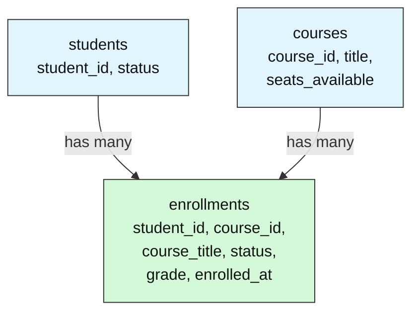
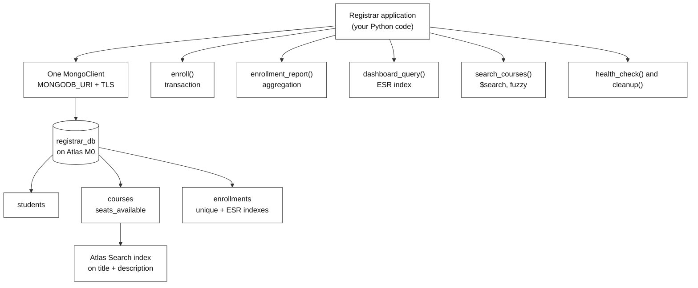
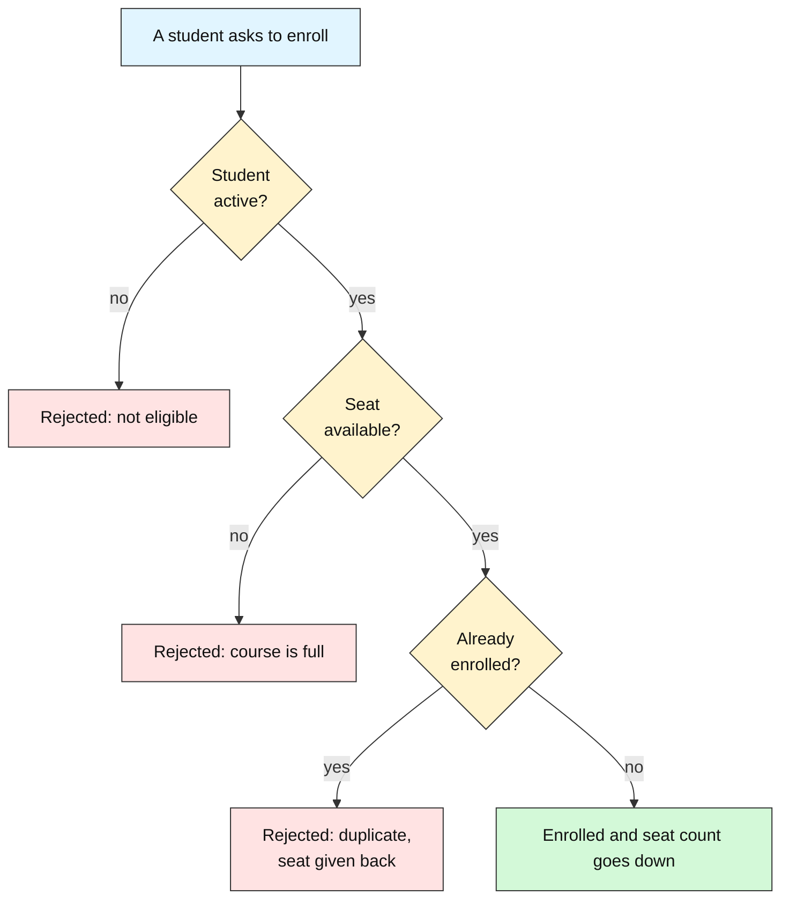

# Capstone: University Registration Database: A Safe, Fast, Searchable MongoDB System

**Type:** Capstone Project | **Level:** Advanced | **Duration:** 1–2 days (8–12 hours of build time)

**Integrates:** the full MongoDB toolkit: CRUD, schema design, aggregation, indexes, transactions, Atlas Search and deployment checks.

**Execution model:** This folder is a **design and build specification**. It contains documents only; no runnable code is shipped here. The learner writes the code: the 8–12 hours is the time to build the system from this spec in the learner's own project folder. The Section 10 questions are design and trace exercises answered in writing against the spec (and, where useful, checked against the learner's own build). The code is **plain Python with `pymongo`**: ordinary functions (`seed`, `enroll`, `enrollment_report`, `dashboard_query`, `search_courses`, `health_check`, `cleanup`) called from one script or notebook. **No ODM, no web framework, no ORM**: the point of the capstone is to see what the database itself does, not to hide it behind a library.

**Data:** a small synthetic registrar data set that your own seed code generates: 20 students, 6 courses plus one more you add later, and 30,000 generated enrollments. Everything lives in a MongoDB Atlas cluster (the free M0 tier is enough), so a network connection and a connection string are needed.

---

## 1. Problem Statement

A university is replacing its spreadsheet-based course registration with a real database. Build a **registration database** on MongoDB Atlas that stores students, courses and enrollments, lets students enroll without ever over-booking a course, answers the dean's questions, keeps the registrar's dashboard fast as records pile up, and lets students find a course even when they misspell its name.

**In one sentence:** a registration database keeps track of *who* (students), *what* (courses) and *who is in what* (enrollments), and it must follow a few rules that can never be broken, even when many people click "enroll" at the same moment.

Think of a **paper sign-up sheet on a classroom door**. Each course has a sheet with a limited number of lines. Nobody may sign twice, nobody may sign when all lines are full, and a student who has left the university may not sign at all. The database is that sheet, but thousands of people can write on it at once.

A student can take many courses, and a course has many students. The **enrollments** collection links the two: each enrollment is one student in one course.

Three requirements separate this from a plain "create a few collections" exercise:

- **Rules are enforced by the database, not by hope.** "No double enrollment", "no seat when the course is full" and "seat and enrollment succeed together or not at all" must hold even if two requests arrive at the same instant. The design uses a unique index, a conditional atomic update and a transaction, not application-side checks alone.
- **Speed is measured, not assumed.** The dashboard query is checked with `explain` before and after the index, and the capstone records how many documents each version examined.
- **The deployment is inspected, not trusted.** The build ends by reading the replica set, the encrypted connection and the user's roles back from the cluster, then leaves the cluster exactly as it was found.

The system is designed for one registrar's application talking to one cluster, with a documented path to more rules and more features.

## 2. Scope

**In scope**

- Three collections in one database (`registrar_db`): `students`, `courses`, `enrollments`.
- A **unique index** on `enrollments` over `(student_id, course_id)`, named `uniq_student_course`.
- Everyday maintenance: find, update and upsert records (an upsert run twice must not create a duplicate).
- A transactional `enroll(student_id, course_id)` function that checks the student, takes one seat and writes the enrollment as one unit.
- A reporting aggregation: enrolled count and average grade per course, for active enrollments, highest average first.
- A **compound ESR index** named `esr_course_status_date` that serves the dashboard query ("10 newest active enrollments for a course") and proof from `explain` that it works.
- A typo-tolerant catalog search built with **Atlas Search** (the `text` operator with fuzzy matching).
- A **health check** (replica set name and member count, TLS in use, the current user's roles) and a **cleanup** that drops the search index and the whole database.

**Optional extensions (not part of the default build)**

- **Change stream** on `enrollments` that prints each new enrollment as it happens.
- **Waiting list**: when a course is full, store the request in a `waitlist` collection and promote the first waiting student when a seat is freed.
- **Vector search**: add a `$vectorSearch` index so "learn to write code" finds Introduction to Programming even though no word matches.

**Out of scope (documented as future work)**

- Payments, prerequisites, timetable clashes and withdrawal deadlines. Each is a new rule that needs the same "what must never break" thinking.
- Sharding and extra replica-set members. The free M0 tier cannot add them, so the build only **inspects** the replica set it is given.
- Web UI, login and user management, multi-university isolation and deployment.
- Backups, fine-tuning and any model training.

## 3. Integration Map — every skill earns its place

| Skill | Concept | Where it lands in the capstone |
|-------|---------|--------------------------------|
| Connecting | `MongoClient` with a connection string from `.env` and a CA bundle | The single connection every function shares |
| CRUD | Insert, find, update, upsert | Seeding the data, fixing a wrong student status, adding course CS301 with an upsert |
| Schema design | Collections, referencing, computed pattern, extended reference | `seats_available` is a stored counter; each enrollment copies `course_title` |
| Unique indexes | A rule the database itself enforces | `uniq_student_course` blocks a second enrollment of the same student in the same course |
| Atomic updates | One conditional write that checks and changes together | Taking a seat only if `seats_available > 0` |
| Transactions | Several writes across collections that commit or abort together | `enroll()` takes the seat and writes the enrollment as one unit |
| Aggregation | `$match`, `$group`, `$sort` | The dean's report: enrollments and average grade per course |
| Compound indexes | Equality, Sort, Range (ESR) field order and `explain` | The dashboard index that turns `COLLSCAN` + `SORT` into `IXSCAN` |
| Atlas Search | Lucene-based text index with fuzzy matching | Finding course CS101 from the typo `programing` |
| Deployment checks | `hello`, TLS and `connectionStatus` | Proving the replica set, encrypted connection and roles, then cleaning up |

## 4. Target Output

A finished build produces the following evidence, in this order. The exact numbers vary a little by cluster, so the checks look at shape, not exact values.

- **Seeded data:** 20 students, 6 courses plus CS301, and the unique index in place. CS101 has only **3 seats**, so over-booking can be tested.
- **Enrollment results** for CS101 using a few students: three succeed, a fourth is rejected because the course is **full**, and an inactive student is rejected as **not eligible**. A repeat enrollment is rejected as a **duplicate**. After every rejection, the seat counter is exactly what it was before.
- **A report:** one row per course with `enrolled` and `avg_grade`, highest average first.
- **A before/after plan** for the dashboard query on 30,003 enrollments:

| | Stages | Documents examined |
|---|--------|--------------------|
| Before the index | `SORT` over `COLLSCAN` | about 30,003 |
| After the index | `LIMIT`, `FETCH`, `IXSCAN` (no `SORT`) | about 10 |

- **A search result:** `search_courses("programing")` returns CS101 as the top hit.
- **A health report:** the replica set name, its member count, `tls_enforced = True` and the list of the current user's roles.
- **A clean cluster:** the search index and the whole `registrar_db` database are dropped.
- **A run record:** a one-line summary of the run (rows seeded, enrollments accepted and rejected with reasons, documents examined before and after the index, search top hit and whether cleanup finished), kept so runs can be compared later.

## 5. Tech Stack & Constraints

- **Language and driver:** Python 3.11 and `pymongo[srv,tls]==4.10.1`, including `SearchIndexModel` for the search index.
- **Database:** MongoDB Atlas free M0 tier. Transactions, change streams and Atlas Search all work on it; sharding and extra members do not.
- **Secrets:** `python-dotenv==1.0.1`, reading `MONGODB_URI` from a `.env` file. The connection string is never written in code.
- **TLS:** `certifi` supplies the CA bundle (`tlsCAFile=certifi.where()`) so the encrypted connection works on every platform.
- **Cost:** free tier only, so a full build and run costs nothing.
- **Constraint:** every collection name, index name and field name used by the checks is fixed in this spec (`registrar_db`, `students`, `courses`, `enrollments`, `uniq_student_course`, `esr_course_status_date`, `seats_available`, `course_title`, `enrolled_at`), so any learner's build can be compared with the reference answers.
- **Constraint:** only the registrar's own database is touched. Nothing is written to any other database on the cluster.

## 6. Architecture Overview

### 6.1 System diagram

### 6.2 Component responsibilities

| Component | Responsibility | Fails by |
|-----------|----------------|----------|
| `seed()` | Insert students and courses, create `uniq_student_course`. Safe to re-run: it drops and refills. | Leaving duplicates if it does not clear first |
| `maintain()` | Find active Computer Science students sorted by name, fix S014's status, upsert CS301 twice. | Creating two CS301 documents if the upsert filter is wrong |
| `enroll()` | Check the student is active, take one seat, write the enrollment, all in one transaction. | Over-booking if the seat is read and then written in two separate steps |
| `enrollment_report()` | Aggregate active enrollments per course: count and average grade, highest average first. | Counting inactive enrollments, or filtering after grouping |
| `dashboard_query()` | Return the 10 newest active enrollments for one course. | Reading every document when no matching index exists |
| `search_courses()` | `$search` with fuzzy matching, 3 results, only `course_id` and `title`. | Returning nothing for a typo if fuzzy matching is off |
| `health_check()` | Read the replica set, TLS use and roles back from the cluster. | Reporting the wrong answer for a connection that is not encrypted |
| `cleanup()` | Drop the search index, then the whole database. | Leaving collections or a search index behind |

### 6.3 Data flow (one enrollment request)

A **state snapshot** shows what the database holds at each step when student S004 asks for a seat in CS101, which has **1 seat left**.

**Colour key used in the table snapshots:** 🟩 inserted &nbsp;·&nbsp; 🟨 updated &nbsp;·&nbsp; 🟥 deleted / rolled back &nbsp;·&nbsp; 🟦 matched / returned by a query &nbsp;·&nbsp; ⬜ not touched

| Step | What the code does | What changes | Result |
|------|--------------------|--------------|--------|
| 0 | Start a session and a transaction | nothing yet | |
| 1 | Read the student | `students` is only read (🟦) | S004 is `active`, so go on |
| 2 | Update CS101 with the filter `seats_available > 0`, decrement by 1 | `courses`: `seats_available` 1 → 0 (🟨) | the update matched one document |
| 3 | Insert the enrollment `{student_id: S004, course_id: CS101, ...}` | `enrollments`: one new document (🟩) | the unique index accepts it |
| 4 | Commit | both changes become visible together | enrolled |

**If step 3 fails** (for example a duplicate), the transaction aborts and step 2 is rolled back:

| Collection | Before | During | After the abort |
|------------|--------|--------|-----------------|
| `courses` (CS101) | `seats_available` 1 | 0 (🟨 uncommitted) | 1 (🟥 rolled back) |
| `enrollments` | no S004 row | insert rejected | no S004 row |

## 7. Key Design Decisions

### 7.1 The enrollment rule (the order of checks and what a retry does)

| Business rule | How the database enforces it | MongoDB feature used |
|---------------|------------------------------|----------------------|
| A student cannot enroll twice in the same course | The database refuses a second record with the same student and course | Unique index on `(student_id, course_id)` |
| A full course rejects new students | The seat counter drops by one only if it is still above zero | Atomic update on `seats_available` |
| The seat and the enrollment succeed together or not at all | Both writes are grouped, so a failure leaves nothing behind | Transaction |
| Only active students can enroll | The student's `status` is checked before the seat is taken | Check in the enrollment code |

**Why both an atomic update and a transaction.** The conditional update (`seats_available > 0`, then decrement) already makes the *seat* safe: two requests cannot both take the last one. It does not protect the *pair* of writes. If the seat is taken and the enrollment insert then fails, the seat would be lost. The transaction makes the pair one unit.

**Retry rule.** Use the driver's transaction helper (`session.with_transaction`), which re-runs the whole callback on a transient transaction error. A business rejection (inactive student, full course, duplicate) is **not** transient and must not be retried: it raises a clear error that names the reason.

### 7.2 Why the dashboard index has this field order

The dashboard query filters on two **equalities** (`course_id`, `status`) and sorts by `enrolled_at`, newest first. The **ESR rule** (Equality, then Sort, then Range) gives the order `(course_id, status, enrolled_at descending)`.

| Index | What MongoDB does | Result |
|-------|-------------------|--------|
| `(course_id, status, enrolled_at desc)` | Jumps to one course and status; entries are already newest-first; reads 10 and stops | `IXSCAN`, no `SORT`, about 10 documents examined |
| `(enrolled_at, course_id, status)` | Walks the whole date order and filters each entry afterwards | Many more entries examined; much slower |

### 7.3 Copy or look up? (the extended reference)

Each enrollment stores a copy of the course title (`course_title`). **Benefit:** a student's course list is one query on `enrollments`, with no `$lookup` join. **Risk:** if a course is renamed, old enrollments show the old title. **Policy:** update the source in `courses` first, then propagate the new title to the copies with one `update_many`, so every copy has a plan for staying correct.

### 7.4 Optional extension: a waiting list

When a course is full, `enroll()` could write a `waitlist` document instead of rejecting. A freed seat (a deleted enrollment) would then promote the oldest waiting student **inside a transaction**, so a seat is never given to two people. This changes the "full course" outcome from rejection to queueing, so the unique index and the explanations in Section 4 must be updated to match.

## 8. Required Documentation Set

Only `00-overview-architecture.md` (this file) and `01-reference-answers.md` exist today. **The other six files below are planned and have not been written yet ("to be written")**; this table says what each is meant to contain.

| File | Status | Contents |
|------|--------|----------|
| `00-overview-architecture.md` | written | this document: problem, scope, integration map, architecture, decisions |
| `01-reference-answers.md` | written | the instructor answer key for the Section 10 questions |
| `02-data-model-and-seeding.md` | to be written | field-by-field schemas, the seed data rules, the unique index, re-run safety |
| `03-enrollment-and-transactions.md` | to be written | `enroll()` contract, the order of checks, retry rule and the abort cases |
| `04-reporting-indexes-and-search.md` | to be written | the aggregation, the ESR index, the search index definition and fuzzy settings |
| `05-test-plan.md` | to be written | one test per function (full course, inactive student, duplicate, upsert twice) and pass criteria |
| `06-deployment-checks-and-cleanup.md` | to be written | the health-check contract, what each check proves, and a cleanup that leaves no trace |
| `lab-capstone-project-assignment.md` | to be written | the post-capstone assignment (Section 10) as a standalone sheet |

## 9. Environment Setup (documentation convention)

This capstone is a design and build spec, so there is nothing to install to *read* it. To *build* it, the planned runbook (`06-deployment-checks-and-cleanup.md`, to be written) will document the environment the design targets:

- a Python 3.11 virtual environment built from a `requirements.txt` that you write,
- a MongoDB Atlas cluster (free M0), a database user, and your IP address allowed in Atlas,
- `MONGODB_URI` in a `.env` file. `load_dotenv()` looks for `.env` in the folder you run from and then in each parent folder, so save it in your project's root folder. Never commit this file to Git.

The first code cell of your notebook or script should be a single pinned install line covering the Section 5 stack, for example `pip install -q "pymongo[srv,tls]==4.10.1" python-dotenv==1.0.1 certifi`.

## 10. Post-Capstone Assignment

1. Trace one enrollment of a student into a course with **one seat left**, and then a second student into the same course. For each step, say which collection changes and how (use the format of the table in 6.3).
2. Explain why `enroll()` takes the seat with a conditional atomic update **and** runs inside a transaction. What would go wrong with a plain "read the seat count, then update it" approach?
3. The dashboard index is `(course_id, status, enrolled_at descending)`. Explain why the fields are in that order, and what would go wrong with `(enrolled_at, course_id, status)`.
4. Each enrollment stores a copy of the course title. Name one benefit and one risk of that copy, and describe how you would handle a course being renamed.
5. A student tries to enroll in a course they are already in. Describe exactly which write fails, what the transaction does about the seat that was already taken, and what the learner sees.
6. Pick two of the three health checks (replica set, TLS, roles). For each, say what you read from the cluster and what it proves. Name one thing the free M0 tier does **not** let you change.

## 11. Further Reading / Next Steps

- [Unique Indexes — Database Manual](https://www.mongodb.com/docs/manual/core/index-unique/)
- [Transactions — Database Manual](https://www.mongodb.com/docs/manual/core/transactions/)
- [Data Modeling in MongoDB — Database Manual](https://www.mongodb.com/docs/manual/data-modeling/)
- [The Equality, Sort, Range guideline — Database Manual](https://www.mongodb.com/docs/manual/tutorial/equality-sort-range-guideline/)
- [Aggregation — Database Manual](https://www.mongodb.com/docs/manual/aggregation/)
- [text (MongoDB Search Operator)](https://www.mongodb.com/docs/atlas/atlas-search/text/)
- [Replication — Database Manual](https://www.mongodb.com/docs/manual/replication/)
- If a later milestone adds a waiting list, payments or prerequisites, the rules table in 7.1 is the seam to extend: add the rule, name the feature that enforces it, and add a failing case to the test plan.
