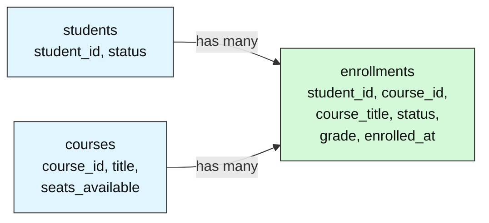
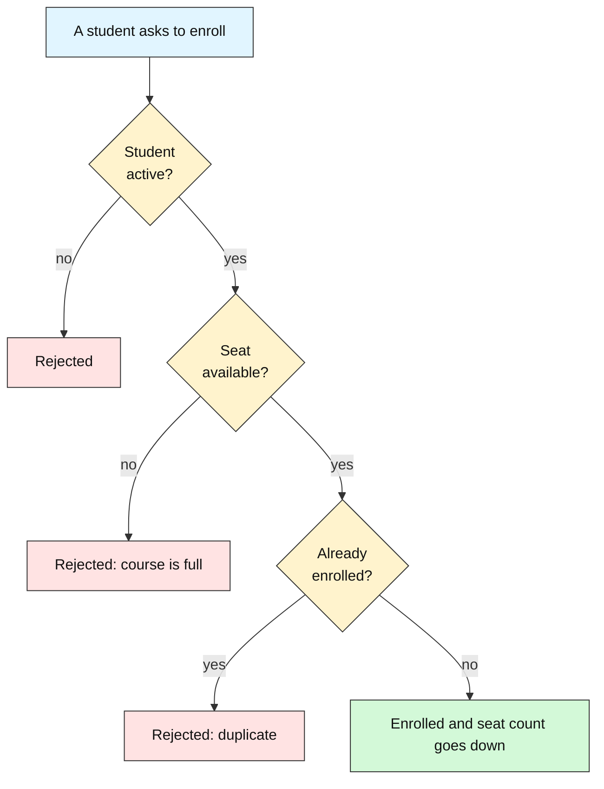
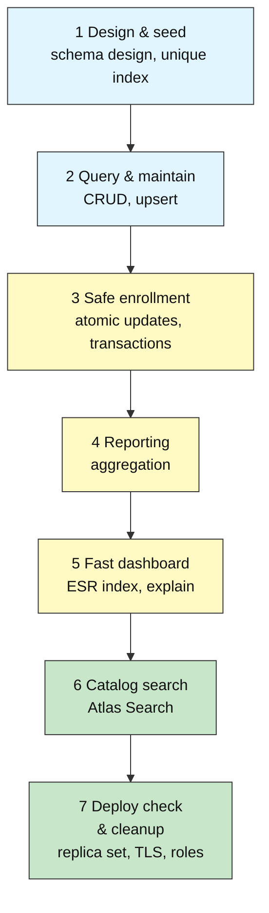

# University Registration Database

---

# Problem Statement / Use Case Overview

A university is replacing its spreadsheet-based course registration with a real database. Students must be able to enroll in courses, a course must never be over-booked, the dean needs reports, the dashboard has to stay fast as records pile up, and students want to find courses even when they misspell the name.

## What Does a Registration Database Have to Get Right?

**In one sentence:** A registration database keeps track of *who* (students), *what* (courses) and *who is in what* (enrollments), and it must follow a few rules that can never be broken, even when many people click "enroll" at once.

Think of a **paper sign-up sheet on a classroom door**. Each course has a sheet with a limited number of lines. Nobody may sign twice, nobody may sign when all lines are full, and a student who has left the university may not sign at all. The database is that sheet, but thousands of people can write on it at the same moment.

### The three kinds of data



A student can take many courses, and a course has many students. The **enrollments** collection links the two. Each enrollment is one student in one course. It also keeps a copy of the course title, so a student's course list needs no extra lookup.

### Rules that must never break



| Business rule | How the database enforces it | MongoDB feature used |
|---------------|------------------------------|----------------------|
| A student cannot enroll twice in the same course | The database refuses a second record with the same student and course | Unique index on `(student_id, course_id)` |
| A full course rejects new students | The seat counter drops by one only if it is still above zero | Atomic update on `seats_available` |
| The seat and the enrollment succeed together or not at all | Both writes are grouped, so a failure leaves nothing behind | Transaction |
| Only active students can enroll | The student's `status` is checked before the seat is taken | Check in the enrollment code |

### What the system has to do

| What the system must do | Plain-words goal | MongoDB feature |
|-------------------------|------------------|-----------------|
| Store students, courses and enrollments | Keep each kind of data in its own place | Three collections, schema design patterns |
| Find and fix records | Look up a student, correct a status, add or update a course | Queries, updates, upserts |
| Enroll safely | Never over-book a course | Atomic updates, transactions |
| Answer the dean's questions | Enrollments and average grade per course | Aggregation pipeline |
| Stay fast as records grow | Show a course's newest active enrollments quickly | Compound index (ESR rule), `explain` |
| Help students find courses | Still find a course when the name is misspelled | Atlas Search with fuzzy matching |
| Prove the setup is healthy | Check the replica set, TLS and roles, then clean up | Deployment checks |

### What "production-ready" means here

Work in this order. Each layer only matters if the one before it is solid.

1. **Correctness first.** The design and the rules above must hold, or nothing else counts.
2. **Then speed.** Reports and the dashboard must stay quick as enrollments grow.
3. **Then search.** Students find courses even with a typo.
4. **Then health checks.** The deployment is safe to run: replica set, encrypted connection and sensible roles.

> **Honest note:** This is a small capstone, not a full registrar. It has no waiting lists, prerequisites, payments or timetable clashes. Real systems add those rules, and each one needs the same careful thinking about what must never break.

**Learn more (official MongoDB documentation):**

- [Unique Indexes — Database Manual](https://www.mongodb.com/docs/manual/core/index-unique/)
- [Transactions — Database Manual](https://www.mongodb.com/docs/manual/core/transactions/)
- [Data Modeling in MongoDB — Database Manual](https://www.mongodb.com/docs/manual/data-modeling/)
- [text (MongoDB Search Operator)](https://www.mongodb.com/docs/atlas/atlas-search/text/)

You are the database owner. Over seven short steps you build and verify the whole thing on MongoDB Atlas. There is no new theory here: each step applies a MongoDB skill you may already know, so the capstone is about **putting the pieces together**, not learning something new.

This is deliberately a **small, single-sitting capstone**: one notebook, one database, three collections, seven checks.

---

# Input Data

| Item | Detail |
|------|--------|
| **Database** | `registrar_db` (created and deleted by the notebook) |
| **Students** | 20 generated students across 5 programs |
| **Courses** | 6 seeded courses, plus one you add (CS101 has only 3 seats, to test over-booking) |
| **Enrollments** | A few you create by hand, plus 30,000 synthetic records loaded in Step 4 |

---

# Processing



| Step | What you do | Skills used |
|------|-------------|------------------|
| 1 | Design the three collections, load the data, add a unique index | Schema design patterns, inserting data, unique indexes |
| 2 | Query, update and upsert records | Queries, updates, upserts |
| 3 | Enroll students in a transaction that can never over-book a course | Atomic updates, transactions |
| 4 | Report enrollments and average grade per course | Aggregation |
| 5 | Make the dashboard query fast with an ESR index | Compound indexes, ESR rule, explain |
| 6 | Search the catalog with typo tolerance | Atlas Search |
| 7 | Check the replica set, TLS and roles, then clean up | Replica set, TLS and roles checks |

---

# Output

Every step ends with a check cell. A finished run prints:

```
Step 1 check passed
Step 2 check passed
Three students enrolled in CS101
Rejected S004 (course is full): no seats available
Rejected S007 (student is inactive): student not eligible
Step 3 check passed
Step 4 check passed
Step 5 check passed      (COLLSCAN + SORT before, IXSCAN with no SORT after)
Step 6 check passed
Step 7 check passed
```

> The numbers in the report (Step 4) and the explain output (Step 5) vary slightly by cluster. The checks look at their shape, not exact values.

---

# Tech Stack

| Component | Tool |
|-----------|------|
| **MongoDB driver** | `pymongo[srv,tls]==4.10.1` |
| **Credential loader** | `python-dotenv==1.0.1` (loads your `.env` file) |
| **CA certificates** | `certifi` |
| **Database** | MongoDB Atlas free M0 tier (transactions, change streams and Atlas Search all work on it) |

---

# Underlying Concepts (Summarized)

There is no new theory here — each step applies a MongoDB skill you may already know: CRUD, schema design, aggregation, indexes, transactions, Atlas Search and deployment checks. Here is the whole toolkit in one place.

### The document model

MongoDB stores **documents** (JSON-like key-value records) inside **collections**. Unlike a relational table, documents in a collection do not have to share one schema, so a field can be added to one record without touching the others. This flexibility is exactly what lets the registrar model students, courses and enrollments without a rigid join table for every relationship.

### Schema patterns

Rather than normalise everything, MongoDB modeling chooses between **embedding** related data in one document and **referencing** it by id. The capstone uses two patterns: a **computed pattern** (`courses.seats_available` is a stored counter, never recounted on read) and an **extended reference** (`enrollments` copies `course_title` so a listing needs no `$lookup`).

### Aggregation and query shape

An **aggregation pipeline** transforms documents stage by stage — `$match` filters, `$group` summarises, `$sort` orders, `$project` shapes the output. Filtering early keeps later stages cheap.

### Indexes and the ESR rule

An **index** is a sorted structure that lets MongoDB find documents without scanning the whole collection. A **compound index** orders fields left to right, and the **ESR rule** — Equality, then Sort, then Range — gives the field order that lets one index serve both the filter and the sort. `explain("executionStats")` shows whether a query used an index (`IXSCAN`) or fell back to a collection scan (`COLLSCAN`).

### Transactions, replication and security

A **transaction** groups several writes across collections so they all commit or all abort — the mechanism that makes over-booking impossible. Atlas runs as a **replica set**: one primary accepts writes while secondaries replicate, and reads can be directed to secondaries. `mongodb+srv://` connections always use **TLS**, and database users are scoped with **roles** that limit what they may do.

### Atlas Search

**Atlas Search** (built on Apache Lucene) indexes text fields so queries tolerate typos and rank by relevance — something a plain `$text` index cannot do.

---

# Pre-requisites

- Comfort with connecting to MongoDB, CRUD, aggregation, indexes, transactions, schema design and Atlas Search (each step below re-explains what it uses)
- A MongoDB Atlas cluster and a `.env` file holding your connection string — set these up before you start
- About 90 minutes. Step 6 waits roughly a minute for the search index to build

---

# Environment / Dependencies Setup

| Package | Purpose |
|---------|---------|
| `pymongo[srv,tls]` | Python driver for MongoDB with SRV and TLS support, including `SearchIndexModel` |
| `python-dotenv` | Loads `.env` files so credentials stay out of the notebook |
| `certifi` | Provides up-to-date CA certificates for reliable SSL/TLS on all platforms |

```bash
pip install -qU "pymongo[srv,tls]==4.10.1" python-dotenv==1.0.1 certifi
```

This installs the MongoDB Python driver (`pymongo`), `python-dotenv` for loading credentials, and `certifi` for trusted CA certificates.

---

# Step-wise Instructions — Development

**How the Capstone Works.** Open your notebook. Each step has:

1. a short brief,
2. a code cell with one or two `# TODO` markers for you to fill in,
3. a **check cell** that stops with a clear message if something is wrong.

When a check prints *passed*, move on. If you are stuck, compare your result with the expected output shown above.

### Step 1 — Design and Seed the Database

*Skills used: schema design, inserting data, unique indexes*

Create the three collections the registrar needs and load the starting data.

**Schema decisions (already made for you, notice why):**

| Collection | Holds | Pattern used |
|---|---|---|
| `students` | one document per student | plain document |
| `courses` | one per course, with a `seats_available` counter | **computed pattern** (a stored counter, never recounted) |
| `enrollments` | one per student per course, with a copy of `course_title` | **referencing** by `student_id` and `course_id` plus an **extended reference** for the title |

**Your tasks**
1. Insert `STUDENTS` and `COURSES`.
2. Create a **unique** index on `enrollments` over `(student_id, course_id)` named `uniq_student_course`, so nobody can enroll twice in the same course.

**Expected output:**

```
Step 1 check passed
```

**Colour key used in the table snapshots:** 🟩 inserted &nbsp;·&nbsp; 🟨 updated &nbsp;·&nbsp; 🟥 deleted &nbsp;·&nbsp; 🟦 matched / returned by a query &nbsp;·&nbsp; ⬜ not touched

**Snapshot — the three collections and the index right after Step 1; every row is new (green). The lab text does not list the seed data, so these are example shapes with illustrative values, except `CS101`, its title and its 3 seats, which the lab gives.**

**`students` (example shape)**

| | student_id | status |
|---|---|---|
| 🟩 | S014 (illustrative) | active (illustrative) |
| 🟩 | … 19 more documents (20 students in total) | |

**`courses` (example shape)**

| | course_id | title | seats_available |
|---|---|---|---|
| 🟩 | CS101 | Introduction to Programming | 3 |
| 🟩 | … 5 more seeded courses (6 in total) | | |

**`enrollments` (example shape, empty at this point)**

| | student_id | course_id | course_title |
|---|---|---|---|
| 🟩 | S001 (illustrative) | CS101 (illustrative) | Introduction to Programming (illustrative) |

The row above only shows the field layout; the collection holds no documents yet. The new unique index is shown here:

**`enrollments` indexes**

| | index name | fields | unique |
|---|---|---|---|
| 🟩 | uniq_student_course | student_id, course_id | yes |

---

### Step 2 — Query and Maintain the Data

*Skills used: queries, updates, upserts*

Everyday registrar work: look things up and keep records correct.

**Your tasks**
1. Find the **active Computer Science students**, sorted by name. Store the list in `cs_students`.
2. Student `S014` is marked inactive by mistake. Set their `status` to `"active"`.
3. Add a new course `CS301` ("Databases") using an **upsert**, and run the upsert **twice** to prove it never creates a duplicate.

*Hints:* `find(filter).sort(...)`, `update_one(..., {"$set": ...})`, and `upsert=True` with `$setOnInsert` for fields that should only be written when the document is first created.

**Expected output:**

```
Step 2 check passed
```

**Snapshot — what Step 2 changes: S014 is corrected (yellow) and CS301 is added once by the upsert (green).**

**`students`**

| | student_id | status |
|---|---|---|
| 🟨 | S014 | inactive → active |

**`courses`**

| | course_id | title |
|---|---|---|
| 🟩 | CS301 | Databases |

The first upsert run inserts `CS301`. Running it a second time finds the existing document and changes nothing, so the collection still holds exactly one `CS301` row.

---

### Step 3 — Enroll Students Safely with a Transaction

*Skills used: atomic updates, transactions*

Enrolling a student changes two collections at once: a seat is taken in `courses` and a record is added to `enrollments`. Both must happen, or neither.

**Your tasks** — complete the `enroll` function:
1. Confirm the student exists and is **active**, otherwise raise `ValueError`.
2. Take one seat: update the course only if `seats_available > 0`, decrementing the counter, and raise `ValueError` if no seat was available.
3. Insert the enrollment record, copying the course `title` into `course_title` (the extended reference).

The notebook then enrolls three students into `CS101` (only 3 seats), tries a 4th (must fail), and tries an inactive student (must fail).

*Hints:* `find_one_and_update(filter, update, session=session)` returns `None` when the filter matches nothing. Every operation inside the transaction needs `session=session`.

**Expected output:**

```
Three students enrolled in CS101
Rejected S004 (course is full): no seats available
Rejected S007 (student is inactive): student not eligible
Step 3 check passed
```

**Snapshot — what Step 3 changes: three seats are taken in `CS101` and three enrollments are added (green); the two rejected attempts leave nothing behind (red).**

**`courses`**

| | course_id | seats_available |
|---|---|---|
| 🟨 | CS101 | 3 → 0 |

**`enrollments`**

| | student_id | course_id | course_title |
|---|---|---|---|
| 🟩 | 3 students (ids not given in the lab) | CS101 | Introduction to Programming |
| 🟥 | S004 | CS101 | not written: course is full, transaction rolled back |
| 🟥 | S007 | not stated | not written: student is inactive, transaction rolled back |

---

### Step 4 — Report on the Data with an Aggregation

*Skills used: aggregation*

The dean wants a report: for every course, how many **active** enrollments does it have and what is the **average grade**, highest average first.

**Your task:** write the aggregation pipeline `report_pipeline` using `$match`, `$group` (with `$sum` and `$avg`) and `$sort`. Then run it.

*Hints:* match `status == "active"` first; group by `$course_id`; name the output fields `enrolled` and `avg_grade`.

**Expected output:**

```
Synthetic enrollments loaded: 30000
Total enrollment documents: 30003
CS201  enrolled= ...  avg_grade=...
Step 4 check passed
```

**Snapshot — `enrollments` after the Step 4 data load: 30,000 synthetic documents are added (green) next to the 3 hand-made ones (grey).**

**`enrollments`**

| | what | count |
|---|---|---|
| ⬜ | hand-made `CS101` enrollments from Step 3 | 3 |
| 🟩 | … synthetic enrollments loaded in Step 4 | 30000 |
| | total | 30003 |

The report itself (enrolled and avg_grade per course) varies by cluster, so it is not shown here.

---

### Step 5 — Make the Dashboard Query Fast

*Skills used: compound indexes, the ESR rule, explain*

The registrar's dashboard shows the **10 newest active enrollments for a course**. With 30,000 documents and no matching index, that query reads everything.

**Your task:** create a compound index that follows the **ESR rule** (Equality fields, then Sort field) for this query, then re-check the plan.

The two equality fields are `course_id` and `status`; the sort field is `enrolled_at` (newest first, so descending). Name the index `esr_course_status_date`.

*Success looks like:* `COLLSCAN` and a `SORT` stage before; `IXSCAN` and no `SORT` stage after, with about 10 documents examined instead of 30,000.

**Expected output:**

```
Before: {'stages': ['SORT', 'COLLSCAN'...], 'docs': 30003, ...}
After:  {'stages': ['LIMIT', 'FETCH', 'IXSCAN'], 'docs': 10, ...}
Step 5 check passed
```

**Snapshot — the indexes on `enrollments` after Step 5; the new ESR index is green and the existing index is untouched.**

**`enrollments` indexes**

| | index name | fields | note |
|---|---|---|---|
| ⬜ | uniq_student_course | student_id, course_id | unique |
| 🟩 | esr_course_status_date | course_id, status, enrolled_at (descending) | the dashboard query examines about 10 documents instead of 30003 |

---

### Step 6 — Let Students Search the Course Catalog

*Skills used: Atlas Search*

Students type course names with typos. Exact `find()` queries cannot cope, but **Atlas Search** can.

The notebook creates an Atlas Search index on `courses` (title and description) and waits for it to build.

**Your task:** write `search_courses(text)`: a `$search` pipeline using the `text` operator on `title` and `description` with **fuzzy matching (one typo allowed)**, limited to 3 results, returning only `course_id` and `title`.

*Test it with `"programing"` (one `m` missing): the top result must be `CS101`.*

*Hints:* `$search` must be the first stage; fuzzy is `{"maxEdits": 1}`. This step needs Atlas (the free M0 tier is fine).

**Expected output:**

```
Building search index (20-60 seconds)...
Search index ready
[{'course_id': 'CS101', 'title': 'Introduction to Programming'}, ...]
Step 6 check passed
```

**Snapshot — Step 6 adds a search index on `courses` (green) and the search for `"programing"` returns `CS101` first (blue). No documents change.**

**`courses` search index**

| | what | fields |
|---|---|---|
| 🟩 | Atlas Search index | title, description |

**`courses` (result of `search_courses("programing")`)**

| | course_id | title |
|---|---|---|
| 🟦 | CS101 | Introduction to Programming |
| 🟦 | … up to 2 more matches (at most 3 results) | |

---

### Step 7 — Check the Deployment and Clean Up

*Skills used: replica set, TLS and role checks*

The last job of a database owner: confirm the system is deployed safely, then leave no mess behind.

**Your tasks**
1. Run the `hello` command and store the replica set name in `set_name` and the number of members in `member_count`.
2. Set `tls_enforced` to `True` if the connection string uses the `mongodb+srv` scheme (which requires TLS).
3. Use `connectionStatus` to list your current user's roles in `roles`.
4. Clean up: drop the search index, then the whole `registrar_db` database.

*Hints:* `db.command("hello")` returns `setName` and `hosts`; `db.command("connectionStatus")["authInfo"]["authenticatedUserRoles"]` lists roles.

**Expected output:**

```
Replica set: atlas-... | members: 3 | TLS enforced: True
Current roles: [...]
Step 7 check passed
```

**Snapshot — the cleanup in Step 7 removes everything the lab created (red).**

| | item | what it held |
|---|---|---|
| 🟥 | search index on `courses` | dropped first |
| 🟥 | `students` | 20 documents |
| 🟥 | `courses` | 7 documents (6 seeded plus `CS301`) |
| 🟥 | `enrollments` | 30003 documents and both indexes |
| 🟥 | `registrar_db` | the whole database |

---

# What We Learnt

- **A database project is a chain of small, well-understood skills.** Each step applied one skill: CRUD, aggregation, indexing, transactions, search and deployment checks.
- **Schema patterns pay off in daily work:** the `seats_available` counter (computed pattern) and the copied `course_title` (extended reference) kept enrollment and listing fast and simple.
- **A transaction protects a rule that spans collections:** a seat is taken and an enrollment written together, or neither happens.
- **Always check the plan, not just the result:** the dashboard query returned correct rows both before and after the index, but `explain` showed the real difference.
- **Own your cleanup:** a good capstone leaves the cluster exactly as it found it.

Congratulations: you have now built a small production-style database from scratch.
