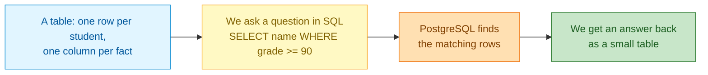
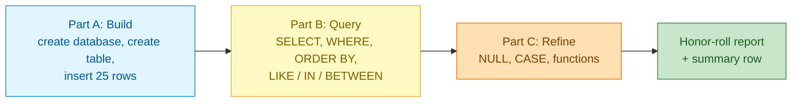
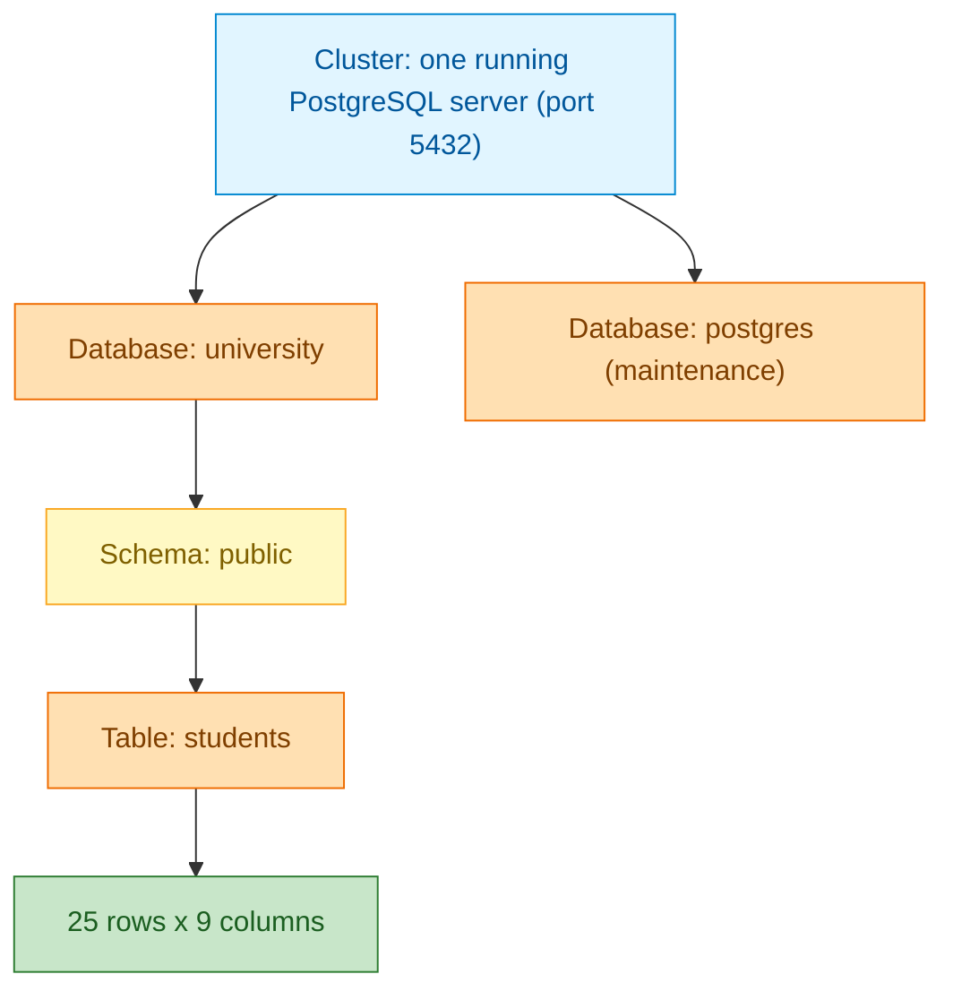
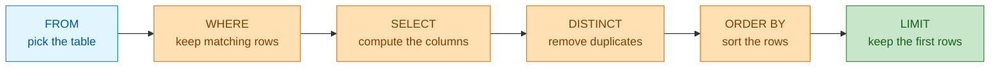
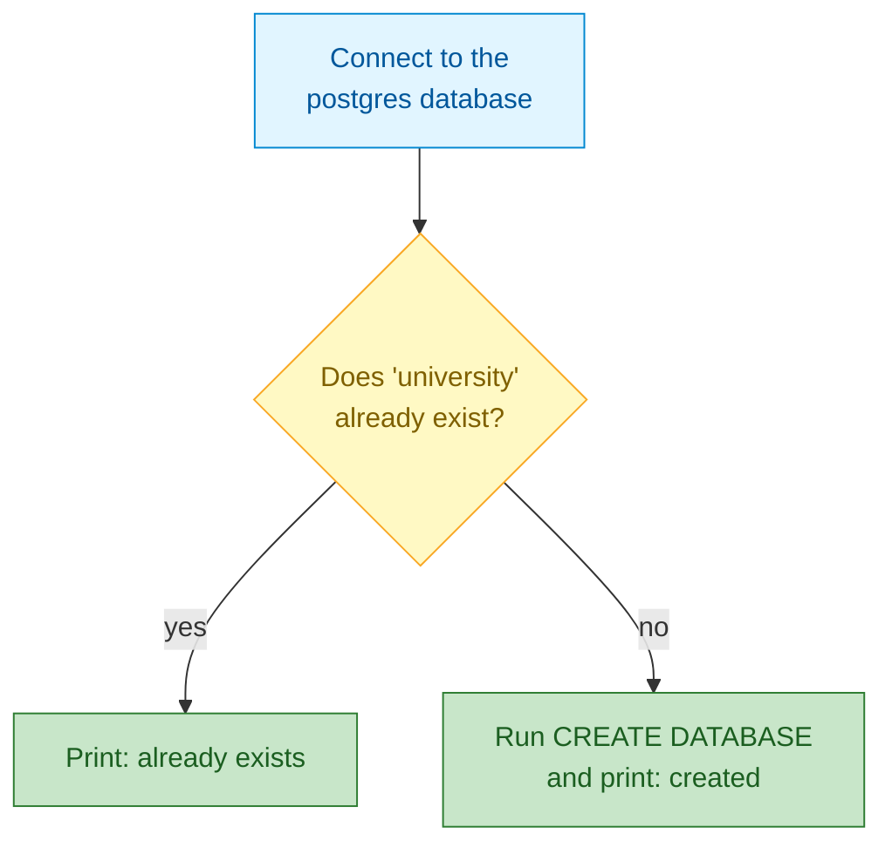
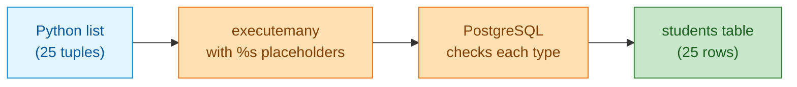
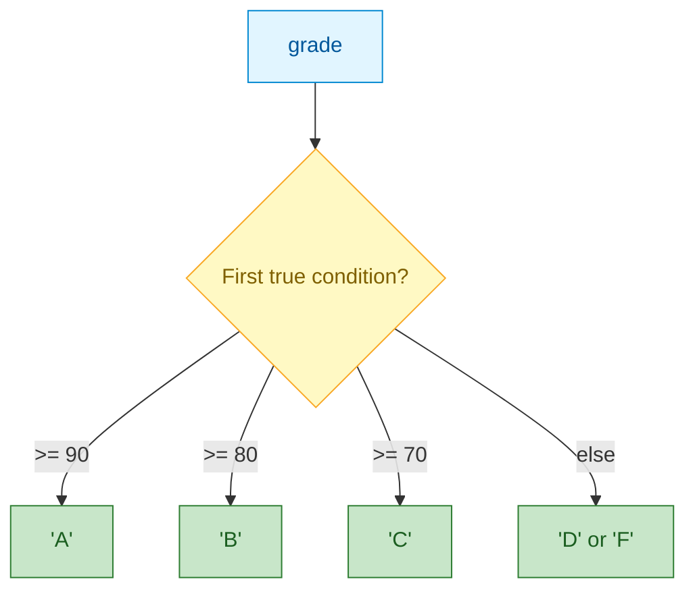

# Create Tables and Query Data

## 1. What is Structured Query Language (SQL)?

SQL is the standard way to talk to a relational database: it is the language you use to describe how data is stored and to ask questions about it. It works with **tables** of rows and columns.

- **What a table is:** a grid of rows and columns. Each *row* is one thing (one student); each *column* is one fact about every row (the grade). A relational database is simply a collection of such tables.
- **What a query is:** a question you write in SQL and send to the database — for example, "show me every student with a grade of 90 or more". The database answers with the matching rows. Creating a table and filling it with rows are also done with SQL, so SQL both *sets up* the data and *asks about* it.
- **How you use it:** you describe the result you want, and the database works out how to get it.
- **Why it matters:** almost every application — a shop, a school, a hospital — keeps its data in a database, and SQL is how people work with that data.

**SQL vs PostgreSQL.** SQL is a *standard*: one shared language that many databases understand. **PostgreSQL** (often shortened to Postgres) is one specific database program that speaks that language — think of SQL as the grammar and PostgreSQL as one fluent speaker. Postgres is free and open source, and it adds extras on top of the standard: extra data types, many built-in functions, and strong correctness features such as transactions (safe groups of changes) and strict typing. Because the core is standard, most of what you learn here also works on other databases such as MySQL or SQLite; the Postgres extras are what make it a common choice for real applications.

**Everyday example:** think of your phone's contact list. Each contact is a row; the name, phone number, and email are columns. When you type a letter to jump to a name, you are asking a question of that list. SQL is how you would ask the same question in words: *"show me every contact whose name starts with A"*.

Here is the whole loop we work inside — data sits in a table, we ask a question in SQL, and the answer comes back as another small table:



Everything else in this lesson is detail on top of that one loop.

## 2. Problem Statement / Use Case Overview

You have just joined a university as the database developer. Today there is no database at all — only a spreadsheet with 25 student records. The registrar needs answers to everyday questions: *Which students are failing? Who earns a scholarship? Whose email address is missing? What letter grade does each student get?*

In this lesson you build the `university` database from scratch, create your first table, load the 25 records, and answer those questions with SQL.

## 3. Input

25 student records, defined inside the notebook. Each record becomes one row with nine columns.

| Column | Type | Meaning |
|--------|------|---------|
| `student_id` | `TEXT` | Business key `STU001` to `STU025` |
| `name` | `TEXT` | Full name |
| `email` | `TEXT` | `first.last@university.example`; **NULL for 3 students** |
| `course` | `TEXT` | Computer Science, Mathematics, Physics, English or Biology |
| `grade` | `INTEGER` | 45 to 98; six students are below 60 |
| `enrollment_date` | `DATE` | 2024-09-01 to 2024-09-03 |
| `status` | `TEXT` | active, inactive or graduated |
| `scholarship` | `BOOLEAN` | true when grade is 90 or higher |
| `graduation_date` | `DATE` | NULL unless the student graduated (2 students) |

Sample rows (8 of 25):

| student_id | name | email | course | grade | enrollment_date | status | scholarship | graduation_date |
|---|---|---|---|---|---|---|---|---|
| STU001 | Alice Johnson | alice.johnson@university.example | Computer Science | 95 | 2024-09-01 | active | true | NULL |
| STU004 | Diana Prince | diana.prince@university.example | English | 48 | 2024-09-01 | active | false | NULL |
| STU006 | Frank Castle | NULL | Mathematics | 52 | 2024-09-01 | inactive | false | NULL |
| STU010 | Julia Child | julia.child@university.example | English | 90 | 2024-09-02 | graduated | true | 2025-06-30 |
| STU012 | Laura Palmer | NULL | Biology | 45 | 2024-09-02 | active | false | NULL |
| STU019 | Sam Wilson | sam.wilson@university.example | Physics | 98 | 2024-09-01 | active | true | NULL |
| STU022 | Vera Wang | vera.wang@university.example | Biology | 85 | 2024-09-01 | graduated | false | 2025-06-30 |
| STU025 | Yusuf Islam | yusuf.islam@university.example | Computer Science | 70 | 2024-09-01 | active | false | NULL |

The table starts with no constraints on purpose, so this lesson can stay focused on creating and reading data.

## 4. Processing



- **Part A — Build (Steps 1 to 3):** look around the server, create the `students` table with typed columns, and load all rows in one parameterized insert.
- **Part B — Query (Steps 4 to 6):** read the data with `SELECT`, filter with `WHERE`, sort and page, then use pattern, list, and range filters.
- **Part C — Refine (Steps 7 to 10):** handle `NULL` correctly, label rows with `CASE`, transform values with built-in functions, and combine everything in one report.

## 5. Output

The final report: every active student at 80 or above, formatted by SQL alone, followed by a one-row summary of the whole table.

```
student_id |    student     |      course      | grade | letter | scholarship |             contact
-----------+----------------+------------------+-------+--------+-------------+---------------------------------
STU019     | WILSON, Sam    | Physics          |    98 | A      | yes         | sam.wilson@university.example
STU001     | JOHNSON, Alice | Computer Science |    95 | A      | yes         | alice.johnson@university.example
STU024     | WARRIOR, Xena  | English          |    94 | A      | yes         | xena.warrior@university.example
STU015     | WILDE, Oscar   | Mathematics      |    93 | A      | yes         | oscar.wilde@university.example
STU007     | HOPPER, Grace  | Computer Science |    91 | A      | yes         | grace.hopper@university.example
STU005     | TORRES, Eve    | Biology          |    88 | B      | no          | eve.torres@university.example
STU017     | ADAMS, Quincy  | Computer Science |    87 | B      | no          | quincy.adams@university.example
STU009     | PETROV, Ivan   | Computer Science |    84 | B      | no          | ivan.petrov@university.example
STU013     | POLO, Marco    | Physics          |    82 | B      | no          | marco.polo@university.example
(9 rows)
```

```
students | failing | scholarships | missing_email | lowest | highest | average
---------+---------+--------------+---------------+--------+---------+--------
      25 |       6 |            6 |             3 |     45 |      98 |    75.1
(1 row)
```

## 6. Tech Stack

| Tool | Version | Role |
|------|---------|------|
| PostgreSQL | 18 | The database the lesson runs against |
| psycopg | 3.3.6 | The Python driver that sends SQL and returns rows |
| python-dotenv | 1.2.4 | Loads the connection settings from the `.env` file |
| Jupyter | any recent version | Runs the notebook |
| psql / pgAdmin | bundled with PostgreSQL | Optional command-line and graphical clients (see the cheat sheet in Section 7) |

**Compute and cost:** this lesson runs on a laptop's Central Processing Unit (CPU) using only a few megabytes of memory. No Graphics Processing Unit (GPU), no cloud account, and no paid service are needed, so a full run costs nothing. Both Python packages are free and open source.

## 7. Underlying Concepts

**Relational model.** Data lives in tables of rows and columns. A row is one thing (a student); a column is one fact about every row (the grade). SQL is the standard way to define tables and ask questions; it is *declarative*, which means you say what you want and the planner decides how to fetch it.

**Where everything lives.** PostgreSQL arranges its objects in a hierarchy: a *cluster* is one running server; a cluster hosts many *databases*; a database contains *schemas*; and a schema contains *tables*.



**Three families of SQL statements.**

| Family | Purpose | Examples in this lesson |
|--------|---------|--------------------------|
| Data Definition Language (DDL) | Create or change structures | `CREATE DATABASE`, `CREATE TABLE`, `DROP TABLE` |
| Data Manipulation Language (DML) | Change data | `INSERT` |
| Data Query Language (DQL) | Read data | `SELECT` |

**Common data types.**

| Type | Stores | Example |
|------|--------|---------|
| `INTEGER` | whole numbers (about +/- 2.1 billion) | `95` |
| `NUMERIC(p,s)` | exact decimals (money) | `9.50` |
| `TEXT` / `VARCHAR(n)` | strings (identical speed in PostgreSQL; `TEXT` has no limit) | `'Alice'` |
| `BOOLEAN` | true / false / NULL | `true` |
| `DATE`, `TIMESTAMPTZ` | calendar date; moment in time with zone | `2024-09-01` |

**How a SELECT is processed (logical order).** You *write* a query as `SELECT ... FROM ... WHERE ... ORDER BY ... LIMIT`, but PostgreSQL *evaluates* it in a different order: it starts from the `FROM` table, filters rows with `WHERE`, computes the columns and aliases in `SELECT`, removes duplicates with `DISTINCT`, sorts with `ORDER BY`, and finally trims with `LIMIT`/`OFFSET`.



That order is why an alias you define in `SELECT` can be used in `ORDER BY` but not in `WHERE`: by the time `WHERE` runs, the alias does not exist yet.

**NULL logic.** SQL uses three-valued logic: true, false, unknown. `NULL = NULL` is unknown, not true. `WHERE` keeps only rows where the condition is true, so unknown rows silently vanish. Use `IS NULL`, `IS NOT NULL` and `COALESCE`.

**Schemas and `search_path`.** A schema is a namespace inside a database. A bare name like `students` is resolved by walking the schemas in `search_path` (default `"$user", public`); `public` is where our tables live.

**Parameters (`%s`).** psycopg sends SQL text and values separately. This prevents SQL injection and lets PostgreSQL reuse plans. Identifiers (table and database names) cannot be parameters; use `psycopg.sql.Identifier` for those.

**psql and pgAdmin cheat sheet.**

| Task | psql | pgAdmin |
|------|------|---------|
| Connect | `psql -h localhost -U postgres -d university` | Register Server, enter host, port, user |
| List databases | `\l` | Servers > Databases |
| List tables | `\dt` | Databases > university > Schemas > public > Tables |
| Describe a table | `\d students` | Right-click table > Properties |
| Run a query | type SQL ending in `;` | Query Tool (Alt+Shift+Q) |
| Quit | `\q` | close the tab |

## 8. Prerequisites

- **Background:** basic Python (variables, lists, tuples). No prior SQL is needed.
- **A running server:** a PostgreSQL server you can log in to, on `localhost:5432` if you use the defaults. If you do not have one yet, install PostgreSQL 18 from the official website and start the server.
- **A settings file:** copy `.env.example` to `.env` at the course root and fill in your connection values (Section 9 explains this).
- **Hardware and cost:** any laptop CPU is enough; no Graphics Processing Unit (GPU), cloud account, or paid service is required.

## 9. Environment / Dependencies Setup

All connection settings live in **one global `.env` file at the course root** (`PGHOST`, `PGPORT`, `PGUSER`, `PGPASSWORD`, `PGDATABASE`, `PGSSLMODE`). Copy `.env.example` to `.env` and fill in your values. Every notebook loads it with `load_dotenv("../../.env")`, so Jupyter must be started from inside this lesson folder.

One command installs the Python packages, at the same pinned versions the notebook installs in its first cell:

```
pip install "psycopg[binary]==3.3.6" "python-dotenv==1.2.4"
```

Installing and starting PostgreSQL itself is a one-time step covered by the installer from the official website; `PGSSLMODE` controls Transport Layer Security (TLS) for the connection and `prefer` is a safe default for a local server.

## 10. Step-wise Development Instructions

### Setup

**Install the dependencies.** This mirrors the notebook's first cell.

```python
!pip install "psycopg[binary]==3.3.6" "python-dotenv==1.2.4"
```

This installs the two Python packages the lesson uses, at the exact versions listed in Section 6: `psycopg` (the PostgreSQL driver that sends our commands in Structured Query Language (SQL) and returns rows) and `python-dotenv` (which reads our connection settings from a `.env` file).

**Import the tools.**

```python
# Bring in the tools we need: standard-library helpers, the PostgreSQL driver
# (psycopg), its safe SQL builder (sql), and the .env loader.
import os
from decimal import Decimal

import psycopg
from psycopg import sql
from dotenv import load_dotenv
```

We import the pieces we use throughout: `os` and `Decimal` from Python's standard library, the `psycopg` driver that talks to PostgreSQL, the `sql` helper that safely quotes names, and `load_dotenv` to read our settings file.

**Load the connection settings** from the global `.env`.

```python
# Read the connection settings from the shared .env file two folders up
# (the section folder, then the course root).
load_dotenv("../../.env")

PGHOST = os.getenv("PGHOST", "localhost")
PGPORT = os.getenv("PGPORT", "5432")
PGUSER = os.getenv("PGUSER", "postgres")
PGPASSWORD = os.getenv("PGPASSWORD") or None  # an empty value means "no password"
PGDATABASE = os.getenv("PGDATABASE", "university")
PGSSLMODE = os.getenv("PGSSLMODE", "prefer")

print(f"Connecting to {PGUSER}@{PGHOST}:{PGPORT}/{PGDATABASE} (sslmode={PGSSLMODE})")
```

We load the connection details from one shared `.env` file so no password is ever written into the notebook. Each setting falls back to a sensible default (`localhost`, port `5432`, user `postgres`, database `university`), so the lesson still runs if a value is missing. The path `../../.env` goes up from this lesson folder to the section folder and then to the course root — that is why we start Jupyter from inside this lesson folder.

**Output:**

```
Connecting to postgres@localhost:5432/university (sslmode=prefer)
```

**Create the `university` database if it is missing.** A server hosts many databases, so we connect to the built-in `postgres` maintenance database first. `CREATE DATABASE` cannot run inside a transaction, which is why the connection uses `autocommit=True`. On a re-run the message changes to `Database 'university' already exists.`

```python
# Connect to the built-in `postgres` database (a server hosts many databases)
# and create our `university` database only if it doesn't exist yet.
conn_args = dict(host=PGHOST, port=PGPORT, user=PGUSER, password=PGPASSWORD, sslmode=PGSSLMODE, autocommit=True)

with psycopg.connect(dbname="postgres", **conn_args) as admin:
    exists = admin.execute("SELECT 1 FROM pg_database WHERE datname = %s", (PGDATABASE,)).fetchone()
    if exists:
        print(f"Database '{PGDATABASE}' already exists.")
    else:
        # Names can't be passed as %s values, so we quote the identifier safely.
        admin.execute(sql.SQL("CREATE DATABASE {}").format(sql.Identifier(PGDATABASE)))
        print(f"Database '{PGDATABASE}' created.")
```

This step is a small branch, so it is worth showing its shape:



- **Input:** the connection settings we just loaded, and the database name `university`.
- **What happens:** we open a connection to the `postgres` maintenance database, ask whether `university` already exists, and create it only if it does not.
- **Output:** the `university` database exists on the server, and you see a short confirmation line.
- **Why:** the notebook stays safe to re-run, and every step after this connects to `university` instead of the maintenance database.

**Output:**

```
Database 'university' created.
```

**Connect and define `show()`**, a helper that prints query results as an aligned, psql-style table.

```python
# Open the real lesson connection to the `university` database, with
# autocommit on so each statement takes effect immediately.
conn = psycopg.connect(dbname=PGDATABASE, **conn_args)


# A small helper that runs a query and prints the rows as an aligned table,
# so our output looks like a real psql session. We use it in almost every step.
def show(query, params=None):
    """Run a query and print the result as a psql-style table."""
    with conn.cursor() as cur:
        cur.execute(query, params)
        if cur.description is None:              # CREATE/INSERT return no rows
            print(cur.statusmessage)
            return
        cols = [d.name for d in cur.description]
        rows = cur.fetchall()
    fmt = lambda v: "NULL" if v is None else ("t" if v is True else "f" if v is False else str(v))
    cells = [[fmt(v) for v in r] for r in rows]
    numeric = [bool(rows) and all(v is None or (isinstance(v, (int, float, Decimal)) and not isinstance(v, bool)) for v in col)
               for col in zip(*rows)] or [False] * len(cols)
    widths = [max([len(c)] + [len(r[i]) for r in cells]) for i, c in enumerate(cols)]
    print(" | ".join(c.center(w) for c, w in zip(cols, widths)).rstrip())
    print("-+-".join("-" * w for w in widths))
    for r in cells:
        print(" | ".join(v.rjust(w) if numeric[i] else v.ljust(w) for i, (v, w) in enumerate(zip(r, widths))).rstrip())
    print(f"({len(rows)} row{'' if len(rows) == 1 else 's'})")


# Quick check that we landed in the right database.
show("SELECT current_database() AS connected_to")
```

- **Input:** a SQL query (a string) and, optionally, the values that fill its `%s` placeholders.
- **What happens:** we run the query on our connection and look at the result. If the statement returned no rows (such as `CREATE` or `INSERT`), we print the server's status message instead. Otherwise we read the column names and every row, then line them up into a fixed-width table, right-aligning numbers the way `psql` does.
- **Output:** the query result printed as a readable table, with a count of the rows.
- **Why:** it lets us spend our attention on SQL, not on formatting. Writing this once means every step below is one short `show(...)` call.

This is the one function we keep, because almost every step calls it (Section 6 lists the packages it relies on). You can run any of these queries directly in `psql` or pgAdmin and get the same rows.

**Output:**

```
connected_to
------------
university
(1 row)
```

### Step 1 — Explore the Server, Databases and Schemas

Before creating anything, we look around. PostgreSQL organizes objects as **cluster > database > schema > table**: your connection is attached to exactly one database, and tables live in a *schema* inside it — by default the schema named `public`. The `search_path` setting tells PostgreSQL which schemas to look in when you write a bare table name such as `students`.

`current_schema()` returns `public` because our `search_path` is `"$user", public` and there is no schema named after our role. Every table this lesson creates goes into `public`.

```python
# Step 1: look around the server before we create anything. Confirm which
# database, role and schema we're in, and what the search path is.
show("""
    SELECT current_database() AS database,
           current_user       AS role,
           current_schema()   AS schema
""")

show("SHOW search_path")

# List the schemas in this database, ignoring PostgreSQL's internal ones.
show("""
    SELECT nspname AS schema
    FROM pg_namespace
    WHERE nspname !~ '^pg_' AND nspname <> 'information_schema'
    ORDER BY nspname
""")
```

**Output:**

```
 database  |   role   | schema
-----------+----------+-------
university | postgres | public
(1 row)
  search_path
---------------
"$user", public
(1 row)
schema
------
public
(1 row)
```

`current_schema()` returns `public` because our `search_path` is `"$user", public` and there is no schema named after our role. Every table this lesson creates goes into `public`.

### Step 2 — Create the `students` Table

A table is a named set of rows that all share the same columns. `CREATE TABLE` lists each column with a **data type**, and PostgreSQL enforces it: you cannot store the word `abc` in an `INTEGER` column. We run `DROP TABLE IF EXISTS` first so the notebook is safe to run again and again. We deliberately add no constraints yet, to keep this first lesson focused on creating and reading data.

```python
# Step 2: create the `students` table. DROP first so re-running the notebook
# starts clean, then CREATE the table with one typed column per fact.
conn.execute("DROP TABLE IF EXISTS students")

conn.execute("""
    CREATE TABLE students (
        student_id      TEXT,      -- business key such as STU001
        name            TEXT,
        email           TEXT,      -- some students have no email on file (NULL)
        course          TEXT,
        grade           INTEGER,   -- whole number 0-100
        enrollment_date DATE,      -- a calendar date, with no time part
        status          TEXT,      -- active / inactive / graduated
        scholarship     BOOLEAN,   -- true or false
        graduation_date DATE       -- NULL until the student graduates
    )
""")
print("students table created")
```

**Output:**

```
students table created
```

Ask PostgreSQL to describe what it just built.

```python
# Ask PostgreSQL to describe the table it just built.
show("""
    SELECT ordinal_position AS pos, column_name, data_type, is_nullable
    FROM information_schema.columns
    WHERE table_schema = 'public' AND table_name = 'students'
    ORDER BY ordinal_position
""")
```

**Output:**

```
pos |   column_name   | data_type | is_nullable
----+-----------------+-----------+------------
  1 | student_id      | text      | YES
  2 | name            | text      | YES
  3 | email           | text      | YES
  4 | course          | text      | YES
  5 | grade           | integer   | YES
  6 | enrollment_date | date      | YES
  7 | status          | text      | YES
  8 | scholarship     | boolean   | YES
  9 | graduation_date | date      | YES
(9 rows)
```

`information_schema.columns` is a standard catalog view that lists every column of every table, so it is a reliable way to confirm what we built. In `psql` the same check is the one-letter command `\d students`; in pgAdmin, expand *Databases > university > Schemas > public > Tables* and right-click the table.

### Step 3 — Insert the 25 Sample Rows

```python
# Step 3: our 25 sample students. Each tuple holds the nine column values in
# order; a Python None becomes SQL NULL.
students = [
    ("STU001", "Alice Johnson", "alice.johnson@university.example", "Computer Science", 95, "2024-09-01", "active", True, None),
    ("STU002", "Bob Smith", "bob.smith@university.example", "Mathematics", 78, "2024-09-01", "active", False, None),
    ("STU003", "Charlie Brown", "charlie.brown@university.example", "Physics", 55, "2024-09-02", "active", False, None),
    ("STU004", "Diana Prince", "diana.prince@university.example", "English", 48, "2024-09-01", "active", False, None),
    ("STU005", "Eve Torres", "eve.torres@university.example", "Biology", 88, "2024-09-03", "active", False, None),
    ("STU006", "Frank Castle", None, "Mathematics", 52, "2024-09-01", "inactive", False, None),
    ("STU007", "Grace Hopper", "grace.hopper@university.example", "Computer Science", 91, "2024-09-02", "active", True, None),
    ("STU008", "Hank Pym", "hank.pym@university.example", "Physics", 73, "2024-09-01", "active", False, None),
    ("STU009", "Ivan Petrov", "ivan.petrov@university.example", "Computer Science", 84, "2024-09-03", "active", False, None),
    ("STU010", "Julia Child", "julia.child@university.example", "English", 90, "2024-09-02", "graduated", True, "2025-06-30"),
    ("STU011", "Karl Marx", "karl.marx@university.example", "Mathematics", 67, "2024-09-01", "active", False, None),
    ("STU012", "Laura Palmer", None, "Biology", 45, "2024-09-02", "active", False, None),
    ("STU013", "Marco Polo", "marco.polo@university.example", "Physics", 82, "2024-09-03", "active", False, None),
    ("STU014", "Nina Simone", "nina.simone@university.example", "English", 76, "2024-09-01", "active", False, None),
    ("STU015", "Oscar Wilde", "oscar.wilde@university.example", "Mathematics", 93, "2024-09-02", "active", True, None),
    ("STU016", "Pia Zadora", "pia.zadora@university.example", "Biology", 71, "2024-09-01", "active", False, None),
    ("STU017", "Quincy Adams", "quincy.adams@university.example", "Computer Science", 87, "2024-09-03", "active", False, None),
    ("STU018", "Rosa Parks", None, "English", 58, "2024-09-02", "inactive", False, None),
    ("STU019", "Sam Wilson", "sam.wilson@university.example", "Physics", 98, "2024-09-01", "active", True, None),
    ("STU020", "Tina Turner", "tina.turner@university.example", "Mathematics", 79, "2024-09-03", "active", False, None),
    ("STU021", "Uma Thurman", "uma.thurman@university.example", "Computer Science", 62, "2024-09-02", "active", False, None),
    ("STU022", "Vera Wang", "vera.wang@university.example", "Biology", 85, "2024-09-01", "graduated", False, "2025-06-30"),
    ("STU023", "Walt Disney", "walt.disney@university.example", "Physics", 56, "2024-09-02", "active", False, None),
    ("STU024", "Xena Warrior", "xena.warrior@university.example", "English", 94, "2024-09-03", "active", True, None),
    ("STU025", "Yusuf Islam", "yusuf.islam@university.example", "Computer Science", 70, "2024-09-01", "active", False, None),
]
```

Here is the input for the whole lesson: 25 students, one tuple per row, with the values in the same order as the table's columns. Writing `None` where a value is missing is how we say "unknown" — it becomes SQL `NULL`, which we handle properly in Step 7.

```python
# Insert all 25 rows in a single executemany call. The %s placeholders carry
# the values separately from the SQL text, so they can never be treated as code.
with conn.cursor() as cur:
    cur.executemany(
        """INSERT INTO students
           (student_id, name, email, course, grade, enrollment_date, status, scholarship, graduation_date)
           VALUES (%s, %s, %s, %s, %s, %s, %s, %s, %s)""",
        students,
    )

# Confirm the rows landed.
show("SELECT count(*) AS students_loaded FROM students")
```

- **Input:** the 25 tuples we just defined.
- **What happens:** `executemany` runs the same `INSERT` once per tuple, sending the values as parameters; PostgreSQL checks each value against its column type and stores the row.
- **Output:** 25 rows now live in the `students` table.
- **Why:** loading all rows in one call is both faster and safer than building a giant SQL string, and it keeps the data out of the SQL text.

The values never touch the SQL string — they travel alongside it:



**Output:**

```
students_loaded
---------------
             25
(1 row)
```

### Step 4 — SELECT: Choose Columns, Alias, LIMIT, DISTINCT

```python
# Step 4: read data with SELECT. Start with every column, first five rows.
show("SELECT * FROM students ORDER BY student_id LIMIT 5")
```

**Output:**

```
student_id |      name     |              email               |      course      | grade | enrollment_date | status | scholarship | graduation_date
-----------+---------------+----------------------------------+------------------+-------+-----------------+--------+-------------+----------------
STU001     | Alice Johnson | alice.johnson@university.example | Computer Science |    95 | 2024-09-01      | active | t           |            NULL
STU002     | Bob Smith     | bob.smith@university.example     | Mathematics      |    78 | 2024-09-01      | active | f           |            NULL
STU003     | Charlie Brown | charlie.brown@university.example | Physics          |    55 | 2024-09-02      | active | f           |            NULL
STU004     | Diana Prince  | diana.prince@university.example  | English          |    48 | 2024-09-01      | active | f           |            NULL
STU005     | Eve Torres    | eve.torres@university.example    | Biology          |    88 | 2024-09-03      | active | f           |            NULL
(5 rows)
```

`SELECT` reads data without changing it. `*` means "all columns". We add `ORDER BY student_id` because a table has **no guaranteed row order** — without it, the same query could return rows in any order, so we always sort to make the output repeatable. `LIMIT 5` caps the result to five rows.

```python
# Choose just the columns we care about, and rename them for the reader.
show("""
    SELECT student_id AS id, name AS student, grade AS score
    FROM students
    ORDER BY student_id
    LIMIT 5
""")
```

**Output:**

```
  id   |    student    | score
-------+---------------+------
STU001 | Alice Johnson |    95
STU002 | Bob Smith     |    78
STU003 | Charlie Brown |    55
STU004 | Diana Prince  |    48
STU005 | Eve Torres    |    88
(5 rows)
```

Naming the columns we want is clearer than `*` and slightly cheaper. `AS` renames a column in the result only — the stored data is untouched. Aliases such as `id`, `student`, and `score` make the output read better for whoever consumes it.

```python
# See which values a column really holds: DISTINCT removes duplicates.
show("SELECT DISTINCT course FROM students ORDER BY course")
show("SELECT DISTINCT status FROM students ORDER BY status")
```

**Output:**

```
     course
----------------
Biology
Computer Science
English
Mathematics
Physics
(5 rows)
  status
---------
active
graduated
inactive
(3 rows)
```

`DISTINCT` collapses the 25 rows into the unique values, which is a quick way to learn what a column actually contains without scrolling the whole table. We see five courses and three statuses.

### Step 5 — WHERE, ORDER BY, AND/OR and Pagination

```python
# Step 5: filter rows with WHERE. Failing students (below 60), lowest first.
show("""
    SELECT student_id, name, course, grade
    FROM students
    WHERE grade < 60
    ORDER BY grade, student_id
""")
```

**Output:**

```
student_id |      name     |    course   | grade
-----------+---------------+-------------+------
STU012     | Laura Palmer  | Biology     |    45
STU004     | Diana Prince  | English     |    48
STU006     | Frank Castle  | Mathematics |    52
STU003     | Charlie Brown | Physics     |    55
STU023     | Walt Disney   | Physics     |    56
STU018     | Rosa Parks    | English     |    58
(6 rows)
```

`WHERE` keeps only the rows for which a condition is true, so here we get the six students scoring below 60. Sorting by `grade` (ascending by default) and then by `student_id` puts the lowest score first and breaks any ties the same way every time.

```python
# The same filter on a text column, sorted best first with DESC.
show("""
    SELECT name, grade
    FROM students
    WHERE course = 'Computer Science'
    ORDER BY grade DESC, student_id
""")
```

**Output:**

```
     name     | grade
--------------+------
Alice Johnson |    95
Grace Hopper  |    91
Quincy Adams  |    87
Ivan Petrov   |    84
Yusuf Islam   |    70
Uma Thurman   |    62
(6 rows)
```

Text values go in single quotes (`'Computer Science'`); double quotes in SQL mean an identifier, such as a column really named `"Order"`. `DESC` sorts from high to low, so the strongest Computer Science students come first.

```python
# Combine conditions with AND / OR. Parentheses matter: AND binds tighter than OR,
# so we group the two course names before applying the other filters.
show("""
    SELECT name, course, grade, status
    FROM students
    WHERE (course = 'Mathematics' OR course = 'Physics')
      AND status = 'active'
      AND grade >= 70
    ORDER BY course, grade DESC, student_id
""")
```

**Output:**

```
    name    |    course   | grade | status
------------+-------------+-------+-------
Oscar Wilde | Mathematics |    93 | active
Tina Turner | Mathematics |    79 | active
Bob Smith   | Mathematics |    78 | active
Sam Wilson  | Physics     |    98 | active
Marco Polo  | Physics     |    82 | active
Hank Pym    | Physics     |    73 | active
(6 rows)
```

We combine conditions with `AND` and `OR`. The parentheses are not decoration: `AND` binds more tightly than `OR`, so without them the query would mean something different. Grouped this way, the condition reads "a Mathematics or Physics student who is also active and scoring at least 70".

```python
# A BOOLEAN column can be used directly as a condition: WHERE scholarship is
# true only for rows where scholarship = true.
show("SELECT name, grade FROM students WHERE scholarship ORDER BY grade DESC, student_id")
```

**Output:**

```
     name     | grade
--------------+------
Sam Wilson    |    98
Alice Johnson |    95
Xena Warrior  |    94
Oscar Wilde   |    93
Grace Hopper  |    91
Julia Child   |    90
(6 rows)
```

Because `scholarship` is a `BOOLEAN`, we can put it straight into `WHERE` — it is true only for the rows we want, and `NULL` would be treated as "not true". These six students are the scholarship holders.

```python
# Paginate with LIMIT and OFFSET: page 1 is the top five, page 2 skips five.
show("SELECT name, grade FROM students ORDER BY grade DESC, student_id LIMIT 5")
show("SELECT name, grade FROM students ORDER BY grade DESC, student_id LIMIT 5 OFFSET 5")
```

**Output:**

```
     name     | grade
--------------+------
Sam Wilson    |    98
Alice Johnson |    95
Xena Warrior  |    94
Oscar Wilde   |    93
Grace Hopper  |    91
(5 rows)
    name     | grade
-------------+------
Julia Child  |    90
Eve Torres   |    88
Quincy Adams |    87
Vera Wang    |    85
Ivan Petrov  |    84
(5 rows)
```

`LIMIT` caps the number of rows and `OFFSET` skips a number before it, together giving you pages of results. A large `OFFSET` gets slow because PostgreSQL still reads and discards the skipped rows — fine for a 25-row table, worth knowing as data grows.

```python
# The same filter, but driven by Python variables. The values travel as
# parameters, so even a hostile string is treated as plain text, not code.
course, min_grade = "Physics", 70
show("""
    SELECT name, grade
    FROM students
    WHERE course = %s AND grade >= %s
    ORDER BY grade DESC, student_id
""", (course, min_grade))
```

**Output:**

```
   name    | grade
-----------+------
Sam Wilson |    98
Marco Polo |    82
Hank Pym   |    73
(3 rows)
```

Here the values come from Python variables and are passed as parameters with `%s`, not pasted into the string. psycopg sends the SQL text and the values separately, so a value like `"x'; DROP TABLE students; --"` would simply be an unmatched text value. This is how we avoid SQL injection, the trick of hiding commands inside data.

### Step 6 — Pattern and Range Filters: LIKE, ILIKE, IN, BETWEEN

```python
# Step 6: pattern matching. LIKE is case-sensitive; ILIKE ignores case.
# '%' matches any run of characters, '_' matches exactly one.
show("SELECT name FROM students WHERE name LIKE 'A%' ORDER BY name")
show("SELECT name FROM students WHERE name ILIKE '%AN%' ORDER BY name")
```

**Output:**

```
     name
-------------
Alice Johnson
(1 row)
    name
------------
Diana Prince
Frank Castle
Hank Pym
Ivan Petrov
Uma Thurman
Vera Wang
(6 rows)
```

`LIKE` matches a text pattern, where `%` stands for any run of characters and `_` stands for exactly one. `ILIKE` is the case-insensitive version (a PostgreSQL extension). So `'A%'` finds names starting with a capital A, and `'%AN%'` finds any name containing "an" in any letter case.

```python
# IN is a tidy replacement for a chain of ORs.
show("""
    SELECT name, course, status
    FROM students
    WHERE course IN ('Biology', 'English')
      AND status IN ('inactive', 'graduated')
    ORDER BY name
""")
```

**Output:**

```
    name    |  course |   status
------------+---------+----------
Julia Child | English | graduated
Rosa Parks  | English | inactive
Vera Wang   | Biology | graduated
(3 rows)
```

`IN (...)` checks whether a value is one of a short list and reads more cleanly than `course = 'Biology' OR course = 'English'`. Combined with the status filter, we get Biology or English students who are no longer active.

```python
# BETWEEN is inclusive on both ends, and works for numbers and dates alike.
show("SELECT name, grade FROM students WHERE grade BETWEEN 70 AND 79 ORDER BY grade, student_id")
show("""
    SELECT count(*) AS enrolled_sep_2_or_3
    FROM students
    WHERE enrollment_date BETWEEN '2024-09-02' AND '2024-09-03'
""")
```

**Output:**

```
    name    | grade
------------+------
Yusuf Islam |    70
Pia Zadora  |    71
Hank Pym    |    73
Nina Simone |    76
Bob Smith   |    78
Tina Turner |    79
(6 rows)
enrolled_sep_2_or_3
-------------------
                 14
(1 row)
```

`BETWEEN a AND b` includes both endpoints, so a grade of exactly 70 or exactly 79 is returned, and it works for dates too. One caution: for a column that stores a time of day, `BETWEEN day_start AND day_end` can drop the last day's later rows — prefer `>= start AND < next_day`.

### Step 7 — NULL: The Value That Means "Unknown"

`NULL` means *no value / unknown* — it is not zero and not an empty string. SQL uses three-valued logic (true, false, unknown), and `WHERE` keeps only rows that are true. Because `email = NULL` evaluates to *unknown* rather than true, that query silently returns nothing; the right test is `IS NULL`. Three students (STU006, STU012, STU018) have no email on file.

```python
# Step 7: NULL handling. IS NULL finds missing values; "= NULL" finds nothing.
show("SELECT student_id, name FROM students WHERE email IS NULL ORDER BY student_id")
# The trap: "= NULL" is never true, so this returns no rows even though three do.
show("SELECT student_id, name FROM students WHERE email = NULL")
```

**Output:**

```
student_id |     name
-----------+-------------
STU006     | Frank Castle
STU012     | Laura Palmer
STU018     | Rosa Parks
(3 rows)
student_id | name
-----------+-----
(0 rows)
```

Because `email = NULL` evaluates to *unknown* rather than true, that query silently returns nothing; the right test is `IS NULL`. The same three rows appear correctly only when we compare with `IS NULL`.

```python
# count(*) counts rows; count(column) counts only non-NULL values, so the
# difference tells us how many emails are missing. COALESCE supplies a default.
show("SELECT count(*) AS total_rows, count(email) AS with_email FROM students")

show("""
    SELECT student_id, name, COALESCE(email, 'no email on file') AS contact
    FROM students
    WHERE student_id IN ('STU005', 'STU006', 'STU012')
    ORDER BY student_id
""")
```

**Output:**

```
total_rows | with_email
-----------+-----------
        25 |         22
(1 row)
student_id |     name     |            contact
-----------+--------------+------------------------------
STU005     | Eve Torres   | eve.torres@university.example
STU006     | Frank Castle | no email on file
STU012     | Laura Palmer | no email on file
(3 rows)
```

`count(*)` counts rows, while `count(email)` counts only the rows where the email is not `NULL` — 25 versus 22, so three are missing. `COALESCE(email, 'no email on file')` returns the email when it exists and the fallback text when it does not, which is how we show a friendly default instead of a blank.

### Step 8 — CASE: If/Else Inside a Query

```python
# Step 8: label rows on the fly with CASE. Conditions are checked top to bottom,
# and the first match wins, so we list the strictest condition first.
show("""
    SELECT name, grade,
           CASE
               WHEN grade >= 90 THEN 'A'
               WHEN grade >= 80 THEN 'B'
               WHEN grade >= 70 THEN 'C'
               WHEN grade >= 60 THEN 'D'
               ELSE 'F'
           END AS letter
    FROM students
    ORDER BY grade DESC, student_id
    LIMIT 10
""")
```

**Output:**

```
     name     | grade | letter
--------------+-------+-------
Sam Wilson    |    98 | A
Alice Johnson |    95 | A
Xena Warrior  |    94 | A
Oscar Wilde   |    93 | A
Grace Hopper  |    91 | A
Julia Child   |    90 | A
Eve Torres    |    88 | B
Quincy Adams  |    87 | B
Vera Wang     |    85 | B
Ivan Petrov   |    84 | B
(10 rows)
```

- **Input:** every student's `grade` value.
- **What happens:** `CASE` checks the conditions from top to bottom and returns the value next to the first one that is true; `END` closes the expression, and `ELSE` covers everything left over.
- **Output:** a new `letter` column that appears only in the result — the stored grades are unchanged.
- **Why:** it lets us present data in a human-friendly form without adding or altering any columns.

Order matters: `>= 90` must be tested before `>= 80`, or a score of 95 would match the wrong branch.



```python
# The simple form "CASE column WHEN value" compares one column for equality,
# which reads nicely when the branches are exact matches.
show("""
    SELECT name, grade,
           CASE WHEN grade >= 60 THEN 'pass' ELSE 'fail' END AS result,
           CASE status WHEN 'active' THEN 'Enrolled'
                       WHEN 'inactive' THEN 'On leave'
                       ELSE 'Alumnus' END AS standing
    FROM students
    ORDER BY grade, student_id
    LIMIT 8
""")
```

**Output:**

```
     name     | grade | result | standing
--------------+-------+--------+---------
Laura Palmer  |    45 | fail   | Enrolled
Diana Prince  |    48 | fail   | Enrolled
Frank Castle  |    52 | fail   | On leave
Charlie Brown |    55 | fail   | Enrolled
Walt Disney   |    56 | fail   | Enrolled
Rosa Parks    |    58 | fail   | On leave
Uma Thurman   |    62 | pass   | Enrolled
Karl Marx     |    67 | pass   | Enrolled
(8 rows)
```

There are two forms of `CASE`. The searched form (`CASE WHEN condition THEN ...`) tests full conditions, as above. The simple form (`CASE status WHEN 'active' THEN ...`) compares one column against exact values. If no branch matches and there is no `ELSE`, the result is `NULL`, so it is good practice to always add an `ELSE`.

### Step 9 — Everyday Functions: Text, Math, Dates and Casts

```python
# Step 9: everyday built-in functions. Text first: upper, length, split_part,
# and '||' to glue strings together.
show("""
    SELECT upper(name)                AS name_upper,
           length(name)               AS chars,
           split_part(name, ' ', 1)    AS first_name,
           split_part(name, ' ', 2) || ', ' || split_part(name, ' ', 1) AS last_first
    FROM students
    ORDER BY student_id
    LIMIT 5
""")
```

**Output:**

```
  name_upper  | chars | first_name |   last_first
--------------+-------+------------+---------------
ALICE JOHNSON |    13 | Alice      | Johnson, Alice
BOB SMITH     |     9 | Bob        | Smith, Bob
CHARLIE BROWN |    13 | Charlie    | Brown, Charlie
DIANA PRINCE  |    12 | Diana      | Prince, Diana
EVE TORRES    |    10 | Eve        | Torres, Eve
(5 rows)
```

PostgreSQL ships with hundreds of built-in functions. `upper` uppercases text, `length` counts characters, `split_part(name, ' ', 1)` returns the first word (the first name), and `||` joins strings together — here flipping "Alice Johnson" into "Johnson, Alice".

```python
# Math and casting. Beware integer division: 95 / 10 is 9, not 9.5.
show("""
    SELECT 95 / 10                      AS integer_division,
           95 / 10.0                    AS numeric_division,
           round(95 / 10.0, 1)          AS rounded,
           95::numeric / 10             AS cast_shortcut,
           CAST('42' AS integer) + 1    AS text_to_int
""")
```

**Output:**

```
integer_division |  numeric_division  | rounded |   cast_shortcut    | text_to_int
-----------------+--------------------+---------+--------------------+------------
               9 | 9.5000000000000000 |     9.5 | 9.5000000000000000 |          43
(1 row)
```

When both sides of a division are integers, PostgreSQL does integer division and truncates the fraction — `95 / 10` is `9`. Making one side `numeric` (or writing `95::numeric`, the short cast) keeps the decimals, and `round(value, 1)` trims them to one place. The two spellings — `::numeric` and `CAST('42' AS integer)` — do the same job: convert a value from one type to another.

```python
# Dates: add days, subtract dates to get a number of days, format and extract
# parts. (We avoid current_date/now() so the output stays repeatable.)
show("""
    SELECT name,
           enrollment_date,
           enrollment_date + 30                         AS plus_30_days,
           to_char(enrollment_date, 'DD Mon YYYY')       AS pretty,
           extract(dow FROM enrollment_date)            AS weekday_no,
           graduation_date - enrollment_date            AS days_to_graduate
    FROM students
    WHERE status = 'graduated'
    ORDER BY student_id
""")
```

**Output:**

```
    name    | enrollment_date | plus_30_days |    pretty   | weekday_no | days_to_graduate
------------+-----------------+--------------+-------------+------------+-----------------
Julia Child | 2024-09-02      | 2024-10-02   | 02 Sep 2024 |          1 |              301
Vera Wang   | 2024-09-01      | 2024-10-01   | 01 Sep 2024 |          0 |              302
(2 rows)
```

Adding a whole number to a `DATE` moves it forward that many days; subtracting two dates gives an integer number of days. `to_char` formats a date as text, and `extract` pulls out one part — here `dow` (day of week), which numbers Sunday as 0. We use a fixed `enrollment_date` instead of `current_date` so the output is the same every time you run it.

### Step 10 — Putting It Together: The Honor-Roll Report

```python
# Step 10: put it all together. One query that uses column expressions,
# COALESCE, CASE, WHERE with AND and BETWEEN, ORDER BY and LIMIT.
show("""
    SELECT student_id,
           upper(split_part(name, ' ', 2)) || ', ' || split_part(name, ' ', 1) AS student,
           course,
           grade,
           CASE WHEN grade >= 90 THEN 'A' ELSE 'B' END AS letter,
           CASE WHEN scholarship THEN 'yes' ELSE 'no' END AS scholarship,
           COALESCE(email, 'no email on file') AS contact
    FROM students
    WHERE status = 'active' AND grade BETWEEN 80 AND 100
    ORDER BY grade DESC, student_id
    LIMIT 10
""")
```

**Output:**

```
student_id |    student     |      course      | grade | letter | scholarship |             contact
-----------+----------------+------------------+-------+--------+-------------+---------------------------------
STU019     | WILSON, Sam    | Physics          |    98 | A      | yes         | sam.wilson@university.example
STU001     | JOHNSON, Alice | Computer Science |    95 | A      | yes         | alice.johnson@university.example
STU024     | WARRIOR, Xena  | English          |    94 | A      | yes         | xena.warrior@university.example
STU015     | WILDE, Oscar   | Mathematics      |    93 | A      | yes         | oscar.wilde@university.example
STU007     | HOPPER, Grace  | Computer Science |    91 | A      | yes         | grace.hopper@university.example
STU005     | TORRES, Eve    | Biology          |    88 | B      | no          | eve.torres@university.example
STU017     | ADAMS, Quincy  | Computer Science |    87 | B      | no          | quincy.adams@university.example
STU009     | PETROV, Ivan   | Computer Science |    84 | B      | no          | ivan.petrov@university.example
STU013     | POLO, Marco    | Physics          |    82 | B      | no          | marco.polo@university.example
(9 rows)
```

This is the report the registrar wanted: active students scoring 80 or above, with names reformatted "Last, First", a letter grade, a readable scholarship flag, and a contact that never shows a blank. Every piece — `split_part`, `||`, `CASE`, `COALESCE`, `WHERE`, `BETWEEN`, `ORDER BY`, `LIMIT` — is something we met earlier in the lesson. `LIMIT 10` is only a safety cap here.

```python
# A one-row summary of the whole table using aggregate functions.
show("""
    SELECT count(*)                                         AS students,
           sum(CASE WHEN grade < 60 THEN 1 ELSE 0 END)      AS failing,
           sum(CASE WHEN scholarship THEN 1 ELSE 0 END)     AS scholarships,
           count(*) - count(email)                          AS missing_email,
           min(grade)                                       AS lowest,
           max(grade)                                       AS highest,
           round(avg(grade), 1)                             AS average
    FROM students
""")
```

**Output:**

```
students | failing | scholarships | missing_email | lowest | highest | average
---------+---------+--------------+---------------+--------+---------+--------
      25 |       6 |            6 |             3 |     45 |      98 |    75.1
(1 row)
```

`count`, `sum`, `min`, `max`, and `avg` summarize many rows into one. We use `sum(CASE WHEN ... THEN 1 ELSE 0 END)` as a counting trick: the `CASE` gives 1 for rows that match and 0 for the rest, and `sum` adds them up. `count(*) - count(email)` gives the number of missing emails.

### Cleanup — Close the Connection

```python
# Finally, close the connection. The table stays in the database for you to use.
conn.close()
print("connection closed")
```

**Output:**

```
connection closed
```

Closing the connection frees the server resources we were holding. The `students` table itself stays in the `university` database, so you can reconnect and keep querying it whenever you like.


## 11. What We Learnt

- PostgreSQL organizes data as cluster > database > schema > table, and `search_path` decides where a bare table name is looked up.
- `CREATE TABLE` defines typed columns and the server enforces those types; `INSERT` with `%s` parameters loads rows safely.
- `SELECT` with `WHERE`, `ORDER BY`, `LIMIT`/`OFFSET` and `DISTINCT` answers most everyday questions — and PostgreSQL evaluates `FROM` before `WHERE` before `SELECT`, which is why a `SELECT` alias works in `ORDER BY` but not in `WHERE`.
- `LIKE`/`ILIKE`, `IN` and `BETWEEN` make filters short and readable.
- `NULL` means unknown: use `IS NULL`/`IS NOT NULL`, reach for `COALESCE` for a default, and remember `count(column)` skips `NULL`s.
- `CASE` labels rows on the fly, and built-in functions handle text, math, dates and casts.
- Everything ran inside one connection to the `university` database, and the `students` table stays there for you to keep working with.
