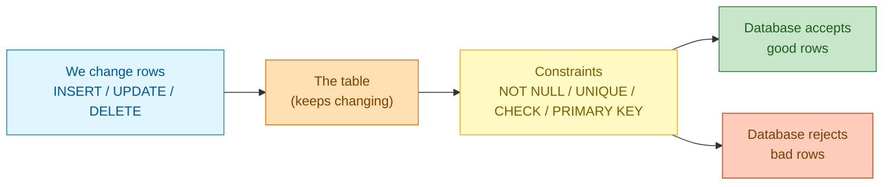
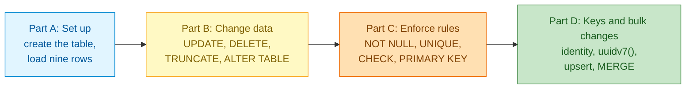
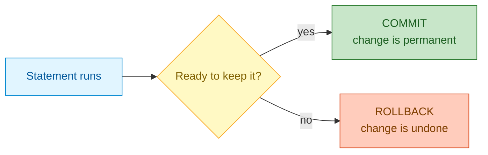
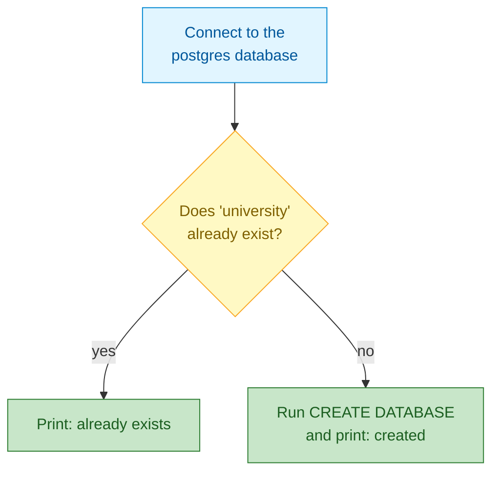
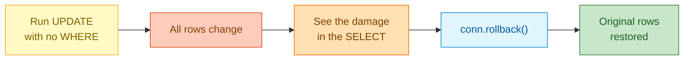
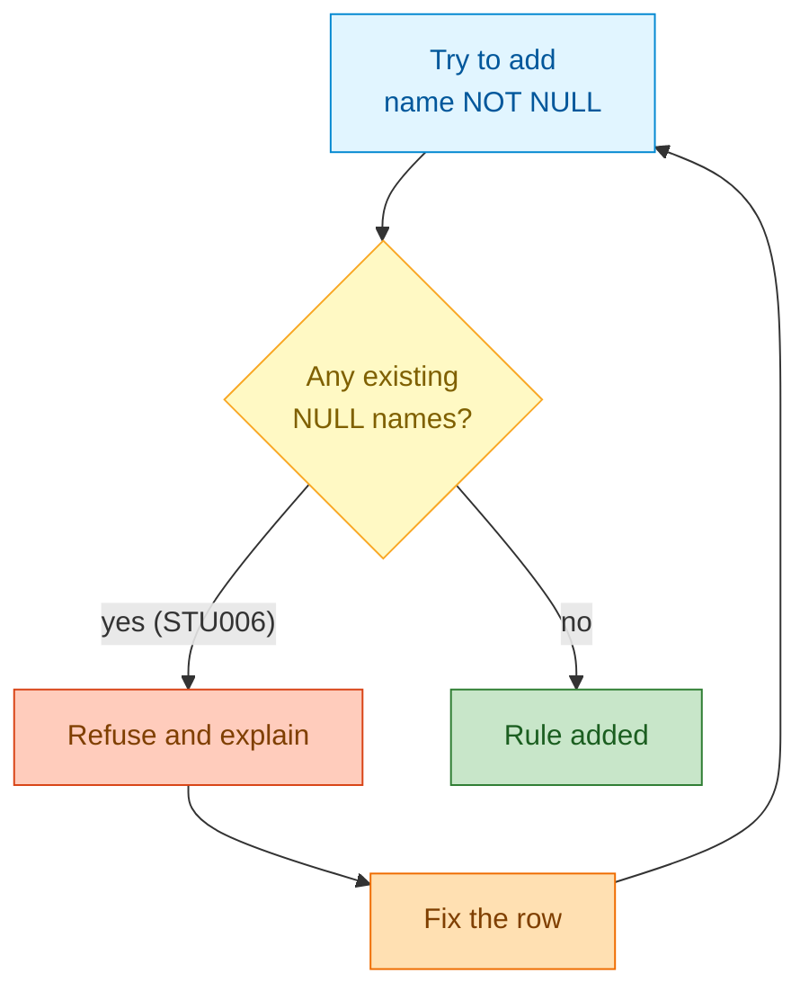
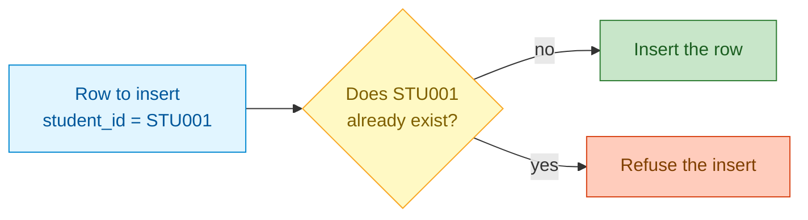

# Update Data and Enforce Constraints
## 1. What are Data Changes and Constraints?

A database is not a read-only snapshot — its data changes all day long, and mistakes creep in with the changes. This lesson is about the two halves of that problem: changing rows on purpose, and making the database itself reject bad changes.

- **Changing data:** `INSERT`, `UPDATE`, and `DELETE` add, change, and remove rows. These are everyday operations — a grade gets corrected, a student withdraws, a new enrollment arrives.
- **Constraints:** rules that live inside the table. Once a rule exists, PostgreSQL enforces it for *every* writer — your notebook, a web app, or a colleague at a `psql` prompt.
- **Why both matter:** a change is only as good as the data it leaves behind. Changing rows quickly is worthless if the table quietly fills up with duplicates, blanks, and impossible values.

**Everyday example:** think of a shared household budget spreadsheet. You fix a mistyped amount (a change), and you add a rule that every entry must have a date (a constraint). The change corrects today's mistake; the rule prevents tomorrow's.

Here is the whole idea in one picture — we change rows ourselves, and we hand the rules to the database so it guards them for us:



## 2. Problem Statement / Use Case Overview

You are the database developer for a university. A colleague has just imported the student records from a spreadsheet, and the mess is obvious: one student has no name, two students share the same email address, and one grade reads 120 on an exam marked out of 100. On top of that, the registrar keeps asking for changes — a corrected grade here, a withdrawn student removed there — and wants a place to record each student's advisor.

In this lesson you take that messy table and make it trustworthy. You will change rows carefully, learn how to undo a mistake, and then add rules so the database refuses bad data even when a program slips up.

## 3. Input

Nine student records, defined inside the notebook. Each record becomes one row with six columns.

| Column | Type | Meaning |
|--------|------|---------|
| `student_id` | `TEXT` | Business key `STU001` to `STU009` |
| `name` | `TEXT` | Full name; **NULL for one student** |
| `email` | `TEXT` | `first.last@university.example`; **NULL for one student, and shared by two others** |
| `course` | `TEXT` | Computer Science, Mathematics, Physics, English, or Biology |
| `grade` | `INTEGER` | 48 to 95 — except one deliberate 120 |
| `status` | `TEXT` | active, inactive, or withdrawn |

Sample rows, including the three problems:

| student_id | name | email | course | grade | status |
|---|---|---|---|---|---|
| STU006 | NULL | frank.castle@university.example | Mathematics | 52 | inactive |
| STU007 | Grace Hopper | grace.hopper@university.example | Computer Science | **120** | active |
| STU008 | Hank Pym | grace.hopper@university.example | Physics | 73 | active |
| STU009 | Zoe Quinn | zoe.quinn@university.example | Biology | 91 | withdrawn |

The blank name, the copied email, and the out-of-range grade are deliberate. They are exactly the data the constraints in this lesson are designed to catch.

## 4. Processing



- **Part A — Set up (Steps 1 to 2):** create the `students` table and load nine rows, three of which are deliberately messy.
- **Part B — Change data (Steps 3 to 7):** correct a grade with `UPDATE ... RETURNING`, see why a missing `WHERE` is dangerous, delete a row, empty a table with `TRUNCATE`, and add a column with `ALTER TABLE`.
- **Part C — Enforce rules (Steps 8 to 11):** add `NOT NULL`, `UNIQUE`, and `CHECK` constraints — each one catching a real problem in the data — then add a `PRIMARY KEY`.
- **Part D — Keys and bulk changes (Steps 12 to 15):** build identity and time-ordered keys, then reconcile data with an upsert and a `MERGE`.
- **Finish (Step 16):** look at the finished, protected table and summarize it.

## 5. Output

After all sixteen steps, the `students` table is clean, typed, and guarded by four rules. The first query lists every row; the second folds them into a one-row summary:

```
student_id |      name     |              email               |      course      | grade |  status  |  advisor
-----------+---------------+----------------------------------+------------------+-------+----------+-----------
STU001     | Alice Johnson | alice.johnson@university.example | Computer Science |    95 | active   | Dr. Ada
STU002     | Bob Smith     | bob.smith@university.example     | Mathematics      |    81 | active   | Dr. Nash
STU003     | Charlie Brown | charlie.brown@university.example | Physics          |    65 | active   | Dr. Curie
STU004     | Diana Prince  | diana.prince@university.example  | English          |    71 | active   | Dr. Wells
STU005     | Eve Torres    | NULL                             | Biology          |    88 | active   | Dr. Darwin
STU006     | Frank Castle  | frank.castle@university.example  | Mathematics      |    52 | inactive | Dr. Nash
STU007     | Grace Hopper  | grace.hopper@university.example  | Computer Science |    82 | active   | Dr. Ada
STU008     | Hank Pym      | hank.pym@university.example      | Physics          |    73 | active   | Dr. Curie
STU010     | Ivan Petrov   | NULL                             | Physics          |    67 | active   | NULL
(9 rows)
students | with_email | lowest | highest | average
---------+------------+--------+---------+--------
       9 |          7 |     52 |      95 |    74.9
(1 row)
```

Two more tables were created along the way. `enrollments` is keyed by an identity column, so its ids are numbered automatically:

```
enrollment_id | student_id |   course   | enrolled_on
--------------+------------+------------+------------
            1 | STU001     | Databases  | 2025-09-01
            2 | STU002     | Databases  | 2025-09-01
            3 | STU003     | Algorithms | 2025-09-02
(3 rows)
```

`events` is keyed by a `uuidv7()` identifier, whose ids sort in creation order:

```
              event_id               |      message
-------------------------------------+------------------
01a1488d-216e-7f16-b397-041646affcc4 | table created
01a1488d-216f-71e0-bc08-de0d3836788b | constraints added
(2 rows)
```

## 6. Tech Stack

| Tool | Version | Role |
|------|---------|------|
| PostgreSQL | 18 | The database the lesson runs against |
| psycopg | 3.3.6 | The Python driver that talks to PostgreSQL and returns rows |
| python-dotenv | 1.2.4 | Loads the connection settings from the `.env` file |
| Jupyter | any recent version | Runs the notebook |
| psql / pgAdmin | bundled with PostgreSQL | Optional command-line and graphical clients |

**Compute and cost:** this lesson runs on a laptop's Central Processing Unit (CPU) using only a few megabytes of memory. No Graphics Processing Unit (GPU), no cloud account, and no paid service are needed, so a full run costs nothing. Both Python packages are free and open source. PostgreSQL 18 is required for `uuidv7()`; on an older server, replace it with `gen_random_uuid()`.

## 7. Underlying Concepts

**Changing data versus changing structure.** `INSERT`, `UPDATE`, and `DELETE` change the *rows* inside a table. `ALTER TABLE` changes the table's *shape* — its columns and rules. Both are wrapped in the same transaction machinery, so both can be undone before you commit. *Everyday example:* rearranging the furniture in a room changes what is in it, while knocking through a new doorway changes the room itself.

**Transactions and commits.** PostgreSQL groups your statements into a **transaction** — a unit of work that either all takes effect or none does. With autocommit off, nothing is final until you call `COMMIT`; `ROLLBACK` throws the whole transaction away. This is the safety net we used to survive a filterless `UPDATE`. *Everyday example:* a bank transfer — the money leaves one account and arrives in the other, or neither happens; it is never half-done.



**The four constraints we meet.** A constraint is a rule the database enforces on every write:

| Constraint | It guarantees | Breaks if |
|-----------|----------------|-----------|
| `NOT NULL` | the column always has a value | a row is written with no value |
| `UNIQUE` | no two rows share a value | a duplicate value is inserted |
| `CHECK` | every row satisfies a condition | a row fails the test |
| `PRIMARY KEY` | the column(s) identify a row | a key is missing or repeated |

A primary key is simply `NOT NULL` and `UNIQUE` combined — one column, or a few, chosen as the row's permanent identity. *Everyday example:* a paper enrolment form with boxes that must be filled in (`NOT NULL`), a rule that no two students share an ID (`UNIQUE`), and a rule that an age has to be a realistic number (`CHECK`).

**Keys you generate.** A **primary key** can be a value you choose (like `student_id`), a number the server counts out for you (`GENERATED ALWAYS AS IDENTITY`), or a globally unique identifier — a **Universally Unique Identifier (UUID)**, for example one from `uuidv7()`. Identity suits a single database; UUIDs suit rows created in many places at once. `uuidv7()` puts the time first, so ids still sort in creation order. *Everyday example:* a library hands each loan a running ticket number (identity), while a parcel gets a globally unique tracking code that no other parcel anywhere shares (UUID).

**Reconciling data.** An **upsert** (`INSERT ... ON CONFLICT`) handles one row: insert it, or update it if the key exists. `MERGE` does the same job for a whole batch, comparing a source list against the target table and choosing update or insert per row. *Everyday example:* updating a contacts list — if the person is already there, their number is corrected; if they are new, they are added; `MERGE` is doing that for a whole address book at once.

**`DELETE` versus `TRUNCATE`.** `DELETE ... WHERE` removes the rows you name and writes a log of each removal, so it can be rolled back row by row. `TRUNCATE` clears the entire table in one sweep and is much faster on large tables, but it cannot be aimed at some rows. *Everyday example:* tearing specific pages out of a notebook (`DELETE`) versus throwing the whole notebook away and starting a fresh one (`TRUNCATE`).

**Where everything lives.** PostgreSQL arranges its objects in a hierarchy: a *cluster* is one running server, a cluster hosts many *databases*, a database contains *schemas*, and a schema contains *tables*. Our table lives at `university > public > students`.

## 8. Prerequisites

- **Background:** basic Python (variables, lists, tuples) and the ability to read a simple `SELECT`/`INSERT`. If you are new to writing queries, practise those two first.
- **A running server:** a PostgreSQL server you can log in to, version 18 or newer, on `localhost:5432` if you use the defaults. (Version 18 is needed for `uuidv7()`.) If you do not have one yet, install PostgreSQL 18 from the official website and start the server.
- **A settings file:** copy `.env.example` to `.env` at the course root and fill in your connection values (Section 9 explains this).
- **Hardware and cost:** any laptop CPU is enough; no Graphics Processing Unit (GPU), cloud account, or paid service is required.

## 9. Environment / Dependencies Setup

All connection settings live in **one global `.env` file at the course root** (`PGHOST`, `PGPORT`, `PGUSER`, `PGPASSWORD`, `PGDATABASE`, `PGSSLMODE`). Copy `.env.example` to `.env` and fill in your values. Every notebook loads it with `load_dotenv("../../.env")`, so Jupyter must be started from inside this lesson folder.

One command installs the Python packages, at the same pinned versions the notebook installs in its first cell:

```
pip install "psycopg[binary]==3.3.6" "python-dotenv==1.2.4"
```

Installing and starting PostgreSQL itself is a one-time step covered by the installer from the official website; `PGSSLMODE` controls Transport Layer Security (TLS) for the connection and `prefer` is a safe default for a local server.

## 10. Step-wise Development Instructions

### Setup

```python
!pip install "psycopg[binary]==3.3.6" "python-dotenv==1.2.4"
```

This installs the two Python packages this lesson uses, at the exact versions listed in Section 6: `psycopg` (the PostgreSQL driver that sends our commands in Structured Query Language (SQL) and returns rows) and `python-dotenv` (which reads our connection settings from a `.env` file).

```python
# Bring in the tools we need: standard-library helpers, the PostgreSQL
# driver (psycopg), its safe SQL builder (sql), and the .env loader.
import os
from decimal import Decimal

import psycopg
from psycopg import sql
from dotenv import load_dotenv
```

We import the pieces we use throughout: `os` and `Decimal` from Python's standard library, the `psycopg` driver that talks to PostgreSQL, the `sql` helper that safely quotes names, and `load_dotenv` to read our settings file.

```python
# Read the connection settings from the shared .env file two folders up
# (the lesson folder, then the section folder, then the course root).
load_dotenv("../../.env")

PGHOST = os.getenv("PGHOST", "localhost")
PGPORT = os.getenv("PGPORT", "5432")
PGUSER = os.getenv("PGUSER", "postgres")
PGPASSWORD = os.getenv("PGPASSWORD") or None  # an empty value means "no password"
PGDATABASE = os.getenv("PGDATABASE", "university")
PGSSLMODE = os.getenv("PGSSLMODE", "prefer")

print(f"Connecting to {PGUSER}@{PGHOST}:{PGPORT}/{PGDATABASE} (sslmode={PGSSLMODE})")
```

We load the connection details from one shared `.env` file so no password is ever written into the notebook. Each setting falls back to a sensible default (`localhost`, port `5432`, user `postgres`, database `university`), so the lesson still runs if a value is missing. The path `../../.env` goes up from this lesson folder to the section folder and then to the course root — that is why we start Jupyter from inside this lesson folder.

**Output:**

```
Connecting to postgres@localhost:5432/university (sslmode=prefer)
```

```python
# Connect to the built-in `postgres` database (a server hosts many databases)
# and create our `university` database only if it doesn't exist yet.
# CREATE DATABASE can't run inside a transaction, so this connection autocommits.
conn_args = dict(host=PGHOST, port=PGPORT, user=PGUSER, password=PGPASSWORD, sslmode=PGSSLMODE)

with psycopg.connect(dbname="postgres", autocommit=True, **conn_args) as admin:
    exists = admin.execute("SELECT 1 FROM pg_database WHERE datname = %s", (PGDATABASE,)).fetchone()
    if exists:
        print(f"Database '{PGDATABASE}' already exists.")
    else:
        # Names can't be passed as %s values, so we quote the identifier safely.
        admin.execute(sql.SQL("CREATE DATABASE {}").format(sql.Identifier(PGDATABASE)))
        print(f"Database '{PGDATABASE}' created.")
```

This lesson starts you with a working database, so it makes sure one exists before we go any further; if you already have `university` from earlier work, this step simply says so and moves on.

The check-and-create is a small branch:



- **Input:** the connection settings we just loaded, and the database name `university`.
- **What happens:** we open a connection to the `postgres` maintenance database, ask whether `university` already exists, and create it only if it does not.
- **Output:** the `university` database exists on the server, and you see a short confirmation line.
- **Why:** the notebook stays safe to re-run, and every step after this connects to `university` instead of the maintenance database.

**Output:**

```
Database 'university' already exists.
```

```python
# Open the lesson connection to `university`. We leave autocommit OFF (the
# default) so we can group changes into a transaction and undo them if we need to.
conn = psycopg.connect(dbname=PGDATABASE, **conn_args)
print(f"Connected to {PGDATABASE}")
```

Here we open the connection the rest of the lesson uses. Unlike the short-lived connection above, this one has **autocommit off**, which means our changes are not saved until we say `conn.commit()`. That pauses the clock after each change, so we can inspect it — or throw it away with `conn.rollback()`. We use that safety net in Step 4 to undo a mistake on purpose.

**Output:**

```
Connected to university
```

```python
# A small helper that runs a query and prints the rows as an aligned table,
# so our output looks like a real psql session. We use it in almost every step.
def show(query, params=None):
    """Run a query and print the result as a psql-style table."""
    with conn.cursor() as cur:
        cur.execute(query, params)
        if cur.description is None:              # INSERT/UPDATE/DELETE return no rows
            print(cur.statusmessage)
            return
        cols = [d.name for d in cur.description]
        rows = cur.fetchall()
    fmt = lambda v: "NULL" if v is None else ("t" if v is True else "f" if v is False else str(v))
    cells = [[fmt(v) for v in r] for r in rows]
    numeric = [bool(rows) and all(v is None or (isinstance(v, (int, float, Decimal)) and not isinstance(v, bool)) for v in col)
               for col in zip(*rows)] or [False] * len(cols)
    widths = [max([len(c)] + [len(r[i]) for r in cells]) for i, c in enumerate(cols)]
    print(" | ".join(c.center(w) for c, w in zip(cols, widths)).rstrip())
    print("-+-".join("-" * w for w in widths))
    for r in cells:
        print(" | ".join(v.rjust(w) if numeric[i] else v.ljust(w) for i, (v, w) in enumerate(zip(r, widths))).rstrip())
    print(f"({len(rows)} row{'' if len(rows) == 1 else 's'})")


# Quick check that we landed in the right database.
show("SELECT current_database() AS connected_to")
```

- **Input:** a SQL query (a string) and, optionally, the values that fill its `%s` placeholders.
- **What happens:** we run the query on our connection and look at the result. If the statement returned no rows (such as `INSERT`, `UPDATE`, or `DELETE`), we print the server's status message instead. Otherwise we read the column names and every row, then line them up into a fixed-width table, right-aligning numbers the way `psql` does.
- **Output:** the query result printed as a readable table, with a count of the rows.
- **Why:** it lets us spend our attention on SQL, not on formatting. Writing this once means every step below is one short `show(...)` call.

This is the one function we keep, because almost every step calls it.

**Output:**

```
connected_to
------------
university
(1 row)
```

### Step 1 — Create the `students` Table

```python
# Step 1: start from a clean table. DROP first so the notebook is safe to
# re-run, then CREATE the columns — deliberately with no rules on them yet.
conn.execute("DROP TABLE IF EXISTS students")

conn.execute("""
    CREATE TABLE students (
        student_id TEXT,       -- business key such as STU001
        name       TEXT,       -- one row has no name on purpose
        email      TEXT,       -- one row has no email (NULL)
        course     TEXT,
        grade      INTEGER,    -- one row is out of range on purpose
        status     TEXT        -- active / inactive / withdrawn
    )
""")
conn.commit()
```

`CREATE TABLE` names the table and lists each column with a **data type**, and PostgreSQL enforces those types: you can never store the word `abc` in an `INTEGER` column. We run `DROP TABLE IF EXISTS` first so the notebook can be run again and again without errors.

Notice there are **no rules yet** — not even "every student must have a name". We left the table wide open on purpose, because the messiest data is the best place to learn how constraints clean it up. Three problems are already hiding in the rows we are about to insert: a missing name, a copied email address, and a grade of 120.

- **Input:** the column list and their types.
- **What happens:** PostgreSQL records the table's shape (an empty table with six columns) in the `university` database.
- **Output:** an empty `students` table with no rows and no constraints.
- **Why:** we need a table before we can change or protect its data, and starting unconstrained lets each rule we add later prove its worth.

### Step 2 — Load the Starting Rows

```python
# Step 2: our starting rows. Three deliberate problems are baked in — a missing
# name, a shared email, and a grade of 120 — so the rules we add later catch them.
students = [
    ("STU001", "Alice Johnson", "alice.johnson@university.example", "Computer Science", 95, "active"),
    ("STU002", "Bob Smith", "bob.smith@university.example", "Mathematics", 78, "active"),
    ("STU003", "Charlie Brown", "charlie.brown@university.example", "Physics", 55, "active"),
    ("STU004", "Diana Prince", "diana.prince@university.example", "English", 48, "active"),
    ("STU005", "Eve Torres", None, "Biology", 88, "active"),
    ("STU006", None, "frank.castle@university.example", "Mathematics", 52, "inactive"),
    ("STU007", "Grace Hopper", "grace.hopper@university.example", "Computer Science", 120, "active"),
    ("STU008", "Hank Pym", "grace.hopper@university.example", "Physics", 73, "active"),
    ("STU009", "Zoe Quinn", "zoe.quinn@university.example", "Biology", 91, "withdrawn"),
]

# Insert all rows in one executemany call. The %s placeholders carry the values
# separately from the SQL text, so they can never be treated as SQL code.
with conn.cursor() as cur:
    cur.executemany(
        """INSERT INTO students
           (student_id, name, email, course, grade, status)
           VALUES (%s, %s, %s, %s, %s, %s)""",
        students,
    )
conn.commit()

show("SELECT student_id, name, email, course, grade, status FROM students ORDER BY student_id")
```

Here is the data we work with for the rest of the lesson: nine students, one tuple per row, with the values in the same order as the table's columns. Writing `None` where a value is missing is how we say "unknown" — it becomes SQL `NULL`.

Look closely and you can already spot the trouble: `STU006` has no name, `STU007` and `STU008` share an email address, and `STU007`'s grade is 120.

- **Input:** the nine tuples, one per student.
- **What happens:** `executemany` runs the same `INSERT` once per tuple, sending the values as parameters; PostgreSQL checks each value against its column type and stores the row.
- **Output:** nine rows now live in the `students` table, with the three problems still in place.
- **Why:** loading all rows in one call is both faster and safer than building a giant SQL string, and the values never touch the SQL text.

**Output:**

```
student_id |      name     |              email               |      course      | grade |   status
-----------+---------------+----------------------------------+------------------+-------+----------
STU001     | Alice Johnson | alice.johnson@university.example | Computer Science |    95 | active
STU002     | Bob Smith     | bob.smith@university.example     | Mathematics      |    78 | active
STU003     | Charlie Brown | charlie.brown@university.example | Physics          |    55 | active
STU004     | Diana Prince  | diana.prince@university.example  | English          |    48 | active
STU005     | Eve Torres    | NULL                             | Biology          |    88 | active
STU006     | NULL          | frank.castle@university.example  | Mathematics      |    52 | inactive
STU007     | Grace Hopper  | grace.hopper@university.example  | Computer Science |   120 | active
STU008     | Hank Pym      | grace.hopper@university.example  | Physics          |    73 | active
STU009     | Zoe Quinn     | zoe.quinn@university.example     | Biology          |    91 | withdrawn
(9 rows)
```

### Step 3 — UPDATE: Change Rows Safely

```python
# Step 3: fix a single row. Always give UPDATE a WHERE clause, and ask for the
# changed rows back with RETURNING so you can see exactly what moved.
show("""
    UPDATE students
    SET grade = 65
    WHERE student_id = 'STU003'
    RETURNING student_id, name, grade
""")
conn.commit()
```

`UPDATE` changes the values in existing rows. `SET` says which column gets which new value, and `WHERE` picks the rows to touch — here, just `STU003`. The registrar had mistyped this grade as 55, and a correction brought it to 65.

`RETURNING` is the part worth remembering: instead of guessing how many rows changed, we ask the database to hand the changed rows straight back. `conn.commit()` then makes the change permanent.

- **Input:** the table name, the `SET` values, and the `WHERE` filter.
- **What happens:** PostgreSQL finds every row matching `WHERE` (one row here), writes the new value, and returns those rows because we asked with `RETURNING`.
- **Output:** one row echoes back with its new grade — and it is now saved.
- **Why:** `WHERE` keeps the change surgical; without it, `UPDATE` rewrites *every* row, which is the trap we look at next.

**Output:**

```
student_id |      name     | grade
-----------+---------------+------
STU003     | Charlie Brown |    65
(1 row)
```

### Step 4 — The Danger of a Missing WHERE

```python
# Step 4: what happens without WHERE? Every row changes at once. We run it
# inside a transaction and roll back, so you can see the danger without losing data.
show("SELECT count(*) AS not_active_before FROM students WHERE status <> 'active'")

conn.execute("UPDATE students SET status = 'active'")   # no WHERE: all nine rows!
show("SELECT count(*) AS not_active_after FROM students WHERE status <> 'active'")

conn.rollback()                                          # undo the whole transaction
show("SELECT count(*) AS not_active_after_rollback FROM students WHERE status <> 'active'")
```

This is the single most common way to hurt a real database: typing `UPDATE` and forgetting `WHERE`. The statement `UPDATE students SET status = 'active'` has no filter, so PostgreSQL happily changes **every** row — all nine students suddenly look active, including the withdrawn one.

Because autocommit is off, that change is not saved yet. `conn.rollback()` throws the whole transaction away, and the withdrawn student is back. Run the same statement on a production database with autocommit on and there is no undo — the data is simply gone.

The flow looks like this:



- **Input:** an `UPDATE` with no `WHERE`, followed by a `rollback`.
- **What happens:** the filterless update rewrites all rows; then the rollback discards the transaction before it is saved.
- **Output:** the counts show the change, then show the data restored to its original state.
- **Why:** seeing the damage and the undo side by side is the best way to build the habit of checking for `WHERE` before you press Enter.

**Output:**

```
not_active_before
-----------------
                2
(1 row)
not_active_after
----------------
               0
(1 row)
not_active_after_rollback
-------------------------
                        2
(1 row)
```

### Step 5 — DELETE: Remove Rows and See What Went

```python
# Step 5: remove a row that should never have been loaded (a student who
# withdrew before term started). RETURNING shows the row as it disappears.
show("DELETE FROM students WHERE student_id = 'STU009' RETURNING student_id, name, status")
conn.commit()
```

`DELETE FROM ... WHERE ...` removes whole rows. `STU009` was added by mistake, so we take her out. Just like `UPDATE`, the `WHERE` clause decides what is removed — and just like `UPDATE`, forgetting it would empty the entire table.

`RETURNING` gives us a receipt: the deleted row is printed one last time, so we can confirm we removed the right student. `conn.commit()` makes it stick.

- **Input:** the table and the `WHERE` filter for the row to remove.
- **What happens:** PostgreSQL finds the matching row, deletes it, and returns it because of `RETURNING`.
- **Output:** the deleted row echoed back, and the row is now gone from the table.
- **Why:** to undo a real deletion you need either a backup or a transaction that has not committed yet — so we always confirm with `RETURNING` before committing.

**Output:**

```
student_id |    name   |   status
-----------+-----------+----------
STU009     | Zoe Quinn | withdrawn
(1 row)
```

### Step 6 — TRUNCATE: Empty a Table in One Stroke

```python
# Step 6: TRUNCATE empties a table in one stroke, far faster than DELETE
# (it frees the storage in one go). We run it in a transaction and roll back.
conn.execute("TRUNCATE students")
show("SELECT count(*) AS rows_after_truncate FROM students")

conn.rollback()
show("SELECT count(*) AS rows_after_rollback FROM students")
```

`TRUNCATE` removes **every** row from a table and hands the storage back to the database in one operation. On a big table it is dramatically faster than `DELETE FROM table`, because `DELETE` writes a record for every row it removes while `TRUNCATE` simply resets the table's storage.

The trade-off is that `TRUNCATE` cannot be aimed at some rows — it is all or nothing. Here we wrap it in a transaction and roll it back, so you see the table empty and then full again.

- **Input:** the table name.
- **What happens:** PostgreSQL empties the table; the `rollback` then restores every row, because the truncation was never committed.
- **Output:** the row count drops to zero, then returns to nine.
- **Why:** reach for `TRUNCATE` when you genuinely want a table cleared — like reloading a staging table — and for `DELETE ... WHERE` when you want to remove specific rows.

**Output:**

```
rows_after_truncate
-------------------
                  0
(1 row)
rows_after_rollback
-------------------
                  8
(1 row)
```

### Step 7 — ALTER TABLE: Add a Column

```python
# Step 7: the registrar wants to record each student's advisor. ALTER TABLE
# changes the table's structure, not its rows — existing rows get NULL at first.
conn.execute("ALTER TABLE students ADD COLUMN advisor TEXT")
conn.commit()

# Then we fill the new column, one update per course. The final line catches any
# student left without an advisor.
conn.execute("UPDATE students SET advisor = 'Dr. Ada'    WHERE course = 'Computer Science'")
conn.execute("UPDATE students SET advisor = 'Dr. Nash'   WHERE course = 'Mathematics'")
conn.execute("UPDATE students SET advisor = 'Dr. Curie'  WHERE course = 'Physics'")
conn.execute("UPDATE students SET advisor = 'Dr. Darwin' WHERE course = 'Biology'")
conn.execute("UPDATE students SET advisor = 'Dr. Wells'  WHERE advisor IS NULL")
conn.commit()

show("SELECT student_id, name, course, advisor FROM students ORDER BY student_id")
```

So far we have only changed *data*. `ALTER TABLE` changes the table's *shape*: here we add a brand-new column, `advisor`. The nine rows that already exist are not lost — they simply get `NULL` in the new column, because there was no value to put there.

Once the column exists we fill it with ordinary `UPDATE` statements, using `WHERE` each time to pick a course. The last statement uses `WHERE advisor IS NULL` as a catch-all, so no student is left without an advisor.

- **Input:** the new column's name and type, then `UPDATE` statements that fill it.
- **What happens:** PostgreSQL adds the column (existing rows become `NULL`), then rewrites the advisor value for the matching rows.
- **Output:** every student now has an advisor, and the table has one more column than before.
- **Why:** real databases grow and change over time; `ALTER TABLE` lets a live table gain columns without rebuilding it from scratch.

**Output:**

```
student_id |      name     |      course      |  advisor
-----------+---------------+------------------+-----------
STU001     | Alice Johnson | Computer Science | Dr. Ada
STU002     | Bob Smith     | Mathematics      | Dr. Nash
STU003     | Charlie Brown | Physics          | Dr. Curie
STU004     | Diana Prince  | English          | Dr. Wells
STU005     | Eve Torres    | Biology          | Dr. Darwin
STU006     | NULL          | Mathematics      | Dr. Nash
STU007     | Grace Hopper  | Computer Science | Dr. Ada
STU008     | Hank Pym      | Physics          | Dr. Curie
(8 rows)
```

### Step 8 — NOT NULL: Every Row Needs a Value

```python
# Step 8: add a NOT NULL rule to `name`. PostgreSQL checks the existing rows
# first, so the rule is refused while STU006 still has no name.
try:
    conn.execute("ALTER TABLE students ALTER COLUMN name SET NOT NULL")
    conn.commit()
    print("NOT NULL added")
except psycopg.errors.NotNullViolation as err:
    conn.rollback()
    print("Refused:", err.diag.message_primary)

# Fix the offending row, then add the rule again — now it succeeds.
show("UPDATE students SET name = 'Frank Castle' WHERE student_id = 'STU006' RETURNING student_id, name")
conn.execute("ALTER TABLE students ALTER COLUMN name SET NOT NULL")
conn.commit()
print("NOT NULL added")
```

A **constraint** is a rule the database itself enforces, so bad data is rejected no matter which program tries to write it. The first one we add is `NOT NULL`: every row must have a value in the `name` column.

Watch what happens when we try to add it. `STU006` still has no name, so PostgreSQL refuses the rule and tells us exactly why. Only after we give that student a name does the same command succeed. The rule is now part of the table — any future `INSERT` or `UPDATE` that leaves `name` empty will fail.



- **Input:** a rule (`name` must never be `NULL`) and the data already in the table.
- **What happens:** PostgreSQL validates the existing rows before accepting the rule; it refuses the first attempt, and accepts the second after the data is cleaned.
- **Output:** the first attempt prints a refusal message; the second prints `NOT NULL added`.
- **Why:** improving data quality starts by cleaning the rows you have, then locking in the rule so the problem cannot return.

**Output:**

```
Refused: column "name" of relation "students" contains null values
student_id |     name
-----------+-------------
STU006     | Frank Castle
(1 row)
NOT NULL added
```

### Step 9 — UNIQUE: No Two Rows Alike

```python
# Step 9: a UNIQUE rule stops two students sharing an email address. STU007 and
# STU008 currently collide, so the rule is refused — fix the data, then retry.
try:
    conn.execute("ALTER TABLE students ADD CONSTRAINT students_email_key UNIQUE (email)")
    conn.commit()
    print("UNIQUE added")
except psycopg.errors.UniqueViolation as err:
    conn.rollback()
    print("Refused:", err.diag.message_primary)

# Give the second student a distinct address, then add the rule again.
show("UPDATE students SET email = 'hank.pym@university.example' WHERE student_id = 'STU008' RETURNING student_id, email")
conn.execute("ALTER TABLE students ADD CONSTRAINT students_email_key UNIQUE (email)")
conn.commit()
print("UNIQUE added")
```

`UNIQUE` makes a column's values distinct: no two students may share an email address. The same pattern repeats — PostgreSQL checks the rows we already have, finds that `STU007` and `STU008` are using the same address, and refuses the rule until we fix the duplicate.

One subtlety worth knowing: a `UNIQUE` column may still hold more than one `NULL`, because `NULL` means "unknown" and two unknowns are not considered equal. So `STU005`, with no email at all, does not break this rule.

- **Input:** the columns that together must be unique, and the current rows.
- **What happens:** PostgreSQL scans for duplicates, refuses the rule if it finds any, and enforces it once the rows are clean.
- **Output:** the first attempt prints a refusal; after fixing `STU008`'s email, the rule is added.
- **Why:** unique values are how you stop two records quietly becoming the same record — for example, the same person enrolled twice.

**Output:**

```
Refused: could not create unique index "students_email_key"
student_id |            email
-----------+----------------------------
STU008     | hank.pym@university.example
(1 row)
UNIQUE added
```

### Step 10 — CHECK: Keep Values in Range

```python
# Step 10: a CHECK rule keeps `grade` in a sensible range. STU007's 120 breaks
# it, so PostgreSQL refuses the rule until we correct that grade.
try:
    conn.execute("ALTER TABLE students ADD CONSTRAINT students_grade_check CHECK (grade BETWEEN 0 AND 100)")
    conn.commit()
    print("CHECK added")
except psycopg.errors.CheckViolation as err:
    conn.rollback()
    print("Refused:", err.diag.message_primary)

# Correct the out-of-range grade, then add the rule again.
show("UPDATE students SET grade = 82 WHERE student_id = 'STU007' RETURNING student_id, name, grade")
conn.execute("ALTER TABLE students ADD CONSTRAINT students_grade_check CHECK (grade BETWEEN 0 AND 100)")
conn.commit()
print("CHECK added")
```

`CHECK` enforces a condition every row must satisfy. `grade BETWEEN 0 AND 100` means a grade can never be negative or above 100 — no matter how confident a program is that it has the right number.

`STU007`'s grade of 120 breaks the rule, so PostgreSQL refuses it and points us at the problem. We correct the grade to 82 and add the rule again; from now on, any attempt to store 120 fails at the database.

- **Input:** a Boolean condition that must hold for every row.
- **What happens:** PostgreSQL tests each existing row against the condition, refuses the rule on any failure, and enforces the rule once the data passes.
- **Output:** the first attempt prints a refusal; after fixing the grade, the rule is added.
- **Why:** `CHECK` turns an assumption you hold in your head ("grades are 0 to 100") into a fact the database guarantees.

**Output:**

```
Refused: check constraint "students_grade_check" of relation "students" is violated by some row
student_id |     name     | grade
-----------+--------------+------
STU007     | Grace Hopper |    82
(1 row)
CHECK added
```

### Step 11 — PRIMARY KEY: One Row, One Identity

```python
# Step 11: every table should have a primary key — a column (or columns) that
# uniquely identifies each row. `student_id` is already unique, so this succeeds.
conn.execute("ALTER TABLE students ADD PRIMARY KEY (student_id)")
conn.commit()
print("primary key added")

# Now PostgreSQL refuses a second row with the same key.
try:
    conn.execute("INSERT INTO students (student_id, name, grade) VALUES ('STU001', 'Impostor', 50)")
    conn.commit()
except psycopg.errors.UniqueViolation as err:
    conn.rollback()
    print("Refused:", err.diag.message_primary)
```

A **primary key** is the one piece of information that identifies a row for good — for a student, that is `student_id`. A primary key is `NOT NULL` and `UNIQUE` combined, and a table should almost always have one.

Adding it here succeeds because `student_id` was already unique. The proof comes in the second half: we try to insert a second `STU001`, and PostgreSQL refuses, printing the key that clashed.



- **Input:** the column to use as the key, and a deliberately duplicated `INSERT`.
- **What happens:** PostgreSQL first adds the key to the existing table, then blocks the duplicate insert because it would break the key.
- **Output:** `primary key added`, then a refusal message naming the duplicate key.
- **Why:** the primary key is what makes each row reachable and keeps the table from filling up with accidental copies.

**Output:**

```
primary key added
Refused: duplicate key value violates unique constraint "students_pkey"
```

### Step 12 — Identity Columns: Let the Server Number the Rows

```python
# Step 12: a primary key we never type ourselves. An identity column asks the
# server for the next number, so two rows can never collide by hand.
conn.execute("DROP TABLE IF EXISTS enrollments")
conn.execute("""
    CREATE TABLE enrollments (
        enrollment_id INTEGER GENERATED ALWAYS AS IDENTITY PRIMARY KEY,
        student_id    TEXT NOT NULL,
        course        TEXT NOT NULL,
        enrolled_on   DATE NOT NULL DEFAULT CURRENT_DATE
    )
""")
conn.commit()

# We never mention enrollment_id — PostgreSQL fills it in for us.
with conn.cursor() as cur:
    cur.executemany(
        "INSERT INTO enrollments (student_id, course, enrolled_on) VALUES (%s, %s, %s)",
        [("STU001", "Databases", "2025-09-01"),
         ("STU002", "Databases", "2025-09-01"),
         ("STU003", "Algorithms", "2025-09-02")],
    )
conn.commit()

show("SELECT enrollment_id, student_id, course, enrolled_on FROM enrollments ORDER BY enrollment_id")
```

Sometimes the key is not something a human chooses — you just want a fresh number for every row. `GENERATED ALWAYS AS IDENTITY` tells PostgreSQL to mint that number itself, starting at 1 and counting up. We never mention `enrollment_id` in the `INSERT`; the server supplies 1, 2, 3, and so on.

We also meet two more common ingredients here: `NOT NULL` (already familiar) and `DEFAULT CURRENT_DATE`, which fills in today's date when we do not give one.

- **Input:** three enrollments described by student, course, and date — no key.
- **What happens:** for each row, PostgreSQL generates the next identity value and stores the row.
- **Output:** the enrollments come back numbered 1, 2, 3 automatically.
- **Why:** identity keys are ideal for rows that have no natural key of their own, like a line in a transcript or a log entry.

**Output:**

```
enrollment_id | student_id |   course   | enrolled_on
--------------+------------+------------+------------
            1 | STU001     | Databases  | 2025-09-01
            2 | STU002     | Databases  | 2025-09-01
            3 | STU003     | Algorithms | 2025-09-02
(3 rows)
```

### Step 13 — UUID Keys with uuidv7()

```python
# Step 13: another way to key a row — a Universally Unique Identifier (UUID),
# a long, globally unique value. PostgreSQL 18 can build a time-ordered one
# with uuidv7(), so the ids also sort in creation order.
conn.execute("DROP TABLE IF EXISTS events")
conn.execute("""
    CREATE TABLE events (
        event_id UUID PRIMARY KEY DEFAULT uuidv7(),
        message  TEXT NOT NULL
    )
""")
conn.commit()

conn.execute("INSERT INTO events (message) VALUES ('table created')")
conn.execute("INSERT INTO events (message) VALUES ('constraints added')")
conn.commit()

show("SELECT event_id, message FROM events ORDER BY event_id")
```

A UUID is a long random-looking value, such as `0199a1f2-...`, that is unique across every machine in the world. That makes it a good key when rows are created in different places and you cannot have them all ask one server for the next number.

`uuidv7()` is a newer flavour that starts with the current time. Because the time comes first, the ids still sort in the order the rows were created — you get the global uniqueness of a UUID without losing a sensible ordering.

- **Input:** two short messages to log.
- **What happens:** for each row, `uuidv7()` builds a fresh time-based id as the default value of `event_id`.
- **Output:** two rows, each with a distinct UUID, already in creation order.
- **Why:** UUID keys are how you avoid collisions when several systems write to the same table.

**Output:**

```
              event_id               |      message
-------------------------------------+------------------
01a1488d-216e-7f16-b397-041646affcc4 | table created
01a1488d-216f-71e0-bc08-de0d3836788b | constraints added
(2 rows)
```

### Step 14 — Upserts: Insert, or Update If It Exists

```python
# Step 14: an "upsert" inserts a row, but updates it if the key already exists.
# ON CONFLICT turns a primary-key clash into an UPDATE instead of an error.
show("""
    INSERT INTO students (student_id, name, course, grade, status)
    VALUES ('STU004', 'Diana Prince', 'English', 71, 'active')
    ON CONFLICT (student_id)
    DO UPDATE SET grade = EXCLUDED.grade, status = EXCLUDED.status
    RETURNING student_id, name, grade, status
""")
conn.commit()
```

A common task is "insert this row if it is new, otherwise update it". Doing that by hand means a `SELECT` first and then either an `INSERT` or an `UPDATE` — two round trips with a race condition in between. The **upsert** does it in one statement.

`ON CONFLICT (student_id)` catches a clash on the primary key. `DO UPDATE SET ... = EXCLUDED....` says what to change; the special name `EXCLUDED` refers to the row we *tried* to insert. Here `STU004` already exists, so her grade is updated to 71 instead of an error being raised.

- **Input:** a row whose key (`STU004`) may or may not already exist.
- **What happens:** PostgreSQL tries the insert; the key clashes, so it runs the `DO UPDATE` branch using the `EXCLUDED` values.
- **Output:** one row changed — the existing `STU004`, now with a grade of 71.
- **Why:** upserts let a data feed be replayed safely: run it twice, and the second run corrects rather than duplicates.

**Output:**

```
student_id |     name     | grade | status
-----------+--------------+-------+-------
STU004     | Diana Prince |    71 | active
(1 row)
```

### Step 15 — MERGE: Many Rows in One Statement

```python
# Step 15: MERGE handles many rows at once. We hand it a small table of grade
# corrections; matching rows are updated, and a brand-new student is inserted.
show("""
    MERGE INTO students AS s
    USING (VALUES
              ('STU002', 'Bob Smith',    'Mathematics', 81, 'active'),
              ('STU010', 'Ivan Petrov',  'Physics',     67, 'active')
           ) AS new_data (student_id, name, course, grade, status)
      ON s.student_id = new_data.student_id
    WHEN MATCHED THEN
        UPDATE SET grade = new_data.grade, status = new_data.status
    WHEN NOT MATCHED THEN
        INSERT (student_id, name, course, grade, status)
        VALUES (new_data.student_id, new_data.name, new_data.course, new_data.grade, new_data.status)
""")
conn.commit()

show("SELECT student_id, name, grade, status FROM students ORDER BY student_id")
```

When you have many rows to reconcile, an upsert per row gets tedious. `MERGE` compares a **source** set of rows with the **target** table in one statement, then chooses what to do for each row.

Here the source is a short list of grade corrections. `ON s.student_id = new_data.student_id` pairs each source row with a target row. `WHEN MATCHED` updates the students who already exist (`STU002`), and `WHEN NOT MATCHED` inserts the ones who do not (`STU010`). After the merge, the select shows both outcomes.

- **Input:** a source list of five-column rows (two of them, here) and the `students` table.
- **What happens:** PostgreSQL matches each source row against the target and runs the matching `UPDATE` or `INSERT` branch.
- **Output:** `STU002`'s grade becomes 81, and `STU010` is added as a new row.
- **Why:** `MERGE` expresses "sync this list into that table" as one readable statement, which is exactly what data feeds and nightly loads need.

**Output:**

```
MERGE 2
student_id |      name     | grade |  status
-----------+---------------+-------+---------
STU001     | Alice Johnson |    95 | active
STU002     | Bob Smith     |    81 | active
STU003     | Charlie Brown |    65 | active
STU004     | Diana Prince  |    71 | active
STU005     | Eve Torres    |    88 | active
STU006     | Frank Castle  |    52 | inactive
STU007     | Grace Hopper  |    82 | active
STU008     | Hank Pym      |    73 | active
STU010     | Ivan Petrov   |    67 | active
(9 rows)
```

### Step 16 — The Finished Table

```python
# Step 16: the table as it now stands — typed, clean, and protected by rules.
show("""
    SELECT student_id, name, email, course, grade, status, advisor
    FROM students
    ORDER BY student_id
""")

# A one-row summary of the finished table.
show("""
    SELECT count(*)             AS students,
           count(email)         AS with_email,
           min(grade)           AS lowest,
           max(grade)           AS highest,
           round(avg(grade), 1) AS average
    FROM students
""")
```

Everything we did comes together here. The `students` table now has a primary key, a required name, unique emails, and a grade that must stay between 0 and 100 — and the messy rows have been repaired.

The first query lists the repaired table. The second is a one-row summary using aggregate functions: `count` counts rows, `min`/`max` find the extremes, and `avg` (wrapped in `round`) gives the average grade.

- **Input:** the finished `students` table.
- **What happens:** the first query lists every row; the second folds all rows into a single summary row.
- **Output:** the cleaned table, then one summary row.
- **Why:** this is the state the registrar wanted — data that is correct now and that the database will keep correct.

**Output:**

```
student_id |      name     |              email               |      course      | grade |  status  |  advisor
-----------+---------------+----------------------------------+------------------+-------+----------+-----------
STU001     | Alice Johnson | alice.johnson@university.example | Computer Science |    95 | active   | Dr. Ada
STU002     | Bob Smith     | bob.smith@university.example     | Mathematics      |    81 | active   | Dr. Nash
STU003     | Charlie Brown | charlie.brown@university.example | Physics          |    65 | active   | Dr. Curie
STU004     | Diana Prince  | diana.prince@university.example  | English          |    71 | active   | Dr. Wells
STU005     | Eve Torres    | NULL                             | Biology          |    88 | active   | Dr. Darwin
STU006     | Frank Castle  | frank.castle@university.example  | Mathematics      |    52 | inactive | Dr. Nash
STU007     | Grace Hopper  | grace.hopper@university.example  | Computer Science |    82 | active   | Dr. Ada
STU008     | Hank Pym      | hank.pym@university.example      | Physics          |    73 | active   | Dr. Curie
STU010     | Ivan Petrov   | NULL                             | Physics          |    67 | active   | NULL
(9 rows)
students | with_email | lowest | highest | average
---------+------------+--------+---------+--------
       9 |          7 |     52 |      95 |    74.9
(1 row)
```

### Cleanup — Close the Connection

```python
# Finally, close the connection. The table and every rule we added stay in the
# database, ready for the next time you connect.
conn.close()
print("connection closed")
```

Closing the connection releases the server resources we were holding. Unlike the rolled-back changes in Step 4, everything we committed — the cleaned rows, the new column, and all four constraints — stays in the `university` database. Reconnect any time and the rules are still there, guarding the table.

**Output:**

```
connection closed
```

## 11. What We Learnt

- `UPDATE`, `DELETE`, and `TRUNCATE` change rows — and the `WHERE` clause is the difference between a careful edit and a catastrophe.
- `RETURNING` hands back the rows you just changed, so you never have to guess what a statement did.
- Transactions control *when* a change becomes permanent: `COMMIT` keeps it, `ROLLBACK` throws it away, and autocommit-off is what gives you that choice.
- `ALTER TABLE` changes a table's structure, letting a live table gain columns without losing its rows.
- Constraints — `NOT NULL`, `UNIQUE`, `CHECK`, and `PRIMARY KEY` — move rules out of your head and into the database, so bad data is rejected at the source.
- A primary key can be a value you choose, a number the server generates (`GENERATED ALWAYS AS IDENTITY`), or a globally unique UUID such as one from `uuidv7()`.
- Upserts (`ON CONFLICT`) and `MERGE` reconcile incoming data with what is already stored, so a feed can be replayed without creating duplicates.
- Everything ran inside one transaction-aware connection to the `university` database, and the cleaned table and its constraints stay there, guarding the data after you disconnect.
