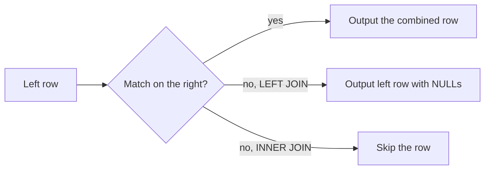

# Model Relationships and Join Tables
## 1. What are Relationships and Joins?

Relational databases organize data into tables that relate to one another. A *relationship* links rows in different tables (for example, which students are enrolled in which courses). A *join* brings those related rows together in a single result.

- **Tables and keys:** Each table has a primary key (one row, one identity). Foreign keys point from one table to another to keep links valid.
- **Types of relationships:** One-to-many (a course has many enrollments), many-to-many (students and courses via a junction table), and self-references (a course may have a prerequisite course).
- **Joins:** Combine matching rows from related tables. Set operations combine entire result sets.
- **Normalization:** Organize data to reduce duplication (1NF to 3NF). Denormalization trades a little duplication for simpler or faster queries when it makes sense.

**Everyday example:** Think of a university: students and courses are separate lists. An "enrollments" card links a student to a course — that's a many-to-many relationship, and a join shows "who is taking what".


## 2. Problem Statement / Use Case Overview

You need to model how students, courses, and enrollments relate, enforce valid links with foreign keys, and answer questions like "Who is taking which course and what grade?" using joins and set operations. You also learn the basics of normalization, denormalization, and common anti-patterns.

In this lesson you build a small normalized model, add relationships, and practice INNER/LEFT/RIGHT/FULL/CROSS and SELF joins, plus UNION/INTERSECT/EXCEPT.

## 3. Input

Sample data for a tiny university:

- **students** (student_id, name, email) — 4 students (Dana has no enrollments)
- **courses** (course_id, code, title, credits) — 3 courses (ENG101 has no students)
- **enrollments** (enrollment_id, student_id, course_id, grade) — links students to courses

All defined inside the notebook so the lesson stays self-contained.

## 4. Processing


## 5. Output

The combined report shows each student and the courses they take (including students with no enrollments):

```
student_id |      name     |    courses     | avg_grade
-----------+---------------+----------------+----------
STU001     | Alice Johnson | CS101, MATH101 |      91.5
STU002     | Bob Smith     | CS101          |      72.0
STU003     | Charlie Brown | MATH101        |      91.0
STU004     | Dana Lee      | NULL           |      NULL
(4 rows)
```

## 6. Tech Stack

| Tool | Version | Role |
|------|---------|------|
| PostgreSQL | 18 | Database |
| psycopg | 3.3.6 | Python driver |
| python-dotenv | 1.2.4 | Loads `.env` |
| Jupyter | any recent version | Runs the notebook |

**Compute and cost:** any laptop is enough; no cloud account or paid service is required.

## 7. Underlying Concepts

**Foreign keys and referential integrity.** A foreign key (FK) makes sure a value in one table points to a valid row in another. `ON DELETE RESTRICT` prevents deleting a referenced row if dependents exist; `ON DELETE CASCADE` would remove dependents too. *Everyday example:* you can't delete a course if students are still enrolled in it.

**Normalization (1NF to 3NF).** 1NF: atomic values, no repeating groups. 2NF: no partial dependencies on a composite key. 3NF: no transitive dependencies. The goal is to reduce duplication and anomalies. *Everyday example:* storing student details once in `students` instead of repeating them on every enrollment.

**Denormalization and anti-patterns.** Denormalization intentionally duplicates data (e.g., store a name in enrollments) to speed reads for specific queries — but it makes updates harder and error-prone. Common anti-patterns: storing comma-separated lists (breaks 1NF), or putting derived/calculated values without a reason. *Everyday example:* caching a product name on an order line can save a join, but if the name changes you must update many rows.

**Joins.** `INNER JOIN`: only matching rows. `LEFT JOIN`: all left rows, NULLs if no match. `RIGHT JOIN`: all right rows. `FULL OUTER JOIN`: all rows from both. `CROSS JOIN`: all pairs. `SELF JOIN`: join a table to itself (hierarchies like prerequisites). *Everyday example:* "show me every student and the courses they take" uses a LEFT JOIN if you want students with no enrollments too.

**Set operations.** `UNION` combines results and removes duplicates; `UNION ALL` keeps them. `INTERSECT` returns rows in both. `EXCEPT` (or `MINUS`) returns rows in the first but not the second. *Everyday example:* students taking CS101 UNION students taking MATH101 gives everyone taking either; INTERSECT gives those taking both.

**Entity-Relationship (ER) intuition.** Entities (students, courses) become tables; relationships become FKs or junction tables. *Everyday example:* drawing boxes and lines on a whiteboard maps cleanly to tables and foreign keys.

**How a join walks through two tables.** For each row on the left, the database looks for matching rows on the right.



`INNER JOIN` skips rows with no match, `LEFT JOIN` keeps them with `NULL`s, and `FULL OUTER JOIN` does this for both sides.

## 8. Prerequisites

- Basic SQL: `SELECT`, `WHERE`, `INSERT`, and constraints.
- A running PostgreSQL server (version 18) and the `.env` file at the course root.
- Familiarity with Python/notebook basics.

## 9. Environment / Dependencies Setup

All connection settings live in the global `.env` at the course root. Every notebook loads it with `load_dotenv("../../.env")`, so start Jupyter from inside this lesson folder.

Install packages:
```
pip install "psycopg[binary]==3.3.6" "python-dotenv==1.2.4"
```

## 10. Step-wise Development Instructions

### Setup — install the packages

```python
!pip install "psycopg[binary]==3.3.6" "python-dotenv==1.2.4"
```

This installs the pinned Python packages: `psycopg` (PostgreSQL driver) and `python-dotenv` (loads `.env`).

### Setup — Imports and helpers

```python
# Imports and helpers
import os
from decimal import Decimal

import psycopg
from psycopg import sql
from dotenv import load_dotenv
```

We import the standard library helpers, `psycopg`, the `sql` builder, and `load_dotenv`.

### Setup — Load environment

```python
# Load environment
load_dotenv("../../.env")
PGHOST = os.getenv("PGHOST", "localhost")
PGPORT = os.getenv("PGPORT", "5432")
PGUSER = os.getenv("PGUSER", "postgres")
PGPASSWORD = os.getenv("PGPASSWORD") or None
PGDATABASE = os.getenv("PGDATABASE", "university")
PGSSLMODE = os.getenv("PGSSLMODE", "prefer")
print(f"Connecting to {PGUSER}@{PGHOST}:{PGPORT}/{PGDATABASE} (sslmode={PGSSLMODE})")
```

Loads connection settings from the shared `.env` at the course root.

### Setup — Ensure database exists

```python
# Ensure database exists
conn_args = dict(host=PGHOST, port=PGPORT, user=PGUSER, password=PGPASSWORD, sslmode=PGSSLMODE)
with psycopg.connect(dbname="postgres", autocommit=True, **conn_args) as admin:
    exists = admin.execute("SELECT 1 FROM pg_database WHERE datname=%s", (PGDATABASE,)).fetchone()
    if not exists:
        admin.execute(sql.SQL("CREATE DATABASE {}").format(sql.Identifier(PGDATABASE)))
print("db ready")
```

Ensures the `university` database exists (self-contained).

### Setup — Connect (no autocommit)

```python
# Connect (no autocommit)
conn = psycopg.connect(dbname=PGDATABASE, **conn_args)
print("connected")
```

Opens a connection with autocommit off so we can commit explicitly.

### Setup — Show helper

```python
# show helper
def show(query, params=None):
    """Run a query and print the result as a psql-style table."""
    with conn.cursor() as cur:
        cur.execute(query, params)
        if cur.description is None:              # statements like CREATE or INSERT return no rows
            print(cur.statusmessage)
            return
        cols = [d.name for d in cur.description]
        rows = cur.fetchall()
    fmt = lambda v: "NULL" if v is None else ("t" if v is True else "f" if v is False else str(v))
    cells = [[fmt(v) for v in r] for r in rows]
    numeric = [bool(rows) and all(v is None or (isinstance(v, (int, float, Decimal)) and not isinstance(v, bool)) for v in col)
               for col in zip(*rows)] or [False] * len(cols)
    widths = [max([len(c)] + [len(r[i]) for r in cells]) for i, c in enumerate(cols)]
    print(" | ".join(c.center(w) for c, w in zip(cols, widths)).rstrip())
    print("-+-".join("-" * w for w in widths))
    for r in cells:
        print(" | ".join(v.rjust(w) if numeric[i] else v.ljust(w) for i, (v, w) in enumerate(zip(r, widths))).rstrip())
    print(f"({len(rows)} row{'' if len(rows) == 1 else 's'})")
show("SELECT current_database()")
```

A small helper to print aligned results (same idea as before).

### Step 1 — Model tables with foreign keys

```python
# Step 1: Model tables with foreign keys
conn.execute("DROP TABLE IF EXISTS enrollments CASCADE")
conn.execute("DROP TABLE IF EXISTS courses CASCADE")
conn.execute("DROP TABLE IF EXISTS students CASCADE")

conn.execute("""CREATE TABLE students (
    student_id TEXT PRIMARY KEY,
    name TEXT NOT NULL,
    email TEXT UNIQUE
)""")
conn.execute("""CREATE TABLE courses (
    course_id TEXT PRIMARY KEY,
    code TEXT NOT NULL UNIQUE,
    title TEXT NOT NULL,
    credits INTEGER NOT NULL CHECK (credits > 0)
)""")
conn.execute("""CREATE TABLE enrollments (
    enrollment_id INTEGER GENERATED ALWAYS AS IDENTITY PRIMARY KEY,
    student_id TEXT NOT NULL REFERENCES students(student_id) ON DELETE RESTRICT,
    course_id TEXT NOT NULL REFERENCES courses(course_id) ON DELETE RESTRICT,
    grade INTEGER CHECK (grade BETWEEN 0 AND 100),
    UNIQUE (student_id, course_id)
)""")
conn.commit()
print("tables created")
```

Creates normalized tables with primary keys, foreign keys (`ON DELETE RESTRICT`), `UNIQUE`, and `CHECK`. The junction `enrollments` represents a many-to-many between students and courses. Foreign keys are not automatically indexed in PostgreSQL — add indexes on the referencing columns if you need them for performance.

### Step 1b — foreign keys in action. First load one valid student, course and enrollment.

```python
# Step 1b: foreign keys in action. First load one valid student, course and enrollment.
conn.execute("INSERT INTO students VALUES ('STU001','Alice Johnson','alice@univ.example')")
conn.execute("INSERT INTO courses VALUES ('C001','CS101','Intro to CS',3)")
conn.execute("INSERT INTO enrollments (student_id,course_id,grade) VALUES ('STU001','C001',95)")
conn.commit()

# 1) Enroll a student who does not exist: the foreign key refuses it.
try:
    conn.execute("INSERT INTO enrollments (student_id, course_id) VALUES ('NOPE', 'C001')")
    conn.commit()
except psycopg.errors.IntegrityError as err:
    conn.rollback()
    print("Refused:", err.diag.message_primary)

# 2) Delete a course that still has enrollments: ON DELETE RESTRICT refuses it.
try:
    conn.execute("DELETE FROM courses WHERE course_id = 'C001'")
    conn.commit()
except psycopg.errors.IntegrityError as err:
    conn.rollback()
    print("Refused:", err.diag.message_primary)
```

Library-card analogy: you cannot enroll a student who does not exist (the first statement is refused), and you cannot delete a course that still has enrollments (the second is refused) because the foreign keys use `ON DELETE RESTRICT`. A refused insert still uses up an identity number, so the `enrollment_id` values below can skip a number; that is normal.

**Output:**

```
Refused: insert or update on table "enrollments" violates foreign key constraint "enrollments_student_id_fkey"
Refused: update or delete on table "courses" violates foreign key constraint "enrollments_course_id_fkey" on table "enrollments"
```

### Step 2 — insert the rest of the sample data (STU004 has no enrollment, ENG101 has no students)

```python
# Step 2: insert the rest of the sample data (STU004 has no enrollment, ENG101 has no students)
conn.execute("INSERT INTO students VALUES ('STU002','Bob Smith','bob@univ.example'),('STU003','Charlie Brown','charlie@univ.example'),('STU004','Dana Lee',NULL)")
conn.execute("INSERT INTO courses VALUES ('C002','MATH101','Calculus I',4),('C003','ENG101','Writing',3)")
conn.execute("INSERT INTO enrollments (student_id,course_id,grade) VALUES ('STU001','C002',88),('STU002','C001',72),('STU003','C002',91)")
conn.commit()
show("SELECT * FROM students ORDER BY student_id")
show("SELECT * FROM courses ORDER BY course_id")
show("SELECT * FROM enrollments ORDER BY enrollment_id")
```

Loads the rest of the sample data. STU004 (Dana) has no enrollments and ENG101 has no students, so the outer joins will differ. The junction table links students and courses.

### Step 3 — INNER JOIN — only matches

```python
# Step 3: INNER JOIN — only matches
show("""
  SELECT s.student_id, s.name, c.code, c.title, e.grade
  FROM enrollments e
  INNER JOIN students s ON s.student_id = e.student_id
  INNER JOIN courses c ON c.course_id = e.course_id
  ORDER BY s.student_id, c.code
""")
```

`INNER JOIN` returns only rows that match in all joined tables.

### Step 4 — LEFT JOIN — all students, even those with no enrollment

```python
# Step 4: LEFT JOIN — all students, even those with no enrollment
show("""
  SELECT s.student_id, s.name, c.code, e.grade
  FROM students s
  LEFT JOIN enrollments e ON e.student_id = s.student_id
  LEFT JOIN courses c ON c.course_id = e.course_id
  ORDER BY s.student_id, c.code
""")
```

`LEFT JOIN` keeps all rows from the left table (`students`); unmatched right-side values become `NULL`. Dana Lee (STU004) appears with NULLs because she has no enrollments.

### Step 5 — RIGHT JOIN and FULL OUTER JOIN

```python
# Step 5: RIGHT JOIN and FULL OUTER JOIN
# RIGHT JOIN: keep every course, even one nobody takes
show("""
  SELECT c.code, e.student_id
  FROM enrollments e
  RIGHT JOIN courses c ON c.course_id = e.course_id
  ORDER BY c.code, e.student_id
""")
# FULL OUTER JOIN: keep unmatched rows from both sides (Dana has no course, ENG101 has no student)
show("""
  SELECT s.name, c.code
  FROM students s
  FULL OUTER JOIN enrollments e ON e.student_id = s.student_id
  FULL OUTER JOIN courses c ON c.course_id = e.course_id
  ORDER BY s.name NULLS LAST, c.code NULLS LAST
""")
```

`RIGHT JOIN` keeps all rows of the right-hand table (here every course, so ENG101 appears with a NULL student). `FULL OUTER JOIN` keeps unmatched rows from both sides at once: Dana Lee (no course) and ENG101 (no student).

### Step 6 — CROSS JOIN

```python
# Step 6: CROSS JOIN
show("""
  SELECT s.name, c.code
  FROM students s CROSS JOIN courses c
  ORDER BY s.name, c.code
""")
```

`CROSS JOIN` produces the Cartesian product (all pairs). Useful to see possible combinations.

### Step 7 — SELF JOIN (courses could relate via prerequisites)

```python
# Step 7: SELF JOIN (courses could relate via prerequisites)
conn.execute("ALTER TABLE courses ADD COLUMN IF NOT EXISTS prerequisite TEXT REFERENCES courses(course_id)")
conn.execute("UPDATE courses SET prerequisite='C001' WHERE course_id='C002'")
conn.commit()
show("""
  SELECT c.code AS course, p.code AS prereq
  FROM courses c
  LEFT JOIN courses p ON p.course_id = c.prerequisite
  ORDER BY c.code
""")
```

A `SELF JOIN` joins a table to itself to represent hierarchical relationships like prerequisites.

### Step 8 — UNION, INTERSECT, EXCEPT

```python
# Step 8: UNION, INTERSECT, EXCEPT
show("""
  SELECT student_id FROM enrollments WHERE course_id='C001'
  UNION
  SELECT student_id FROM enrollments WHERE course_id='C002'
  ORDER BY student_id
""")
show("""
  SELECT student_id FROM enrollments WHERE course_id='C001'
  INTERSECT
  SELECT student_id FROM enrollments WHERE course_id='C002'
  ORDER BY student_id
""")
show("""
  SELECT student_id FROM enrollments WHERE course_id='C001'
  EXCEPT
  SELECT student_id FROM enrollments WHERE course_id='C002'
  ORDER BY student_id
""")

```

Set operations combine result sets: `UNION` (distinct), `INTERSECT` (common), `EXCEPT` (difference).

### Step 9 — showcase a combined report

```python
# Step 9: showcase a combined report
show("""
  SELECT s.student_id, s.name, string_agg(c.code, ', ' ORDER BY c.code) AS courses, ROUND(avg(e.grade), 1) AS avg_grade
  FROM students s
  LEFT JOIN enrollments e ON e.student_id = s.student_id
  LEFT JOIN courses c ON c.course_id = e.course_id
  GROUP BY s.student_id, s.name
  ORDER BY s.student_id
""")
```

A small report that brings relationships together (joins + aggregation; `GROUP BY` and `avg` are explained fully later in the course).

### Setup — Cleanup

```python
# Cleanup
conn.close()
print("connection closed")
```

Closes the connection. The tables and rules remain in the database.

## 11. What We Learnt

- **Modeling:** Primary keys, foreign keys, and a junction table capture many-to-many cleanly.
- **Referential integrity:** `ON DELETE RESTRICT` keeps links valid; `UNIQUE` and `CHECK` enforce rules.
- **Normalization:** 1NF–3NF reduce duplication; denormalization trades duplication for convenience when justified.
- **Joins:** `INNER`, `LEFT`, `RIGHT`, `FULL OUTER`, `CROSS`, and `SELF` each serve different questions.
- **Set operations:** `UNION`, `INTERSECT`, and `EXCEPT` combine result sets.
- **Practical reports:** Combining joins and aggregates turns relationships into answers.
