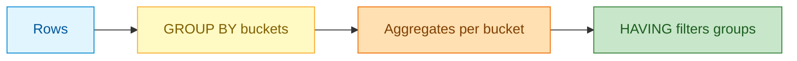

# Summarize Data with Aggregates and Subqueries
## 1. What are Aggregates and Subqueries?

Aggregates collapse many rows into one value (totals, averages, counts). Grouping splits data into buckets. Subqueries answer questions by nesting one query inside another. Together they turn raw rows into summaries and decisions.

- **Aggregates:** COUNT/SUM/AVG/MIN/MAX
- **Grouping:** GROUP BY, HAVING, FILTER
- **Reporting helpers:** string/array aggregates, percentiles
- **Nesting:** scalar subqueries, EXISTS/ANY/ALL, LATERAL
- **Rollups:** GROUPING SETS/ROLLUP/CUBE
- **Time:** dates, time zones, intervals, generate_series

**Everyday example:** A shop wants "total sales per region last month" — aggregates + grouping give the answer in one row per region.



## 2. Problem Statement / Use Case Overview

You need to summarize sales: totals per customer/region, products above average price, customers with recent orders, and multi-level rollups. You also learn to work with dates and generate series for calendars.

In this lesson you build a small sales model and produce summary reports with aggregates and subqueries.

## 3. Input

Small sample tables: customers, products, orders, order_items with a few rows each.

## 4. Processing


## 5. Output

The revenue report shows per-customer totals:

```\n name | orders | items | revenue
------+--------+-------+--------
Carol |      1 |     3 | 1298.99
Alice |      2 |     4 | 1257.97
Bob   |      1 |     3 |   88.47
(3 rows)\n```

## 6. Tech Stack

| Tool | Version | Role |
|------|---------|------|
| PostgreSQL | 18 | Database |
| psycopg | 3.3.6 | Python driver |
| python-dotenv | 1.2.4 | Loads `.env` |
| Jupyter | any recent version | Runs the notebook |

**Compute and cost:** Laptop CPU, minimal memory, free.

## 7. Underlying Concepts

**Aggregates.** Functions like COUNT, SUM, AVG, MIN, MAX collapse many rows. *Everyday example:* "How much did we sell today?" is SUM.

**GROUP BY and HAVING.** GROUP BY buckets rows; HAVING filters buckets (WHERE filters rows before grouping). *Everyday example:* totals per store (group) — only stores with >$1000 (having).

**FILTER and string/array aggregates.** FILTER adds conditions per aggregate; STRING_AGG/ARRAY_AGG collect values. *Everyday example:* "how many expensive items" vs "all items".

**Subqueries and predicates.** Scalar subqueries return one value; EXISTS tests membership; ANY/ALL compare against sets. *Everyday example:* "products more expensive than average".

**Rollups.** GROUPING SETS/Rollup/Cube produce subtotals and grand totals in one query. *Everyday example:* sales by region, by category, and overall.

**Dates and series.** Intervals arithmetic, time zone conversion, generate_series build calendars. *Everyday example:* missing dates in a report filled with zeros.

## 8. Prerequisites

- Basic SQL and joins from lessons 1–3.
- Running PostgreSQL 18 and `.env` at course root.

## 9. Environment / Dependencies Setup

Load `.env` via `load_dotenv("../../.env")` from inside the lesson folder. Install:
```
pip install "psycopg[binary]==3.3.6" "python-dotenv==1.2.4"
```

## 10. Step-wise Development Instructions

### Setup

```python
!pip install "psycopg[binary]==3.3.6" "python-dotenv==1.2.4"
```

Installs the pinned packages: `psycopg` (PostgreSQL driver) and `python-dotenv` (loads `.env`).

```python
# Imports
import os
from decimal import Decimal
import psycopg
from psycopg import sql
from dotenv import load_dotenv
```

Imports standard library helpers, the driver, SQL builder, and `.env` loader.

```python
# Load env
load_dotenv("../../.env")
PGHOST=os.getenv("PGHOST","localhost"); PGPORT=os.getenv("PGPORT","5432")
PGUSER=os.getenv("PGUSER","postgres"); PGPASSWORD=os.getenv("PGPASSWORD") or None
PGDATABASE=os.getenv("PGDATABASE","university"); PGSSLMODE=os.getenv("PGSSLMODE","prefer")
print(f"Connecting to {PGUSER}@{PGHOST}:{PGPORT}/{PGDATABASE} (sslmode={PGSSLMODE})")
```

Loads connection settings from the shared `.env` at the course root.

**Output:**

```
Connecting to postgres@localhost:5432/university (sslmode=prefer)
```

```python
# Ensure DB
conn_args=dict(host=PGHOST,port=PGPORT,user=PGUSER,password=PGPASSWORD,sslmode=PGSSLMODE)
with psycopg.connect(dbname="postgres",autocommit=True,**conn_args) as admin:
    if not admin.execute("SELECT 1 FROM pg_database WHERE datname=%s",(PGDATABASE,)).fetchone():
        admin.execute(sql.SQL("CREATE DATABASE {}").format(sql.Identifier(PGDATABASE)))
print("db ready")
```

Ensures the database exists (self-contained).

**Output:**

```
db ready
```

```python
# Connect
conn=psycopg.connect(dbname=PGDATABASE,**conn_args)
print("connected")
```

Opens connection (autocommit off).

**Output:**

```
connected
```

```python
# show helper
def show(q,params=None):
    with conn.cursor() as cur:
        cur.execute(q,params)
        if cur.description is None:
            print(cur.statusmessage); return
        cols=[d.name for d in cur.description]; rows=cur.fetchall()
    fmt=lambda v:"NULL" if v is None else str(v)
    cells=[[fmt(v) for v in r] for r in rows]
    numeric=[bool(rows) and all(isinstance(v,(int,float,Decimal)) and not isinstance(v,bool) for v in col) for col in zip(*rows)] or [False]*len(cols)
    widths=[max([len(c)]+[len(r[i]) for r in cells]) for i,c in enumerate(cols)]
    print(" | ".join(c.center(w) for c,w in zip(cols,widths)))
    print("-+-".join("-"*w for w in widths))
    for r in cells:
        print(" | ".join((v.rjust(w) if numeric[i] else v.ljust(w)) for i,(v,w) in enumerate(zip(r,widths))))
    print(f"({len(rows)} rows)")
show("SELECT current_database()")
```

Aligned table helper (consistent style).

**Output:**

```
current_database
----------------
university      
(1 rows)
```

### Step 1 — Set up sales data

```python
# Step 1: Create and load data
conn.execute("DROP TABLE IF EXISTS order_items")
conn.execute("DROP TABLE IF EXISTS orders")
conn.execute("DROP TABLE IF EXISTS products")
conn.execute("DROP TABLE IF EXISTS customers")

conn.execute("""CREATE TABLE customers (
  customer_id INTEGER PRIMARY KEY,
  name TEXT NOT NULL,
  region TEXT NOT NULL
)""")
conn.execute("""CREATE TABLE products (
  product_id INTEGER PRIMARY KEY,
  name TEXT NOT NULL,
  category TEXT NOT NULL,
  price NUMERIC(10,2) NOT NULL
)""")
conn.execute("""CREATE TABLE orders (
  order_id INTEGER PRIMARY KEY,
  customer_id INTEGER REFERENCES customers(customer_id),
  order_date DATE NOT NULL
)""")
conn.execute("""CREATE TABLE order_items (
  order_item_id INTEGER PRIMARY KEY,
  order_id INTEGER REFERENCES orders(order_id),
  product_id INTEGER REFERENCES products(product_id),
  quantity INTEGER NOT NULL CHECK(quantity>0)
)""")
conn.execute("INSERT INTO customers VALUES (1,'Alice','North'),(2,'Bob','South'),(3,'Carol','North'),(4,'Dave','West')")
conn.execute("INSERT INTO products VALUES (1,'Laptop','Electronics',999.99),(2,'Mouse','Electronics',29.49),(3,'Desk','Furniture',199.00),(4,'Chair','Furniture',149.50)")
conn.execute("INSERT INTO orders VALUES (101,1,'2025-10-01'),(102,1,'2025-10-15'),(103,2,'2025-10-10'),(104,3,'2025-10-12')")
conn.execute("INSERT INTO order_items VALUES (1,101,1,1),(2,101,2,2),(3,102,3,1),(4,103,2,3),(5,104,1,1),(6,104,4,2)")
conn.commit()
print("loaded")
```

Creates a small sales model (customers/orders/order_items/products) and loads sample data.

**Output:**

```
loaded
```

### Step 2 — Basic aggregates

```python
# Step 2: Basic aggregates
show("SELECT COUNT(*) AS orders, SUM(quantity) AS total_items, AVG(quantity) AS avg_qty FROM order_items")
show("SELECT MIN(price) AS min_price, MAX(price) AS max_price, ROUND(AVG(price),2) AS avg_price FROM products")
```

`COUNT`, `SUM`, `AVG`, `MIN`, `MAX` summarize across rows.

**Output:**

```
orders | total_items |      avg_qty      
-------+-------------+-------------------
     6 |          10 | 1.6666666666666667
(1 rows)
min_price | max_price | avg_price
----------+-----------+----------
    29.49 |    999.99 |    344.50
(1 rows)
```

### Step 3 — GROUP BY and HAVING

```python
# Step 3: GROUP BY and HAVING
show("""
  SELECT c.customer_id, c.name, COUNT(DISTINCT o.order_id) AS num_orders, SUM(oi.quantity) AS items
  FROM customers c
  JOIN orders o ON o.customer_id=c.customer_id
  JOIN order_items oi ON oi.order_id=o.order_id
  GROUP BY c.customer_id, c.name
  ORDER BY items DESC
""")
show("""
  SELECT c.region, COUNT(DISTINCT c.customer_id) AS customers, SUM(oi.quantity) AS items
  FROM customers c
  JOIN orders o ON o.customer_id=c.customer_id
  JOIN order_items oi ON oi.order_id=o.order_id
  GROUP BY c.region
  HAVING SUM(oi.quantity) > 5
  ORDER BY c.region
""")
```

`GROUP BY` groups rows; `HAVING` filters groups (after aggregation).

**Output:**

```
customer_id |  name | num_orders | items
------------+-------+------------+------
          1 | Alice |          2 |     4
          2 | Bob   |          1 |     3
          3 | Carol |          1 |     3
(3 rows)
region | customers | items
-------+-----------+------
North  |         2 |     7
(1 rows)
```

### Step 4 — FILTER and string aggregation

```python
# Step 4: FILTER and string/array aggregates
show("""
  SELECT category,
         COUNT(*) AS products,
         COUNT(*) FILTER (WHERE price>100) AS pricey,
         STRING_AGG(name, ', ' ORDER BY name) AS names
  FROM products
  GROUP BY category
""")
```

`FILTER (WHERE ...)` applies conditions per aggregate. `STRING_AGG` concatenates values.

**Output:**

```
  category  | products | pricey |     names    
------------+----------+--------+--------------
Electronics |        2 |      1 | Laptop, Mouse
Furniture   |        2 |      2 | Chair, Desk  
(2 rows)
```

### Step 5 — Percentiles and subqueries

```python
# Step 5: Percentiles and subqueries
show("SELECT PERCENTILE_CONT(0.5) WITHIN GROUP (ORDER BY price) AS median, PERCENTILE_CONT(0.75) WITHIN GROUP (ORDER BY price) AS p75 FROM products")
show("""
  SELECT name, price
  FROM products
  WHERE price > (SELECT AVG(price) FROM products)
  ORDER BY price DESC
""")
```

Percentiles summarize distributions; a scalar subquery finds products above average price.

**Output:**

```
median |   p75   
-------+---------
174.25 | 399.2475
(1 rows)
 name  | price 
-------+-------
Laptop | 999.99
(1 rows)
```

### Step 6 — EXISTS, ANY, ALL

```python
# Step 6: EXISTS, ANY/ALL
show("""
  SELECT c.customer_id, c.name
  FROM customers c
  WHERE EXISTS (SELECT 1 FROM orders o WHERE o.customer_id=c.customer_id AND o.order_date >= '2025-10-12')
  ORDER BY c.customer_id
""")
show("""
  SELECT name, price
  FROM products
  WHERE price > ALL (SELECT price FROM products WHERE category='Furniture')
  ORDER BY price DESC
""")
```

`EXISTS` tests for related rows. `ANY/ALL` compare against sets returned by subqueries.

**Output:**

```
customer_id |  name
------------+------
          1 | Alice
          3 | Carol
(2 rows)
 name  | price 
-------+-------
Laptop | 999.99
(1 rows)
```

### Step 7 — GROUPING SETS

```python
# Step 7: GROUPING SETS, ROLLUP, CUBE
show("""
  SELECT region, category, SUM(oi.quantity) AS items
  FROM customers c
  JOIN orders o ON o.customer_id=c.customer_id
  JOIN order_items oi ON oi.order_id=o.order_id
  JOIN products p ON p.product_id=oi.product_id
  GROUP BY GROUPING SETS ((region),(category),())
  ORDER BY region NULLS LAST, category NULLS LAST
""")
```

`GROUPING SETS` produces multiple groupings in one query; `ROLLUP`/`CUBE` give rollups/cross-tabulations.

**Output:**

```
region |   category  | items
-------+-------------+------
North  | NULL        |     7
South  | NULL        |     3
NULL   | Electronics |     7
NULL   | Furniture   |     3
NULL   | NULL        |    10
(5 rows)
```

### Step 8 — Dates, intervals, generate_series

```python
# Step 8: Dates, time zones, intervals, generate_series
show("SELECT NOW() AS now_ts, NOW() AT TIME ZONE 'UTC' AS now_utc, (NOW() - INTERVAL '7 days')::date AS week_ago")
show("SELECT d::date AS day FROM generate_series('2025-10-01'::date, '2025-10-07'::date, INTERVAL '1 day') d")
```

Date/time functions, intervals, and `generate_series` build calendars/series.

**Output:**

```
             now_ts              |          now_utc           |  week_ago 
---------------------------------+----------------------------+-----------
2026-10-20 14:04:51.187205+05:30 | 2026-10-20 08:34:51.187205 | 2026-10-13
(1 rows)
   day    
----------
2025-10-01
2025-10-02
2025-10-03
2025-10-04
2025-10-05
2025-10-06
2025-10-07
(7 rows)
```

### Step 9 — Showcase

```python
# Step 9: Showcase
show("""
  SELECT c.name, COUNT(DISTINCT o.order_id) AS orders, SUM(oi.quantity) AS items,
         ROUND(SUM(oi.quantity * p.price),2) AS revenue
  FROM customers c
  JOIN orders o ON o.customer_id=c.customer_id
  JOIN order_items oi ON oi.order_id=o.order_id
  JOIN products p ON p.product_id=oi.product_id
  GROUP BY c.customer_id, c.name
  ORDER BY revenue DESC
""")
```

A revenue report combining joins and aggregates.

**Output:**

```
 name | orders | items | revenue
------+--------+-------+--------
Carol |      1 |     3 | 1298.99
Alice |      2 |     4 | 1257.97
Bob   |      1 |     3 |   88.47
(3 rows)
```

### Cleanup — Close the connection

```python
# Cleanup
conn.close()
print("connection closed")
```

Closes the connection.

**Output:**

```
connection closed
```

## 11. What We Learnt

- **Summaries:** Aggregates + GROUP BY turn rows into insights.
- **Filtering groups:** HAVING vs WHERE; FILTER per aggregate.
- **Nesting:** Subqueries, EXISTS, ANY/ALL answer multi-step questions.
- **Rollups:** GROUPING SETS/Rollup/Cube give totals.
- **Time:** Dates/intervals/generate_series for calendars.
- **Reports:** Combining joins and aggregates produces useful summaries.
