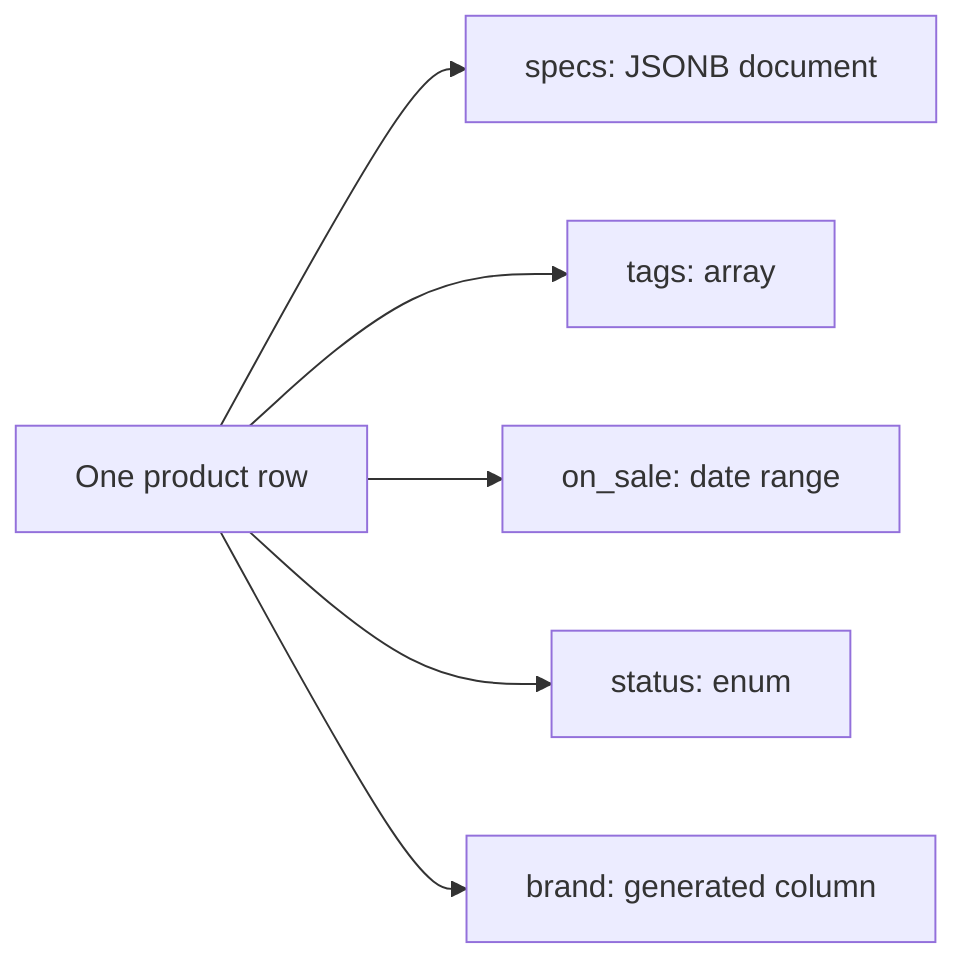
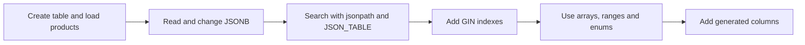
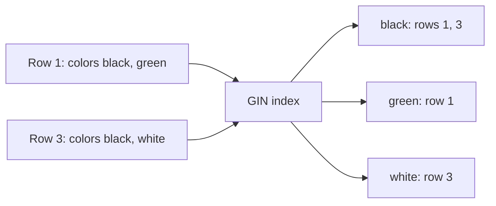
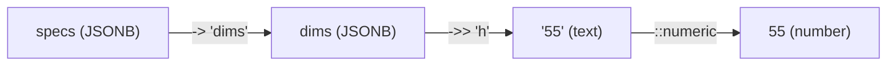
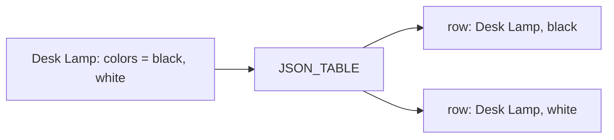
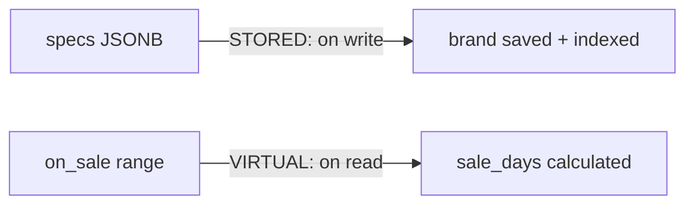

# JSONB, Arrays, Ranges and Generated Columns

## 1. What are Flexible Data Types in PostgreSQL?

A plain table expects every row to look the same: one number here, one word there. Real data is messier. PostgreSQL has column types that hold a whole document, a list, a period of time, or a value it works out for you.

- **JSONB (JSON Binary):** stores a JavaScript Object Notation (JSON) document, with nested keys and lists, in a binary form that PostgreSQL can search and index.
- **Arrays:** a list of values inside one column, such as a product's tags.
- **Ranges:** one value that holds a start and an end, such as a sale from 20 November to 1 December.
- **Enums:** short for enumerations, a column that only accepts words from a fixed list.
- **Generated columns:** a column PostgreSQL fills in by calculating from other columns.

**Example:** think of the label on a shop shelf. Some facts are the same for every item (name, price), while others differ (a lamp has a warranty, boots have a size). JSONB is the free-form part of the label, and the other types keep the fixed parts tidy.



The diagram shows one row that carries five different kinds of value, all in the same table.

## 2. Problem Statement / Use Case Overview

A small online shop sells very different things: backpacks have dimensions and colors, lamps have a warranty, boots have a size. Giving every possible attribute its own column would leave most cells empty and force a table change whenever a new kind of product arrives. The shop also wants to tag products, track when each one is on sale, and find all products of one brand quickly. In this lesson we build one `products` table that handles all of this. We store flexible details in JSONB, search inside them, add tags and sale periods, protect the stock status with an enum, and let PostgreSQL calculate extra columns for us.

## 3. Input

Four sample products that we type into the notebook, so nothing needs downloading:

- `name`: the product name.
- `specs`: a JSONB document with brand, weight, colors and dimensions.
- `tags`: a list of words such as `outdoor` or `bag`.
- `on_sale`: a date range for the sale period (some products have none).
- `status`: `in_stock`, `low` or `sold_out`.

## 4. Processing

The notebook goes from creating the table to calculating columns. Along the way we add Generalized Inverted Index (GIN) indexes, which speed up searches inside JSONB and arrays:



Each box is one or two notebook steps. Every step prints its result, so you can see what the query returned.

## 5. Output

You will see four kinds of result:

- the products with their brand, first color and height read from inside the JSONB document;
- one row per product-and-color pair, made by `JSON_TABLE`;
- the products that match a tag, a date range or an enum comparison, plus two friendly refusals (a bad enum word and an attempt to write to a generated column);
- the final table with the two calculated columns:

```
     name      | brand | sale_days
---------------+-------+----------
Trail Backpack | Nord  |        11
Water Bottle   | Aqua  |      NULL
Desk Lamp      | Lumo  |        14
Hiking Boots   | Nord  |        10
(4 rows)
```

## 6. Tech Stack

| Tool | Version | Role |
|------|---------|------|
| PostgreSQL | 18 (17 or newer runs everything except the VIRTUAL generated column) | Database server |
| psycopg | 3.3.6 | Python driver for PostgreSQL |
| python-dotenv | 1.2.4 | Loads the `.env` settings |
| Jupyter | any recent version | Runs the notebook |

**Compute and cost:** any laptop Central Processing Unit (CPU) with about 1 gigabyte (GB) of free Random Access Memory (RAM) is enough. No Graphics Processing Unit (GPU), cloud account or paid service is needed. The notebook runs in a few minutes.

## 7. Underlying Concepts

**JSON versus JSONB.** PostgreSQL has two JSON types. `JSON` keeps your text exactly as typed. `JSONB` converts it to a binary form: it ignores extra spaces, keeps one copy of a repeated key, and can be indexed. Choose `JSONB` almost every time.

**Reading JSONB.** `->` returns a piece as JSONB and `->>` returns it as text. `#>>` follows a path of keys. `@>` means "contains" and `?` means "has this key". *Everyday example:* a folder of folders, where `->` opens a folder and `->>` takes out the paper inside.

**jsonpath and JSON_TABLE.** `jsonpath` is a small search language for JSON: `$` is the whole document, `[*]` is every list item and `? (...)` is a filter. `JSON_TABLE` (PostgreSQL 17 and newer) uses a path to turn a JSON list into normal rows and columns. *Everyday example:* unpacking a box of items onto a table so you can count them.

**GIN indexes.** A GIN index stores each item found *inside* a value and the rows that contain it. It suits JSONB and arrays, where one row holds many items. *Everyday example:* the index at the back of a book, which lists each word and its pages.



A search for `black` reads one entry in the index and gets rows 1 and 3 directly, instead of reading every row.

**Arrays, ranges and enums.** An array keeps a short list inside one row (`ANY`, `@>` "has all of", `&&` "shares one"). A range is one value with a start and an end; `[a,b)` includes `a` and leaves out `b`, and `@>` and `&&` ask "contains?" and "overlaps?". An enum accepts only the words you list, and it sorts in the order you declared them. *Everyday example for ranges:* a hotel booking from the 3rd up to, but not including, the 7th, which leaves the 7th free for the next guest.

**Generated columns.** `GENERATED ALWAYS AS (expression)` makes PostgreSQL calculate a column from others. `STORED` saves the result when a row is written, so it can be indexed. `VIRTUAL` (the default in PostgreSQL 18) calculates it when you read, so it takes no space. *Everyday example:* a spreadsheet formula column that you never type into.

**When not to use JSONB.** JSONB does not enforce types or required keys, and PostgreSQL keeps fewer statistics about values inside it. Changing one key rewrites the whole document. Put the facts you always filter and join on (such as price) in normal columns, and keep the varying details in JSONB.

## 8. Prerequisites

- A running PostgreSQL server, version 18 recommended (17 is the minimum for `JSON_TABLE`).
- The shared `.env` file filled in (see Section 9).
- Basic Structured Query Language (SQL): `SELECT`, `WHERE`, `INSERT` and `UPDATE`.

## 9. Environment / Dependencies Setup

All connection settings live in one shared `.env` file at the course root. Copy `.env.example` to `.env` once and fill in your values (the keys are `PGHOST`, `PGPORT`, `PGUSER`, `PGPASSWORD`, `PGDATABASE` and `PGSSLMODE`). Every notebook reads it with `load_dotenv("../../.env")`, so start Jupyter from inside this lesson's folder.

Install the packages (the first notebook cell does the same thing):

```bash
pip install "psycopg[binary]==3.3.6" "python-dotenv==1.2.4"
```

## 10. Step-wise Development Instructions

### Setup — Install the packages

```python
!pip install "psycopg[binary]==3.3.6" "python-dotenv==1.2.4"
```

This one line installs the exact versions of the two libraries we use: `psycopg` (a Python driver, which lets Python talk to PostgreSQL) and `python-dotenv` (which reads our connection settings from the shared `.env` file). Pinning the versions keeps the lesson working months from now.

### Setup — Load the settings

```python
# Bring in the tools we need.
import os
from decimal import Decimal
import psycopg
from psycopg import sql
from dotenv import load_dotenv

# Read the connection settings from the shared .env file.
load_dotenv("../../.env")
PGHOST = os.getenv("PGHOST", "localhost")
PGPORT = os.getenv("PGPORT", "5432")
PGUSER = os.getenv("PGUSER", "postgres")
PGPASSWORD = os.getenv("PGPASSWORD") or None
PGDATABASE = os.getenv("PGDATABASE", "university")
PGSSLMODE = os.getenv("PGSSLMODE", "prefer")
```

We import the libraries and read the connection settings (server address, port, user, password, database name) from the shared `.env` file. Each setting has a safe default, and the password is never written in the code.

### Setup — Connect to PostgreSQL

```python
# Connect to the server, create our practice database if it is missing, then open our connection.
conn_args = dict(host=PGHOST, port=PGPORT, user=PGUSER, password=PGPASSWORD, sslmode=PGSSLMODE)
try:
    with psycopg.connect(dbname="postgres", autocommit=True, **conn_args) as admin:
        if not admin.execute("SELECT 1 FROM pg_database WHERE datname = %s", (PGDATABASE,)).fetchone():
            admin.execute(sql.SQL("CREATE DATABASE {}").format(sql.Identifier(PGDATABASE)))
    conn = psycopg.connect(dbname=PGDATABASE, **conn_args)
    print("connected to", PGDATABASE)
except psycopg.OperationalError as err:
    raise SystemExit(f"Could not connect. Is PostgreSQL running, and do the .env settings match it?\n{err}")
```

We connect twice: first to the built-in `postgres` database to create `university` if it does not exist yet, then to `university` itself. If the server is down or a setting is wrong, we stop with a friendly message instead of a long error. We leave autocommit off, so our changes only become permanent when we call `conn.commit()`.

### Setup — Add a printing helper

```python
# A small helper that runs a query and prints the result as a neat table.
def show(query, params=None):
    """Run a query and print the result as a psql-style table."""
    with conn.cursor() as cur:
        cur.execute(query, params)
        if cur.description is None:              # statements like CREATE or INSERT return no rows
            print(cur.statusmessage)
            return
        cols = [d.name for d in cur.description]
        rows = cur.fetchall()
    fmt = lambda v: "NULL" if v is None else ("t" if v is True else "f" if v is False else str(v))
    cells = [[fmt(v) for v in r] for r in rows]
    numeric = [bool(rows) and all(v is None or (isinstance(v, (int, float, Decimal)) and not isinstance(v, bool)) for v in col)
               for col in zip(*rows)] or [False] * len(cols)
    widths = [max([len(c)] + [len(r[i]) for r in cells]) for i, c in enumerate(cols)]
    print(" | ".join(c.center(w) for c, w in zip(cols, widths)).rstrip())
    print("-+-".join("-" * w for w in widths))
    for r in cells:
        print(" | ".join(v.rjust(w) if numeric[i] else v.ljust(w) for i, (v, w) in enumerate(zip(r, widths))).rstrip())
    print(f"({len(rows)} row{'' if len(rows) == 1 else 's'})")
```

We will print many query results, so we write this printing code once as a function called `show` and reuse it in every later cell. It runs the query, turns each value into text, lines the columns up, and prints a row count at the bottom.

### Step 1 — Create a table with flexible columns

```python
# Start clean so we can run this notebook again and again.
conn.execute("DROP TABLE IF EXISTS products CASCADE")
conn.execute("DROP TYPE IF EXISTS stock_status")

# An enum is a column type that only accepts words from a short, fixed list.
conn.execute("CREATE TYPE stock_status AS ENUM ('in_stock', 'low', 'sold_out')")

# One table that uses four flexible types: JavaScript Object Notation in binary form (JSONB), an array, a date range and our enum.
conn.execute("""
    CREATE TABLE products (
        product_id INTEGER GENERATED ALWAYS AS IDENTITY PRIMARY KEY,
        name       TEXT NOT NULL,
        specs      JSONB NOT NULL,
        tags       TEXT[] NOT NULL DEFAULT '{}',
        on_sale    DATERANGE,
        status     stock_status NOT NULL DEFAULT 'in_stock'
    )
""")

# Add four products. '[a,b)' means "from a, up to but not including b".
conn.execute("""
    INSERT INTO products (name, specs, tags, on_sale, status) VALUES
    ('Trail Backpack', '{"brand":"Nord","weight_kg":1.2,"colors":["green","black"],"dims":{"h":55,"w":30}}', '{outdoor,bag}', '[2026-11-20,2026-12-01)', 'in_stock'),
    ('Water Bottle',   '{"brand":"Aqua","weight_kg":0.4,"colors":["blue"],"dims":{"h":25,"w":8}}',           '{outdoor,kitchen}', NULL, 'in_stock'),
    ('Desk Lamp',      '{"brand":"Lumo","weight_kg":0.9,"colors":["black","white"],"dims":{"h":40,"w":15}}', '{home,office}', '[2026-12-01,2026-12-15)', 'low'),
    ('Hiking Boots',   '{"brand":"Nord","weight_kg":1.6,"colors":["brown"],"dims":{"h":20,"w":12}}',         '{outdoor,shoes}', '[2026-11-25,2026-12-05)', 'sold_out')
""")
conn.commit()
show("SELECT product_id, name, status FROM products ORDER BY product_id")
```

We build one small `products` table that mixes four types a plain table of numbers and text cannot hold well:

- `JSONB` (JavaScript Object Notation, or JSON, stored in a fast binary form) keeps flexible, nested details such as brand and colors.
- `TEXT[]` is an array: a list of values inside one column.
- `DATERANGE` stores a start and an end date as one value.
- `stock_status` is an enum, a type that only accepts the words we list.

Think of a shop's shelf label: some facts are the same for every item (name, price), while other facts differ (a lamp has a bulb type, boots have a size). `JSONB` is the free-form part of the label.

### Step 2 — Read inside JSONB

```python
# Pull single values out of the JSONB document in a few different ways.
show("""
    SELECT name,
           specs ->  'brand'                AS brand_json,
           specs ->> 'brand'                AS brand_text,
           (specs ->> 'weight_kg')::numeric AS kg,
           specs #>> '{dims,h}'             AS height_cm,
           specs -> 'colors' ->> 0          AS first_color
    FROM products ORDER BY product_id
""")

# Filter by "contains": which products have brand Nord?
show("""SELECT name FROM products WHERE specs @> '{"brand":"Nord"}' ORDER BY product_id""")

# Filter by "has this key": which products list dimensions?
show("SELECT count(*) AS with_dims FROM products WHERE specs ? 'dims'")
```

- **Input:** the `specs` column, one JSONB document per product.
- **What happens:**
  - `->` returns a piece of the document *as JSONB* (text values keep their quote marks), while `->>` returns it *as plain text*.
  - `#>>` follows a path of keys (`dims`, then `h`), and `-> 'colors' ->> 0` takes the first item of a list (counting starts at 0).
  - `@>` means "contains": the left document must hold everything in the right one. `?` asks "does this key exist?".
- **Output:** plain columns we can filter, sort and cast, such as `kg` as a number.
- **Why:** `->` keeps you inside the document so you can keep digging; `->>` gets you out into normal Structured Query Language (SQL) values.

It works like a folder of folders: `->` opens a folder, `->>` takes out the paper inside.



### Step 3 — Change JSONB in place

```python
# Merge a new key into the document with ||, then fix one value with jsonb_set.
conn.execute("""UPDATE products SET specs = specs || '{"warranty_years": 2}' WHERE name = 'Desk Lamp'""")
conn.execute("""UPDATE products SET specs = jsonb_set(specs, '{weight_kg}', '1.5') WHERE name = 'Trail Backpack'""")
conn.commit()
show("SELECT name, specs ->> 'warranty_years' AS warranty, specs ->> 'weight_kg' AS kg FROM products ORDER BY product_id")
```

`||` merges two JSONB documents (new keys are added, same keys are replaced), and `jsonb_set(document, path, new_value)` replaces one value at a path. Neither edits the old value in place: PostgreSQL builds a new document and stores it, so `UPDATE` is how you save the change.

### Step 4 — Search with jsonpath

```python
# jsonpath is a small query language for JSON. @? asks "does the path find anything?"
show("""SELECT name FROM products WHERE specs @? '$.colors[*] ? (@ == "black")' ORDER BY product_id""")

# @@ checks a true/false condition: which products weigh less than 1 kg?
show("SELECT name FROM products WHERE specs @@ '$.weight_kg < 1' ORDER BY product_id")

# jsonb_path_query returns the matching values themselves: every color of every product.
show("SELECT name, jsonb_path_query(specs, '$.colors[*]') AS color FROM products ORDER BY product_id, color")
```

`jsonpath` lets you describe *where to look* and *what to match* in one short text. `$` is the whole document, `[*]` means "every item in the list", and `? (...)` is a filter, where `@` stands for the item being checked. Think of it as a search pattern for a document, like "find every red item on any shelf".

### Step 5 — Turn JSON into rows with JSON_TABLE

```python
# JSON_TABLE (PostgreSQL 17 and newer) turns a JSON list into ordinary rows and columns.
show("""
    SELECT p.name, c.color
    FROM products p,
         JSON_TABLE(p.specs, '$.colors[*]' COLUMNS (color TEXT PATH '$')) AS c
    ORDER BY p.product_id, c.color
""")
```

- **Input:** each product's `specs` document and the path `$.colors[*]`.
- **What happens:** for every item the path finds, `JSON_TABLE` creates one row, and `COLUMNS (...)` says which columns to fill and from where.
- **Output:** one row per product-and-color pair, so a product with two colors becomes two rows.
- **Why:** once the data looks like a normal table, you can join, group and sort it like any other.

It is like unpacking a box of items onto a table so you can count them.



### Step 6 — Speed up JSONB and arrays with GIN

```python
# A Generalized Inverted Index (GIN) lists every key and value and the rows that hold it.
conn.execute("CREATE INDEX idx_products_specs ON products USING GIN (specs jsonb_path_ops)")
conn.execute("CREATE INDEX idx_products_tags  ON products USING GIN (tags)")
conn.commit()

# Look up the indexes we just made and the method each one uses.
show("""
    SELECT c.relname AS index_name, am.amname AS method
    FROM pg_index i
    JOIN pg_class c ON c.oid = i.indexrelid
    JOIN pg_am am   ON am.oid = c.relam
    WHERE i.indrelid = 'products'::regclass AND NOT i.indisprimary
    ORDER BY c.relname
""")
```

A normal index (a balanced tree, or B-tree) keeps one entry per row. A GIN index flips that around: it keeps one entry per *item inside* a value, and for each item the list of rows that contain it. That is why it fits `JSONB` (`@>`, `?`) and arrays (`@>`, `&&`), where one row holds many items.

Think of the index at the back of a book: it lists each word and the pages it appears on. The option we used, `jsonb_path_ops`, makes a smaller, faster GIN index that supports `@>` and jsonpath but not the `?` operator. With only four rows PostgreSQL may still read the whole table; the index pays off as the table grows.

### Step 7 — Work with arrays

```python
# Does any tag equal 'outdoor'?
show("SELECT name FROM products WHERE 'outdoor' = ANY(tags) ORDER BY product_id")

# Contains all of these tags (@>) and shares at least one tag (&&).
show("SELECT name FROM products WHERE tags @> ARRAY['outdoor','bag']")
show("SELECT name FROM products WHERE tags && ARRAY['kitchen','shoes'] ORDER BY product_id")

# unnest turns an array into rows so we can count how often each tag is used.
show("SELECT tag, count(*) AS products FROM products, unnest(tags) AS tag GROUP BY tag ORDER BY count(*) DESC, tag")

# array_agg does the reverse: it gathers rows back into one array.
show("SELECT brand, array_agg(name ORDER BY name) AS items FROM (SELECT specs ->> 'brand' AS brand, name FROM products) b GROUP BY brand ORDER BY brand")
```

Arrays are handy for short lists that belong to one row, such as tags. `ANY` checks one value against the list, `@>` means "has all of these", and `&&` means "shares at least one". `unnest` and `array_agg` convert between an array and rows. If you need to attach details to each list item, use a separate table instead.

### Step 8 — Use ranges and enums

```python
# Which products are on sale on 26 November? @> means "the range contains this date".
show("SELECT name, on_sale FROM products WHERE on_sale @> DATE '2026-11-26' ORDER BY product_id")

# Which sales overlap the first ten days of December? && means "overlaps".
show("SELECT name, lower(on_sale) AS starts, upper(on_sale) AS ends FROM products WHERE on_sale && daterange('2026-12-01','2026-12-10') ORDER BY product_id")

# Enums sort in the order we declared them, not alphabetically.
show("SELECT name, status FROM products WHERE status > 'in_stock' ORDER BY status, name")

# A word that is not in the list is refused. We catch the error and explain it.
try:
    conn.execute("UPDATE products SET status = 'broken'")
except psycopg.errors.InvalidTextRepresentation as err:
    conn.rollback()
    print("Refused:", err.diag.message_primary)
```

A range is one value with a start and an end, so "does this date fall inside?" and "do these two periods overlap?" become one-line questions instead of pairs of `>=` and `<` checks. In `[a,b)` the square bracket includes `a` and the round bracket leaves out `b`. An enum protects a column from typos: `'broken'` is refused, so we catch the error, roll back the failed statement and print the reason.

### Step 9 — Add generated columns

```python
# STORED: the database computes the value on write and saves it, so we can index it.
conn.execute("ALTER TABLE products ADD COLUMN brand TEXT GENERATED ALWAYS AS (specs ->> 'brand') STORED")
conn.execute("CREATE INDEX idx_products_brand ON products (brand)")

# VIRTUAL (the default in PostgreSQL 18): computed when we read it, nothing extra is stored.
conn.execute("ALTER TABLE products ADD COLUMN sale_days INTEGER GENERATED ALWAYS AS (upper(on_sale) - lower(on_sale)) VIRTUAL")
conn.commit()
show("SELECT name, brand, sale_days FROM products ORDER BY product_id")

# A generated column is read-only: writing to it is refused.
try:
    conn.execute("UPDATE products SET brand = 'Other' WHERE name = 'Desk Lamp'")
except psycopg.errors.GeneratedAlways as err:
    conn.rollback()
    print("Refused:", err.diag.message_primary)
```

- **Input:** the existing `specs` and `on_sale` columns.
- **What happens:** `GENERATED ALWAYS AS (...)` tells PostgreSQL to compute a column from others. `STORED` saves the result when a row is written; `VIRTUAL` works it out each time you read.
- **Output:** `brand` and `sale_days` appear as normal columns, and trying to write to them is refused.
- **Why:** the value can never drift out of sync with its source, and a `STORED` column can have its own index, so you get a fast `brand` lookup from a JSONB field.

A spreadsheet formula column works the same way: you never type into it.



### Cleanup — Close the connection

```python
# Close the connection politely. Our tables stay in the database.
conn.close()
print("connection closed")
```

We close the connection when we are done. The tables and rules we made stay in the database.

## 11. What We Learnt

- **JSONB:** we stored flexible details in one column and read them with `->`, `->>`, `#>>`, `@>` and `?`, as explained in Section 7.
- **Searching documents:** `jsonpath` finds values by pattern, and `JSON_TABLE` turns a JSON list into ordinary rows.
- **GIN indexes:** they index the items inside a value, which is why they fit JSONB and arrays.
- **Arrays and ranges:** `ANY`, `@>`, `&&`, `unnest` and `array_agg` handle lists; `@>` and `&&` on ranges answer "contains" and "overlaps" in one step.
- **Enums:** they refuse words outside the list, so typos cannot enter the table.
- **Generated columns:** `STORED` columns are saved and can be indexed, `VIRTUAL` columns are calculated on read, and neither can be written to directly.
- **Trade-off:** JSONB is great for varying details, but facts you filter on constantly belong in normal columns.
