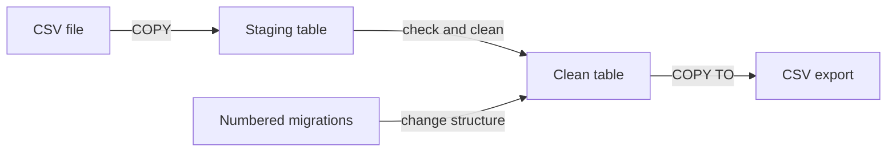
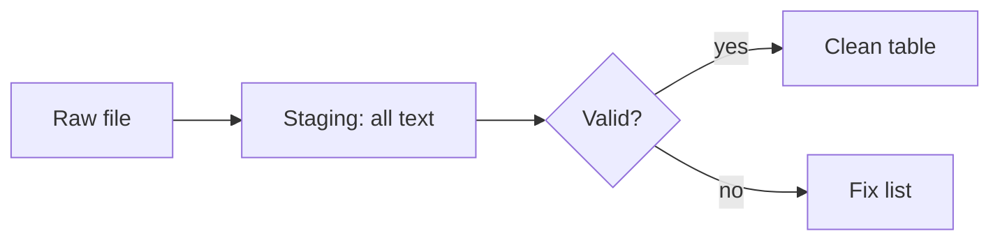
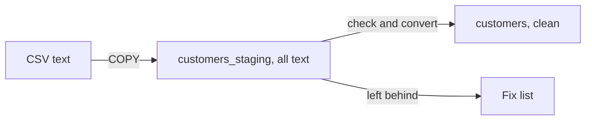
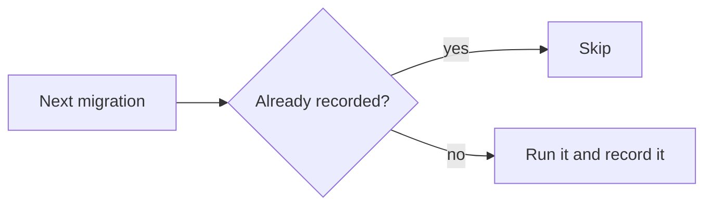

# Load, Migrate and Move Data

## 1. What is Data Loading and Migration?

Data rarely starts life in your database. It arrives as files from other systems, and your table design keeps changing as the product grows. Moving data in, changing structure safely and getting data out again are everyday jobs.

- **Loading:** putting many rows into a table at once, usually from a file such as Comma-Separated Values (CSV).
- **Migration:** a numbered, repeatable change to the table structure, so every copy of the database ends up the same.
- **Moving data:** copying or syncing rows between tables or systems, and exporting them again.

**Example:** think of a warehouse. Trucks arrive at the loading dock, staff check each box, and only good items go on the shelves. Migrations are the renovation plans for the building, numbered so no step is done twice.



The diagram shows data flowing in through staging to the clean table and out again, while migrations reshape the table itself.

## 2. Problem Statement / Use Case Overview

A shop is moving its customer list from an old system into PostgreSQL. The old system exports a Comma-Separated Values (CSV) file, but the file has problems: one signup date is not a date, and one email belongs to two people. Loading it row by row is slow, and one bad row should not wreck the whole import. The shop also needs to add new columns to the customer table later without breaking anything, keep the list in step with a daily feed of changes, and export reports as CSV. In this lesson we use Structured Query Language (SQL) and a little Python to load the file safely, move the good rows into a clean table, apply numbered changes to the table, sync updates, and export results.

## 3. Input

All data is created inside the notebook, so nothing needs downloading:

- A six-row customer CSV (`customer_id`, `name`, `email`, `signup_date`) with two planted problems.
- A generated list of 20,000 sensor readings, used to practise the bulk-load recipe.
- A short "feed" of two customer changes, used for the upsert.

## 4. Processing


Each box is one notebook step, and each prints what it did.

## 5. Output

You will see the refusal message for the bad row, the list of rows left behind in staging, the two migration runs, the synced customer table and the exported CSV:

```
Run 1:
  migration 1: applied
  migration 2: applied
  migration 3: applied
Run 2:
  migration 1: already applied, skipped
  migration 2: already applied, skipped
  migration 3: already applied, skipped
```

```
customer_id,name,city
1,Ana Rossi,unknown
2,Ben Okafor,unknown
3,Cy Tanaka,unknown
6,Fay Chen,unknown
7,Gus Lund,unknown
```

## 6. Tech Stack

| Tool | Version | Role |
|------|---------|------|
| PostgreSQL | 18 (16 or newer runs everything; `ON_ERROR` needs 17) | Database server |
| psycopg | 3.3.6 | Python driver, including its `copy()` streaming |
| python-dotenv | 1.2.4 | Loads the `.env` settings |
| Jupyter | any recent version | Runs the notebook |

**Compute and cost:** any laptop Central Processing Unit (CPU) with about 1 gigabyte (GB) of free Random Access Memory (RAM) is enough. No Graphics Processing Unit (GPU), cloud account or paid service is needed. The notebook runs in about a minute.

## 7. Underlying Concepts

**COPY.** `COPY` is PostgreSQL's bulk loader. Instead of one command per row, the client opens one stream and the server reads rows as fast as they arrive. In Python, `cursor.copy()` gives a writer for loading and an iterator for exporting. `\copy` in the `psql` tool does the same from a file on your own machine, while plain `COPY ... FROM 'file'` reads a file on the *server*. *Everyday example:* moving house with one big truck instead of carrying boxes one by one.

**All or nothing, and how to loosen it.** By default one bad value cancels the whole COPY. PostgreSQL 17 added `ON_ERROR ignore`, which skips rows that fail type conversion; it cannot skip a violated unique rule. Because of this, many teams load into a staging table first.

**The staging pattern.** Land everything as text, inspect it with SQL, then move clean rows into the real table with `INSERT ... SELECT` and conversions. Rows you could not move stay behind as a fix list.



**The bulk-load recipe.** Load first, build indexes afterwards, then run `ANALYZE`. Doing it in this order is much cheaper than keeping indexes up to date while rows arrive, and `ANALYZE` gives the planner correct statistics. For very large loads, raising `maintenance_work_mem` for the session speeds up index builds. *Everyday example:* paint the whole wall, then hang the pictures.

**Migrations.** A migration is a numbered change to the structure (add a column, add an index). A small `schema_migrations` table records which numbers ran, so applying the list again does nothing. PostgreSQL can roll back most structure changes inside a transaction, so a failed migration does not leave a half-changed table. Adding a column with a constant default is fast, because PostgreSQL stores the default once instead of rewriting every row.

**Upsert.** `INSERT ... ON CONFLICT DO UPDATE` inserts new rows and updates existing ones atomically (as one indivisible step). `DO NOTHING` simply skips conflicts.

**Backups and moving whole databases.** `pg_dump` writes a database to a file and `pg_restore` (or `psql`) loads it back; `pg_restore` can use several parallel jobs to rebuild large databases faster. These are command-line tools you run in a terminal, outside this notebook, so we mention them here but do not run them. *Everyday example:* photocopying a binder so you can rebuild it elsewhere.

## 8. Prerequisites

- A running PostgreSQL server, version 18 recommended (16 or newer works; step 6 explains the one difference).
- The shared `.env` file filled in (see Section 9).
- Basic SQL: `SELECT`, `WHERE`, `INSERT`, and creating tables.

## 9. Environment / Dependencies Setup

All connection settings live in one shared `.env` file at the course root. Copy `.env.example` to `.env` once and fill in your values (the keys are `PGHOST`, `PGPORT`, `PGUSER`, `PGPASSWORD`, `PGDATABASE` and `PGSSLMODE`). Every notebook reads it with `load_dotenv("../../.env")`, so start Jupyter from inside this lesson's folder.

Install the packages (the first notebook cell does the same thing):

```bash
pip install "psycopg[binary]==3.3.6" "python-dotenv==1.2.4"
```

## 10. Step-wise Development Instructions

### Setup — Install the packages

```python
!pip install "psycopg[binary]==3.3.6" "python-dotenv==1.2.4"
```

This one line installs the exact versions of the two libraries we use: `psycopg` (a Python driver, which lets Python talk to PostgreSQL) and `python-dotenv` (which reads our connection settings from the shared `.env` file). Pinning the versions keeps the lesson working months from now.

### Setup — Load the settings

```python
# Bring in the tools we need.
import os
from decimal import Decimal
import psycopg
from psycopg import sql
from dotenv import load_dotenv

# Read the connection settings from the shared .env file.
load_dotenv("../../.env")
PGHOST = os.getenv("PGHOST", "localhost")
PGPORT = os.getenv("PGPORT", "5432")
PGUSER = os.getenv("PGUSER", "postgres")
PGPASSWORD = os.getenv("PGPASSWORD") or None
PGDATABASE = os.getenv("PGDATABASE", "university")
PGSSLMODE = os.getenv("PGSSLMODE", "prefer")
```

We import the libraries and read the connection settings (server address, port, user, password, database name) from the shared `.env` file. Each setting has a safe default, and the password is never written in the code.

### Setup — Connect to PostgreSQL

```python
# Connect to the server, create our practice database if it is missing, then open our connection.
conn_args = dict(host=PGHOST, port=PGPORT, user=PGUSER, password=PGPASSWORD, sslmode=PGSSLMODE)
try:
    with psycopg.connect(dbname="postgres", autocommit=True, **conn_args) as admin:
        if not admin.execute("SELECT 1 FROM pg_database WHERE datname = %s", (PGDATABASE,)).fetchone():
            admin.execute(sql.SQL("CREATE DATABASE {}").format(sql.Identifier(PGDATABASE)))
    conn = psycopg.connect(dbname=PGDATABASE, **conn_args)
    print("connected to", PGDATABASE)
except psycopg.OperationalError as err:
    raise SystemExit(f"Could not connect. Is PostgreSQL running, and do the .env settings match it?\n{err}")
```

We connect twice: first to the built-in `postgres` database to create `university` if it does not exist yet, then to `university` itself. If the server is down or a setting is wrong, we stop with a friendly message instead of a long error. We leave autocommit off, so our changes only become permanent when we call `conn.commit()`.

### Setup — Add a printing helper

```python
# A small helper that runs a query and prints the result as a neat table.
def show(query, params=None):
    """Run a query and print the result as a psql-style table."""
    with conn.cursor() as cur:
        cur.execute(query, params)
        if cur.description is None:              # statements like CREATE or INSERT return no rows
            print(cur.statusmessage)
            return
        cols = [d.name for d in cur.description]
        rows = cur.fetchall()
    fmt = lambda v: "NULL" if v is None else ("t" if v is True else "f" if v is False else str(v))
    cells = [[fmt(v) for v in r] for r in rows]
    numeric = [bool(rows) and all(v is None or (isinstance(v, (int, float, Decimal)) and not isinstance(v, bool)) for v in col)
               for col in zip(*rows)] or [False] * len(cols)
    widths = [max([len(c)] + [len(r[i]) for r in cells]) for i, c in enumerate(cols)]
    print(" | ".join(c.center(w) for c, w in zip(cols, widths)).rstrip())
    print("-+-".join("-" * w for w in widths))
    for r in cells:
        print(" | ".join(v.rjust(w) if numeric[i] else v.ljust(w) for i, (v, w) in enumerate(zip(r, widths))).rstrip())
    print(f"({len(rows)} row{'' if len(rows) == 1 else 's'})")
```

We will print many query results, so we write this printing code once as a function called `show` and reuse it in every later cell. It runs the query, turns each value into text, lines the columns up, and prints a row count at the bottom.

### Step 1 — Create the tables

```python
# Start clean so we can run this notebook again and again.
conn.execute("DROP TABLE IF EXISTS customers_raw, customers_staging, customers CASCADE")

# raw: typed columns and no rules, so a bad value is refused at once.
conn.execute("CREATE TABLE customers_raw (customer_id INTEGER, name TEXT, email TEXT, signup_date DATE)")

# staging: every column is plain text, so any file can land here without errors.
conn.execute("CREATE TABLE customers_staging (customer_id TEXT, name TEXT, email TEXT, signup_date TEXT)")

# customers: the clean table we really want, with proper types and rules.
conn.execute("""
    CREATE TABLE customers (
        customer_id INTEGER PRIMARY KEY,
        name        TEXT NOT NULL,
        email       TEXT NOT NULL UNIQUE,
        signup_date DATE NOT NULL
    )
""")
conn.commit()
print("three tables created")
```

We make three tables that stand for three stages of a data load. `customers_raw` has the right types but no safety net, `customers_staging` is all text so anything can land in it, and `customers` is the clean destination with a primary key and a unique email. Think of a delivery: boxes arrive at the loading dock (staging), get checked, and only good items go on the shelf (`customers`).

### Step 2 — Prepare a CSV file in memory

```python
# A pretend export from an old system as Comma-Separated Values (CSV) text.
# Row 4 has a bad date ("soon") and row 5 reuses Ana's email on purpose.
csv_text = """customer_id,name,email,signup_date
1,Ana Rossi,ana@example.com,2026-01-05
2,Ben Okafor,ben@example.com,2026-01-09
3,Cy Tanaka,cy@example.com,2026-02-14
4,Dee Novak,dee@example.com,soon
5,Eli Brown,ana@example.com,2026-03-01
6,Fay Chen,fay@example.com,2026-03-12
"""
print(len(csv_text.splitlines()) - 1, "data rows ready to load")
```

To keep the lesson self-contained we hold the file's text in a Python string. With a real file you would use `open("customers.csv")` and pass its text to the same `copy.write(...)` call. We planted two problems on purpose: a date that is not a date, and an email that belongs to someone else. Real exports almost always contain a few of these.

### Step 3 — See COPY refuse a bad row

```python
# COPY sends the whole text to the server in one go. A single bad value cancels everything.
try:
    with conn.cursor() as cur:
        with cur.copy("COPY customers_raw FROM STDIN WITH (FORMAT csv, HEADER)") as copy:
            copy.write(csv_text)
    conn.commit()
except psycopg.errors.InvalidDatetimeFormat as err:
    conn.rollback()
    print("Refused:", err.diag.message_primary)

# Nothing was loaded, not even the five good rows.
show("SELECT count(*) AS rows_loaded FROM customers_raw")
```

- **Input:** the CSV text, with `HEADER` telling COPY to skip the first line.
- **What happens:** `COPY ... FROM STDIN` streams the text to the server, which converts each value to the column type. At `soon` the date conversion fails and the whole command is cancelled.
- **Output:** an error message and zero rows in the table.
- **Why:** COPY is all-or-nothing by default, which protects you from half-loaded tables. It is also much faster than one `INSERT` per row, because the server reads one stream instead of thousands of separate commands.

### Step 4 — Land everything in the staging table

```python
# Load the same text into the all-text table. Nothing can fail on types, so every row lands.
with conn.cursor() as cur:
    with cur.copy("COPY customers_staging FROM STDIN WITH (FORMAT csv, HEADER)") as copy:
        copy.write(csv_text)
conn.commit()

# Now we can ask Structured Query Language (SQL) which rows look wrong: dates must look like 2026-01-31.
show(r"SELECT customer_id, name, signup_date FROM customers_staging WHERE signup_date !~ '^\d{4}-\d{2}-\d{2}$'")
```

We load first and judge later. All six rows are now in `customers_staging`, and a simple pattern check (`!~` means "does not match the pattern") finds the row whose date is not in `YYYY-MM-DD` shape. Problems we can *see* in a table are far easier to fix than an error message from a failed load.

### Step 5 — Clean and move rows into the real table

```python
# Copy only the good rows into customers, converting text to real types as we go.
cur = conn.execute(r"""
    INSERT INTO customers (customer_id, name, email, signup_date)
    SELECT customer_id::int, name, lower(email), signup_date::date
    FROM customers_staging
    WHERE signup_date ~ '^\d{4}-\d{2}-\d{2}$'
    ORDER BY customer_id::int
    ON CONFLICT (email) DO NOTHING
""")
conn.commit()
print("moved", cur.rowcount, "rows")

# Which staging rows did not make it? They are the ones we must follow up on.
show("""
    SELECT s.customer_id, s.name, s.signup_date
    FROM customers_staging s
    LEFT JOIN customers c ON c.customer_id = s.customer_id::int
    WHERE c.customer_id IS NULL
""")
```

- **Input:** six text rows in `customers_staging`.
- **What happens:**
  - `WHERE` keeps only rows whose date looks valid.
  - `::int`, `::date` and `lower()` convert and tidy each value.
  - `ON CONFLICT (email) DO NOTHING` skips a row whose email already exists, instead of failing.
- **Output:** four rows in `customers`, and a list of the two rows that were left behind (Dee's bad date and Eli's duplicate email).
- **Why:** this "land, check, promote" pattern keeps bad data out of the clean table while telling you exactly what needs attention.



### Step 6 — Skip bad rows while loading (PostgreSQL 17+)

```python
# PostgreSQL 17 can skip rows that fail type conversion instead of cancelling the whole COPY.
try:
    with conn.cursor() as cur:
        with cur.copy("COPY customers_raw FROM STDIN WITH (FORMAT csv, HEADER, ON_ERROR ignore)") as copy:
            copy.write(csv_text)
    conn.commit()
    show("SELECT count(*) AS rows_loaded FROM customers_raw")
except psycopg.errors.SyntaxError:
    conn.rollback()
    print("ON_ERROR needs PostgreSQL 17 or newer; this server is older, so we skip this step.")
```

`ON_ERROR ignore` tells COPY to skip any row it cannot convert and keep loading the rest, so on PostgreSQL 17 and newer five rows load and `soon` is skipped. On an older server the option does not exist, so we catch the syntax error and say so, instead of stopping the notebook. This only skips *type* problems; a duplicate value in a unique column would still stop the load.

### Step 7 — Follow the bulk-load recipe

```python
# Make 20,000 rows of sensor readings as CSV text (about 1 megabyte).
big_csv = "".join(f"{i % 50},2026-01-{1 + i // 1000:02d} 00:00:{i % 60:02d},{20 + (i % 100) / 10}\n" for i in range(20000))

# 1) Create the table with no indexes yet.
conn.execute("DROP TABLE IF EXISTS readings")
conn.execute("CREATE TABLE readings (sensor_id INTEGER, taken_at TIMESTAMP, value NUMERIC(6,2))")

# 2) Load everything with one COPY.
with conn.cursor() as cur:
    with cur.copy("COPY readings FROM STDIN WITH (FORMAT csv)") as copy:
        copy.write(big_csv)

# 3) Build the index after the load, then 4) refresh the planner's statistics.
conn.execute("CREATE INDEX idx_readings_sensor ON readings (sensor_id, taken_at)")
conn.execute("ANALYZE readings")
conn.commit()
show("SELECT count(*) AS rows_loaded, (SELECT reltuples::int FROM pg_class WHERE relname = 'readings') AS planner_estimate FROM readings")
```

- **Input:** 20,000 generated CSV rows and an empty table.
- **What happens:** we create the table, load all rows with one `COPY`, and only then create the index and run `ANALYZE`.
- **Output:** the exact row count, and the planner's estimate (it matches because we just ran `ANALYZE`).
- **Why:** building an index once over finished data is much cheaper than updating it 20,000 times while loading, and `ANALYZE` gives the planner (the part of PostgreSQL that picks how to run a query) fresh numbers about the new data.


### Step 8 — Change the table with numbered migrations

```python
# A small table that remembers which changes were already applied.
conn.execute("DROP TABLE IF EXISTS schema_migrations")
conn.execute("CREATE TABLE schema_migrations (version INTEGER PRIMARY KEY, applied_at TIMESTAMPTZ NOT NULL DEFAULT now())")
conn.commit()

# The changes we want, in order. Each has a number so we never run it twice.
MIGRATIONS = [
    (1, "ALTER TABLE customers ADD COLUMN phone TEXT"),
    (2, "ALTER TABLE customers ADD COLUMN city TEXT NOT NULL DEFAULT 'unknown'"),
    (3, "CREATE INDEX idx_customers_signup ON customers (signup_date)"),
]

# Run twice on purpose: the second run should find nothing to do.
for run in (1, 2):
    print(f"Run {run}:")
    done = {v for (v,) in conn.execute("SELECT version FROM schema_migrations")}
    for version, ddl in MIGRATIONS:
        if version in done:
            print(f"  migration {version}: already applied, skipped")
            continue
        conn.execute(ddl)                                                    # the change itself
        conn.execute("INSERT INTO schema_migrations (version) VALUES (%s)", (version,))   # remember it
        conn.commit()                                                        # change and note succeed together
        print(f"  migration {version}: applied")
```

- **Input:** a list of numbered changes and the `schema_migrations` table that records which ones ran.
- **What happens:** for each change not yet recorded, we run it, record its number and commit. PostgreSQL can undo schema changes inside a transaction, so a failed migration leaves nothing half-done.
- **Output:** run 1 applies all three; run 2 skips all three.
- **Why:** the same list can safely run on your laptop, a test server and production, and each ends up with the same structure.

It works like a checklist taped to a workshop door: you tick each job as you finish it, so nobody repeats one.



### Step 9 — Sync changes with an upsert

```python
# A new feed: Ben changed his email, and Gus is a brand-new customer.
feed = [(2, "Ben Okafor", "ben.o@example.com", "2026-01-09"), (7, "Gus Lund", "gus@example.com", "2026-04-02")]

# Insert new customers and update existing ones in a single statement.
with conn.cursor() as cur:
    cur.executemany("""
        INSERT INTO customers (customer_id, name, email, signup_date) VALUES (%s, %s, %s, %s)
        ON CONFLICT (customer_id) DO UPDATE SET name = EXCLUDED.name, email = EXCLUDED.email
    """, feed)
conn.commit()
show("SELECT customer_id, name, email, city FROM customers ORDER BY customer_id")
```

An upsert ("update or insert") is `INSERT ... ON CONFLICT ... DO UPDATE`. If the `customer_id` is new, the row is inserted; if it already exists, the named columns are updated, and `EXCLUDED` means "the row we tried to insert". The same feed can be applied again and again without creating duplicates, which is exactly what you want when you keep two systems in step.

### Step 10 — Export a query as CSV

```python
# COPY can also run in the other direction: stream any query's result out as CSV text.
with conn.cursor() as cur:
    with cur.copy("COPY (SELECT customer_id, name, city FROM customers ORDER BY customer_id) TO STDOUT WITH (FORMAT csv, HEADER)") as copy:
        exported = "".join(bytes(chunk).decode() for chunk in copy)
print(exported)
```

`COPY (query) TO STDOUT` sends the result of a query to Python as CSV text, which we could save to a file or hand to another system. Together with the loading steps, you now have both directions of the data highway.

### Cleanup — Close the connection

```python
# Close the connection politely. Our tables stay in the database.
conn.close()
print("connection closed")
```

We close the connection when we are done. The tables and rules we made stay in the database.

## 11. What We Learnt

- **COPY:** it streams many rows in one command, which is why it beats row-by-row inserts, as described in Section 7.
- **All or nothing:** a single bad value cancels a plain COPY, and `ON_ERROR ignore` (PostgreSQL 17+) can skip type failures.
- **Staging pattern:** land as text, check with SQL, then promote clean rows and keep a fix list.
- **Bulk-load recipe:** load first, build indexes after, then `ANALYZE`.
- **Migrations:** numbered changes recorded in a table can be applied repeatedly and safely.
- **Upsert:** `ON CONFLICT DO UPDATE` keeps two sources in step without duplicates.
- **Export:** `COPY (query) TO STDOUT` sends results out as CSV.
