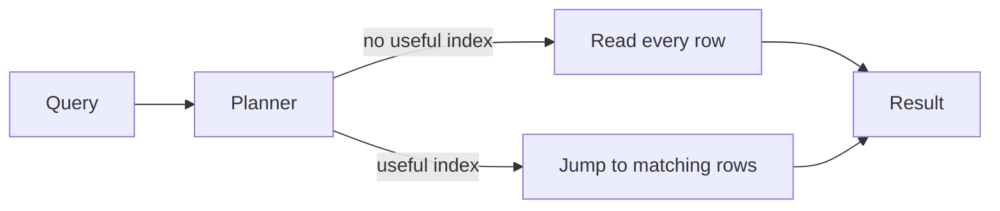
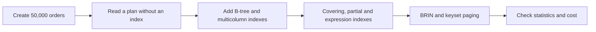
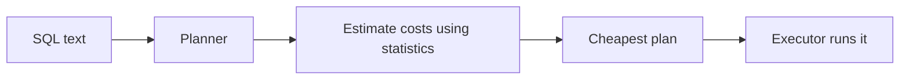
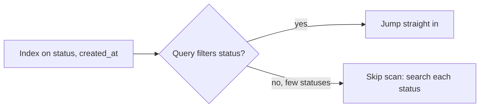
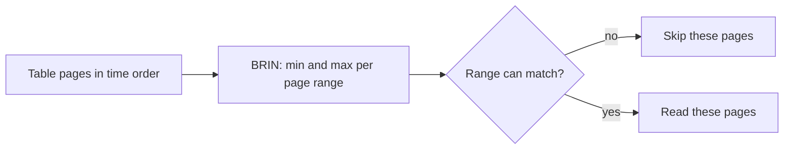

# Speed Up Queries with Indexes and EXPLAIN

## 1. What are Indexes and Query Plans?

An index is a separate, sorted structure that helps PostgreSQL find rows without reading the whole table. A query plan is PostgreSQL's recipe for running a Structured Query Language (SQL) query, and `EXPLAIN` lets you read it.

- **Index:** a shortcut to rows, kept in step with the table automatically.
- **Plan:** the steps PostgreSQL picks, such as "read every row" or "use this index".
- **Planner:** the part of PostgreSQL that picks the cheapest plan, using statistics about your data.
- **Trade-off:** indexes make reads faster and writes a little slower, and they take disk space.

**Example:** think of the index at the back of a book. To find every page about "bridges" you check the index instead of reading all 500 pages, but the publisher must update the index whenever the book changes.



The planner chooses between the two paths for every query, based on what it knows about your data.

## 2. Problem Statement / Use Case Overview

An online shop's orders page has become slow. Looking up one customer's orders, listing the day's orders, finding a customer by email in any letter case, and paging deep into the order list each take longer as the table grows. The team could add an index to everything, but every index slows down writes and takes space. In this lesson we create 50,000 orders, read query plans with `EXPLAIN`, add the right kind of index for each question, and see what each choice costs.

## 3. Input

One table of 50,000 orders that PostgreSQL generates for us, so nothing needs downloading:

- `customer_id`: one of 2,000 customers.
- `status`: mostly `shipped`, some `cancelled`, a few `pending`.
- `email`: mixed-case addresses such as `User42@Example.com`.
- `amount` and `created_at`: a price and a time, one order every 10 minutes.

## 4. Processing

We add balanced tree (B-tree) indexes first, then a Block Range Index (BRIN), plus covering, partial and expression variants, and check each change with `EXPLAIN`:



At each step we run `EXPLAIN` before and after the change, so you can see the plan change shape.

## 5. Output

Most steps print a query plan. The first plan reads the whole table, and the later plans use indexes. For example, the plan for one customer's orders changes from a full read to an index lookup. The last step lists every index with its size, so you can see what each one costs. Exact sizes and buffer counts depend on your server, but the *shape* of each plan is the same:

```
Seq Scan on orders (actual rows=25.00 loops=1)
  Filter: (customer_id = 42)
  Rows Removed by Filter: 49975
```

becomes a `Bitmap Index Scan` or `Index Scan` on `idx_orders_customer` that finds the same 25 rows without reading the rest.

## 6. Tech Stack

| Tool | Version | Role |
|------|---------|------|
| PostgreSQL | 18 (skip scan needs 18; everything else runs on 16 or newer) | Database server |
| psycopg | 3.3.6 | Python driver for PostgreSQL |
| python-dotenv | 1.2.4 | Loads the `.env` settings |
| Jupyter | any recent version | Runs the notebook |

**Compute and cost:** any laptop Central Processing Unit (CPU) with about 1 gigabyte (GB) of free Random Access Memory (RAM) and roughly 50 megabytes (MB) of disk is enough. No Graphics Processing Unit (GPU), cloud account or paid service is needed. The notebook runs in a few minutes.

## 7. Underlying Concepts

**How PostgreSQL runs a query.** The planner lists possible plans, estimates the cost of each using table statistics, and runs the cheapest. `EXPLAIN` shows the plan; `EXPLAIN ANALYZE` also runs it and shows real row counts; the `BUFFERS` option adds how many 8 kilobyte (KB) pages were touched. A plan is a tree: read it from the innermost, most-indented step outwards.



**Scan types.** A `Seq Scan` reads the whole table. An `Index Scan` walks an index and fetches matching rows from the table. A `Bitmap Index Scan` first collects the matching row locations, then a `Bitmap Heap Scan` reads those pages once, which suits queries returning many rows. An `Index Only Scan` answers from the index alone. *Everyday example:* a Seq Scan reads every page of a book, an Index Scan follows the index to each page one by one, a Bitmap scan writes the page numbers down first and then reads them in order.

**B-tree.** The default index (the balanced tree, or B-tree), kept sorted. It helps `=`, ranges and `ORDER BY`. In a multicolumn B-tree the column order matters: it works like a phone book sorted by last name, then first name. PostgreSQL 18 adds *skip scan*, which lets a multicolumn index help even when the first column is not in the query, as long as that column has few different values.

**Covering, partial and expression indexes.** `INCLUDE` adds extra columns so a query can be answered from the index alone (`Index Only Scan`, which needs a recent `VACUUM`). A partial index uses `WHERE` to index only some rows. An expression index indexes a calculated value such as `lower(email)`, and the query must use the same expression.

**Other index types.** A Generalized Inverted Index (GIN) suits values with many items, like arrays, JavaScript Object Notation in binary form (JSONB) and text search. A Generalized Search Tree (GiST) suits shapes, ranges and nearest-neighbour searches. A Space-Partitioned GiST (SP-GiST) suits data that splits into regions, like points or phone prefixes. A BRIN stores a min and max per group of pages and suits huge tables whose column order matches the physical order, like time-stamped logs. We practise B-tree and BRIN in the notebook and meet the others by name here.

**Statistics.** `ANALYZE` samples the table and stores facts such as `n_distinct` and `correlation` in `pg_stats`. If the statistics are stale (after a big load, for example), the planner guesses wrong and may pick a slow plan, so run `ANALYZE` after large changes.

**Keyset pagination.** `OFFSET n` makes PostgreSQL read and discard `n` rows, so deep pages are slow. Keyset pagination remembers the last key seen (`WHERE id > last_id ORDER BY id LIMIT 10`) and reads only the page. *Everyday example:* a bookmark.

**What indexes cost.** Each index must be updated on every insert, update that touches its columns, and delete, and it uses disk space and cache. An unused index is pure cost, so add indexes for real queries and drop the ones that do not help.

## 8. Prerequisites

- A running PostgreSQL server, version 18 recommended (the skip scan part needs 18).
- The shared `.env` file filled in (see Section 9).
- Basic SQL: `SELECT`, `WHERE`, `ORDER BY` and `CREATE TABLE`.

## 9. Environment / Dependencies Setup

All connection settings live in one shared `.env` file at the course root. Copy `.env.example` to `.env` once and fill in your values (the keys are `PGHOST`, `PGPORT`, `PGUSER`, `PGPASSWORD`, `PGDATABASE` and `PGSSLMODE`). Every notebook reads it with `load_dotenv("../../.env")`, so start Jupyter from inside this lesson's folder.

Install the packages (the first notebook cell does the same thing):

```bash
pip install "psycopg[binary]==3.3.6" "python-dotenv==1.2.4"
```

## 10. Step-wise Development Instructions

### Setup — Install the packages

```python
!pip install "psycopg[binary]==3.3.6" "python-dotenv==1.2.4"
```

This one line installs the exact versions of the two libraries we use: `psycopg` (a Python driver, which lets Python talk to PostgreSQL) and `python-dotenv` (which reads our connection settings from the shared `.env` file). Pinning the versions keeps the lesson working months from now.

### Setup — Load the settings

```python
# Bring in the tools we need.
import os
from decimal import Decimal
import psycopg
from psycopg import sql
from dotenv import load_dotenv

# Read the connection settings from the shared .env file.
load_dotenv("../../.env")
PGHOST = os.getenv("PGHOST", "localhost")
PGPORT = os.getenv("PGPORT", "5432")
PGUSER = os.getenv("PGUSER", "postgres")
PGPASSWORD = os.getenv("PGPASSWORD") or None
PGDATABASE = os.getenv("PGDATABASE", "university")
PGSSLMODE = os.getenv("PGSSLMODE", "prefer")
```

We import the libraries and read the connection settings (server address, port, user, password, database name) from the shared `.env` file. Each setting has a safe default, and the password is never written in the code.

### Setup — Connect to PostgreSQL

```python
# Connect to the server, create our practice database if it is missing, then open our connection.
conn_args = dict(host=PGHOST, port=PGPORT, user=PGUSER, password=PGPASSWORD, sslmode=PGSSLMODE)
try:
    with psycopg.connect(dbname="postgres", autocommit=True, **conn_args) as admin:
        if not admin.execute("SELECT 1 FROM pg_database WHERE datname = %s", (PGDATABASE,)).fetchone():
            admin.execute(sql.SQL("CREATE DATABASE {}").format(sql.Identifier(PGDATABASE)))
    conn = psycopg.connect(dbname=PGDATABASE, **conn_args)
    print("connected to", PGDATABASE)
except psycopg.OperationalError as err:
    raise SystemExit(f"Could not connect. Is PostgreSQL running, and do the .env settings match it?\n{err}")
```

We connect twice: first to the built-in `postgres` database to create `university` if it does not exist yet, then to `university` itself. If the server is down or a setting is wrong, we stop with a friendly message instead of a long error. We leave autocommit off, so our changes only become permanent when we call `conn.commit()`.

### Setup — Add a printing helper

```python
# A small helper that runs a query and prints the result as a neat table.
def show(query, params=None):
    """Run a query and print the result as a psql-style table."""
    with conn.cursor() as cur:
        cur.execute(query, params)
        if cur.description is None:              # statements like CREATE or INSERT return no rows
            print(cur.statusmessage)
            return
        cols = [d.name for d in cur.description]
        rows = cur.fetchall()
    fmt = lambda v: "NULL" if v is None else ("t" if v is True else "f" if v is False else str(v))
    cells = [[fmt(v) for v in r] for r in rows]
    numeric = [bool(rows) and all(v is None or (isinstance(v, (int, float, Decimal)) and not isinstance(v, bool)) for v in col)
               for col in zip(*rows)] or [False] * len(cols)
    widths = [max([len(c)] + [len(r[i]) for r in cells]) for i, c in enumerate(cols)]
    print(" | ".join(c.center(w) for c, w in zip(cols, widths)).rstrip())
    print("-+-".join("-" * w for w in widths))
    for r in cells:
        print(" | ".join(v.rjust(w) if numeric[i] else v.ljust(w) for i, (v, w) in enumerate(zip(r, widths))).rstrip())
    print(f"({len(rows)} row{'' if len(rows) == 1 else 's'})")
```

We will print many query results, so we write this printing code once as a function called `show` and reuse it in every later cell. It runs the query, turns each value into text, lines the columns up, and prints a row count at the bottom.

### Step 1 — Create 50,000 orders to practise on

```python
# Start clean so we can run this notebook again and again.
conn.execute("DROP TABLE IF EXISTS orders")

# An orders table with a mix of numbers, words, an email and a timestamp.
conn.execute("""
    CREATE TABLE orders (
        order_id    INTEGER GENERATED ALWAYS AS IDENTITY PRIMARY KEY,
        customer_id INTEGER NOT NULL,
        status      TEXT NOT NULL,
        email       TEXT NOT NULL,
        amount      NUMERIC(8,2) NOT NULL,
        created_at  TIMESTAMP NOT NULL
    )
""")

# Let PostgreSQL invent 50,000 rows: 2,000 customers, a few "pending" orders, one order every 10 minutes.
conn.execute("""
    INSERT INTO orders (customer_id, status, email, amount, created_at)
    SELECT g % 2000 + 1,
           CASE WHEN g % 50 = 0 THEN 'pending' WHEN g % 7 = 0 THEN 'cancelled' ELSE 'shipped' END,
           'User' || (g % 2000 + 1) || '@Example.com',
           (g % 500) + 0.99,
           TIMESTAMP '2026-01-01' + g * INTERVAL '10 minutes'
    FROM generate_series(1, 50000) AS g
""")

# Collect statistics so the planner knows what the table looks like.
conn.execute("ANALYZE orders")
conn.commit()
show("SELECT count(*) AS orders, count(DISTINCT customer_id) AS customers FROM orders")
```

We create 50,000 fake orders with `generate_series`, which counts from 1 to 50,000 and gives us one row per number. This is the smallest table where the difference between a slow and a fast query becomes visible. `ANALYZE` stores statistics about the table (how many rows, how values are spread) so the planner can make good choices. The planner is the part of PostgreSQL that decides *how* to run a query.

### Step 2 — Add a helper that shows the query plan

```python
# EXPLAIN shows the plan PostgreSQL chose. We call it many times, so we wrap it in a small function.
def explain(query, buffers=False):
    """Run EXPLAIN ANALYZE on a query and print the plan, without cost numbers."""
    options = "ANALYZE, COSTS OFF, TIMING OFF, SUMMARY OFF" + (", BUFFERS" if buffers else "")
    with conn.cursor() as cur:
        cur.execute(f"EXPLAIN ({options}) {query}")
        for (line,) in cur.fetchall():
            print(line)
```

`EXPLAIN` shows the plan for a query, and the `ANALYZE` option also *runs* the query and reports what really happened, such as how many rows each step produced. We switch off cost numbers and timings so the output stays short and the same every run. We define a helper because we use it in almost every later step.

### Step 3 — Read a plan without an index

```python
# With no index on customer_id, how does PostgreSQL find customer 42's orders?
explain("SELECT * FROM orders WHERE customer_id = 42", buffers=True)
```

- **Input:** a query for one customer's orders, on a table with only a primary key index.
- **What happens:** the plan shows a `Seq Scan` (sequential scan): PostgreSQL read every row and threw away the ones that did not match. `Rows Removed by Filter` counts the thrown-away rows, and `Buffers` shows how many 8 kilobyte (KB) pages it touched.
- **Output:** 25 matching rows found by reading all 50,000.
- **Why:** this is the baseline. Reading a plan top to bottom, from the innermost step outwards, is the skill that the rest of the lesson builds on.

It is like finding every page that mentions one name in a book with no index: you read the whole book.

### Step 4 — Add a B-tree index

```python
# A balanced tree (B-tree) index keeps the values sorted so PostgreSQL can jump straight to them.
conn.execute("CREATE INDEX idx_orders_customer ON orders (customer_id)")
conn.execute("ANALYZE orders")
conn.commit()
explain("SELECT * FROM orders WHERE customer_id = 42", buffers=True)
```

The same query now uses the index (look for `Index Scan` or `Bitmap Index Scan`) and touches far fewer pages, because the index takes PostgreSQL straight to the 25 matching rows. A B-tree index is the default and works for `=`, `<`, `>`, `BETWEEN` and `ORDER BY`. The price is that every insert and update must also update the index.

### Step 5 — Order the columns of a multicolumn index

```python
# One index over two columns: first status, then created_at.
conn.execute("CREATE INDEX idx_orders_status_created ON orders (status, created_at)")
conn.execute("ANALYZE orders")
conn.commit()

# Uses both columns: PostgreSQL goes to 'shipped', then to one day inside it.
explain("SELECT order_id FROM orders WHERE status = 'shipped' AND created_at >= '2026-06-01' AND created_at < '2026-06-02'")

# Skips the first column. PostgreSQL 18 can still use the index by trying each status in turn (a "skip scan").
explain("SELECT order_id FROM orders WHERE created_at >= '2026-06-01' AND created_at < '2026-06-02'")
```

- **Input:** an index on `(status, created_at)` and two queries.
- **What happens:**
  - The first query filters on both columns, so PostgreSQL walks to `shipped` and then to one day inside it.
  - The second query leaves out `status`. Before PostgreSQL 18 this index would be almost useless for it. PostgreSQL 18 can run a *skip scan*: because `status` has only a few different values, it searches the date range once for each status.
- **Output:** both plans use the index; the second shows `Index Searches` greater than 1, because PostgreSQL searches the index again for each status.
- **Why:** the order of columns decides which queries an index can help. Put the columns you compare with `=` first.

It is like a phone book sorted by last name, then first name: easy to find "Smith, Ana", hard to find every "Ana" unless there are only a few last names to check.



### Step 6 — Make an index cover the whole query

```python
# Replace the plain customer index with one that also carries the amount column.
conn.execute("DROP INDEX idx_orders_customer")
conn.execute("CREATE INDEX idx_orders_customer_amount ON orders (customer_id) INCLUDE (amount)")
conn.commit()

# VACUUM marks pages as "all rows visible", which index-only scans need. It cannot run inside a transaction.
conn.autocommit = True
conn.execute("VACUUM ANALYZE orders")
conn.autocommit = False

# Everything this query needs is inside the index, so it never reads the table.
explain("SELECT customer_id, sum(amount) FROM orders WHERE customer_id = 42 GROUP BY customer_id")
```

`INCLUDE (amount)` stores an extra column inside the index entries without sorting by it. When a query needs only `customer_id` and `amount`, PostgreSQL can answer from the index alone: an `Index Only Scan` with `Heap Fetches: 0`. `VACUUM` first records which table pages contain only visible rows, so PostgreSQL can trust the index without double-checking the table. This is why a covering index can be the fastest option for a frequent query.

### Step 7 — Index only what you need: partial and expression indexes

```python
# Partial index: only 'pending' orders are indexed, so the index stays tiny.
conn.execute("CREATE INDEX idx_orders_pending ON orders (created_at) WHERE status = 'pending'")

# Expression index: indexes lower(email), so case-insensitive lookups can use it.
conn.execute("CREATE INDEX idx_orders_email_lower ON orders (lower(email))")
conn.execute("ANALYZE orders")
conn.commit()

# The query must repeat the WHERE condition for the partial index to apply.
explain("SELECT order_id FROM orders WHERE status = 'pending' ORDER BY created_at LIMIT 5")

# The query must use the same expression, lower(email), for the expression index to apply.
explain("SELECT order_id FROM orders WHERE lower(email) = 'user42@example.com'")
```

A partial index covers only the rows that match its `WHERE`, so a work queue of 1,000 pending orders gets a tiny index no matter how many shipped orders exist. An expression index stores the *result* of an expression such as `lower(email)`, so searches written the same way can use it. In both cases the query has to match how the index was defined, otherwise PostgreSQL cannot use the index.

### Step 8 — Compare B-tree and BRIN sizes

```python
# We no longer need the multicolumn index, so we drop it to give the planner a clearer choice.
conn.execute("DROP INDEX idx_orders_status_created")

# A Block Range Index (BRIN) stores only the smallest and largest value of each group of pages.
conn.execute("CREATE INDEX idx_orders_created_btree ON orders (created_at)")
conn.execute("CREATE INDEX idx_orders_created_brin ON orders USING BRIN (created_at)")
conn.commit()
show("""
    SELECT indexrelid::regclass AS index_name, pg_size_pretty(pg_relation_size(indexrelid)) AS size
    FROM pg_index
    WHERE indexrelid IN ('idx_orders_created_btree'::regclass, 'idx_orders_created_brin'::regclass)
    ORDER BY pg_relation_size(indexrelid) DESC
""")

# Drop the big one and let the small BRIN index answer a one-day range query.
conn.execute("DROP INDEX idx_orders_created_btree")
conn.commit()
explain("SELECT order_id FROM orders WHERE created_at >= '2026-03-01' AND created_at < '2026-03-02'")
```

- **Input:** `created_at`, which grows with every new order, so rows with similar times sit next to each other on disk.
- **What happens:** a B-tree stores every value, while a BRIN stores just the minimum and maximum for each block range (a run of table pages). PostgreSQL skips every range that cannot hold the dates we ask for.
- **Output:** the BRIN index is tiny compared with the B-tree (24 kB against 1,112 kB on our test server, so your numbers may differ slightly), and it still answers the range query using a `Bitmap Index Scan` followed by a `Bitmap Heap Scan`.
- **Why:** BRIN works well only when the column's order matches the table's physical order, such as time-stamped log or order data, and it can be a thousand times smaller.



### Step 9 — Page through results without OFFSET

```python
# OFFSET must walk past 40,000 rows just to throw them away.
explain("SELECT order_id, amount FROM orders ORDER BY order_id OFFSET 40000 LIMIT 10")

# Keyset pagination remembers the last id we saw and jumps straight to the next page.
explain("SELECT order_id, amount FROM orders WHERE order_id > 40000 ORDER BY order_id LIMIT 10")

# Both give the same page of results.
show("SELECT order_id, amount FROM orders WHERE order_id > 40000 ORDER BY order_id LIMIT 3")
```

Look at the `actual rows` of the inner `Index Scan` in each plan: with `OFFSET 40000` PostgreSQL reads 40,010 rows to return 10, and it gets slower the deeper you page. The keyset version starts at `order_id > 40000` and reads only 10. The price is that you can go to "the next page" but not jump to "page 87". Think of a bookmark: you reopen the book where you stopped instead of counting pages from the front each time.

### Step 10 — Peek at the planner's statistics and index costs

```python
# What does PostgreSQL know about our columns? n_distinct = how many different values.
show("SELECT attname, n_distinct, correlation FROM pg_stats WHERE tablename = 'orders' AND attname IN ('status', 'customer_id', 'created_at') ORDER BY attname")

# Every index takes space and must be updated on each write. Here is the bill.
show("""
    SELECT indexrelid::regclass AS index_name, pg_size_pretty(pg_relation_size(indexrelid)) AS size
    FROM pg_index WHERE indrelid = 'orders'::regclass
    ORDER BY pg_relation_size(indexrelid) DESC, indexrelid::regclass::text
""")
```

`pg_stats` is where `ANALYZE` stores what it learned. `n_distinct` is the number of different values (a negative number means a fraction of the row count), and `correlation` runs from -1 to 1 and says how closely the column's order matches the table's physical order: close to 1 is why BRIN worked for `created_at`. Both are estimated from a random sample, so your last digits will differ a little from run to run. The size list is the other half of the story. Each index speeds up reads but takes disk space and slows every `INSERT`, `UPDATE` and `DELETE`, so keep the indexes that earn their place and drop the rest.

### Cleanup — Close the connection

```python
# Close the connection politely. Our tables stay in the database.
conn.close()
print("connection closed")
```

We close the connection when we are done. The tables and rules we made stay in the database.

## 11. What We Learnt

- **Plans:** `EXPLAIN (ANALYZE)` shows how a query really ran, and a `Seq Scan` is the baseline that indexes improve on, as explained in Section 7.
- **B-tree and column order:** a multicolumn index helps most when its leading columns are in the query, and PostgreSQL 18 skip scan relaxes that for low-variety columns.
- **Covering indexes:** `INCLUDE` plus `VACUUM` enables `Index Only Scan`.
- **Partial and expression indexes:** index only the rows or the calculation you actually query, and write the query to match.
- **BRIN:** a tiny index for columns whose order matches the table's physical order, such as time.
- **Keyset pagination:** it stays fast on deep pages, where `OFFSET` gets slower.
- **Statistics and cost:** `ANALYZE` feeds the planner, and every index costs space and write speed, so keep only the ones that help.
