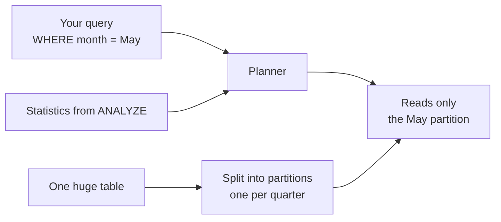
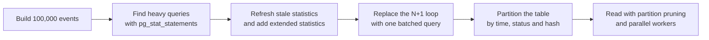
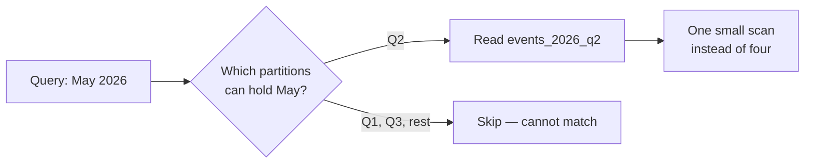
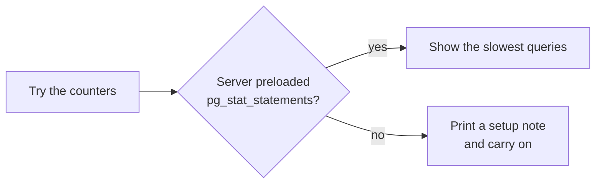
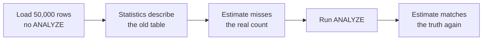
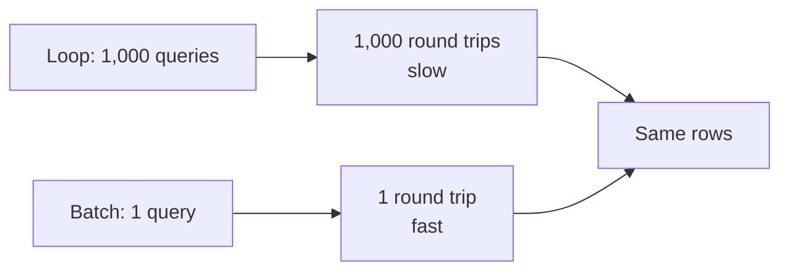
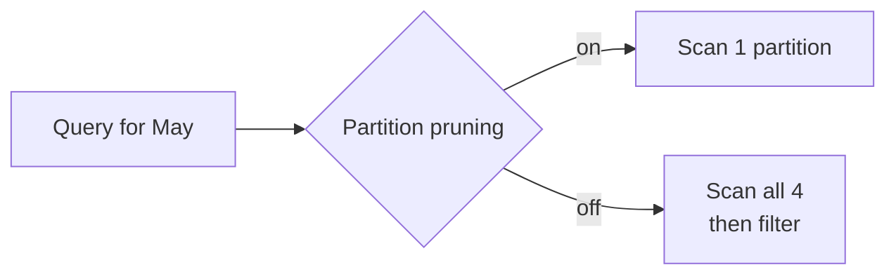
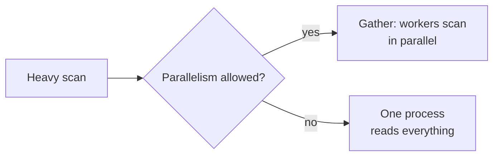

# Tune Workloads with Stats and Partitioning

## 1. What are Statistics and Partitions in PostgreSQL?

PostgreSQL runs every Structured Query Language (SQL) query through a planner that must guess how much work each step takes — and it makes those guesses from **statistics**: facts it collects about your data. When one table grows huge, **partitions** split it into pieces so queries can read only the piece they need.

- **Statistics:** facts about a table — roughly how many rows, which values are common, how values are spread — gathered by a command called `ANALYZE`.
- **Planner:** the part of PostgreSQL that uses those statistics to choose how to run a query.
- **Stale statistics:** facts collected long ago, after which the table changed — the planner then guesses wrong.
- **Partitioning:** splitting one big table into smaller physical pieces (partitions) that behave like one table to your queries.

**Example:** statistics are like a weather forecast built from last month's report — great while the weather holds, misleading once conditions change. A partitioned table is a filing cabinet with one drawer per year: to find every document from 2026 you open one drawer, not all of them.



The planner needs both halves to work well: statistics tell it *what the data looks like*, and partitions keep it from *reading data the query cannot need*.

## 2. Problem Statement / Use Case Overview

An analytics dashboard sits on top of an `events` table that grows by thousands of rows an hour. After last week's bulk import, some queries picked odd plans, page times crept upward, and a developer found a code path that issues one tiny query per row. Nobody knows which queries actually cost the most time. In this lesson we measure the workload with `pg_stat_statements`, refresh and extend the statistics the planner relies on, replace a query-at-a-time loop with one batched query, split the big table into time-based partitions, and let several workers scan together.

## 3. Input

One synthetic events table that the notebook itself generates — nothing to download:

- **100,000 events to start**, each stamped every 3 minutes from 1 January 2026; a later step loads 50,000 more.
- **`account_id`**: one of 5,000 accounts.
- **`event_type` and `event_code`**: `click`/`view`/`signup`/`purchase`, where the code always matches the type (`EV1`–`EV4`) — deliberately correlated, so we can show the planner struggling with it.
- **`status`**: mostly `ok`, one in twenty `failed`.
- **`payload`** and **`created_at`**: a short text blob and a timestamp.

Three partitioned copies of this data (by quarter, by status, by hash) are built during the lesson, and the assignment builds its own small tables. Total size: about 20 MB.

## 4. Processing

We work through the workload in six moves — measure first, then fix, then restructure:



At every stage we read query plans with `EXPLAIN`, PostgreSQL's command that prints how a query would run, so you can see each change take effect.

## 5. Output

Every step prints something you can check against. The key results:

- **Step 2** lists the slowest queries so far, with the heavy scan on top — the `pg_stat_statements` view is our workload's receipt (timings from one run on a laptop; yours will differ):

  ```
  calls | total_ms | mean_ms |                          query
 ------+----------+---------+--------------------------------------------------------
      1 |     41.7 |  41.740 | SELECT count(*) FROM events WHERE md5(payload || accoun
      1 |      0.3 |   0.291 | SELECT pg_stat_statements_reset()
      1 |      0.0 |   0.010 | SELECT account_id, status, created_at FROM events WHERE
  (3 rows)
  ```

- **Step 3** shows the planner's estimate drifting after the big load, then snapping back after `ANALYZE` (the exact estimate depends on the random sample `ANALYZE` draws, so your digits will differ slightly):

  ```
  Aggregate  (cost=4111.52..4111.53 rows=1 width=8)
    ->  Seq Scan on events  (cost=0.00..4017.56 rows=37581 width=0)
          Filter: (event_type = 'purchase'::text)

  count
  -----
  75000
  (1 row)

  Aggregate  (cost=4205.80..4205.81 rows=1 width=8)
    ->  Seq Scan on events  (cost=0.00..4018.00 rows=75120 width=0)
          Filter: (event_type = 'purchase'::text)
  ```

  The estimate (`rows=37581`) misses the real count (75,000) by about a factor of two until `ANALYZE` lands it back at `rows=75120`.

- **Step 4** fixes the estimate for the correlated pair with extended statistics: the plan's `rows=` jumps from roughly half the truth to almost exactly it (37,620 before, 74,195 after, against a real 75,000).

- **Step 5** times both ways of fetching 1,000 rows and proves they return the same data:

  ```
  N+1 loop :     40.2 ms for 1,000 queries
  Batch    :      1.7 ms for 1 query
  same rows both ways: True
  ```

  and the call-count view shows the loop as a single entry with `calls = 1000`.

- **Step 6** shows partition pruning: the plan for one month touches exactly one partition; with pruning switched off, an `Append` node opens all four.

- **Steps 7–8** print row counts per partition — list partitioning groups by value, hash spreads rows evenly — and an equality lookup still reads a single hash partition.

- **Step 9** shows a `Gather` node with `Workers Launched` for the heavy scan, and none when parallelism is off, with the execution times to match.

Exact numbers (times, buffer counts, sample-based estimates) depend on your server; the *shape* of each result is what to compare. Sample outputs are shown above with your own digits noted where they may differ.

## 6. Tech Stack

| Tool | Version | Role |
|------|---------|------|
| PostgreSQL | 18 (everything hands-on runs on 14 or newer) | Database server |
| psycopg | 3.3.6 | Python driver for PostgreSQL |
| python-dotenv | 1.2.4 | Loads the `.env` settings |
| Jupyter | any recent version | Runs the notebook |

**Compute and cost:** any laptop Central Processing Unit (CPU) with about 1 gigabyte (GB) of free Random Access Memory (RAM) and roughly 30 megabytes (MB) of disk is enough. No Graphics Processing Unit (GPU), cloud account or paid service is needed. The notebook runs in about a minute. The optional `pg_stat_statements` part needs one server restart (free, instructions in Section 9).

## 7. Underlying Concepts

**Your workload and its receipt.** A *workload* is the stream of queries your application sends to the database. You cannot tune what you cannot see, and `pg_stat_statements` is the built-in tool that makes the workload visible: once enabled, PostgreSQL tallies every query — how many times it ran (`calls`), the total time it consumed, and the average time per run. *Everyday example:* it is a till receipt for your database — every item (query) listed with how often it was run and what it cost. The one catch: the server must load the extension at startup via `shared_preload_libraries` (see Section 9), because the counters have to exist before the first query runs.

**How the planner estimates.** `ANALYZE` samples rows and stores facts — row count, most common values, number of distinct values, how closely a column's order matches the physical row order. The planner then estimates each step as *table size × selectivity* (the share of rows a condition matches) and picks the cheapest plan. When the table changes a lot after the last `ANALYZE`, the estimate no longer describes reality, and cheap-per-estimated-row choices become slow-in-reality choices. *Everyday example:* a navigation app still routing you around a street that closed last year — every extra detour is minutes lost, exactly like a plan built on numbers from the past. Fix: run `ANALYZE` after big loads.

**Extended statistics.** Regular statistics describe one column at a time, so the planner assumes columns are independent unless told otherwise. If `event_type` and `event_code` always appear as fixed pairs, multiplying their separate estimates badly miscounts the rows matching both. A `CREATE STATISTICS` entry records how the columns depend on each other, and the next `ANALYZE` uses it. *Everyday example:* knowing the street names of a city and the postal codes of a city separately doesn't tell you which code belongs to which street — the pairing is the missing fact.

**The N+1 query pattern.** An application that fetches one row with one query — then another, then another — runs the N+1 pattern: N single-row queries where one query with `= ANY(...)` (a list of values) would do. Each round trip costs network and planning time, and the damage multiplies with N. `pg_stat_statements` exposes it as one entry with a huge `calls` number, which is also how you spot N+1 loops you did not write yourself. *Everyday example:* buying your shopping one item per trip to the shop, instead of handing over the whole list once.

**Partitioning and pruning.** A partitioned table stores rows in separate physical partitions but presents one table name to your queries:
- **Range partitioning** splits by an ordered column — one partition per quarter of time. For logs, orders and events, time is the natural key.
- **List partitioning** groups by exact values — one partition per status.
- **Hash partitioning** spreads rows evenly by a hash of a key — useful to break up a huge table when no single column splits it naturally.

*Partition pruning* is the planner's shortcut: when the `WHERE` clause names a range or value, PostgreSQL reads only the partitions that can hold matching rows and skips the rest entirely. *Everyday example:* looking for a document from 2026 in a cabinet with a drawer per year — you open one drawer.



**Parallel query.** For big enough scans PostgreSQL can launch background workers to share the work; the plan shows a `Gather` node with `Workers Planned` and `Workers Launched`, each worker scanning part of the table under a `Partial Aggregate` (or similar) node. Small queries never go parallel — the setup cost would exceed the saving — and `max_parallel_workers_per_gather` caps how many workers one query may use. *Everyday example:* moving a sofa is faster with two friends than solo, but asking four people to lift one shopping bag is a waste.

**Just-in-Time (JIT) compilation.** For very expensive queries, PostgreSQL can compile the plan into machine code instead of interpreting it step by step; when that happens, `EXPLAIN` shows a `JIT` section with its own timings. Small queries never bother — the preparation would cost more than it saves. *Everyday example:* a chef preps and chops ingredients before a banquet, but not before making a single sandwich.

**Asynchronous input/output (I/O).** PostgreSQL 18 reads pages in batches — issuing several page reads at once and moving on instead of waiting for each one to finish — which speeds up large sequential scans. *Everyday example:* ordering all your groceries in one go rather than waiting for each item to arrive before ordering the next. You do not switch it on in SQL; it is on by default for the scans it suits.

## 8. Prerequisites

- A running PostgreSQL server, version 18 recommended (everything hands-on runs on 14 or newer).
- The shared `.env` file filled in (see Section 9).
- Basic Structured Query Language (SQL): `SELECT`, `WHERE`, `CREATE TABLE`, `INSERT`.
- A server you can restart once, *only if* you want the `pg_stat_statements` part — it is optional, and the lesson continues without it (Section 9).

## 9. Environment / Dependencies Setup

All connection settings live in one shared `.env` file at the course root. Copy `.env.example` to `.env` once and fill in your values (the keys are `PGHOST`, `PGPORT`, `PGUSER`, `PGPASSWORD`, `PGDATABASE` and `PGSSLMODE`). Every notebook reads it with `load_dotenv("../../.env")`, so start Jupyter from inside this lesson's folder.

Install the packages (the first notebook cell does the same thing):

```bash
pip install "psycopg[binary]==3.3.6" "python-dotenv==1.2.4"
```

**Optional — enable `pg_stat_statements`.** The counters only work if the server loads the extension when it starts. In `psql`, run `SHOW config_file;` to find your `postgresql.conf`, add this line to it, and restart the server:

```bash
shared_preload_libraries = 'pg_stat_statements'
```

If you skip this (or cannot restart the server), the notebook prints a short note in Steps 2 and 5 and carries on — every other part of the lesson works without it.

## 10. Step-wise Development Instructions

### Setup — Install the packages

```python
!pip install "psycopg[binary]==3.3.6" "python-dotenv==1.2.4"
```

This one line installs the exact versions of the two libraries we use: `psycopg` (a Python driver, which lets Python talk to PostgreSQL) and `python-dotenv` (which reads our connection settings from the shared `.env` file). Pinning the versions keeps the lesson working months from now.

### Setup — Load the settings

```python
# Bring in the tools we need.
import os
import time
from decimal import Decimal

import psycopg
from psycopg import sql
from dotenv import load_dotenv

# Read the connection settings from the shared .env file.
load_dotenv("../../.env")
PGHOST = os.getenv("PGHOST", "localhost")
PGPORT = os.getenv("PGPORT", "5432")
PGUSER = os.getenv("PGUSER", "postgres")
PGPASSWORD = os.getenv("PGPASSWORD") or None
PGDATABASE = os.getenv("PGDATABASE", "university")
PGSSLMODE = os.getenv("PGSSLMODE", "prefer")
```

We import the libraries and read the connection settings (server address, port, user, password, database name) from the shared `.env` file. Each setting has a safe default, and the password is never written in the code. `time` will measure how long each way of fetching rows takes in Step 5.

### Setup — Connect to PostgreSQL

```python
# Connect to the server, create our practice database if it is missing, then open our connection.
conn_args = dict(host=PGHOST, port=PGPORT, user=PGUSER, password=PGPASSWORD, sslmode=PGSSLMODE)
try:
    with psycopg.connect(dbname="postgres", autocommit=True, **conn_args) as admin:
        if not admin.execute("SELECT 1 FROM pg_database WHERE datname = %s", (PGDATABASE,)).fetchone():
            admin.execute(sql.SQL("CREATE DATABASE {}").format(sql.Identifier(PGDATABASE)))
    conn = psycopg.connect(dbname=PGDATABASE, **conn_args)
    print("connected to", PGDATABASE)
except psycopg.OperationalError as err:
    raise SystemExit(f"Could not connect. Is PostgreSQL running, and do the .env settings match it?\n{err}")
```

We connect twice: first to the built-in `postgres` database to create `university` if it does not exist yet, then to `university` itself. If the server is down or a setting is wrong, we stop with a friendly message instead of a long error. We leave autocommit off, so our changes only become permanent when we call `conn.commit()`.

### Setup — Add a printing helper

```python
# A small helper that runs a query and prints the result as a neat table.
def show(query, params=None):
    """Run a query and print the result as a psql-style table."""
    with conn.cursor() as cur:
        cur.execute(query, params)
        if cur.description is None:              # statements like CREATE or INSERT return no rows
            print(cur.statusmessage)
            return
        cols = [d.name for d in cur.description]
        rows = cur.fetchall()
    fmt = lambda v: "NULL" if v is None else ("t" if v is True else "f" if v is False else str(v))
    cells = [[fmt(v) for v in r] for r in rows]
    numeric = [bool(rows) and all(v is None or (isinstance(v, (int, float, Decimal)) and not isinstance(v, bool)) for v in col)
               for col in zip(*rows)] or [False] * len(cols)
    widths = [max([len(c)] + [len(r[i]) for r in cells]) for i, c in enumerate(cols)]
    print(" | ".join(c.center(w) for c, w in zip(cols, widths)).rstrip())
    print("-+-".join("-" * w for w in widths))
    for r in cells:
        print(" | ".join(v.rjust(w) if numeric[i] else v.ljust(w) for i, (v, w) in enumerate(zip(r, widths))).rstrip())
    print(f"({len(rows)} row{'' if len(rows) == 1 else 's'})")
```

We will print many query results, so we write this printing code once as a function called `show` and reuse it in every later cell. It runs the query, turns each value into text, lines the columns up, and prints a row count at the bottom. (`psql` in its docstring is PostgreSQL's command-line tool, whose tables look just like this.)

### Setup — Add a plan-printing helper

```python
# Print how PostgreSQL would run a query. analyze=True also runs it and reports real times.
def explain(query, analyze=False):
    """Print PostgreSQL's plan for a query; with analyze=True, also run it."""
    prefix = "EXPLAIN (ANALYZE, COSTS OFF, TIMING OFF) " if analyze else "EXPLAIN "
    with conn.cursor() as cur:
        cur.execute(prefix + query)
        for (line,) in cur.fetchall():
            print(line)
```

Almost every step of this lesson compares a plan before and after a change, so we wrap `EXPLAIN` in a helper too. Called plainly, it prints the planner's *estimate* — the `rows=` number is what the statistics led it to expect. Called with `analyze=True`, it runs the query for real and prints actual rows and execution time instead. We switch off cost numbers and per-row timings so the output stays short.

### Step 1 — Build the events table to practise on

```python
# Start clean so we can run this notebook again and again.
conn.execute("DROP TABLE IF EXISTS events CASCADE")

# Our practice table: what happened, to which account, and when.
# autovacuum stays OFF only so Step 3's statistics really go stale for the demo — never disable it on a real table.
conn.execute("""
    CREATE TABLE events (
        event_id    BIGINT GENERATED ALWAYS AS IDENTITY PRIMARY KEY,
        account_id  INTEGER NOT NULL,
        event_type  TEXT NOT NULL,   -- click, view, signup, purchase
        event_code  TEXT NOT NULL,   -- EV1..EV4, always matching the event_type
        status      TEXT NOT NULL,   -- ok or failed
        payload     TEXT,
        created_at  TIMESTAMP NOT NULL
    ) WITH (autovacuum_enabled = false)
""")

# Let PostgreSQL invent 100,000 events: 5,000 accounts, one every 3 minutes from 1 Jan 2026.
conn.execute("""
    INSERT INTO events (account_id, event_type, event_code, status, payload, created_at)
    SELECT g % 5000 + 1,
           CASE WHEN g % 4 = 0 THEN 'click'  WHEN g % 4 = 1 THEN 'view'
                WHEN g % 4 = 2 THEN 'signup' ELSE 'purchase' END,
           CASE WHEN g % 4 = 0 THEN 'EV1' WHEN g % 4 = 1 THEN 'EV2'
                WHEN g % 4 = 2 THEN 'EV3' ELSE 'EV4' END,
           CASE WHEN g % 20 = 0 THEN 'failed' ELSE 'ok' END,
           repeat('x', 50),
           TIMESTAMP '2026-01-01' + g * INTERVAL '3 minutes'
    FROM generate_series(1, 100000) AS g
""")

# Gather statistics so the planner knows what the table looks like.
conn.execute("ANALYZE events")
conn.commit()
show("SELECT count(*) AS events, count(DISTINCT account_id) AS accounts FROM events")
```

- **Input:** nothing — PostgreSQL generates every row from `generate_series`, which counts from 1 to 100,000 and gives us one event per number.
- **What happens:** we drop any leftovers from an earlier run, create the table, invent 100,000 events, then run `ANALYZE` so the planner starts with accurate statistics.
- **Output:** a confirmation that we have 100,000 events across 5,000 accounts.
- **Why:** this is the workload everything else tunes. We switch autovacuum (PostgreSQL's automatic maintenance) off *for this table only* so that Step 3 can show statistics genuinely going stale — on a real table autovacuum would quietly refresh them for us.

### Step 2 — See which queries cost the most

```python
# The counters live in the extension; they only work if the server preloaded it at startup (Section 9).
pss_ready = True
try:
    conn.execute("CREATE EXTENSION IF NOT EXISTS pg_stat_statements")
    conn.execute("SELECT pg_stat_statements_reset()")
except psycopg.errors.ObjectNotInPrerequisiteState:
    conn.rollback()   # the failed statement aborted the transaction, so we clean up before continuing
    pss_ready = False
    print("This server did not preload pg_stat_statements — see Section 9 to enable it (optional).")

# A small workload to measure: one heavy scan over every row...
conn.execute("SELECT count(*) FROM events WHERE md5(payload || account_id::text) LIKE 'a%'")

# ...and one quick single-row lookup, so the receipt has something fast to compare against.
show("SELECT account_id, status, created_at FROM events WHERE event_id = 42")

# Now ask the server which queries have used the most time so far.
if pss_ready:
    show("""
        SELECT calls,
               round(total_exec_time::numeric, 1) AS total_ms,
               round(mean_exec_time::numeric, 3) AS mean_ms,
               left(query, 55) AS query
        FROM pg_stat_statements
        ORDER BY total_exec_time DESC
        LIMIT 5
    """)
else:
    print("(skipped: pg_stat_statements is not available on this server)")
conn.commit()
```

- **Input:** our connection, plus whatever queries have run since we reset the counters.
- **What happens:**
  - We create the extension (installing it is harmless anywhere) and reset its counters. The first *call* to the counters fails if the server did not preload the extension at startup — we catch exactly that error, roll back the half-done transaction, print a pointer to Section 9, and mark `pss_ready = False` so later cells skip their `pg_stat_statements` part and continue.
  - We run a deliberately heavy full-table scan and a quick single-row lookup, then read the view: every query with its call count, total time and average time, most expensive first.
- **Output:** a small table where the `md5` scan tops the list with tens of milliseconds and the point lookup trails at well under a millisecond.
- **Why:** you cannot tune what you cannot measure. This view is how you find the queries worth fixing first — including the N+1 loop we will meet in Step 5.



If the diagram's right-hand path ran on your machine, that is fine — every other step works without the extension.

### Step 3 — Watch statistics go stale (and fix them)

```python
# A big load of brand-new purchase events — but we deliberately do NOT run ANALYZE yet.
conn.execute("""
    INSERT INTO events (account_id, event_type, event_code, status, payload, created_at)
    SELECT g % 5000 + 1, 'purchase', 'EV4', 'ok', repeat('x', 50),
           TIMESTAMP '2026-08-01' + g * INTERVAL '3 minutes'
    FROM generate_series(1, 50000) AS g
""")
conn.commit()

# What does the planner EXPECT for purchase events? The rows= number is its estimate.
explain("SELECT count(*) FROM events WHERE event_type = 'purchase'")

# What is really there?
show("SELECT count(*) FROM events WHERE event_type = 'purchase'")

# Refresh the statistics and ask the planner again.
conn.execute("ANALYZE events")
conn.commit()
explain("SELECT count(*) FROM events WHERE event_type = 'purchase'")
```

- **Input:** the `events` table with 50,000 extra rows loaded behind the statistics' back.
- **What happens:**
  - We insert 50,000 purchases without refreshing statistics, so the facts on file still describe the old, smaller table.
  - Plain `EXPLAIN` prints the planner's estimate (`rows=...`); `count(*)` prints the truth; the gap is how stale the statistics are.
  - `ANALYZE` re-samples the table, and the next estimate lands on the truth again.
- **Output:** an estimate that misses the real count by a wide margin, then a refreshed estimate that matches it closely (exact digits depend on the random sample, so yours will differ slightly).
- **Why:** every plan is built on these numbers. After any bulk load, one `ANALYZE` is the cheapest performance fix there is.



### Step 4 — Teach the planner about correlated columns

```python
# event_code always matches event_type, but the planner estimates them as if independent.
explain("SELECT count(*) FROM events WHERE event_type = 'purchase' AND event_code = 'EV4'")

# Record how these two columns depend on each other...
conn.execute("CREATE STATISTICS events_type_code (dependencies) ON event_type, event_code FROM events")

# ...and refresh the statistics so the new fact gets used.
conn.execute("ANALYZE events")
conn.commit()

# The same query again — the estimate should now be close to the truth.
explain("SELECT count(*) FROM events WHERE event_type = 'purchase' AND event_code = 'EV4'")
show("SELECT count(*) AS matching_rows FROM events WHERE event_type = 'purchase' AND event_code = 'EV4'")
```

- **Input:** a query with two conditions whose values are tied together — `purchase` always arrives with `EV4`.
- **What happens:** first the planner multiplies two separate estimates, assuming independence, and lands far below the real count. We create a statistics object over the *pair*, re-run `ANALYZE`, and ask again — the new estimate uses the recorded dependency and jumps to roughly the true count.
- **Output:** a plan whose `rows=` roughly triples to meet reality, plus the real `count(*)` right beside it for comparison.
- **Why:** one-column statistics cannot see relationships between columns. When two columns are used together in real queries (as denormalised codes often are), one `CREATE STATISTICS` line gives the planner the missing fact — no queries or indexes change.

### Step 5 — Replace 1,000 queries with one

```python
# The 1,000 event ids we want to fetch.
ids = list(range(1, 1001))

# The N+1 way: one query per id — a round trip to the server every time.
start = time.perf_counter()
rows_loop = []
with conn.cursor() as cur:
    for event_id in ids:
        cur.execute("SELECT account_id, payload FROM events WHERE event_id = %s", (event_id,))
        rows_loop.append(cur.fetchone())
loop_seconds = time.perf_counter() - start

# The batched way: every id in ONE query — one round trip.
start = time.perf_counter()
with conn.cursor() as cur:
    cur.execute("SELECT account_id, payload FROM events WHERE event_id = ANY(%s) ORDER BY event_id", (ids,))
    rows_batch = cur.fetchall()
batch_seconds = time.perf_counter() - start

print(f"N+1 loop : {loop_seconds * 1000:8.1f} ms for 1,000 queries")
print(f"Batch    : {batch_seconds * 1000:8.1f} ms for 1 query")
print("same rows both ways:", rows_loop == rows_batch)

# pg_stat_statements now remembers the loop as a single entry with calls = 1000.
if pss_ready:
    show("""
        SELECT calls,
               round(total_exec_time::numeric, 1) AS total_ms,
               round(mean_exec_time::numeric, 3) AS mean_ms,
               left(query, 55) AS query
        FROM pg_stat_statements
        WHERE query ILIKE '%from events where event_id%'
        ORDER BY calls DESC
    """)
else:
    print("(skipped: pg_stat_statements is not available on this server)")
conn.commit()
```

- **Input:** 1,000 event ids, fetched both ways.
- **What happens:**
  - The loop runs the same single-row query 1,000 times, timing the whole thing — every call pays a round trip.
  - One query with `= ANY(...)` (PostgreSQL's "match any value in this list" operator) sends all ids at once and sorts the results.
  - We compare the two row lists to prove the batch returns exactly the same data.
  - Finally we ask `pg_stat_statements` for every query touching `events WHERE event_id`: the loop appears as *one* entry with `calls = 1000`, next to the batch's single call — which is how you spot N+1 loops in real applications you did not write.
- **Output:** timing lines for both ways (the loop takes tens to hundreds of times longer than the batch; over a real network the gap grows further), a `True` for identical rows, and the call-count table.
- **Why:** N+1 is the most common self-inflicted slowdown in data applications. The fix is always the same — send the list, not the loop — and the receipt above proves both what it costs and that you fixed it.



### Step 6 — Split the table by time

```python
# Start clean so we can run this notebook again and again.
conn.execute("DROP TABLE IF EXISTS events_p CASCADE")

# One table name, four physical pieces: a partition per quarter of 2026, plus a catch-all.
conn.execute("""
    CREATE TABLE events_p (
        account_id INTEGER NOT NULL,
        event_type TEXT NOT NULL,
        event_code TEXT NOT NULL,
        status     TEXT NOT NULL,
        created_at TIMESTAMP NOT NULL
    ) PARTITION BY RANGE (created_at)
""")
conn.execute("CREATE TABLE events_2026_q1 PARTITION OF events_p FOR VALUES FROM ('2026-01-01') TO ('2026-04-01')")
conn.execute("CREATE TABLE events_2026_q2 PARTITION OF events_p FOR VALUES FROM ('2026-04-01') TO ('2026-07-01')")
conn.execute("CREATE TABLE events_2026_q3 PARTITION OF events_p FOR VALUES FROM ('2026-07-01') TO ('2026-10-01')")
conn.execute("CREATE TABLE events_rest PARTITION OF events_p DEFAULT")

# Copy every event into its time slice, then gather statistics for the whole table.
conn.execute("""
    INSERT INTO events_p (account_id, event_type, event_code, status, created_at)
    SELECT account_id, event_type, event_code, status, created_at FROM events
""")
conn.execute("ANALYZE events_p")
conn.commit()
show("SELECT tableoid::regclass AS partition, count(*) FROM events_p GROUP BY 1 ORDER BY 1")
```

- **Input:** the 150,000-row `events` table.
- **What happens:** we declare `events_p` as *partitioned by range* over `created_at`, then add four partitions: three cover the quarters of 2026 and a `DEFAULT` partition catches everything else (including the October–November tail our data runs into). Inserting through `events_p` routes each row to its partition automatically — no `CASE` needed. `tableoid::regclass` is how we peek behind the curtain: it shows which physical partition each row landed in.
- **Output:** one row per partition with its count — every event filed in exactly one place, catch-all included.
- **Why:** queries will soon read one partition instead of the whole table, and maintenance (say, dropping old data) becomes "drop a partition" rather than "delete millions of rows".

### Step 7 — Read one month, not four quarters

```python
# A query for one month. Pruning lets PostgreSQL read ONLY the partition that can hold it.
explain("SELECT count(*) FROM events_p WHERE created_at >= '2026-05-01' AND created_at < '2026-06-01'")

# Turn pruning off — now the same query must open every partition to be sure.
conn.execute("SET enable_partition_pruning = off")
explain("SELECT count(*) FROM events_p WHERE created_at >= '2026-05-01' AND created_at < '2026-06-01'")
conn.execute("RESET enable_partition_pruning")
conn.commit()
```

- **Input:** one month's query, planned twice: normally, then with pruning disabled.
- **What happens:** with pruning on, the planner looks at the date range, works out that only `events_2026_q2` can hold May 2026, and plans a single scan against it — the other partitions do not even appear. With `enable_partition_pruning = off`, the plan grows an `Append` node that opens all four partitions and filters each one.
- **Output:** a one-partition plan versus a four-partition plan for the *identical* query.
- **Why:** pruning is what makes partitioning pay off — the database skips entire pieces of disk without reading them. It happens automatically whenever your `WHERE` clause gives the partition key a usable range or value.



### Step 8 — Group by value, then spread by hash

```python
# Start clean so we can run this notebook again and again.
conn.execute("DROP TABLE IF EXISTS events_l CASCADE")

# List partitioning: one partition per status; anything unexpected falls into the default.
conn.execute("""
    CREATE TABLE events_l (
        account_id INTEGER NOT NULL,
        status     TEXT NOT NULL,
        created_at TIMESTAMP NOT NULL
    ) PARTITION BY LIST (status)
""")
conn.execute("CREATE TABLE events_ok PARTITION OF events_l FOR VALUES IN ('ok')")
conn.execute("CREATE TABLE events_failed PARTITION OF events_l FOR VALUES IN ('failed')")
conn.execute("CREATE TABLE events_other PARTITION OF events_l DEFAULT")
conn.execute("INSERT INTO events_l SELECT account_id, status, created_at FROM events")
conn.execute("ANALYZE events_l")
conn.commit()
show("SELECT tableoid::regclass AS partition, count(*) FROM events_l GROUP BY 1 ORDER BY 1")
```

- **Input:** the same events, this time grouped by their `status` value.
- **What happens:** `PARTITION BY LIST (status)` gives every distinct status its own partition — `ok` and `failed` get named ones, and a `DEFAULT` partition is the safety net for any future status (insert a new value without one and the insert fails loudly instead of vanishing).
- **Output:** two populated partitions — the heavily skewed `ok` count next to the small `failed` one, with no rows in the catch-all.
- **Why:** list partitioning suits columns with few known values, and it lets maintenance target exactly one value: "archive all failed events" becomes a partition move.

```python
# Start clean so we can run this notebook again and again.
conn.execute("DROP TABLE IF EXISTS events_h CASCADE")

# Hash partitioning: four pieces, spread by a hash of account_id — no rule about which account goes where.
conn.execute("""
    CREATE TABLE events_h (
        account_id INTEGER NOT NULL,
        status     TEXT NOT NULL,
        created_at TIMESTAMP NOT NULL
    ) PARTITION BY HASH (account_id)
""")
for remainder in range(4):
    conn.execute(f"CREATE TABLE events_h{remainder} PARTITION OF events_h FOR VALUES WITH (MODULUS 4, REMAINDER {remainder})")
conn.execute("INSERT INTO events_h SELECT account_id, status, created_at FROM events")
conn.execute("ANALYZE events_h")
conn.commit()
show("SELECT tableoid::regclass AS partition, count(*) FROM events_h GROUP BY 1 ORDER BY 1")

# An equality lookup still prunes: only the one partition that can hold account 42 is read.
explain("SELECT count(*) FROM events_h WHERE account_id = 42")
```

- **Input:** `account_id`, with no natural ordering that would make ranges useful.
- **What happens:** we split into four partitions by *modulo* — `MODULUS 4, REMAINDER 0..3` — and a short loop writes the four `CREATE TABLE` statements instead of us repeating them by hand. PostgreSQL hashes each incoming `account_id` and files it in the partition whose remainder matches. A final `EXPLAIN` on `WHERE account_id = 42` shows pruning still works: the plan reads exactly one of the four.
- **Output:** four counts of nearly equal size (the hash spreads rows evenly), then a single-partition plan for the lookup.
- **Why:** hash partitioning is the fallback when no column splits your data evenly — it trades "ranges make sense" for "every partition is about the same size", which is exactly what you want when the goal is simply to keep each piece small.


### Step 9 — Let workers share the big scan

```python
# Warm the buffer cache first, so both runs below read from memory rather than disk.
show("SELECT count(*) FROM events")

# A deliberately expensive scan — look for Gather and Workers Launched in the plan.
explain("SELECT count(*) FROM events WHERE md5(payload || account_id::text) LIKE 'ab%'", analyze=True)

# The same query with parallelism switched off.
conn.execute("SET max_parallel_workers_per_gather = 0")
explain("SELECT count(*) FROM events WHERE md5(payload || account_id::text) LIKE 'ab%'", analyze=True)
conn.execute("RESET max_parallel_workers_per_gather")
conn.commit()
```

- **Input:** an expensive full-table scan (hashing every row costs real processor time), planned twice.
- **What happens:**
  - The warm-up query pulls the table into the buffer cache (memory), so disk speed does not skew the comparison.
  - The first plan shows a `Gather` node: PostgreSQL launched background workers, each scanning part of the table under `Partial Aggregate`, then combined the pieces.
  - The second plan, with `max_parallel_workers_per_gather = 0`, is a plain single-process `Seq Scan`.
- **Output:** two plans and two execution times — `Workers Planned`/`Workers Launched` above, none below (your times and worker count will differ; the *shape* is the lesson).
- **Why:** one query can use several cores only if it is worth the setup cost, which is why small queries stay single-threaded. For big scans, this is free speed — and the same `Gather` shape is what you look for when a large query is slower than expected.



### Cleanup — Close the connection

```python
# Close the connection politely. Our tables stay in the database.
conn.close()
print("connection closed")
```

We close the connection when we are done. The tables and statistics we made stay in the database.

## 11. What We Learnt

- **Statistics drive the planner:** `ANALYZE` samples the table, the planner multiplies table size by selectivity, and stale facts after a bulk load mean wrong estimates — one `ANALYZE` fixes them, as explained in Section 7.
- **Extended statistics** record how columns depend on each other, so correlated pairs stop being estimated as if they were independent.
- **`pg_stat_statements`** is the receipt for your workload: call counts and time totals show which queries are worth fixing — and expose N+1 loops as one entry with a huge `calls` number.
- **N+1 loops** become one batched query with `= ANY(...)`, trading thousands of round trips for one.
- **Partitioning** splits one table into range, list or hash pieces, and **partition pruning** lets queries read only the partitions that can match — one drawer instead of the whole cabinet.
- **Parallel query, Just-in-Time (JIT) compilation and asynchronous input/output (I/O)** are the planner's heavy machinery: worth knowing by sight (`Gather`, a `JIT` section) even when you only watch them work.
