# Transactions, Multi-Version Concurrency Control (MVCC) and Locking

## 1. What are Transactions, MVCC and Locking?

Every time two people use your app at the same moment, the database has to answer a hard question: whose change wins, and what does each person see while the other is still working? PostgreSQL answers with three ideas that fit together — transactions, Multi-Version Concurrency Control (MVCC), and locks.

- **Transaction:** a group of statements that either all take effect or none do. You decide when it ends.
- **MVCC:** PostgreSQL keeps several versions of a row instead of overwriting it, so readers can see a stable copy while a writer works on a new one. That is why readers never block writers.
- **Lock:** a marker on a row (or a name) that stops a second writer from changing it at the same time. Locks are what make two customers competing for one seat take turns.
- **Isolation level:** the rule that decides how much of other people's unfinished work a transaction is allowed to see.

**Example:** picture a booking sheet on a clipboard at a small venue. Two people reach for the same free seat. Without rules, both scribble their name and one booking silently disappears. A transaction is one person finishing their entry; MVCC lets everyone read a photocopy that never changes mid-sentence; a lock is the pen — only one hand holds it at a time.

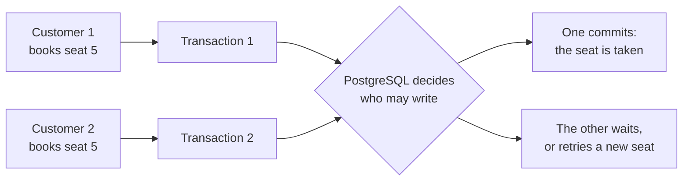

Get this right and your app stays correct under load. Get it wrong and you ship double bookings, lost updates, and reports that quietly count the same order twice.

## 2. Problem Statement / Use Case Overview

A small venue sells six seats through a web app. Last week two customers clicked **Book** on seat 5 within the same second, both got a confirmation email, and only one name ended up on the sheet. The team also has a nightly cleanup job that occasionally runs twice at once, and a report that shows different totals when you refresh it mid-run.

None of this is a bug in the app's button. It is a concurrency problem: two transactions touched the same row without agreeing on who goes first, and nobody checked what the other had already committed. In this lesson we reproduce each failure with two live database sessions, watch what PostgreSQL actually does, and fix every one of them with the right tool — a row lock, a conditional write, `SKIP LOCKED`, a stricter isolation level, or an advisory lock.

## 3. Input

One tiny table the notebook creates itself — nothing to download:

- **`seats`**: six rows, one per seat, with `seat_no`, `booked_by` (empty while the seat is free) and `booked_at`.
- **Two or more live connections:** the notebook opens extra connections to the same database and drives them side by side, exactly like two customers on two phones.
- **No outside data.** Every row is generated by `generate_series(1, 6)`, so the whole lesson runs in a couple of seconds.

## 4. Processing

We recreate the venue's problems one at a time, then fix them one at a time:

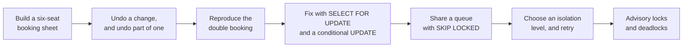

Every step prints the booking sheet, so you can see the state of the world before and after. Where a step needs two sessions, we open a second connection in the same cell and close it when the step ends.

## 5. Output

Each step prints something you can check against. The key results:

- **Step 2** shows a booking that exists inside the transaction, then vanishes after `rollback()`, and finally survives after `commit()` — the same seat, three different outcomes.
- **Step 3** leaves only seat 2 booked: the savepoint undid seat 3 and kept the rest.
- **Step 4** shows the bug. Both sessions read the seat as free, both wrote, and the sheet ends with one name:

  ```
  alice sees: None
  bob sees:   None
  seat_no | booked_by
  --------+----------
  5       | bob
  (1 row)
  alice_bookings
  --------------
  0
  (1 row)
  ```

- **Step 5** proves the two halves of MVCC in one screen: a plain read from another session returns instantly with the old value, while a lock request waits and gives up:

  ```
  seat_no | booked_by
  --------+----------
  3       | NULL
  (1 row)
  bob waited 1.00s, then gave up: canceling statement due to lock timeout
  ```

  After Alice commits, Bob's retry sees `alice` and he takes seat 4 instead.
- **Step 6** reports `alice changed 1 row(s), bob changed 0 row(s)` — the losing update now knows it lost.
- **Step 7** prints `worker-1 claimed seat 1 while worker-2 claimed seat 2`: neither worker waited for the other.
- **Step 8** prints `booked at the start: 0   booked a moment later: 1` — one transaction, two different answers, because READ COMMITTED refreshes the snapshot for every statement.
- **Step 9** prints `booked at the start: 0   booked a moment later: 0   (one snapshot)`, then `refused: could not serialize access due to concurrent update`, then a successful retry: the transaction's view never moved, and its write was rejected instead of overwriting someone else.
- **Step 10** prints `first job started: True   second job started: False`, then `True` once the first job releases the lock.
- **Step 11** ends with one session reporting a deadlock and the other finishing normally; the server picks the victim, so which line says "deadlock detected" can swap on your machine.

Exact timings and which session loses the deadlock depend on your server; the *shape* of each result is what to compare.

## 6. Tech Stack

| Tool | Version | Role |
|------|---------|------|
| PostgreSQL | 18 (14 or newer works for everything here) | Database server |
| psycopg | 3.3.6 | Python driver for PostgreSQL |
| python-dotenv | 1.2.4 | Loads the `.env` settings |
| Jupyter | any recent version | Runs the notebook |
| Python `threading` and `time` | standard library | Drives a second session alongside the first for the deadlock demo |

**Compute and cost:** any laptop Central Processing Unit (CPU) with about 200 megabytes (MB) of free memory is enough. No Graphics Processing Unit (GPU), cloud account, or paid service is needed, and the notebook finishes in well under a minute — plus about one second of deliberate waiting in Step 5 and one second in Step 11.

## 7. Underlying Concepts

**ACID (Atomicity, Consistency, Isolation, Durability): the four promises.** A transaction promises four things. **Atomicity** — all its statements happen, or none do. **Consistency** — the database moves from one valid state to another, with every constraint still true. **Isolation** — concurrent transactions cannot see each other's half-finished work. **Durability** — once it commits, the change survives a crash. *Everyday example:* a bank transfer either takes money from one account and puts it in the other, or leaves both untouched; it is never half-done.

**Transactions and how you end them.** PostgreSQL starts a transaction before your first statement in a session that is not in autocommit mode. `COMMIT` keeps everything; `ROLLBACK` throws everything away; a session that disconnects rolls back whatever it had not committed. In psycopg, `conn.commit()` and `conn.rollback()` send exactly those commands. A **savepoint** is a bookmark inside an open transaction: you can roll back to it and keep everything before it, which is how an application undoes one failed step without losing the work that already succeeded. *Everyday example:* an undo stack in a text editor — one undo can take back a single word while the rest of the paragraph stays.

**MVCC: row versions instead of overwrites.** When a transaction updates a row, PostgreSQL does not overwrite it in place. It writes a new version and marks the old one as replaced. Each transaction gets a **snapshot** — a list of which transactions had committed when it started — and it only ever sees row versions that were committed before that snapshot. Old versions stay on disk until `VACUUM` clears them out. *Everyday example:* a shared document where everyone reads the printed copy from this morning while others edit the master file. Nobody waits to read, and nobody sees a half-edited sentence — but your copy does not show today's edits either.

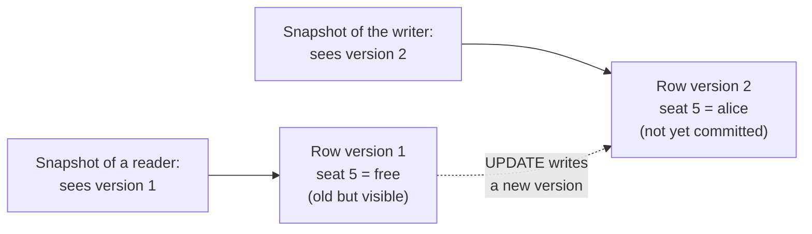

The key consequence: **readers never block writers, and writers never block readers.** Only two writers reaching for the same row have to take turns.

**Isolation levels.** Isolation is a dial, not a switch. PostgreSQL offers three levels:

| Level | What one transaction sees | The anomaly you can still hit |
|-------|---------------------------|-------------------------------|
| `READ COMMITTED` (the default) | a fresh snapshot for **every statement** | a non-repeatable read: the same query returns different rows later in the transaction |
| `REPEATABLE READ` | **one snapshot** for the whole transaction | a write to a row that changed after the snapshot is refused with a serialization error |
| `SERIALIZABLE` | one snapshot plus extra checks that make the result look as if transactions ran one at a time | more serialization errors, because the database works harder to defend the rule |

**Retries are part of the design.** At `REPEATABLE READ` and `SERIALIZABLE`, PostgreSQL may refuse a write rather than let it corrupt your view of the data. It raises the standard error code SQLSTATE `40001` (*could not serialize access due to concurrent update*). Your application catches that error, rolls back, and runs the whole transaction again on a fresh snapshot. Never patch a half-finished transaction — restart it. *Everyday example:* a form that says "someone else changed this record, please try again" — you fill it in again from the new values instead of forcing your stale numbers through.

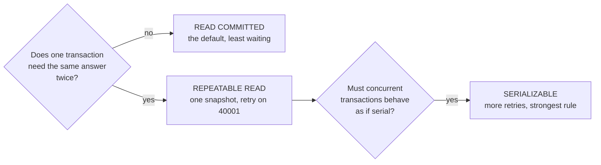

**Row locks.** `UPDATE` and `DELETE` lock the rows they touch until the transaction ends. Plain `SELECT` does not. `SELECT ... FOR UPDATE` reads rows and locks them at the same time, which is how you "hold" a row while you decide what to do with it. Its sibling `FOR NO KEY UPDATE` is the lighter version used when you are not changing the primary key, and `FOR SHARE` lets other readers share but blocks writers. Add `SKIP LOCKED` and a waiting session ignores rows somebody else already locked instead of queuing — perfect for a work queue where any free job will do. *Everyday example:* putting a coat on the chair next to yours at a café to say "this one is taken"; other people walk past it and sit elsewhere.

**Advisory locks.** Some things you need to protect are not rows at all — "only one nightly job may run", "only one process may rebuild this cache". An advisory lock is a lock on a number you choose, held by a database session, that no table owns. `pg_try_advisory_lock(key)` returns `true` or `false` immediately instead of waiting, which makes "if nobody else is doing this, do it" a one-line decision. *Everyday example:* a single key to a shared meeting room kept at the front desk — whoever holds it is inside; everyone else is told to come back later.

**Deadlocks.** A deadlock is a cycle of waiting: Alice holds seat 1 and wants seat 2, Bob holds seat 2 and wants seat 1. Neither can move. PostgreSQL watches for cycles; after `deadlock_timeout` (one second by default) it kills one transaction with SQLSTATE `40P01` (*deadlock detected*) so the other can finish. You cannot stop deadlocks from ever happening, but you can make them rare by locking rows in a consistent order and keeping transactions short.

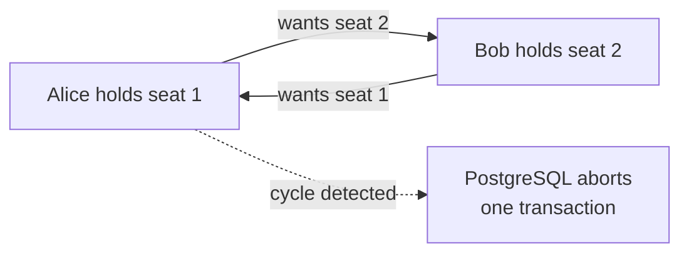

## 8. Prerequisites

- A running PostgreSQL server, version 18 recommended (14 or newer works for everything here).
- The shared `.env` file filled in with your connection settings (see Section 9).
- Basic Structured Query Language (SQL): `SELECT`, `UPDATE`, `INSERT`, `WHERE`.
- Comfort reading short Python scripts: functions, `try`/`except`, and a connection object.
- No accounts, API keys, or extra hardware — everything runs locally.

## 9. Environment / Dependencies Setup

All connection settings live in one shared `.env` file at the course root. Copy `.env.example` to `.env` once and fill in your values (the keys are `PGHOST`, `PGPORT`, `PGUSER`, `PGPASSWORD`, `PGDATABASE` and `PGSSLMODE`). Every notebook reads it with `load_dotenv("../../.env")`, so start Jupyter from inside this lesson's folder.

Install the packages (the first notebook cell does the same thing):

```bash
pip install "psycopg[binary]==3.3.6" "python-dotenv==1.2.4"
```

Give the login in your `.env` permission to create a table in `PGDATABASE` — the notebook creates and drops its own `seats` table there. No server restart, extension, or special configuration is needed for this lesson.

## 10. Step-wise Development Instructions

### Setup — Install the packages

```python
!pip install "psycopg[binary]==3.3.6" "python-dotenv==1.2.4"
```

This one line installs the exact versions of the two libraries we use: `psycopg` (the Python driver that lets Python talk to PostgreSQL) and `python-dotenv` (which reads our connection settings from the shared `.env` file). Pinning the versions keeps the lesson working months from now.

### Setup — Load the settings

```python
# Bring in the tools we need: psycopg to talk to PostgreSQL, and threading + time
# so we can run a second session alongside the first.
import os
import threading
import time

import psycopg
from psycopg import sql
from dotenv import load_dotenv

# Read the connection settings from the shared .env file at the course root.
load_dotenv("../../.env")
PGHOST = os.getenv("PGHOST", "localhost")
PGPORT = os.getenv("PGPORT", "5432")
PGUSER = os.getenv("PGUSER", "postgres")
PGPASSWORD = os.getenv("PGPASSWORD") or None
PGDATABASE = os.getenv("PGDATABASE", "university")
PGSSLMODE = os.getenv("PGSSLMODE", "prefer")

# One dictionary of settings we reuse every time we open a connection.
conn_args = dict(host=PGHOST, port=PGPORT, user=PGUSER,
                 password=PGPASSWORD, sslmode=PGSSLMODE)
```

We import the libraries and read the connection settings (server address, port, user, password, database name) from the shared `.env` file. Each setting has a safe default, and the password never appears in the code. `threading` and `time` are standard Python tools we will need for one step: to make two sessions wait on each other at the same moment.

### Setup — Connect to PostgreSQL

```python
# Make sure our practice database exists, then open the main connection.
try:
    with psycopg.connect(autocommit=True, **{**conn_args, "dbname": "postgres"}) as admin:
        if not admin.execute("SELECT 1 FROM pg_database WHERE datname = %s", (PGDATABASE,)).fetchone():
            admin.execute(sql.SQL("CREATE DATABASE {}").format(sql.Identifier(PGDATABASE)))
    conn = psycopg.connect(dbname=PGDATABASE, **conn_args)
    print("connected to", PGDATABASE)
except psycopg.OperationalError as err:
    raise SystemExit(f"Could not connect. Is PostgreSQL running, and do the .env settings match it?\n{err}")
```

We connect twice: once to the built-in `postgres` database to create our practice database if it is missing, then to that database itself. If the server is down or a setting is wrong, we stop with a friendly message instead of a long error. This connection stays in autocommit mode **off**, so our changes only become permanent when we commit — which is exactly what this lesson is about.

### Setup — Add a printing helper

```python
# A small helper that runs a query and prints the result as a neat table.
# Pass using=<session> to print from a second connection instead of the main one.
def show(query, params=None, using=None):
    """Run a query and print the result as a psql-style table."""
    session = using or conn
    with session.cursor() as cur:
        cur.execute(query, params)
        if cur.description is None:              # statements like CREATE or UPDATE return no rows
            print(cur.statusmessage)
            return
        cols = [d.name for d in cur.description]
        rows = cur.fetchall()
    cells = [["NULL" if v is None else str(v) for v in row] for row in rows]
    widths = [max([len(c)] + [len(row[i]) for row in cells]) for i, c in enumerate(cols)]
    print(" | ".join(c.center(w) for c, w in zip(cols, widths)).rstrip())
    print("-+-".join("-" * w for w in widths))
    for row in cells:
        print(" | ".join(v.ljust(w) for v, w in zip(row, widths)).rstrip())
    print(f"({len(rows)} row{'' if len(rows) == 1 else 's'})")
```

We print a lot of query results, so we write this printing code once and reuse it in every later cell. It runs the query, turns each value into text, lines the columns up, and prints a row count at the bottom. The `using` argument matters here: many steps compare what the main connection sees with what a second session sees, so `show(..., using=other_session)` prints from that session's point of view. (`psql` in the docstring is PostgreSQL's command-line tool, whose tables look just like this.)

### Setup — Open a second session

```python
# Open another connection: think of it as a second customer using the app at the same time.
def new_session():
    """Open an independent connection to our database."""
    return psycopg.connect(dbname=PGDATABASE, **conn_args)
```

Almost every step in this lesson needs two people acting at once, so we wrap "open another connection" in a tiny function and call it whenever a step begins. A connection is a **session**: its own transactions, its own locks, its own view of the data. Closing it rolls back anything it had not committed, which is why each step can start from a clean slate.

### Step 1 — Build a booking sheet to practise on

```python
# Start clean so we can run this notebook again and again.
conn.execute("DROP TABLE IF EXISTS seats CASCADE")

# A tiny booking sheet: one row per seat, empty until somebody books it.
conn.execute("""
    CREATE TABLE seats (
        seat_no   INTEGER PRIMARY KEY,
        booked_by TEXT,              -- the customer holding the seat, NULL while it is free
        booked_at TIMESTAMPTZ        -- when they booked it
    )
""")
conn.execute("INSERT INTO seats (seat_no) SELECT g FROM generate_series(1, 6) AS g")
conn.commit()

show("SELECT seat_no, booked_by FROM seats ORDER BY seat_no")
```

- **Input:** nothing — PostgreSQL generates the six rows from `generate_series`, which counts from 1 to 6.
- **What happens:** we drop any leftover table from an earlier run, create the sheet, fill it with six free seats, and commit.
- **Output:** six rows, all with `booked_by` set to `NULL`.
- **Why:** every concurrency problem needs something to fight over. Six rows are enough: one seat to book, one to compete for, and a few spare.

### Step 2 — A change you can undo

```python
# Start from six free seats.
conn.execute("UPDATE seats SET booked_by = NULL, booked_at = NULL")
conn.commit()

# Book seat 1. Nothing is permanent yet — we have not committed.
conn.execute("UPDATE seats SET booked_by = 'alice', booked_at = now() WHERE seat_no = 1")
show("SELECT seat_no, booked_by FROM seats WHERE seat_no = 1")

# Throw the transaction away: the booking never existed.
conn.rollback()
show("SELECT seat_no, booked_by FROM seats WHERE seat_no = 1")

# Do it again, this time keeping it.
conn.execute("UPDATE seats SET booked_by = 'alice', booked_at = now() WHERE seat_no = 1")
conn.commit()
show("SELECT seat_no, booked_by FROM seats WHERE seat_no = 1")
```

- **Input:** the `seats` table, plus one connection with autocommit switched off.
- **What happens:**
  - We update seat 1. Our own session can read its own uncommitted work — that is the "we can see our own changes" half of isolation.
  - `conn.rollback()` sends `ROLLBACK`, so PostgreSQL discards the change.
  - We repeat the update and call `conn.commit()`, which sends `COMMIT` and makes it permanent.
- **Output:** three small tables in a row: `alice`, then `NULL`, then `alice` again. Same statement, three different endings.
- **Why:** this is the safety net behind every answer in this lesson. If a step fails halfway, `ROLLBACK` is how you get back to a state you trust — and it is only possible because the work was never committed.

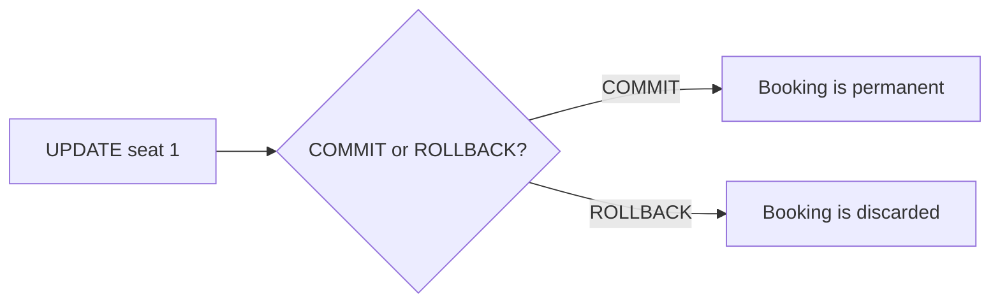

In Python, `conn.rollback()` and `conn.commit()` send those exact commands for you. If your session simply closes without committing, PostgreSQL rolls back — the default is always "do not keep unfinished work".

### Step 3 — Undo only part of a transaction

```python
# Book two seats, then mark a point we can come back to.
conn.execute("UPDATE seats SET booked_by = NULL, booked_at = NULL")
conn.execute("UPDATE seats SET booked_by = 'alice', booked_at = now() WHERE seat_no = 2")
conn.execute("SAVEPOINT before_seat_3")
conn.execute("UPDATE seats SET booked_by = 'alice', booked_at = now() WHERE seat_no = 3")

# Seat 3 turns out to be a problem (say the payment failed): undo just that part.
conn.execute("ROLLBACK TO SAVEPOINT before_seat_3")
conn.commit()
show("SELECT seat_no, booked_by FROM seats WHERE booked_by IS NOT NULL ORDER BY seat_no")
```

- **Input:** one open transaction and a named savepoint called `before_seat_3`.
- **What happens:** we book seat 2, create a savepoint, book seat 3, then roll back to the savepoint and commit. Rolling back to a savepoint keeps everything before it and discards everything after it.
- **Output:** a single row — seat 2 booked by `alice`. Seat 3 never made it.
- **Why:** real applications do several things in one transaction and some of them fail. A savepoint lets you drop the failed part without losing the successful parts or restarting the whole transaction.

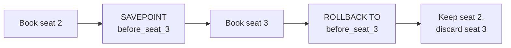

### Step 4 — Two customers, one seat: the race

```python
# Start from a clean sheet, then let two sessions read the same free seat.
conn.execute("UPDATE seats SET booked_by = NULL, booked_at = NULL")
conn.commit()
alice, bob = new_session(), new_session()
print("alice sees:", alice.execute("SELECT booked_by FROM seats WHERE seat_no = 5").fetchone()[0])
print("bob sees:  ", bob.execute("SELECT booked_by FROM seats WHERE seat_no = 5").fetchone()[0])

# Both book it in their own transaction and both commit. Nobody gets an error.
alice.execute("UPDATE seats SET booked_by = 'alice', booked_at = now() WHERE seat_no = 5")
alice.commit()
bob.execute("UPDATE seats SET booked_by = 'bob', booked_at = now() WHERE seat_no = 5")
bob.commit()
alice.close()
bob.close()

# What does the booking sheet say now?
show("SELECT seat_no, booked_by FROM seats WHERE seat_no = 5")
show("SELECT count(*) AS alice_bookings FROM seats WHERE seat_no = 5 AND booked_by = 'alice'")
```

- **Input:** two fresh connections and one free seat (number 5).
- **What happens:**
  - Both sessions check the seat and both are told it is free — at that moment, it is.
  - Alice writes her name and commits. Her statement locks the row only until she commits, so once she is done the row is free again.
  - Bob, who never re-read the seat, writes his name over hers and commits. PostgreSQL has no reason to object: his `UPDATE` was a perfectly valid statement.
- **Output:** the sheet says `bob`, and Alice's booking count is `0`. Alice has a confirmation email and no seat.
- **Why:** this is a **lost update**, and it is the bug in the lesson's problem statement. The database did exactly what it was asked; the application never asked the right question. The next three steps are three ways to ask it properly.

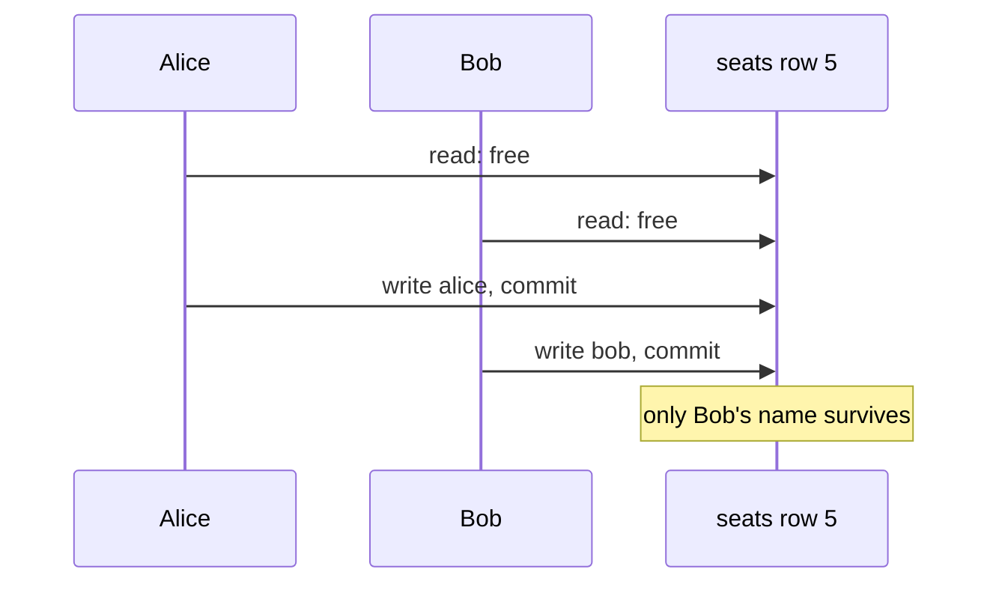

Two sessions that both check and then both write will always be able to do this. The fix is never "check harder" — it is to make reading and writing one atomic decision.

### Step 5 — Make the second customer wait: SELECT FOR UPDATE

```python
# Clean sheet, then session A takes seat 3 without committing.
conn.execute("UPDATE seats SET booked_by = NULL, booked_at = NULL")
conn.commit()
alice, bob = new_session(), new_session()
alice.execute("UPDATE seats SET booked_by = 'alice', booked_at = now() WHERE seat_no = 3")

# A plain reader on another connection is NOT blocked: it sees the last committed version.
show("SELECT seat_no, booked_by FROM seats WHERE seat_no = 3", using=bob)

# A writer that asks for the row itself must wait for Alice to finish.
bob.execute("SET lock_timeout = '1s'")
waited = time.perf_counter()
try:
    bob.execute("SELECT seat_no FROM seats WHERE seat_no = 3 FOR UPDATE")
    print("bob got the lock straight away (unexpected)")
except psycopg.errors.LockNotAvailable as err:
    bob.rollback()
    print(f"bob waited {time.perf_counter() - waited:.2f}s, then gave up:",
          str(err).strip().splitlines()[0])

# Alice commits: her booking becomes permanent and her lock is released.
alice.commit()
alice.close()

# Bob retries. The lock is gone, the seat is taken, so he books seat 4 instead.
taken_by = bob.execute("SELECT booked_by FROM seats WHERE seat_no = 3 FOR UPDATE").fetchone()[0]
bob.execute("UPDATE seats SET booked_by = 'bob', booked_at = now() WHERE seat_no = 4")
bob.commit()
bob.close()
print(f"bob's retry sees seat 3 held by {taken_by}, so he takes seat 4")
show("SELECT seat_no, booked_by FROM seats ORDER BY seat_no")
```

- **Input:** two sessions, one row already changed but not committed.
- **What happens:**
  - Alice's `UPDATE` holds a row lock on seat 3 until she commits or rolls back.
  - Bob's plain `SELECT` returns immediately with `NULL` — the last committed version. **Readers never block writers, and they never see uncommitted work.**
  - Bob's `SELECT ... FOR UPDATE` asks for the row *and* its lock, so it has to wait. We set `lock_timeout = '1s'` so the wait turns into a clear error instead of hanging forever; psycopg raises `LockNotAvailable`.
  - Alice commits, which ends her transaction and releases every lock she held.
  - Bob retries: the lock is free, the row says `alice`, so he books a different seat.
- **Output:** a fast `NULL` read, then `bob waited 1.00s, then gave up: canceling statement due to lock timeout`, then Bob's retry message and a booking sheet where seat 3 is Alice's and seat 4 is Bob's.
- **Why:** `FOR UPDATE` turns "check, then write" into "hold the row while I decide". Anyone else who wants that row waits until you are done — and then sees your committed result instead of a stale one. `lock_timeout` is the production habit that goes with it: always bound a wait, so one slow transaction cannot freeze your app.

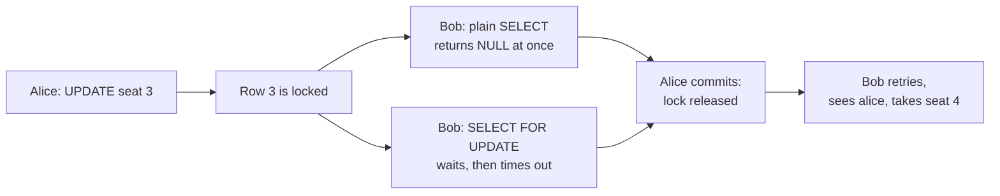

### Step 6 — Fix it without waiting: a conditional UPDATE

```python
# Clean sheet: this time neither customer waits for the other.
conn.execute("UPDATE seats SET booked_by = NULL, booked_at = NULL")
conn.commit()
alice, bob = new_session(), new_session()

# Each booking asks for the seat only if it is still free, and reports how many rows it changed.
claim = "UPDATE seats SET booked_by = %s, booked_at = now() WHERE seat_no = %s AND booked_by IS NULL"
alice_rows = alice.execute(claim, ("alice", 5)).rowcount
alice.commit()                      # release the row so bob can try the same statement
bob_rows = bob.execute(claim, ("bob", 5)).rowcount
bob.commit()
alice.close()
bob.close()

print(f"alice changed {alice_rows} row(s), bob changed {bob_rows} row(s)")
show("SELECT seat_no, booked_by FROM seats WHERE seat_no = 5")
```

- **Input:** the same two sessions and the same free seat, but a `WHERE` clause that states the condition the booking depends on.
- **What happens:** Alice's statement matches one row, changes it, and reports `rowcount == 1`. Bob's statement is sent after Alice commits, so the row now fails `booked_by IS NULL`; it matches nothing and reports `rowcount == 0`. Bob's application reads that zero and tells him the seat is gone.
- **Output:** `alice changed 1 row(s), bob changed 0 row(s)`, and seat 5 belongs to Alice.
- **Why:** this is **optimistic** concurrency: do not hold a lock, just make the write itself check the condition. It costs one extra `WHERE` and works best when conflicts are rare. `FOR UPDATE` is **pessimistic** — you pay a wait up front so you can decide with the row held. Both are correct; the trade-off is waiting versus retrying.

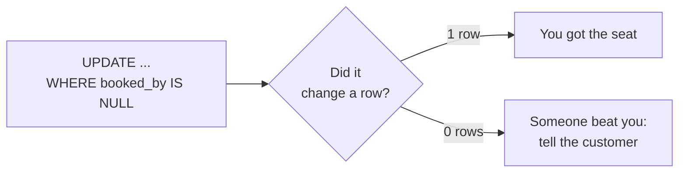

One detail worth knowing: Bob's `UPDATE` was sent while Alice still held the row lock long enough to matter, and PostgreSQL would have made him wait, then re-checked the condition against the *new* version — so even in that ordering he changes zero rows. A conditional write is safe without any extra locking.

### Step 7 — Share a queue with SKIP LOCKED

```python
# Clean sheet: six free seats, and two workers that each claim one.
conn.execute("UPDATE seats SET booked_by = NULL, booked_at = NULL")
conn.commit()

# One claim statement: lock the first free seat nobody else has locked, and skip the rest.
claim_one = """
    UPDATE seats SET booked_by = %s, booked_at = now()
    WHERE seat_no = (
        SELECT seat_no FROM seats WHERE booked_by IS NULL
        ORDER BY seat_no
        FOR UPDATE SKIP LOCKED
        LIMIT 1
    )
    RETURNING seat_no
"""
worker_one, worker_two = new_session(), new_session()
seat_one = worker_one.execute(claim_one, ("worker-1",)).fetchone()[0]
seat_two = worker_two.execute(claim_one, ("worker-2",)).fetchone()[0]
print(f"worker-1 claimed seat {seat_one} while worker-2 claimed seat {seat_two}")

# Neither waited: the second worker skipped the seat the first one is holding.
worker_one.commit()
worker_two.commit()
worker_one.close()
worker_two.close()
show("SELECT seat_no, booked_by FROM seats ORDER BY seat_no")
```

- **Input:** two workers running the identical claim statement at the same time, with six free seats.
- **What happens:**
  - `worker_one` locks the first free seat it finds (seat 1) and keeps the transaction open, so the lock stays held.
  - `worker_two` runs the same statement. The subquery would pick seat 1 again, but `SKIP LOCKED` tells it to ignore rows that are already locked, so it moves to seat 2 and takes that.
  - Both commit; the two claims do not overlap.
- **Output:** `worker-1 claimed seat 1 while worker-2 claimed seat 2`, then a sheet with both seats assigned — and no waiting at all.
- **Why:** without `SKIP LOCKED`, `worker_two` would sit blocked behind `worker_one` for no reason, and a hundred workers would form a queue behind one row. `SKIP LOCKED` turns a table into a work queue: every worker gets a different job, instantly. This is the pattern behind job runners, outbox tables, and "who processes this order?" services.

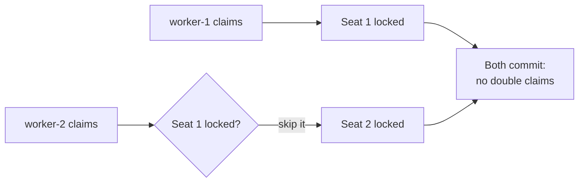

### Step 8 — READ COMMITTED: a fresh snapshot for every statement

```python
# Clean sheet, then two sessions: one keeps reading while the other books a seat.
conn.execute("UPDATE seats SET booked_by = NULL, booked_at = NULL")
conn.commit()
reader, writer = new_session(), new_session()
reader.execute("SET TRANSACTION ISOLATION LEVEL READ COMMITTED")
first_count = reader.execute("SELECT count(*) FROM seats WHERE booked_by IS NOT NULL").fetchone()[0]

# Another session books seat 5 and commits while our reader is still in its transaction.
writer.execute("UPDATE seats SET booked_by = 'dave', booked_at = now() WHERE seat_no = 5")
writer.commit()

# The same transaction asks again: READ COMMITTED gave this statement a new snapshot.
second_count = reader.execute("SELECT count(*) FROM seats WHERE booked_by IS NOT NULL").fetchone()[0]
print(f"booked at the start: {first_count}   booked a moment later: {second_count}")

reader.rollback()
reader.close()
writer.close()
```

- **Input:** one open transaction reading the same `count(*)` twice, and a second session that commits a change in between.
- **What happens:** `SET TRANSACTION ISOLATION LEVEL READ COMMITTED` sets the level for the current transaction (this is the default anyway, and it must be the first statement of the transaction). Each statement inside it takes a fresh snapshot, so the second `count(*)` already includes the writer's commit.
- **Output:** `booked at the start: 0   booked a moment later: 1` — one transaction, two different answers.
- **Why:** READ COMMITTED is what almost every application gets, and it is usually what you want: short waits, and you see the newest committed data each time you ask. The catch is that a value you read can change under you, which matters when a decision depends on two reads agreeing. That is exactly what the next step addresses.


### Step 9 — REPEATABLE READ: one snapshot, and a retry

```python
# Clean sheet, same two sessions — but now the reader asks for one fixed snapshot.
conn.execute("UPDATE seats SET booked_by = NULL, booked_at = NULL")
conn.commit()
reader, writer = new_session(), new_session()
reader.execute("SET TRANSACTION ISOLATION LEVEL REPEATABLE READ")
rr_first = reader.execute("SELECT count(*) FROM seats WHERE booked_by IS NOT NULL").fetchone()[0]

# A different session books seat 6 and commits.
writer.execute("UPDATE seats SET booked_by = 'dave', booked_at = now() WHERE seat_no = 6")
writer.commit()
rr_second = reader.execute("SELECT count(*) FROM seats WHERE booked_by IS NOT NULL").fetchone()[0]
print(f"booked at the start: {rr_first}   booked a moment later: {rr_second}   (one snapshot)")

# Writing a row that changed after our snapshot is refused, not silently applied.
try:
    reader.execute("UPDATE seats SET booked_by = 'erin' WHERE seat_no = 6")
    reader.commit()
    print("the update went through (unexpected)")
except psycopg.errors.SerializationFailure as err:
    reader.rollback()
    print("refused:", str(err).strip().splitlines()[0])

    # The retry: a brand-new transaction, same level, sees fresh data.
    reader.execute("SET TRANSACTION ISOLATION LEVEL REPEATABLE READ")
    reader.execute("UPDATE seats SET booked_by = 'erin' WHERE seat_no = 6")
    reader.commit()
    print("retried and committed; seat 6 is now held by",
          reader.execute("SELECT booked_by FROM seats WHERE seat_no = 6").fetchone()[0])

reader.close()
writer.close()
```

- **Input:** one `REPEATABLE READ` transaction that reads twice and then writes, plus a second session committing a change to the same row.
- **What happens:**
  - The first read fixes a snapshot for the whole transaction.
  - The writer commits seat 6, but the reader's second `count(*)` still answers from the old snapshot — no change under its feet.
  - When the reader tries to *write* seat 6, PostgreSQL compares its snapshot with the row's current version. They disagree, so it refuses with the standard error code SQLSTATE `40001` (*could not serialize access due to concurrent update*) rather than overwrite Dave's booking.
  - The retry opens a new transaction at the same level, so the new snapshot includes Dave's commit; the second attempt succeeds.
- **Output:** `booked at the start: 0   booked a moment later: 0   (one snapshot)`, then `refused: could not serialize access due to concurrent update`, then a successful retry with seat 6 held by `erin`.
- **Why:** this is the heart of Multi-Version Concurrency Control (MVCC). A stable snapshot gives you consistent reports, and the cost is that a conflicting write has to be retried. Every application using `REPEATABLE READ` or `SERIALIZABLE` must have a retry loop — without it, users see errors that are really "try again".

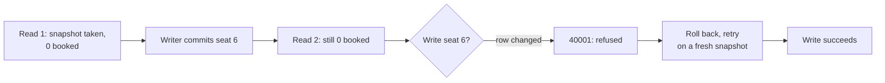

### Step 10 — Advisory locks: a lock on a name

```python
# Two copies of the same nightly job start at once; only one may run.
conn.execute("UPDATE seats SET booked_by = NULL, booked_at = NULL")
conn.commit()
job_one, job_two = new_session(), new_session()
got_one = job_one.execute("SELECT pg_try_advisory_lock(4242)").fetchone()[0]
got_two = job_two.execute("SELECT pg_try_advisory_lock(4242)").fetchone()[0]
print("first job started:", got_one, "  second job started:", got_two)

# The first job finishes and releases the lock; now the second job is allowed in.
job_one.execute("SELECT pg_advisory_unlock(4242)")
job_one.commit()
job_two.commit()
got_again = job_two.execute("SELECT pg_try_advisory_lock(4242)").fetchone()[0]
print("after the first job released it, the second job starts:", got_again)
job_two.execute("SELECT pg_advisory_unlock(4242)")
job_two.commit()
job_one.close()
job_two.close()
```

- **Input:** two sessions asking for the same lock number, `4242`.
- **What happens:** `pg_try_advisory_lock(4242)` is non-blocking — it returns `true` if the lock is free and `false` if another session holds it. The first job gets `true`, the second gets `false` immediately, so it can log "another copy is running" and exit instead of duplicating work. When the first job unlocks, the second one's next attempt succeeds.
- **Output:** `first job started: True   second job started: False`, then `after the first job released it, the second job starts: True`.
- **Why:** row locks only exist for rows. Advisory locks protect anything else you can name with a number: a nightly report, a cache rebuild, or a job that has no row of its own yet. The `try_` form is what makes it a decision rather than a wait — perfect for "only run this once at a time" jobs.

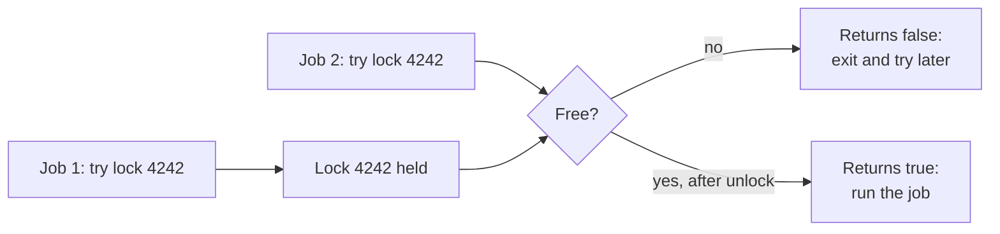

### Step 11 — Deadlocks: the crossed lock

```python
# Clean sheet, then two sessions each grab a different seat first.
conn.execute("UPDATE seats SET booked_by = NULL, booked_at = NULL")
conn.commit()
alice, bob = new_session(), new_session()
alice.execute("UPDATE seats SET booked_by = 'alice' WHERE seat_no = 1")
bob.execute("UPDATE seats SET booked_by = 'bob' WHERE seat_no = 2")

# A background thread makes Bob reach for Alice's seat a moment after Alice starts waiting.
outcome = {}

def bob_takes_alice_seat():
    try:
        bob.execute("UPDATE seats SET booked_by = 'bob' WHERE seat_no = 1")
        outcome["bob"] = "got both rows"
    except psycopg.errors.DeadlockDetected:
        bob.rollback()
        outcome["bob"] = "deadlock detected — rolled back"
    except psycopg.Error as err:
        bob.rollback()
        outcome["bob"] = f"stopped: {str(err).strip().splitlines()[0]}"

worker = threading.Thread(target=bob_takes_alice_seat)
worker.start()
time.sleep(0.3)

# Meanwhile Alice reaches for Bob's seat: now each session holds what the other needs.
alice.execute("SET statement_timeout = '10s'")     # a safety net, so a stuck wait becomes an error
try:
    alice.execute("UPDATE seats SET booked_by = 'alice' WHERE seat_no = 2")
    alice.commit()
    outcome["alice"] = "got both rows"
except psycopg.errors.DeadlockDetected:
    alice.rollback()
    outcome["alice"] = "deadlock detected — rolled back"
worker.join()

print("alice:", outcome.get("alice"), "| bob:", outcome.get("bob"))
alice.close()
bob.close()
show("SELECT seat_no, booked_by FROM seats WHERE booked_by IS NOT NULL ORDER BY seat_no")
```

- **Input:** two sessions that each hold one row and each want the other's row.
- **What happens:**
  - Alice locks seat 1 and Bob locks seat 2, each in its own open transaction.
  - A thread makes Bob ask for seat 1, which Alice holds — so Bob waits.
  - Alice then asks for seat 2, which Bob holds. Both sessions are now waiting on each other: a deadlock.
  - After `deadlock_timeout` (one second by default) PostgreSQL detects the cycle and aborts one transaction with SQLSTATE `40P01`. The other proceeds, and we record which was which.
- **Output:** two outcome lines — one session `got both rows`, the other `deadlock detected — rolled back` — then the final sheet. Which session loses is decided by the server, so it can swap between runs.
- **Why:** the database saved you from an infinite wait, but it did it by killing somebody's transaction. The real fix is in the application: always lock rows in the same order (seat 1, then seat 2, never the reverse), keep transactions short, and treat a `40001`/`40P01` error as "retry the whole transaction" rather than a user-facing failure.

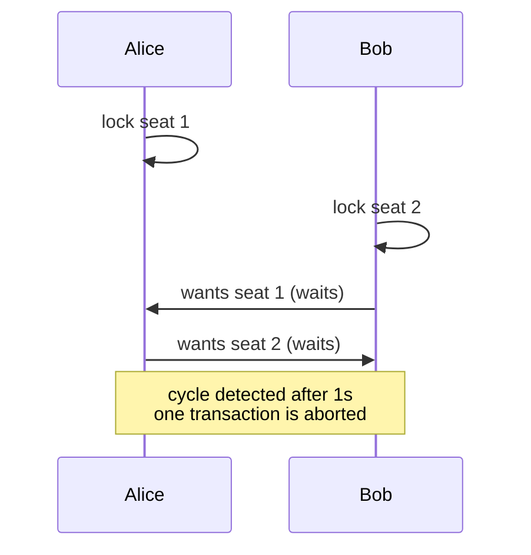

### Cleanup — Close the connection

```python
# Close the connection politely. Any uncommitted work is rolled back, locks are released.
conn.close()
print("connection closed — the seats table stays for you to experiment with")
```

We close the main connection when we are done. The `seats` table stays in the database, so you can keep experimenting; the next run of Step 1 drops and rebuilds it anyway.

## 11. What We Learnt

- **ACID** is the promise behind every transaction: all or nothing (atomicity), valid states only (consistency), no half-finished work visible (isolation), and committed means kept (durability).
- **Transactions end on purpose:** `COMMIT` keeps the work, `ROLLBACK` discards it, and closing a session without committing discards it too. A **savepoint** undoes one part of a transaction while keeping the rest.
- **MVCC** explains why readers never block writers: PostgreSQL keeps several versions of a row, each transaction reads from its own **snapshot**, and `VACUUM` later clears the versions nobody can see.
- **Isolation levels** are a dial — `READ COMMITTED` takes a fresh snapshot per statement, `REPEATABLE READ` holds one snapshot per transaction and refuses conflicting writes with `40001`, and `SERIALIZABLE` defends the strongest rule at the cost of more retries. **Retry loops are part of using them.**
- **Row locks** make two writers take turns: `SELECT ... FOR UPDATE` holds a row while you decide, a **conditional `UPDATE ... WHERE`** avoids waiting by checking the condition in the write itself, and `SKIP LOCKED` turns a table into a queue where every worker takes a different row.
- **Advisory locks** protect things that are not rows — nightly jobs, cache rebuilds — and `pg_try_advisory_lock` answers "is anyone else doing this?" without waiting.
- **Deadlocks** are cycles of waiting that PostgreSQL breaks by aborting one transaction after `deadlock_timeout`; consistent lock ordering and short transactions keep them rare, and a retry handles the one that slips through.
