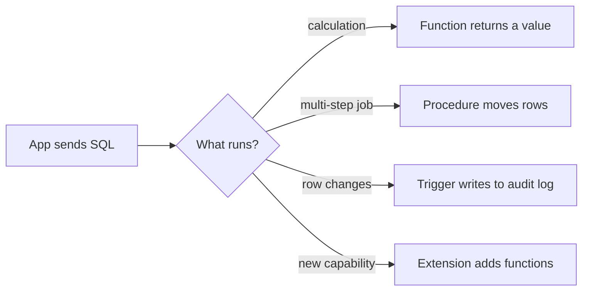
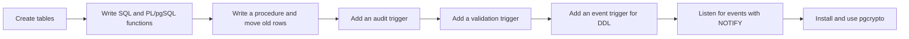
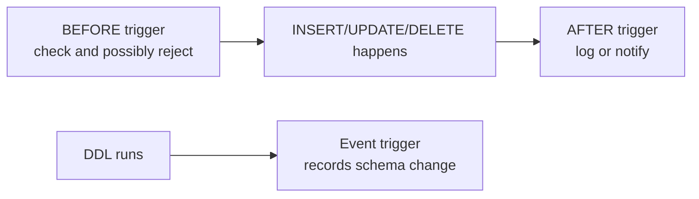
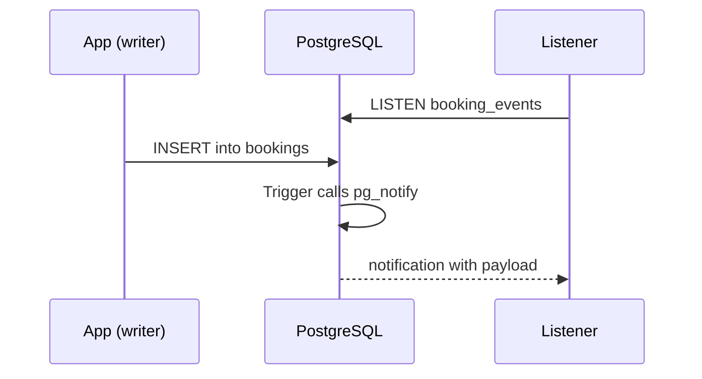

# Functions, Triggers and Extensions

## 1. What are Functions, Triggers and Extensions?

When you repeat the same logic across an app, bugs creep in: one place discounts tickets, another forgets to do it. PostgreSQL lets you put logic next to the data so it runs the same way no matter which app talks to the database. **Functions** calculate values, **procedures** run multi-step jobs that can commit partway, **triggers** fire automatically on changes, and **extensions** add whole packages of features.

- **Function:** a named piece of code you can call from Structured Query Language (SQL), written in SQL or Procedural Language/PostgreSQL (PL/pgSQL).
- **Procedure:** like a function, but called with `CALL`, allowed to commit or roll back inside it, and useful for jobs that move rows between tables.
- **Trigger:** code that runs automatically before or after an `INSERT`, `UPDATE`, `DELETE`, or even a Data Definition Language (DDL) command.
- **Event trigger:** a trigger that fires on database-wide events like `CREATE TABLE`, not on a single row.
- **Extension:** a bundled add-on (code, types, functions) that you install once with `CREATE EXTENSION`.

**Example:** a theatre sells tickets. Instead of every checkout page calculating discounts differently, a function computes the price; a trigger writes to an audit log on every booking change; and `pgcrypto` hashes passwords the same way for every service.



## 2. Problem Statement / Use Case Overview

A small theatre manages shows and bookings in PostgreSQL. Today the business logic is scattered: every script computes prices differently, nobody can tell who changed a booking, invalid bookings slip through, and there is no way to watch for schema changes. 

We fix all of that by bringing the rules into the database. We write functions to price tickets, a procedure to archive old bookings, row triggers to audit and validate changes, an event trigger to log schema edits, `LISTEN`/`NOTIFY` to push events to listeners, and an extension (`pgcrypto`) to hash values safely.

## 3. Input

The notebook creates everything it needs:

- **`events`**: shows with names and start times.
- **`bookings`**: tickets sold with `event_id`, `customer`, `seats`, and `price_cents`.
- **`audit_log`**: records every booking change as JavaScript Object Notation (JSON).
- **`bookings_archive`**: a holding table for old bookings moved by a procedure.
- **`ddl_log`**: records schema changes caught by an event trigger.
- **No files to download.** Two live connections are used for `LISTEN`/`NOTIFY`.

## 4. Processing

We build the system in order:



## 5. Output

Key results from the live run:

- **Functions:** `seat_price(4500, 2)` returns `9000` (no discount) and `seat_price(4500, 4)` returns `16200` (10% off for 3+ seats). `price_band` labels `9000` as `standard`.
- **Table-returning function:** `event_totals()` returns one row per event with booking counts, seats sold, and revenue in cents.
- **Procedure:** `CALL archive_old_bookings(30)` moves the 90-day-old booking into `bookings_archive`, deletes it from `bookings`, and prints a `NOTICE` showing how many rows were moved.
- **Audit trigger:** After `INSERT`, `UPDATE`, and `DELETE` on `bookings`, `audit_log` gets three rows with the action and the before/after values in JSON; a `NOTIFY` is sent each time.
- **Validation trigger:** Inserting a booking with `seats = 0` raises `ERROR: seats must be positive, got 0` and the row is not created.
- **Event trigger:** Creating, altering, and dropping `demo_table` produces three rows in `ddl_log` (one per Data Definition Language command).
- **LISTEN/NOTIFY:** A listener catches `notification on booking_events : INSERT 7`.
- **Extension:** `pgcrypto` is installed; `gen_random_uuid()` returns a Universally Unique Identifier (UUID), `crypt`/`gen_salt` produce a password hash, and a hash comparison returns `true`.

## 6. Tech Stack

| Tool | Version | Role |
|------|---------|------|
| PostgreSQL | 18 (14 or newer works for most steps) | Database server |
| psycopg | 3.3.6 | Python driver for PostgreSQL |
| python-dotenv | 1.2.4 | Loads `.env` settings |
| Jupyter | any recent version | Runs the notebook |
| Python `threading` and `time` | standard library | Drive a second session for `LISTEN`/`NOTIFY` |

**Compute and cost:** any laptop CPU with ~200 MB free memory; no GPU, cloud account, or paid service needed. Runtime under a minute.

## 7. Underlying Concepts

**Functions vs procedures.** A **function** returns a value and runs in the transaction of its caller (you can use it in `SELECT`). A **procedure** is called with `CALL`, has no required return value, and can do `COMMIT`/`ROLLBACK` inside it — handy for long jobs like archiving millions of rows in batches. *Everyday example:* a function is a calculator; a procedure is a clerk who does a whole checklist and can finish one batch and move on.*

**Languages: SQL and PL/pgSQL.** **SQL** functions are simple, fast, and plan well for pure queries. **PL/pgSQL** (Procedural Language/PostgreSQL) adds variables, `IF`/`LOOP`, `RAISE EXCEPTION`, `RAISE NOTICE`, and access to the special variables `NEW`, `OLD`, and trigger metadata. Mark functions `IMMUTABLE` (always same result for same inputs), `STABLE` (same within a query), or `VOLATILE` (default, may change) so the planner can optimize safely. *Everyday example:* SQL is a recipe card; PL/pgSQL is a recipe card with "if you're out of milk, do this" notes.*

**Triggers.** A **row-level trigger** fires once per affected row (`FOR EACH ROW`) — perfect for per-booking audits and validations. A **statement-level trigger** fires once per statement. `BEFORE` triggers can change `NEW` or reject the row; `AFTER` triggers see the committed effect and are great for logging/notifications. A trigger function must return `NEW`, `OLD`, or `NULL`. *Everyday example:* a security camera (row trigger) records every person who walks through a door, or a bouncer (BEFORE trigger) turns someone away at the gate.*

**Event triggers.** An **event trigger** fires on Data Definition Language (DDL) events like `CREATE`, `ALTER`, `DROP` across the whole database. Use them to log schema changes, enforce rules, or block dangerous operations. They run in a special context and use `TG_TAG` and `current_query()`. *Everyday example:* a logbook that records every time someone renovates the building, not just who moves furniture in one room.*

**LISTEN/NOTIFY.** PostgreSQL has a built-in publish/subscribe channel: `NOTIFY channel, payload` sends a message; `LISTEN channel` in another session receives it. Messages are delivered at transaction commit and are simple strings. It's lightweight and built into the database — useful for cache invalidation or waking a worker. *Everyday example:* a bulletin board where posting a note instantly alerts anyone standing in front of it.*

**Extensions.** **`pgcrypto`** adds cryptographic functions: password hashing (`crypt`/`gen_salt`), digest hashes (`digest`), random bytes/UUIDs (`gen_random_bytes`, `gen_random_uuid`), and encryption helpers. Extensions live in the database and may require superuser privileges to install. *Everyday example:* a lockbox you bolt onto the building that comes with tested locks and keys instead of making your own.*



## 8. Prerequisites

- A running PostgreSQL server, version 18 recommended (14+ works for most steps).
- The shared `.env` filled in (see Section 9).
- Comfort with `SELECT`/`INSERT`/`UPDATE`/`DELETE`, primary/foreign keys, and JSON.
- No accounts, API keys, or extra hardware required.

## 9. Environment / Dependencies Setup

The shared `.env` at the course root holds `PGHOST`, `PGPORT`, `PGUSER`, `PGPASSWORD`, `PGDATABASE`, `PGSSLMODE`. Every notebook does `load_dotenv("../../.env")` and should be started from inside this lesson folder.

Install packages:

```bash
pip install "psycopg[binary]==3.3.6" "python-dotenv==1.2.4"
```

`pgcrypto` ships with PostgreSQL; on this machine it's available but not installed. The notebook creates the `extensions` it needs with `CREATE EXTENSION IF NOT EXISTS`. Some environments require superuser to create extensions — if yours does, follow your administrator's instructions.

## 10. Step-wise Development Instructions

### Setup — Install the packages

```python
!pip install "psycopg[binary]==3.3.6" "python-dotenv==1.2.4"
```

Installs the driver and the `.env` loader at pinned versions.

### Setup — Load settings and connect

```python
# Bring in the tools we need.
import os
import threading
import time

import psycopg
from psycopg import sql
from dotenv import load_dotenv

load_dotenv("../../.env")
PGHOST = os.getenv("PGHOST", "localhost")
PGPORT = os.getenv("PGPORT", "5432")
PGUSER = os.getenv("PGUSER", "postgres")
PGPASSWORD = os.getenv("PGPASSWORD") or None
PGDATABASE = os.getenv("PGDATABASE", "university")
PGSSLMODE = os.getenv("PGSSLMODE", "prefer")
conn_args = dict(host=PGHOST, port=PGPORT, user=PGUSER,
                 password=PGPASSWORD, sslmode=PGSSLMODE)

try:
    with psycopg.connect(autocommit=True, **{**conn_args, "dbname": "postgres"}) as admin:
        if not admin.execute("SELECT 1 FROM pg_database WHERE datname = %s", (PGDATABASE,)).fetchone():
            admin.execute(sql.SQL("CREATE DATABASE {}").format(sql.Identifier(PGDATABASE)))
    conn = psycopg.connect(dbname=PGDATABASE, autocommit=True, **conn_args)
    print("connected to", PGDATABASE)
except psycopg.OperationalError as err:
    raise SystemExit(f"Could not connect. Is PostgreSQL running?\n{err}")
```

Open the main connection in autocommit mode so `CALL` to a procedure that does `COMMIT` behaves predictably, and so DDL we run here takes effect immediately.

### Setup — Printing helper and a second session

```python
# Print query results as a tidy table.
def show(query, params=None, using=None):
    session = using or conn
    with session.cursor() as cur:
        cur.execute(query, params)
        if cur.description is None:
            print(cur.statusmessage)
            return
        cols = [d.name for d in cur.description]
        rows = cur.fetchall()
    cells = [["NULL" if v is None else str(v) for v in row] for row in rows]
    widths = [max([len(c)] + [len(row[i]) for row in cells]) for i, c in enumerate(cols)]
    print(" | ".join(c.center(w) for c, w in zip(cols, widths)).rstrip())
    print("-+-".join("-" * w for w in widths))
    for row in cells:
        print(" | ".join(v.ljust(w) for v, w in zip(row, widths)).rstrip())
    print(f"({len(rows)} row{'' if len(rows) == 1 else 's'})")


# A second connection for LISTEN/NOTIFY.
def new_session():
    return psycopg.connect(dbname=PGDATABASE, autocommit=True, **conn_args)
```

### Step 1 — Build the theatre schema

```python
# Start clean, then create tables for shows, bookings, audit history, and logs.
conn.execute("DROP EVENT TRIGGER IF EXISTS log_ddl")
conn.execute("DROP TABLE IF EXISTS bookings, events, audit_log, ddl_log, bookings_archive CASCADE")

conn.execute("""
    CREATE TABLE events (
        event_id  SERIAL PRIMARY KEY,
        name      TEXT NOT NULL,
        starts_at TIMESTAMPTZ NOT NULL
    )
""")
conn.execute("""
    CREATE TABLE bookings (
        booking_id  BIGSERIAL PRIMARY KEY,
        event_id    INTEGER NOT NULL REFERENCES events (event_id) ON DELETE CASCADE,
        customer    TEXT NOT NULL,
        seats       INTEGER NOT NULL,
        price_cents INTEGER NOT NULL,
        created_at  TIMESTAMPTZ NOT NULL DEFAULT now()
    )
""")
conn.execute("""
    CREATE TABLE audit_log (
        audit_id   BIGSERIAL PRIMARY KEY,
        table_name TEXT NOT NULL,
        action     TEXT NOT NULL,
        row_data   JSONB NOT NULL,
        changed_at TIMESTAMPTZ NOT NULL DEFAULT now()
    )
""")
conn.execute("CREATE TABLE bookings_archive (LIKE bookings INCLUDING ALL)")
conn.execute("""
    CREATE TABLE ddl_log (
        ddl_id  BIGSERIAL PRIMARY KEY,
        tag     TEXT NOT NULL,
        command TEXT NOT NULL,
        ran_at  TIMESTAMPTZ NOT NULL DEFAULT now()
    )
""")

conn.execute("""
    INSERT INTO events (name, starts_at) VALUES
        ('Jazz Night', now() + interval '7 days'),
        ('Stand-up', now() + interval '14 days')
""")
conn.execute("""
    INSERT INTO bookings (event_id, customer, seats, price_cents) VALUES
        (1, 'alice', 2, 9000),
        (1, 'bob', 1, 4500),
        (2, 'carol', 3, 12000)
""")

show("SELECT event_id, name FROM events ORDER BY event_id")
show("SELECT booking_id, customer, seats, price_cents FROM bookings ORDER BY booking_id")
```

- **Input:** nothing to load.
- **What happens:** create the tables, add seed data, and show it.
- **Output:** two events and three bookings.
- **Why:** a realistic schema to attach functions, triggers, and a procedure to.

### Step 2 — Write SQL and PL/pgSQL functions

```python
# A simple SQL function that gives a quantity discount (10% off for 3+ seats).
conn.execute("""
    CREATE OR REPLACE FUNCTION seat_price(base_cents int, seats int)
    RETURNS int
    LANGUAGE sql IMMUTABLE
    AS $$
        SELECT (base_cents * seats * CASE WHEN seats >= 3 THEN 90 ELSE 100 END) / 100;
    $$
""")

# A PL/pgSQL function that maps a price to a band.
conn.execute("""
    CREATE OR REPLACE FUNCTION price_band(cents int)
    RETURNS text
    LANGUAGE plpgsql IMMUTABLE
    AS $$
    BEGIN
        IF cents < 5000 THEN
            RETURN 'budget';
        ELSIF cents < 10000 THEN
            RETURN 'standard';
        ELSE
            RETURN 'premium';
        END IF;
    END;
    $$
""")

show("SELECT seat_price(4500, 2) AS two_seats, seat_price(4500, 4) AS four_seats")
show("SELECT booking_id, price_cents, price_band(price_cents) AS band FROM bookings ORDER BY booking_id")
```

- **Input:** integer cents and a seat count.
- **What happens:** `seat_price` is pure SQL; `price_band` uses PL/pgSQL's `IF/ELSIF/ELSE`. Both are marked `IMMUTABLE` because they depend only on their inputs.
- **Output:** `9000` and `16200`; bands `standard`, `budget`, `premium`.
- **Why:** functions let the database enforce the pricing rule once and use it anywhere.

### Step 3 — Return a table from a function

```python
# Summarise bookings per event without writing a view first.
conn.execute("""
    CREATE OR REPLACE FUNCTION event_totals()
    RETURNS TABLE (event_name text, bookings bigint, seats bigint, revenue_cents bigint)
    LANGUAGE sql STABLE
    AS $$
        SELECT e.name, count(b.booking_id), COALESCE(sum(b.seats), 0), COALESCE(sum(b.price_cents), 0)
        FROM events e LEFT JOIN bookings b USING (event_id)
        GROUP BY e.name
        ORDER BY e.name;
    $$
""")

show("SELECT * FROM event_totals()")
```

- **Input:** none (reads from `events` and `bookings`).
- **What happens:** the function returns a table and you call it like any table in `SELECT`.
- **Output:** one row per event with counts and totals.
- **Why:** `RETURNS TABLE` is great for reusable reports; `STABLE` tells the planner the result is stable within a single statement.

### Step 4 — Move rows with a procedure

```python
# A procedure that archives old bookings and commits inside the procedure.
conn.execute("""
    CREATE OR REPLACE PROCEDURE archive_old_bookings(older_than_days int)
    LANGUAGE plpgsql
    AS $$
    DECLARE
        moved int;
    BEGIN
        INSERT INTO bookings_archive
        SELECT * FROM bookings WHERE created_at < now() - make_interval(days => older_than_days);

        GET DIAGNOSTICS moved = ROW_COUNT;

        DELETE FROM bookings WHERE created_at < now() - make_interval(days => older_than_days);

        COMMIT;
        RAISE NOTICE 'archived % old bookings', moved;
    END;
    $$
""")

# Plant an old booking so there is something to move.
conn.execute("""
    INSERT INTO bookings (event_id, customer, seats, price_cents, created_at)
    VALUES (2, 'old-timer', 1, 3000, now() - interval '90 days')
""")

conn.execute("CALL archive_old_bookings(30)")
show("SELECT count(*) AS live_bookings FROM bookings")
show("SELECT booking_id, customer FROM bookings_archive ORDER BY booking_id")
```

- **Input:** a cutoff in days.
- **What happens:** `GET DIAGNOSTICS` captures how many rows were copied; `INSERT ... SELECT` moves them to the archive; `DELETE` removes them from live bookings; `COMMIT` ends that work; `RAISE NOTICE` prints a message.
- **Output:** live bookings drop by one, and the old booking appears in `bookings_archive`.
- **Why:** procedures can batch and commit their own work, which is safer for large cleanups than doing it all in one huge transaction.

### Step 5 — Audit every change with a row trigger

```python
# A trigger function that records before/after as JSON and notifies listeners.
conn.execute("""
    CREATE OR REPLACE FUNCTION audit_booking_change()
    RETURNS trigger
    LANGUAGE plpgsql
    AS $$
    BEGIN
        INSERT INTO audit_log (table_name, action, row_data)
        VALUES (TG_TABLE_NAME, TG_OP,
                jsonb_build_object('old', to_jsonb(OLD), 'new', to_jsonb(NEW)));
        PERFORM pg_notify('booking_events',
                          TG_OP || ' ' || COALESCE(NEW.booking_id, OLD.booking_id)::text);
        RETURN COALESCE(NEW, OLD);
    END;
    $$
""")

conn.execute("DROP TRIGGER IF EXISTS bookings_audit ON bookings")
conn.execute("""
    CREATE TRIGGER bookings_audit
    AFTER INSERT OR UPDATE OR DELETE ON bookings
    FOR EACH ROW EXECUTE FUNCTION audit_booking_change()
""")

# Fire all three operations.
conn.execute("INSERT INTO bookings (event_id, customer, seats, price_cents) VALUES (1, 'dave', 2, 9000)")
conn.execute("UPDATE bookings SET seats = 4 WHERE customer = 'dave'")
conn.execute("DELETE FROM bookings WHERE customer = 'dave'")

show("""
    SELECT action,
           row_data->'new'->>'customer' AS new_customer,
           row_data->'old'->>'seats'    AS old_seats
    FROM audit_log ORDER BY audit_id
""")
```

- **Input:** changes to `bookings`.
- **What happens:** `TG_OP` tells us whether it was `INSERT`/`UPDATE`/`DELETE`; `OLD` and `NEW` give the row versions; `to_jsonb` stores them; `pg_notify` publishes an event. `AFTER` and returning `COALESCE(NEW, OLD)` is the standard pattern.
- **Output:** three audit rows (INSERT, UPDATE, DELETE). Old values appear on UPDATE/DELETE and new values on INSERT/UPDATE.
- **Why:** an audit trail answers "who changed what and when" without relying on every app to remember to log it.

### Step 6 — Block bad data with a BEFORE trigger

```python
# Reject bookings with zero or negative seats before they are written.
conn.execute("""
    CREATE OR REPLACE FUNCTION check_booking()
    RETURNS trigger
    LANGUAGE plpgsql
    AS $$
    BEGIN
        IF NEW.seats <= 0 THEN
            RAISE EXCEPTION 'seats must be positive, got %', NEW.seats;
        END IF;
        RETURN NEW;
    END;
    $$
""")

conn.execute("DROP TRIGGER IF EXISTS bookings_check ON bookings")
conn.execute("""
    CREATE TRIGGER bookings_check
    BEFORE INSERT OR UPDATE ON bookings
    FOR EACH ROW EXECUTE FUNCTION check_booking()
""")

try:
    conn.execute("INSERT INTO bookings (event_id, customer, seats, price_cents) VALUES (1, 'erin', 0, 1000)")
except psycopg.errors.RaiseException as err:
    print("refused:", str(err).strip().splitlines()[0])

show("SELECT count(*) AS erin_bookings FROM bookings WHERE customer = 'erin'")
```

- **Input:** an invalid row with `seats = 0`.
- **What happens:** the `BEFORE` trigger checks the rule and calls `RAISE EXCEPTION`, which aborts the statement. The row is never inserted.
- **Output:** an exception message and zero bookings for `erin`.
- **Why:** database rules are the last line of defence — even if an app forgets to validate, PostgreSQL enforces them.

### Step 7 — Log schema changes with an event trigger

```python
# Record every CREATE/ALTER/DROP TABLE in ddl_log.
conn.execute("""
    CREATE OR REPLACE FUNCTION log_ddl_command()
    RETURNS event_trigger
    LANGUAGE plpgsql
    AS $$
    BEGIN
        INSERT INTO ddl_log (tag, command) VALUES (TG_TAG, current_query());
    END;
    $$
""")

conn.execute("DROP EVENT TRIGGER IF EXISTS log_ddl")
conn.execute("""
    CREATE EVENT TRIGGER log_ddl
    ON ddl_command_end
    WHEN TAG IN ('CREATE TABLE', 'ALTER TABLE', 'DROP TABLE')
    EXECUTE FUNCTION log_ddl_command()
""")

# Make a few schema changes to watch them be logged.
conn.execute("CREATE TABLE demo_table (id int)")
conn.execute("ALTER TABLE demo_table ADD COLUMN note text")
conn.execute("DROP TABLE demo_table")

show("SELECT tag, left(command, 38) AS command_start FROM ddl_log ORDER BY ddl_id")
```

- **Input:** three DDL statements.
- **What happens:** `TG_TAG` tells us which DDL command ran, `current_query()` captures the statement, and we insert into `ddl_log`. Only `CREATE TABLE`, `ALTER TABLE`, and `DROP TABLE` fire this trigger.
- **Output:** three rows in order of execution.
- **Why:** event triggers give visibility into who is changing the schema, without auditing every single table.

### Step 8 — Listen for events with LISTEN/NOTIFY

```python
# Open a listener on a second connection, then fire a change on the first.
listener = new_session()
listener.execute("LISTEN booking_events")

conn.execute("INSERT INTO bookings (event_id, customer, seats, price_cents) VALUES (2, 'frank', 2, 8000)")

for note in listener.notifies(timeout=3, stop_after=1):
    print("notification on", note.channel, ":", note.payload)

listener.close()
```

- **Input:** a new booking inserted after the listener subscribes.
- **What happens:** the audit trigger calls `pg_notify('booking_events', 'INSERT ...')`. Since we're in autocommit mode, the notify is delivered at commit; the listener picks it up and prints the payload.
- **Output:** `notification on booking_events : INSERT ...`
- **Why:** `LISTEN`/`NOTIFY` is a simple, zero-infrastructure way for processes to react to database changes.



### Step 9 — Add capabilities with an extension (pgcrypto)

```python
# Check what's available and install pgcrypto if missing.
show("""
    SELECT name, default_version, installed_version
    FROM pg_available_extensions
    WHERE name IN ('pgcrypto', 'pg_cron', 'postgis')
    ORDER BY name
""")

conn.execute("CREATE EXTENSION IF NOT EXISTS pgcrypto")

# Generate a UUID and hash a password.
show("SELECT gen_random_uuid() AS token")
show("SELECT crypt('correct horse', gen_salt('bf')) AS stored_hash")
show("""
    SELECT crypt('correct horse', stored_hash) = stored_hash AS password_matches
    FROM (SELECT crypt('correct horse', gen_salt('bf')) AS stored_hash) AS h
""")
show("SELECT encode(digest('postgres', 'sha256'), 'hex') AS sha256_of_postgres")
```

- **Input:** a password string.
- **What happens:** `CREATE EXTENSION pgcrypto` adds cryptographic functions. `gen_random_uuid()` makes a random UUID. `gen_salt('bf')` builds a blowfish salt; `crypt` hashes with it; comparing `crypt(plain, stored_hash)` to the stored hash tells us if it matches. `digest` computes a hash; `encode(..., 'hex')` prints it as hex.
- **Output:** a UUID, a hash starting with `$2a$`, `true`, and a 64-hex digest.
- **Why:** never roll your own password hashing — use a tested extension like `pgcrypto`. Always hash with a salt (here `gen_salt`) rather than storing plain text or unsalted digests.

### Step 10 — Inspect functions and procedures in the catalog

```python
# See what we just created alongside extension functions.
show("""
    SELECT p.proname, l.lanname, p.prokind, p.provolatile,
           pg_get_function_identity_arguments(p.oid) AS arguments
    FROM pg_proc p
    JOIN pg_language l ON l.oid = p.prolang
    WHERE p.pronamespace = 'public'::regnamespace AND p.prokind IN ('f', 'p')
    ORDER BY p.proname
""")
```

- **Input:** the system catalogs `pg_proc` and `pg_language`.
- **What happens:** we list our functions (`prokind = 'f'`) and procedures (`prokind = 'p'`), their language, volatility, and arguments.
- **Output:** includes `seat_price`, `price_band`, `event_totals`, `archive_old_bookings`, and our trigger functions.
- **Why:** `pg_catalog` is the source of truth for what's installed; it's how you audit what logic lives in the database.

### Cleanup

```python
# Drop the event trigger we created and tidy up.
conn.execute("DROP EVENT TRIGGER IF EXISTS log_ddl")
conn.execute("DROP TABLE IF EXISTS ddl_log")
conn.close()
print("connection closed — tables stay so you can explore further")
```

## 11. What We Learnt

- **Functions return values; procedures run jobs.** Use SQL/PL/pgSQL functions in `SELECT` for calculations and reports; use `CALL`ed procedures when you need to commit in steps, like archiving old rows.
- **Triggers automate rules.** A `BEFORE` row trigger validates and can reject; an `AFTER` row trigger audits or notifies. A trigger function receives `NEW`/`OLD`, checks `TG_OP`, and must return the right row.
- **Event triggers watch DDL.** They log schema changes across the database with `TG_TAG` and `current_query()` — useful for audit and policy.
- **LISTEN/NOTIFY is built in.** `pg_notify` + `LISTEN` lets sessions react to changes with no extra queueing system; delivery is at commit.
- **Extensions add tested features.** `pgcrypto` provides `gen_random_uuid`, `crypt`/`gen_salt` for password hashing, and `digest`/`encode` for hashes. Prefer tested cryptography over homegrown code.
- **The catalog tells the truth.** `pg_proc`, `pg_language`, and `pg_available_extensions` let you inspect what lives in the database and what's available to install.
