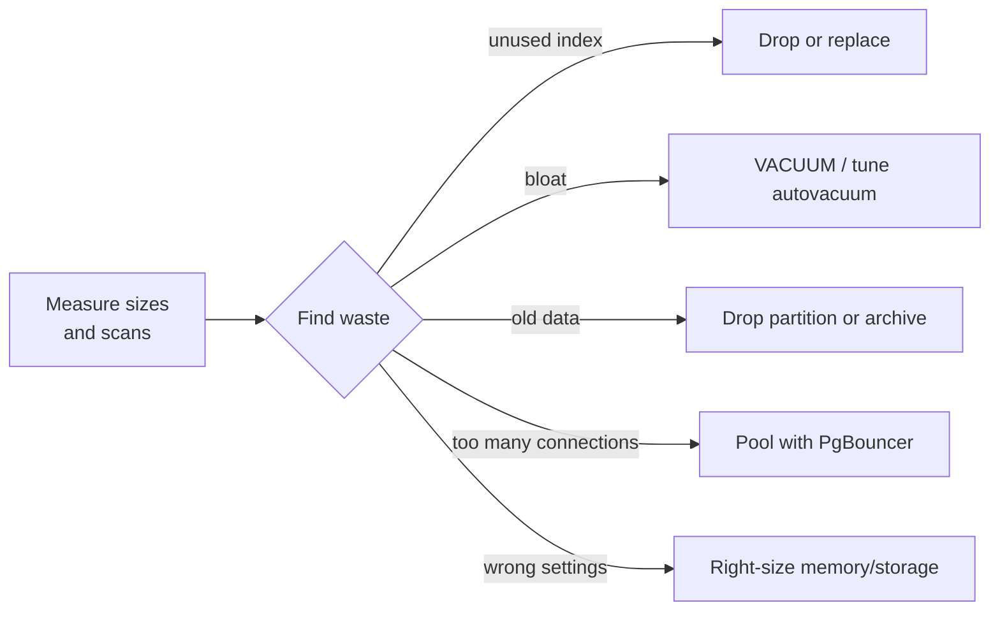
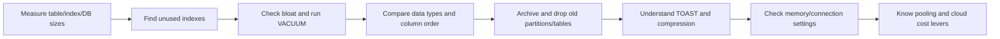
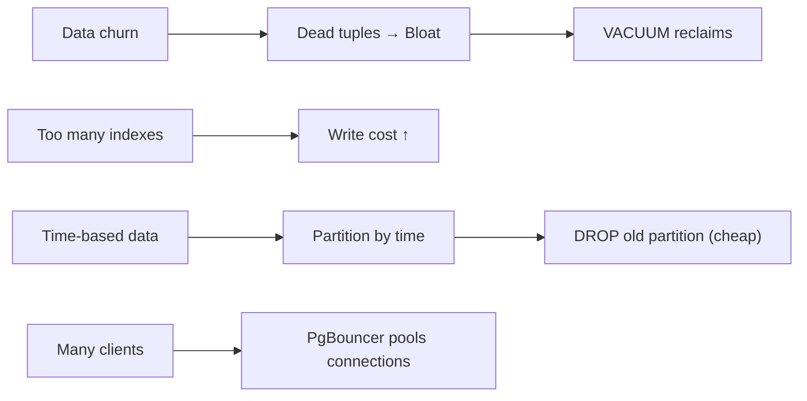
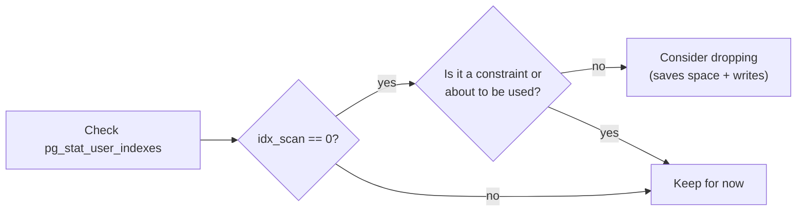
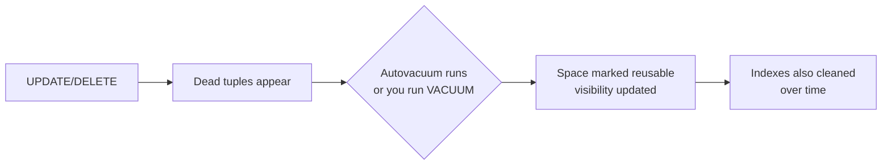
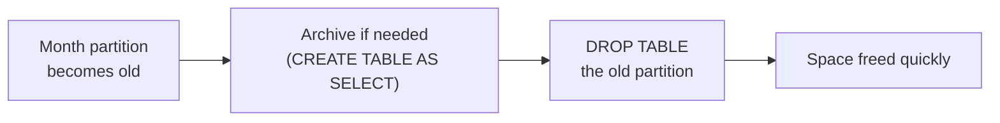

# Optimize Cost: Storage, Bloat and Right-Sizing

## 1. What are Storage, Bloat and Right-Sizing?

Running PostgreSQL is cheap until tables grow. Costs come from disk space, slow queries that need more memory or bigger machines, and indexes that speed reads but slow writes and eat space. **Bloat** is wasted space left behind after updates and deletes. **Vacuuming** reclaims it. **Right-sizing** means giving the server just enough memory, connections, and storage for the real workload instead of over-provisioning.

- **Table and index size:** how many bytes a relation actually uses on disk.
- **Bloat:** dead rows and dead index entries that take space but aren't visible to new transactions.
- **VACUUM / autovacuum:** remove dead tuples and update visibility maps so space can be reused.
- **Unused or duplicate indexes:** indexes that are never scanned but cost space and slow writes.
- **TOAST:** The Oversized-Attribute Storage Technique (TOAST) stores large values out of line and compresses them.
- **Retention:** drop or archive old partitions/data cheaply instead of deleting row by row forever.
- **PgBouncer:** a connection pooler that lets thousands of clients share a small pool of database connections.
- **Right-sizing:** tune `shared_buffers`, `work_mem`, `effective_cache_size`, connections, storage, and consider replicas or serverless trade-offs.

**Example:** an orders table collects a year of history. Old months become read-only — dropping a partition is instant and frees space; keeping them all and deleting row by row bloats and locks for hours.



## 2. Problem Statement / Use Case Overview

A reporting database is growing fast and the bill is climbing. Queries slow down, disk usage creeps up, and there are dozens of indexes nobody uses. We need to find where space goes, spot unused indexes, understand bloat and vacuum, choose efficient types, expire old data by partitioning, see TOAST behavior, and learn the right-sizing and pooling levers that cut cost without hurting performance.

## 3. Input

No external files. The notebook creates:

- **`biglog`**: a table with ~20,000 rows and a text payload plus an index.
- **`orders_bad` / `orders_good`**: two small tables to compare data types and size.
- **`logs_2025_09` / `logs_2025_10`**: two tables used to demonstrate archive-then-drop retention.

## 4. Processing



## 5. Output

- **Sizes:** `pg_table_size`, `pg_indexes_size`, `pg_total_relation_size`, and `pg_database_size` reported with `pg_size_pretty`.
- **Unused indexes:** `pg_stat_user_indexes` shows `idx_scan = 0` for unused indexes and their sizes.
- **Bloat estimate:** `pgstattuple_approx` shows free space before and after `VACUUM`.
- **Types:** comparing `orders_bad` (`char(10)`, `numeric`) vs `orders_good` (`numeric(10,2)`, `text`) shows size differences.
- **Retention:** archiving with `CREATE TABLE ... AS SELECT` then `DROP TABLE` frees/relocates old data quickly.
- **Settings:** `shared_buffers`, `work_mem`, `effective_cache_size`, and backend counts shown.

## 6. Tech Stack

| Tool | Version | Role |
|------|---------|------|
| PostgreSQL | 18 (14+ works) | Database server |
| psycopg | 3.3.6 | Python driver |
| python-dotenv | 1.2.4 | Loads `.env` |
| Jupyter | any recent version | Notebook |
| `pgstattuple` | extension (optional but used) | Approximate bloat/free space |

**Compute and cost:** local machine; no GPU/cloud required for the demos. Time ~60 min.

## 7. Underlying Concepts

**Sizes that matter.** `pg_table_size` is the table's main fork; `pg_indexes_size` is all indexes; `pg_total_relation_size` adds TOAST and indexes. `pg_database_size` is the whole database. Always measure in bytes and pretty-print. *Everyday example:* a suitcase has a main compartment, side pockets (indexes), and a laundry bag (TOAST) — look at all three.*

**Bloat.** When rows are updated/deleted, PostgreSQL leaves dead tuples until vacuumed. Dead tuples bloat tables and indexes, waste memory in caches, and slow scans. Autovacuum runs automatically, but heavy churn needs tuning (`autovacuum_vacuum_scale_factor`, thresholds, and sometimes `VACUUM (VERBOSE)` in maintenance windows). `VACUUM` reclaims space for reuse; `VACUUM FULL` rewrites the whole table (locks it, rarely needed). *Everyday example:* a notebook with crossed-out pages — vacuum erases the crossed-out pages so new notes fit.*

**Unused and duplicate indexes.** Every index speeds reads but slows `INSERT`/`UPDATE`/`DELETE` and uses disk. `pg_stat_user_indexes.idx_scan` shows how many times an index was used; an index with 0 scans (and not a constraint backing something unique) is often unused. Duplicate indexes waste space. Drop carefully and watch for a while. *Everyday example:* a set of keys — if you never use one, carrying it costs time and weight.*

**Efficient data types and column order.** Use the smallest type that fits (`integer` vs `bigint`, `text` vs `char(n)`). Variable-length types go well; `NULL` has overhead. Column order affects alignment and can affect size slightly. `numeric` is exact but larger than `integer`. Avoid `varchar(n)` unless you truly need a length check. *Everyday example:* packing a bag — put small, fixed things together and don't bring a huge box for a small item.*

**Retention with partition drop and archiving.** For time-series data, partition by range (month/day). Dropping a whole partition with `DROP TABLE` is nearly instant and frees space; deleting millions of rows row by row is slow, bloats, and generates lots of write-ahead log. Archive to cheaper storage or another table first if you need history. *Everyday example:* instead of shredding a whole year's receipts page by page, just throw out last year's binder.*

**TOAST and compression.** Large values (`text`, `bytea`, JSON) go to TOAST tables. PostgreSQL compresses them (default `pglz`, `lz4` available in recent versions) and may store out of line. Keeping values smaller avoids TOAST. *Everyday example:* mailing a poster — roll it up and put it in a separate tube (TOAST) instead of making the envelope huge.*

**Right-sizing and pooling.** Set `shared_buffers` to a reasonable fraction of memory (often 25% on dedicated servers), `work_mem` per sort/hash (be careful with many connections), `effective_cache_size` to what the OS can cache. Too many connections exhaust memory — use **PgBouncer** in transaction or session pooling mode. For managed clouds, weigh instance size, storage type/IOPS, read replicas vs standbys, reserved capacity, and serverless trade-offs. *Everyday example:* a restaurant doesn't need a table for every person who might call — use a host stand (pooler) to seat people as tables free up.*



## 8. Prerequisites

- PostgreSQL 18 running locally
- The shared `.env` filled in
- Comfortable with `SELECT`, sizes, and indexes
- `pgstattuple` extension available (may need install)

## 9. Environment / Dependencies Setup

`.env` at course root: `PGHOST`, `PGPORT`, `PGUSER`, `PGPASSWORD`, `PGDATABASE`, `PGSSLMODE`. Start Jupyter from inside this lesson folder.

```bash
pip install "psycopg[binary]==3.3.6" "python-dotenv==1.2.4"
```

```sql
CREATE EXTENSION IF NOT EXISTS pgstattuple;
```

## 10. Step-wise Development Instructions

### Setup — Install and connect

```python
!pip install "psycopg[binary]==3.3.6" "python-dotenv==1.2.4"
```

```python
import os
import psycopg
from psycopg import sql
from dotenv import load_dotenv

load_dotenv("../../.env")
PGHOST = os.getenv("PGHOST", "localhost")
PGPORT = os.getenv("PGPORT", "5432")
PGUSER = os.getenv("PGUSER", "postgres")
PGPASSWORD = os.getenv("PGPASSWORD") or None
PGDATABASE = os.getenv("PGDATABASE", "university")
PGSSLMODE = os.getenv("PGSSLMODE", "prefer")
conn_args = dict(host=PGHOST, port=PGPORT, user=PGUSER,
                 password=PGPASSWORD, sslmode=PGSSLMODE)

with psycopg.connect(autocommit=True, **{**conn_args, "dbname": "postgres"}) as admin:
    if not admin.execute("SELECT 1 FROM pg_database WHERE datname = %s", (PGDATABASE,)).fetchone():
        admin.execute(sql.SQL("CREATE DATABASE {}").format(sql.Identifier(PGDATABASE)))
conn = psycopg.connect(autocommit=True, dbname=PGDATABASE, **conn_args)
conn.execute("CREATE EXTENSION IF NOT EXISTS pgstattuple")
print("connected")
```

```python
def show(query, params=None):
    with conn.cursor() as cur:
        cur.execute(query, params)
        if cur.description is None:
            print(cur.statusmessage); return
        cols = [d.name for d in cur.description]
        rows = cur.fetchall()
    cells = [["NULL" if v is None else str(v) for v in row] for row in rows]
    widths = [max([len(c)] + [len(row[i]) for row in cells]) for i,c in enumerate(cols)]
    print(" | ".join(c.center(w) for c,w in zip(cols,widths)).rstrip())
    print("-+-".join("-"*w for w in widths))
    for row in cells:
        print(" | ".join(v.ljust(w) for v,w in zip(row,widths)).rstrip())
    print(f"({len(rows)} row{'' if len(rows)==1 else 's'})")
```

### Step 1 — Measure table, index, and database sizes

```python
conn.execute("DROP TABLE IF EXISTS biglog CASCADE")
conn.execute("CREATE TABLE biglog (id bigserial primary key, payload text, created_at timestamptz default now())")
conn.execute("INSERT INTO biglog (payload) SELECT repeat('x', 200) || g FROM generate_series(1, 20000) g")
conn.execute("CREATE INDEX idx_biglog_created ON biglog(created_at)")
conn.execute("ANALYZE biglog")

show("""
    SELECT relname, pg_size_pretty(pg_table_size(oid)) AS table_size,
           pg_size_pretty(pg_indexes_size(oid)) AS indexes_size,
           pg_size_pretty(pg_total_relation_size(oid)) AS total_size
    FROM pg_class WHERE relname IN ('biglog','idx_biglog_created')
    ORDER BY relname
""")

show("SELECT pg_size_pretty(pg_database_size(current_database())) AS db_size")
```

- **Input:** a freshly created table with an index.
- **What happens:** insert 20,000 rows with a 200-character payload, add an index on `created_at`, analyze, and measure sizes.
- **Output:** table, indexes, and total sizes in human-readable form.
- **Why:** you cannot cut costs until you measure what takes space.

### Step 2 — Find unused and potentially duplicate indexes

```python
show("""
    SELECT schemaname, relname, indexrelname, idx_scan,
           pg_size_pretty(pg_relation_size(indexrelid)) AS index_size
    FROM pg_stat_user_indexes
    WHERE relname = 'biglog'
    ORDER BY indexrelname
""")
```

- **Input:** index usage statistics from `pg_stat_user_indexes`.
- **What happens:** look at `idx_scan` (number of times the index was used). A brand-new index with `idx_scan = 0` may be unused or just not used yet.
- **Output:** each index on `biglog` with its scan count and size.
- **Why:** drop indexes with zero scans in real workloads only after confirming they're not used in planned queries or constraints.



### Step 3 — Estimate bloat with pgstattuple_approx

```python
show("SELECT approx_free_percent, approx_tuple_count, dead_tuple_count FROM pgstattuple_approx('biglog')")
```

- **Input:** the `biglog` table.
- **What happens:** `pgstattuple_approx` gives a fast estimate of free space and tuple counts (approximate to avoid a full table scan).
- **Output:** percentage of free space and tuple counts.
- **Why:** before vacuuming you want a baseline; after churn you'll see more free space.

### Step 4 — VACUUM to reclaim space for reuse

```python
# Create some dead tuples by deleting a fraction of the rows.
conn.execute("DELETE FROM biglog WHERE id % 10 = 0")
conn.execute("ANALYZE biglog")
show("SELECT approx_free_percent FROM pgstattuple_approx('biglog')")
conn.execute("VACUUM biglog")
show("SELECT approx_free_percent FROM pgstattuple_approx('biglog')")
```

- **Input:** deleted 10% of the rows.
- **What happens:** deleted rows become dead tuples; `VACUUM` marks them as removable and updates visibility so space can be reused.
- **Output:** `approx_free_percent` changes after `VACUUM` (in this small demo it may increase or behave differently depending on state).
- **Why:** `VACUUM` is normal maintenance. `VACUUM FULL` rewrites the table and takes an exclusive lock — use only when you must shrink the file size dramatically. Autovacuum handles most of this automatically.



### Step 5 — Efficient data types and column order

```python
conn.execute("DROP TABLE IF EXISTS orders_bad, orders_good")
conn.execute("CREATE TABLE orders_bad (id bigserial primary key, status char(10), notes text, amount numeric)")
conn.execute("CREATE TABLE orders_good (id bigserial primary key, amount numeric(10,2), status text, notes text)")

show("""
    SELECT relname, pg_size_pretty(pg_table_size(oid)) AS table_size
    FROM pg_class WHERE relname IN ('orders_bad','orders_good')
""")
```

- **Input:** two near-identical tables with different types/ordering.
- **What happens:** create them empty and compare `pg_table_size`.
- **Output:** sizes for both tables (small here; the lesson shows the principle).
- **Why:** prefer `text` over `char(n)` unless a fixed length is required; use appropriately sized numerics/integers; put fixed/commonly accessed columns thoughtfully. Smaller rows mean more fit in memory and cheaper I/O.

### Step 6 — Retention: archive then drop old data

```python
conn.execute("DROP TABLE IF EXISTS logs_2025_09, logs_2025_10")
conn.execute("CREATE TABLE logs_2025_09 (id bigserial, log_time timestamptz, payload text)")
conn.execute("CREATE TABLE logs_2025_10 (id bigserial, log_time timestamptz, payload text)")
conn.execute("INSERT INTO logs_2025_09 SELECT g, '2025-09-15', repeat('y',50) FROM generate_series(1,5000) g")
conn.execute("INSERT INTO logs_2025_10 SELECT g, '2025-10-01', repeat('y',50) FROM generate_series(1,5000) g")

show("""
    SELECT relname, pg_size_pretty(pg_total_relation_size(oid)) AS total_size
    FROM pg_class WHERE relname LIKE 'logs_%' ORDER BY relname
""")

# Archive September, then drop it (cheap vs deleting rows)
conn.execute("CREATE TABLE log_archive_2025_09 AS SELECT * FROM logs_2025_09")
conn.execute("DROP TABLE logs_2025_09")

show("SELECT relname FROM pg_class WHERE relname IN ('logs_2025_10','log_archive_2025_09') ORDER BY relname")
```

- **Input:** two month-sized log tables.
- **What happens:** copy old data to an archive table, then `DROP TABLE` the old partition/table.
- **Output:** sizes before, then the old table gone and archive present.
- **Why:** `DROP TABLE` removes the files quickly; `DELETE FROM` would touch every row, bloat, and take much longer. For partitions, `ALTER TABLE ... DETACH CONVERT TO TABLE` / dropping partitions is the standard cost-saving pattern.



### Step 7 — Right-sizing settings and connections

```python
show("SELECT current_setting('shared_buffers') AS shared_buffers, current_setting('work_mem') AS work_mem, current_setting('effective_cache_size') AS effective_cache_size")
show("SELECT numbackends, xact_commit, xact_rollback FROM pg_stat_database WHERE datname = current_database()")
show("SELECT count(*) AS active_backends FROM pg_stat_activity WHERE pid <> pg_backend_pid()")
```

- **Input:** current server settings and activity.
- **What happens:** inspect key memory settings and connection counts.
- **Output:** values for this server (tuned by the environment).
- **Why:** *Guidelines:* start from measured usage. `shared_buffers` caches data pages; `effective_cache_size` tells the planner how much OS cache to expect; `work_mem` is per sort/hash operation (multiply by operations/connections carefully). Too many connections = high memory use — use a pooler.

**Pooler note (PgBouncer):** put PgBouncer between apps and PostgreSQL. Modes: `session` (connection held for whole session), `transaction` (released after each transaction — most common for web apps), `statement` (released after each statement — restrictive). Fewer backend connections mean less memory and overhead.

### Step 8 — Managed cloud cost levers (read)

These are decisions, not SQL you must run now:
- **Instance class:** right-size CPU/RAM to p50/p95; don't pay for peak you never hit.
- **Storage type and IOPS:** use gp3/SSD appropriately; provision IOPS only if needed.
- **Read replicas vs standbys:** replicas can serve reads and sometimes be cheaper than scaling the primary; standbys are for HA.
- **Reserved capacity:** commit for predictable workloads.
- **Serverless:** pay per use but can be pricier per hour; watch for cold starts and idle charges.
- **Other:** archive old data to object storage, drop unused indexes, tune autovacuum, use compression, and pool connections.

### Cleanup

```python
conn.execute("DROP TABLE IF EXISTS biglog, orders_bad, orders_good, logs_2025_10, log_archive_2025_09 CASCADE")
conn.close()
print("done")
```

## 11. What We Learnt

- **Measure first:** use `pg_table_size`, `pg_indexes_size`, `pg_total_relation_size`, and `pg_database_size` with `pg_size_pretty` to find what's big.
- **Indexes cost:** check `pg_stat_user_indexes` for `idx_scan`; unused indexes slow writes and waste disk.
- **Bloat needs vacuum:** updates/deletes leave dead tuples; `VACUUM` reclaims for reuse; watch autovacuum settings and use `pgstattuple_approx` to estimate.
- **Types matter:** smaller, correct data types use less space and memory.
- **Retire old data cheaply:** partition by time and `DROP TABLE` old partitions, or archive then drop — far cheaper than row-by-row deletes.
- **TOAST holds big values:** large text/JSON goes out of line and may be compressed; keeping values small avoids TOAST overhead.
- **Right-size and pool:** tune `shared_buffers`/`work_mem`/`effective_cache_size`, limit connections with **PgBouncer** (transaction pooling), and choose cloud options (instance, storage/IOPS, replicas/standbys, reserved/serverless) to match real usage.
