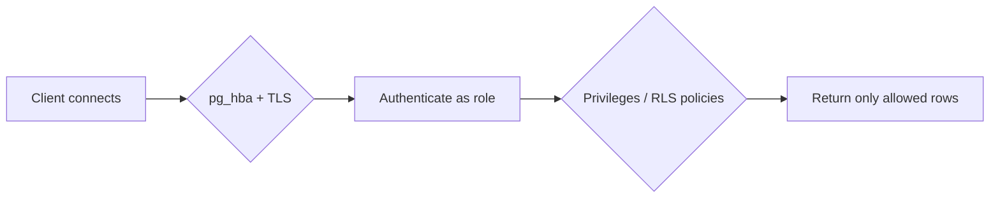
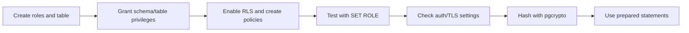
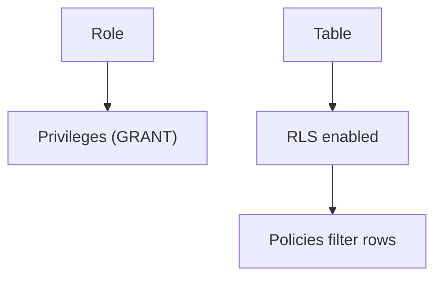
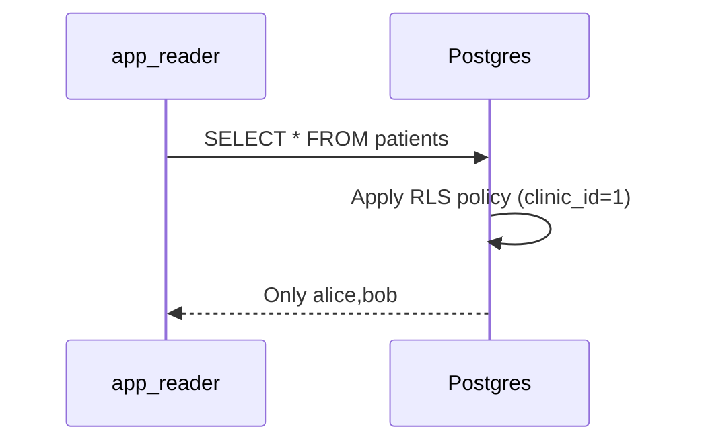

# Secure Postgres with Roles, RLS and TLS

## 1. What is Postgres Security?

Security in PostgreSQL is layered. You control who can connect, what they can do on schemas/tables/columns, which rows they see, how passwords are stored, and whether traffic is encrypted. Row-Level Security (RLS) enforces rules per row, roles/privileges enforce access control, `pg_hba.conf` and Transport Layer Security (TLS) control connections, and extensions like `pgcrypto` help with safe hashing.

- **Role:** an identity that can own objects and have privileges; roles can be users (login) or groups.
- **Privilege:** permission to do something (SELECT, INSERT, UPDATE, DELETE, USAGE, CREATE).
- **Row-Level Security (RLS):** policies that filter which rows a role can see or modify.
- **Policy:** a rule attached to a table that runs as a predicate (USING/WITH CHECK).
- **pg_hba.conf:** host-based authentication rules controlling how clients authenticate.
- **TLS:** encrypts connections between client and server.
- **SCRAM-SHA-256:** the modern password authentication mechanism (MD5 is deprecated).
- **Prepared statement:** a parsed query plan reused to avoid SQL injection and save parsing cost.
- **Audit logging:** recording security-relevant events for accountability.

**Example:** in a clinic app, doctors should only see patients in their clinic (RLS), nurses get read-only access (role privileges), and all traffic goes over TLS.



## 2. Problem Statement / Use Case Overview

A healthcare app has one database but multiple roles: `app_reader` (read-only) and `app_writer` (can modify). Some data must be hidden by clinic (row-level), some actions must be denied. We need to demonstrate role creation and grants, enable RLS with policies, test with `SET ROLE`, check security settings (password encryption, SSL), use `pgcrypto` for hashing, and use prepared statements safely.

## 3. Input

No external files. The notebook creates:
- **`patients`** table with `id`, `clinic_id`, `name`, `diagnosis`
- Roles `app_reader`, `app_writer` (no login needed when using `SET ROLE`)

## 4. Processing



## 5. Output

- Role list and privileges via `information_schema.role_table_grants`
- RLS filtering (reader sees only clinic_id=1)
- Security settings (`password_encryption`, `ssl`)
- pgcrypto hash and bcrypt check
- Prepared statement execution

## 6. Tech Stack

| Tool | Version | Role |
|------|---------|------|
| PostgreSQL | 18 | Database |
| psycopg | 3.3.6 | Python driver |
| python-dotenv | 1.2.4 | Load `.env` |
| Jupyter | any recent | Notebook |

**Compute/cost:** local; no GPU/cloud required. Time ~50 min.

## 7. Underlying Concepts

**Roles and privileges.** PostgreSQL uses roles for both users and groups. Grant privileges on schemas, tables, sequences. Use `GRANT role TO role` for group membership. Least privilege: give only what is needed.

**Row-Level Security.** By default tables have no RLS. `ALTER TABLE ... ENABLE ROW LEVEL SECURITY` turns it on. Policies define `USING` (visibility) and `WITH CHECK` (modification). If RLS is enabled and no policy matches, access is denied. Superusers and roles with `BYPASSRLS` can bypass.

**Authentication.** `pg_hba.conf` controls client auth (local/host, method like `trust`, `scram-sha-256`, `cert`). `password_encryption` is `scram-sha-256` in modern Postgres. MD5 is deprecated.

**TLS.** Set `ssl = on` on server and require encrypted connections; verify with `SHOW ssl` and connection params (`sslmode`).

**SQL injection and prepared statements.** Never concatenate untrusted strings into SQL. Use parameterized queries/prepared statements. Prepared statements separate code and data.

**pgcrypto.** Provides `crypt()`/`gen_salt()` for password hashing, `digest()` for checksums, and `gen_random_bytes()`/`gen_random_uuid()`.

**Audit logging.** Configure `log_statement`, `log_connections`, or use extensions/pgaudit for detailed auditing. Consider logging DDL and sensitive operations.



## 8. Prerequisites

- PostgreSQL 18 running locally
- Shared `.env` configured
- Comfort with GRANT/SELECT/UPDATE

## 9. Environment / Dependencies Setup

`.env` at course root. Start Jupyter from inside this lesson folder.

```bash
pip install "psycopg[binary]==3.3.6" "python-dotenv==1.2.4"
```

## 10. Step-wise Development Instructions

### Setup - Install and connect
```python
!pip install "psycopg[binary]==3.3.6" "python-dotenv==1.2.4"
```

```python
import os
import psycopg
from psycopg import sql
from dotenv import load_dotenv

load_dotenv("../../.env")
PGHOST = os.getenv("PGHOST", "localhost")
PGPORT = os.getenv("PGPORT", "5432")
PGUSER = os.getenv("PGUSER", "postgres")
PGPASSWORD = os.getenv("PGPASSWORD") or None
PGDATABASE = os.getenv("PGDATABASE", "university")
PGSSLMODE = os.getenv("PGSSLMODE", "prefer")
conn_args = dict(host=PGHOST, port=PGPORT, user=PGUSER, password=PGPASSWORD, sslmode=PGSSLMODE)

with psycopg.connect(autocommit=True, **{**conn_args, "dbname": "postgres"}) as admin:
    if not admin.execute("SELECT 1 FROM pg_database WHERE datname = %s", (PGDATABASE,)).fetchone():
        admin.execute(sql.SQL("CREATE DATABASE {}").format(sql.Identifier(PGDATABASE)))
conn = psycopg.connect(autocommit=True, dbname=PGDATABASE, **conn_args)
print("connected")
```

```python
def show(query, params=None):
    with conn.cursor() as cur:
        cur.execute(query, params)
        if cur.description is None:
            print(cur.statusmessage); return
        cols = [d.name for d in cur.description]
        rows = cur.fetchall()
    cells = [["NULL" if v is None else str(v) for v in row] for row in rows]
    widths = [max([len(c)] + [len(row[i]) for row in cells]) for i,c in enumerate(cols)]
    print(" | ".join(c.center(w) for c,w in zip(cols,widths)).rstrip())
    print("-+-".join("-"*w for w in widths))
    for row in cells:
        print(" | ".join(v.ljust(w) for v,w in zip(row,widths)).rstrip())
    print(f"({len(rows)} row{'' if len(rows)==1 else 's'})")
```

### Step 1 - Roles and privileges
```python
conn.execute("DROP ROLE IF EXISTS app_reader, app_writer")
conn.execute("CREATE ROLE app_reader")
conn.execute("CREATE ROLE app_writer")
conn.execute("DROP TABLE IF EXISTS patients CASCADE")
conn.execute("CREATE TABLE patients(id serial primary key, clinic_id int, name text, diagnosis text)")
conn.execute("INSERT INTO patients(clinic_id,name,diagnosis) VALUES (1,'alice','flu'),(1,'bob','cold'),(2,'carol','allergy')")
conn.execute("GRANT USAGE ON SCHEMA public TO app_reader, app_writer")
conn.execute("GRANT SELECT ON patients TO app_reader")
conn.execute("GRANT SELECT, INSERT, UPDATE, DELETE ON patients TO app_writer")
show("SELECT grantee, privilege_type FROM information_schema.role_table_grants WHERE table_name='patients' AND grantee LIKE 'app_%' ORDER BY grantee, privilege_type")
```

- **What happens:** create roles, grant schema and table privileges (least privilege).
- **Why:** control who can access what.

### Step 2 - Test access with SET ROLE
```python
conn.execute("SET ROLE app_reader")
show("SELECT id, name, clinic_id FROM patients ORDER BY id")
conn.execute("RESET ROLE")
```

- **What happens:** switch to role without logging in; see if SELECT works.
- **Why:** `SET ROLE` is great for testing policies/privileges.

### Step 3 - Enable Row-Level Security
```python
conn.execute("ALTER TABLE patients ENABLE ROW LEVEL SECURITY")
conn.execute("DROP POLICY IF EXISTS patients_clinic ON patients")
conn.execute("CREATE POLICY patients_clinic ON patients FOR SELECT TO app_reader USING (clinic_id = 1)")
conn.execute("GRANT SELECT ON patients TO app_reader")
conn.execute("SET ROLE app_reader")
show("SELECT id, name, clinic_id FROM patients ORDER BY id")
conn.execute("RESET ROLE")
```

- **What happens:** RLS filters rows so reader only sees clinic_id=1.
- **Why:** enforce data isolation per tenant/clinic.



### Step 4 - Check security settings
```python
show("SHOW password_encryption")
show("SHOW ssl")
show("SELECT * FROM pg_hba_file_rules LIMIT 5")
```

- **What happens:** inspect password encryption, SSL status, and pg_hba rules.
- **Why:** know auth/TLS configuration; md5 deprecated, prefer scram-sha-256.

### Step 5 - Hash safely with pgcrypto
```python
conn.execute("CREATE EXTENSION IF NOT EXISTS pgcrypto")
show("SELECT encode(digest('hello','sha256'),'hex') AS sha256_hex")
show("SELECT crypt('s3cr3t', gen_salt('bf')) LIKE '$2%' AS is_bcrypt")
show("SELECT crypt('s3cr3t', crypt('s3cr3t', gen_salt('bf'))) = crypt('s3cr3t', crypt('s3cr3t', gen_salt('bf'))) AS match_demo")
```

- **What happens:** use `digest` for checksums and `crypt`/`gen_salt` for password hashing.
- **Why:** use tested crypto, salt passwords, never store plaintext.

### Step 6 - Prepared statements (safe queries)
```python
with conn.cursor() as cur:
    cur.execute("PREPARE get_patient(int) AS SELECT id, name, clinic_id FROM patients WHERE id = $1")
    cur.execute("EXECUTE get_patient(1)")
    print("prepared result:", cur.fetchall())
    cur.execute("DEALLOCATE get_patient")
```

- **What happens:** prepare a parameterized statement and execute with values.
- **Why:** prevents SQL injection and can be reused; always pass values as parameters, not string concatenation.

### Step 7 - Audit logging note
```python
show("SELECT name, setting FROM pg_settings WHERE name IN ('log_statement','log_connections','log_disconnections') ORDER BY name")
```

- **What happens:** check common logging settings.
- **Why:** enable appropriate logging for auditing in production (consider pgaudit extension).

### Cleanup
```python
conn.execute("DROP TABLE IF EXISTS patients CASCADE")
conn.execute("DROP ROLE IF EXISTS app_reader, app_writer")
conn.close()
print("done")
```

## 11. What We Learnt

- **Least privilege:** grant only needed roles/privileges; prefer roles as groups.
- **RLS enforces row access:** enable RLS and create policies with `USING`/`WITH CHECK`; no matching policy denies access when RLS is on.
- **Auth matters:** use `scram-sha-256`, configure `pg_hba.conf`, and enable TLS (`ssl`).
- **Safe crypto:** use `pgcrypto` with salts for passwords; use `digest` for checksums.
- **Safe queries:** use parameterized/prepared statements to avoid SQL injection.
- **Auditability:** log connections/statements as appropriate for your security needs.
