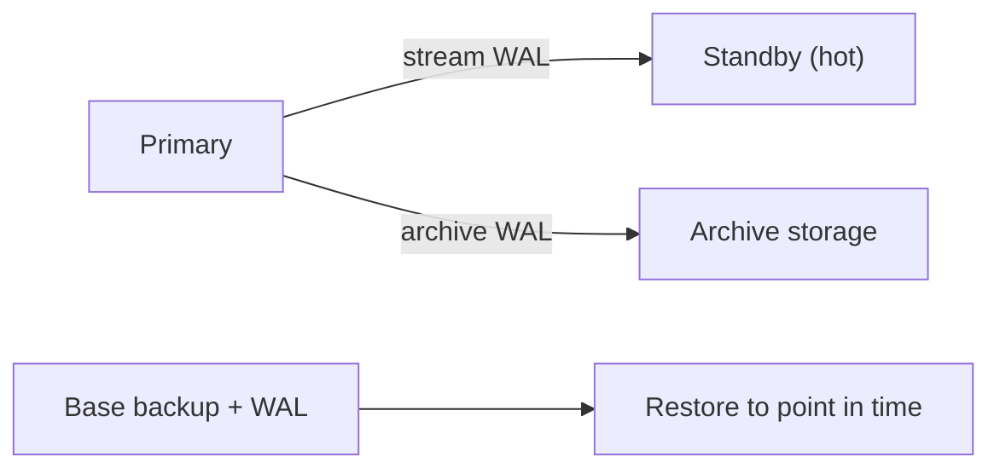
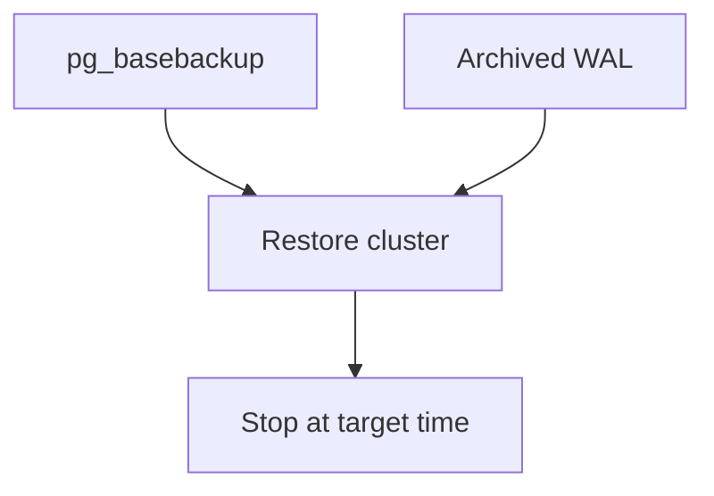
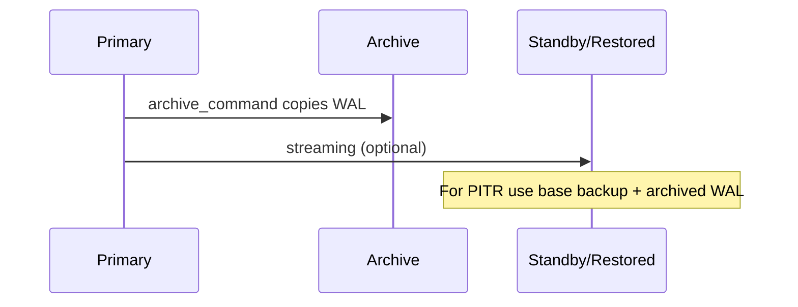

# Back Up, Recover and Replicate Postgres

## 1. What are Backups, Recovery and Replication?

Backups protect against data loss; recovery restores a known good state. Write-Ahead Log (WAL) lets you replay changes to a point in time. Replication copies changes to another server for high availability and read scaling.

- **WAL:** log of all changes before they go to data files.
- **Checkpoint:** flushes dirty pages and records position in WAL.
- **pg_dump:** logical backup of schema/data (portable).
- **pg_restore:** restore a logical backup.
- **pg_basebackup:** physical backup of cluster files.
- **WAL archiving:** copy WAL segments for Point-In-Time Recovery (PITR).
- **PITR:** restore to any time after base backup using archived WAL.
- **Recovery Point Objective (RPO):** max acceptable data loss.
- **Recovery Time Objective (RTO):** max acceptable downtime.
- **Streaming replication:** primary streams WAL to standby in real time.
- **Hot standby:** standby can serve read queries while applying WAL.
- **Promotion:** standby becomes primary on failover.
- **Replication slot:** prevents primary from removing WAL needed by standby.
- **Logical replication:** replicate selected tables using publications/subscriptions.

**Example:** take a base backup Sunday, archive WAL all week, recover to Tuesday 2pm if needed (PITR).



## 2. Problem Statement / Use Case Overview

We need to understand the backup/replication tools, check WAL/checkpoint settings, take a logical backup with `pg_dump`, demonstrate restore concepts, look at replication status and slots, and know WAL archiving for PITR. All from SQL/catalogs where possible (no starting a second cluster here).

## 3. Input

Use existing `university` database or create `backup_demo`.

## 4. Processing


## 5. Output

Catalog queries showing WAL, checkpoints, replication, and backup artifacts created on disk.

## 6. Tech Stack

| Tool | Version | Role |
|------|---------|------|
| PostgreSQL | 18 | Database |
| pg_dump/pg_restore/psql | bundled | CLI backup/restore |
| psycopg | 3.3.6 | Python driver |
| python-dotenv | 1.2.4 | Load `.env` |

## 7. Underlying Concepts

**WAL and checkpoints.** Changes go to WAL first (durability). Checkpoints flush to disk. `pg_stat_bgwriter`/settings show activity.

**Logical vs physical.** `pg_dump` is logical (SQL/format), good for migrations/version changes. `pg_basebackup` is physical (byte copy), needed for streaming replication and PITR.

**PITR.** Requires base backup + continuous WAL archives. Replay to `recovery_target_time` etc.

**Replication.** Streaming gives low lag for HA/read scaling. Logical replication allows selective replication and cross-version in some cases.

**RPO/RTO.** RPO depends on WAL frequency/archiving; RTO depends on restore time and automation.



## 8. Prerequisites

- PostgreSQL 18
- Command line tools available (`pg_dump`, `psql`)
- Shared `.env`

## 9. Environment / Dependencies Setup

```bash
pip install "psycopg[binary]==3.3.6" "python-dotenv==1.2.4"
```

## 10. Step-wise Development Instructions

### Setup
```python
!pip install "psycopg[binary]==3.3.6" "python-dotenv==1.2.4"
```

```python
import os, subprocess, tempfile
import psycopg
from psycopg import sql
from dotenv import load_dotenv

load_dotenv("../../.env")
PGHOST=os.getenv("PGHOST"); PGPORT=os.getenv("PGPORT"); PGUSER=os.getenv("PGUSER")
PGPASSWORD=os.getenv("PGPASSWORD") or None; PGDATABASE=os.getenv("PGDATABASE"); PGSSLMODE=os.getenv("PGSSLMODE")
conn_args=dict(host=PGHOST,port=PGPORT,user=PGUSER,password=PGPASSWORD,sslmode=PGSSLMODE)

with psycopg.connect(autocommit=True,**{**conn_args,"dbname":"postgres"}) as admin:
    if not admin.execute("SELECT 1 FROM pg_database WHERE datname=%s",(PGDATABASE,)).fetchone():
        admin.execute(sql.SQL("CREATE DATABASE {}").format(sql.Identifier(PGDATABASE)))
conn = psycopg.connect(autocommit=True,dbname=PGDATABASE,**conn_args)
print("connected")
```

```python
def show(q,p=None):
    with conn.cursor() as cur:
        cur.execute(q,p)
        if cur.description is None:
            print(cur.statusmessage); return
        cols=[d.name for d in cur.description]; rows=cur.fetchall()
    cells=[["NULL" if v is None else str(v) for v in r] for r in rows]
    widths=[max([len(c)]+[len(r[i]) for r in cells]) for i,c in enumerate(cols)]
    print(" | ".join(c.center(w) for c,w in zip(cols,widths)).rstrip())
    print("-+-".join("-"*w for w in widths))
    for r in cells: print(" | ".join(v.ljust(w) for v,w in zip(r,widths)).rstrip())
    print(f"({len(rows)} row{'' if len(rows)==1 else 's'})")
```

### Step 1 - WAL and checkpoints
```python
show("SELECT name, setting, unit FROM pg_settings WHERE name IN ('wal_level','archive_mode','max_wal_senders','checkpoint_timeout') ORDER BY name")
show("SELECT checkpoints_timed, checkpoints_req, buffers_checkpoint, buffers_clean FROM pg_stat_bgwriter")
```

- **What happens:** check WAL/replication settings and checkpoint stats.
- **Why:** know your durability/replication capacity.

### Step 2 - Logical backup with pg_dump
```python
env = os.environ.copy()
if PGPASSWORD: env["PGPASSWORD"]=PGPASSWORD
fd, path = tempfile.mkstemp(suffix=".sql", prefix="backup_demo_")
os.close(fd)
cmd = ["pg_dump", "-h", PGHOST, "-p", str(PGPORT), "-U", PGUSER, "-d", PGDATABASE, "-f", path]
res = subprocess.run(cmd, env=env, stdout=subprocess.PIPE, stderr=subprocess.PIPE)
print("pg_dump returncode:", res.returncode)
print("backup size:", os.path.getsize(path), "bytes")
os.remove(path)
print("cleaned temp backup")
```

- **What happens:** dump schema+data to a SQL file using `pg_dump`.
- **Why:** logical backups are portable and great for migrations/testing restores.

### Step 3 - Replication status and slots
```python
show("SELECT pid, application_name, state, sync_state, write_lag, flush_lag, replay_lag FROM pg_stat_replication")
show("SELECT slot_name, plugin, slot_type, active, restart_lsn FROM pg_replication_slots")
```

- **What happens:** check if any standbys connected or slots exist.
- **Why:** monitor replication health.

### Step 4 - WAL files and current LSN
```python
show("SELECT pg_current_wal_lsn() AS current_lsn, pg_walfile_name(pg_current_wal_lsn()) AS wal_file")
```

- **What happens:** see current WAL position.
- **Why:** needed for base backups/PITR planning.

### Step 5 - PITR and archiving concepts (read)
Key points:
- **pg_basebackup** creates a physical copy: `pg_basebackup -D /backup/base -Fp -Xs -P`
- Enable **archive_mode = on** and **archive_command** to copy WAL to safe storage
- Restore: put base backup in place, create `recovery.signal`, set `restore_command`/`recovery_target_time`, start server
- **RPO** = how much WAL you can lose (archive interval), **RTO** = time to restore+recover



### Step 6 - Logical replication concepts (read)
- Create a **publication** on primary: `CREATE PUBLICATION pub FOR TABLE orders;`
- Create a **subscription** on subscriber: `CREATE SUBSCRIPTION sub CONNECTION '...' PUBLICATION pub;`
- Replicates changes to selected tables; subscriber can be different version in some cases.

### Cleanup
```python
conn.close()
print("done")
```

## 11. What We Learnt

- **WAL first:** durability comes from WAL; checkpoints flush dirty pages.
- **Logical backup:** `pg_dump`/`pg_restore` for portable/schema-aware backups.
- **Physical backup + WAL:** `pg_basebackup` + WAL archiving enables PITR.
- **RPO/RTO:** define acceptable loss/downtime before designing backup strategy.
- **Streaming replication:** for HA/read scaling with hot standbys; use replication slots.
- **Logical replication:** for selective/table-level replication and flexible topologies.
- **Always test restores:** a backup you haven't tested isn't a backup.
